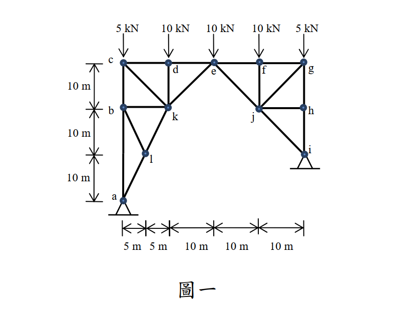

# SA-2013-1 題目正本

> 本檔只記錄考卷上寫了什麼、圖上畫了什麼，不含任何解法。解析見同資料夾 `SA-2013-1.md`。
> 判讀清單經使用者確認前，狀態為「待確認」；確認後本檔原則上不再修改（改動須回考卷原圖並記 log）。

| 項目 | 內容 |
|---|---|
| 考卷 | `raw/exams/SA-2013_結構學.pdf`，第 1 頁（正面）上半，第一題（圖一） |
| 考年 | 2013（民國 102 年）專技高考結構工程技師「結構學」 |
| 配分 | 25 分 |
| 附圖 | `SA-2013-1-fig-1.png` |
| 判讀狀態 | **已確認**（2026-11-05 使用者確認。原轉錄：2026-11-05 轉錄；PyMuPDF 110 dpi 整頁＋350–1000 dpi 局部放大；盲讀於開啟解析前完成） |

## 1. 考卷原文（逐字）

一、分析圖一桁架結構桿件 ke, kd, kc, kb, kl 之內力。請註明拉力或壓力。（25 分）

## 2. 考卷給的公式、附表與參數

- 考卷沒有給任何參考公式或附表。
- 卷首注意事項：㈠可以使用電子計算器。㈡不必抄題，作答時請將試題題號及答案依照順序寫在試卷上，於本試題上作答者，不予計分。
- 考試時間：2 小時。

## 3. 附圖

*證據圖 SA-2013-1-fig-1.png*

圖面文字照錄：5 kN、10 kN、10 kN、10 kN、5 kN、c、d、e、f、g、b、k、j、h、l、i、a、10 m、10 m、10 m、5 m、5 m、10 m、10 m、10 m、圖一

## 4. 判讀清單

| # | 項目 | 判讀 | 圖上／題文依據 | 把握 |
|---|---|---|---|---|
| 1 | 座標（以 a 為原點） | a(0,0)、l(5,10)、b(0,20)、k(10,20)、c(0,30)、d(10,30)、e(20,30)、f(30,30)、j(30,20)、g(40,30)、h(40,20)、i(40,10) | PDF 向量座標：10 m＝34.8 pt；下方 5｜5｜10｜10｜10 m、左側 10｜10｜10 m | 確定 |
| 2 | 桿件 | 上弦 cd、de、ef、fg；左豎桿 c–b、b–a；ck、dk、bk、ke、bl、lk、al；ej、fj、jg、jh、gh、hi、ji；共 20 桿 | PDF 向量線段 | 確定 |
| 3 | a–b | 一根連續豎桿，中段（l 的高度）沒有節點 | 向量檔分成兩段共線線段，交接處無節點圓點 | 確定（解讀）；使用者確認 |
| 4 | 支承 | a、i 皆為鉸支承（三角形）；i 比 a 高 10 m | 圖上符號；左側尺寸 | 確定（解讀）；使用者確認 |
| 5 | 靜定性 | j = 12、m = 20、r = 4 | 計數 | 確定 |
| 6 | 載重 | c 5 kN、d 10 kN、e 10 kN、f 10 kN、g 5 kN，皆向下 | 箭頭 | 確定 |
| 7 | 所求 | ke、kd、kc、kb、kl 內力並註明拉壓 | 題文 | 確定 |

---
*轉錄：2026-11-05（SA-U1-2 題目正本推廣・批 1）*
*確認：2026-11-05 使用者確認*
