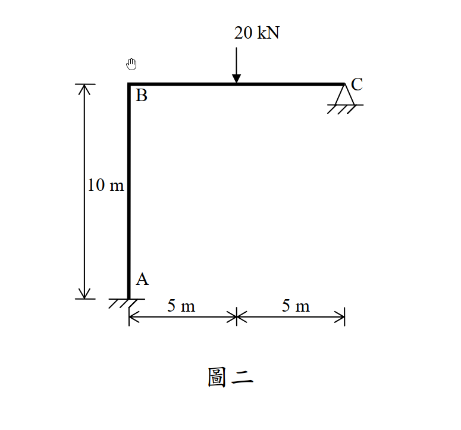
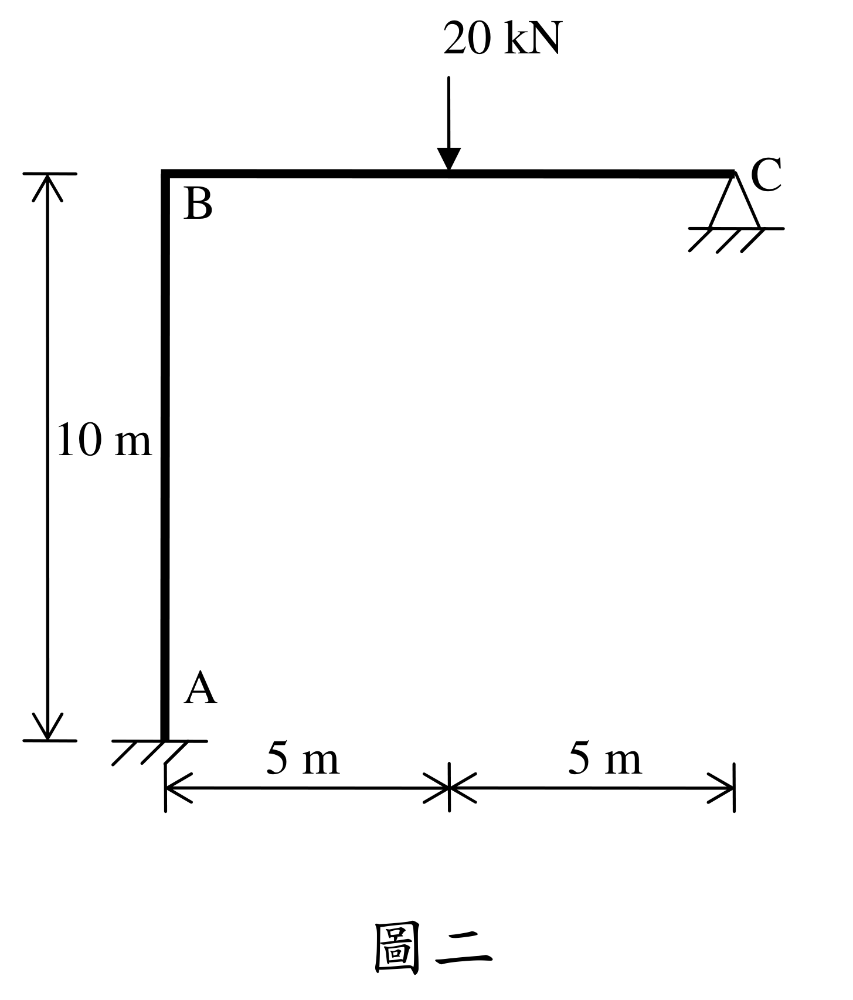

# SA-2013-2 題目正本

> 本檔只記錄考卷上寫了什麼、圖上畫了什麼，不含任何解法。解析見同資料夾 `SA-2013-2.md`。
> 判讀清單經使用者確認前，狀態為「待確認」；確認後本檔原則上不再修改（改動須回考卷原圖並記 log）。

| 項目 | 內容 |
|---|---|
| 考卷 | `raw/exams/SA-2013_結構學.pdf`，第 1 頁（正面）下半，第二題（圖二） |
| 考年 | 2013（民國 102 年）專技高考結構工程技師「結構學」 |
| 配分 | 25 分 |
| 附圖 | `SA-2013-2-fig-1.png`、`SA-2013-2-fig-2.png` |
| 判讀狀態 | **已確認**（2026-11-07 使用者確認。原轉錄：2026-11-07 轉錄；PyMuPDF 110 dpi 整頁＋300–500 dpi 局部放大、PDF 向量座標核對；盲讀於開啟解析前完成） |

## 1. 考卷原文（逐字）

二、所示剛架結構A 為固接支承，C 點為鉸支承。桿件BC 在中點承受一20 kN 集中載重，如圖二所示。請應用卡氏定理分析求得C 點支承之反力與C 點之轉角。各桿件之E、I 均相同。使用其他方法不予給分。（25 分）

## 2. 考卷給的公式、附表與參數

- 考卷沒有給任何參考公式或附表。
- E、I 各桿相同，沒有數值（答案以 EI 表示）。
- 考卷沒有說是否忽略軸向變形。
- 指定方法：卡氏定理；他法不給分。
- 卷首注意事項：㈠可以使用電子計算器。㈡不必抄題，作答時請將試題題號及答案依照順序寫在試卷上，於本試題上作答者，不予計分。
- 考試時間：2 小時。

## 3. 附圖

*證據圖 SA-2013-2-fig-1.png*

*證據圖 SA-2013-2-fig-2.png（2026-11-07 自考卷重新擷取 500 dpi，無游標）*

圖面文字照錄：20 kN、B、C、10 m、A、5 m、5 m、圖二

## 4. 判讀清單

| # | 項目 | 判讀 | 圖上／題文依據 | 把握 |
|---|---|---|---|---|
| 1 | 構件 | 柱 A–B、梁 B–C，B 剛接 | 圖面 | 確定 |
| 2 | A | 固定端（3 反力） | 題文；剖線 | 確定 |
| 3 | C | 鉸支承（2 反力：水平＋垂直） | 題文；三角形＋剖線 | 確定 |
| 4 | 幾何 | AB＝10 m、BC＝10 m | 左側 10 m；下方 5 m｜5 m | 確定 |
| 5 | 載重 | BC 中點（距 B 5 m）20 kN 向下 | 題文「在中點」；箭頭對齊尺寸分界 | 確定 |
| 6 | 考卷沒有給 | EI 數值；軸向變形是否忽略 | 題文 | 確定 |
| 7 | 靜不定度 | 固定 3＋鉸 2＝5：二度靜不定 | 計數 | 確定 |
| 8 | 所求 | C 點支承反力（兩個分量）與 C 點轉角；卡氏定理 | 題文 | 確定 |
| 9 | 證據圖 | 舊 fig-1 的滑鼠游標在 B 上方附近；新增 fig-2（500 dpi） | — | 確定 |

---
*轉錄：2026-11-07（SA-U2-1 題目正本推廣・批 1）*
*確認：2026-11-07 使用者確認*
