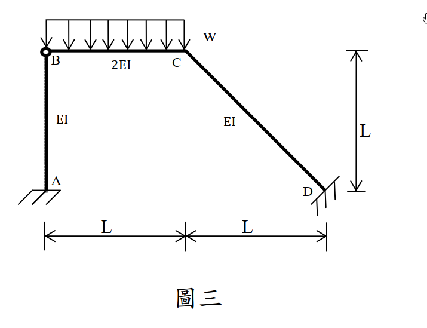

# SA-2013-3 題目正本

> 本檔只記錄考卷上寫了什麼、圖上畫了什麼，不含任何解法。解析見同資料夾 `SA-2013-3.md`。
> 判讀清單經使用者確認前，狀態為「待確認」；確認後本檔原則上不再修改（改動須回考卷原圖並記 log）。

| 項目 | 內容 |
|---|---|
| 考卷 | `raw/exams/SA-2013_結構學.pdf`，第 2 頁上半，第三題（圖三） |
| 考年 | 2013（民國 102 年）專技高考結構工程技師「結構學」 |
| 配分 | 25 分 |
| 附圖 | `SA-2013-3-fig-1.png` |
| 判讀狀態 | **已確認**（2026-11-04 使用者確認。原轉錄：2026-11-04 轉錄；PyMuPDF 150 dpi 整頁＋350–500 dpi 局部放大；盲讀於開啟解析前完成） |

## 1. 考卷原文（逐字）

三、所示剛架結構 A、D 為固接支承，B 點為鉸接。桿件 BC 承受垂直均佈載重 w，如圖三所示。各桿件之 E 均相同。桿件 AB、CD 面積慣性矩為 I，桿件 BC 則為 2I。請以傾角變位法分析各桿件端點彎矩，並繪桿件 BC 剪力圖與彎矩圖。使用其他方法不予給分。（25 分）

## 2. 考卷給的公式、附表與參數

- 考卷沒有給任何參考公式或附表；所需公式須自備。
- 卷首注意事項：㈠可以使用電子計算器。㈡不必抄題，作答時請將試題題號及答案依照順序寫在試卷上，於本試題上作答者，不予計分。
- 考試時間：2 小時。

## 3. 附圖

*證據圖 SA-2013-3-fig-1.png*

圖面文字照錄：w、B、2EI、C、EI、EI、L、A、D、L、L、圖三

## 4. 判讀清單

| # | 項目 | 判讀 | 圖上／題文依據 | 把握 |
|---|---|---|---|---|
| 1 | A | 柱底固接 | 斜線填充（400 dpi） | 確定 |
| 2 | D | 斜桿底端固接 | 垂直於桿軸的斜線填充 | 確定 |
| 3 | B | 內鉸（AB 柱頂與 BC 梁鉸接） | 空心圓圈 | 確定 |
| 4 | C | 剛接 | 無鉸圈 | 確定 |
| 5 | 幾何 | AB 垂直 L；BC 水平 L；CD 由 (L, L) 至 (2L, 0)，長 √2L | 水平 L＋L、右側高 L | 確定 |
| 6 | 剛度 | AB、CD：EI（I）；BC：2EI（2I） | 圖標＋題文 | 確定 |
| 7 | 載重 | BC 全長均布 w 向下 | 箭頭範圍 B 至 C | 確定 |
| 8 | 指定方法 | 傾角變位法（他法不給分） | 題文 | 確定 |
| 9 | 所求 | 各桿件端點彎矩；BC 剪力圖與彎矩圖 | 題文 | 確定 |

---
*轉錄：2026-11-04（SA-U2-3 題目正本推廣・批 1；判讀沿用同日盲解稽核紀錄 wiki/queries/盲解紀錄-SA-U2-3a-2026-11-04.md，並回考卷原圖核對）*
*確認：2026-11-04 使用者確認*
