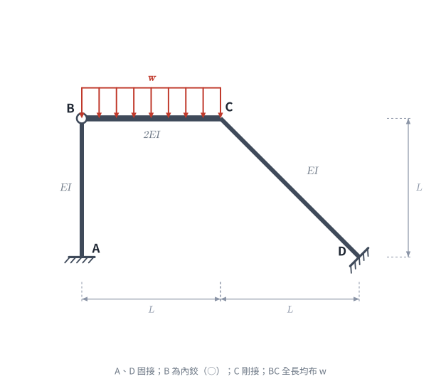
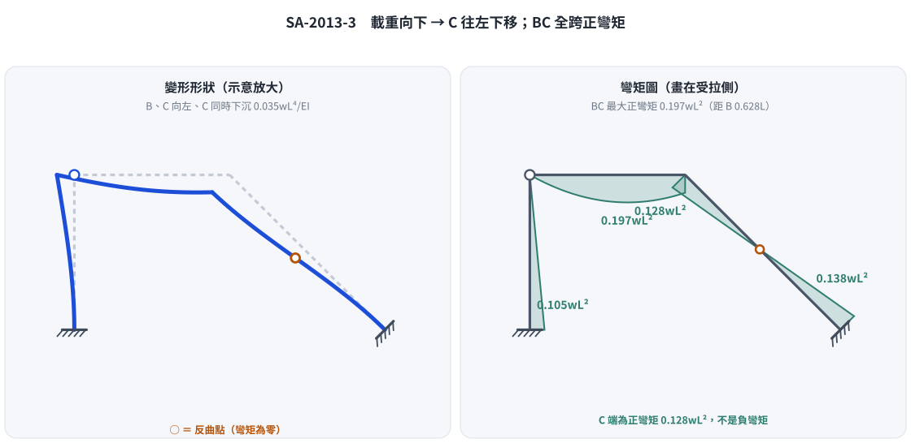

# 考題編號：SA-2013-3

**主分類：** `SA-U2-3` 靜不定結構之傾角變位法
**副分類：** 無
**分析法：** 傾角變位法 (Slope-Deflection Method) 與 虛功原理 (Principle of Virtual Work)
**標籤：** `傾角變位法` `側移剛架` `斜桿` `半剛接` `符號慣例`

---

## 1. 題目（考卷原文見題目正本）

> 考卷原文、公式／附表、附圖與判讀清單（已確認）見 [`SA-2013-3-problem.md`](SA-2013-3-problem.md)。本節只列解題時最容易讀錯的地方與本解使用的記號；題意以題目正本為準。

*重繪自考卷附圖，依判讀清單 #1–#9 重繪。攔：B 內鉸、CD 斜桿方向與固接面誤讀。*

### 常見誤讀
| 項目 | 正確判讀 | 常見誤讀 |
|---|---|---|
| B | 內鉸（空心圓） | 剛接 |
| 側移虛功式 | 桿端彎矩虛功＋載重虛功＝0，右端 $+0.5wL^2$ | 內虛功＝外虛功，右端 $-0.5wL^2$（本題舊版解析） |

**本解記號：** 桿端彎矩、節點轉角、弦位角一律順時針為正（傾角變位法慣例）。$R=u/L$，$u$ 為 B 點水平位移（假設向右為正，解出負值即向左）。

## 2. 考題核心精神與出題者意圖 (Core Concepts & Examiner's Intent)

本題是傾角變位法極具挑戰性的綜合題型，主考四大核心：
1. **統一符號慣例的定力**：傾角變位法的靈魂在於「端彎矩 $M$、節點轉角 $\theta$、弦位角 $\psi$」必須使用完全一致的正負號慣例（本解法統一採**順時針為正**）。一旦混用，在斜桿的側移關係中必定全盤皆輸。
2. **斜桿側移幾何分析**：剛架發生側移時，斜桿 CD 的弦位角 $\psi_{CD}$ 必須從 C 點的水平與垂直位移向量中推導，測驗考生對微小位移幾何的理解。
3. **半剛接（一端鉸接）修正公式**：B 點為鉸接，代表 $M_{BA} = M_{BC} = 0$。熟練的考生會直接套用修正勁度（$3EI/L$）與修正固端彎矩，減少未知數 $\theta_B$。
4. **斜桿剛架的層剪力方程式**：傳統垂直柱的 $\sum F_x = 0$ 在含斜桿的剛架中極易寫錯。出題者意圖測驗考生是否懂得使用**虛功原理 (Virtual Work)** 來建立絕對正確的側移方程式。

## 3. 解題戰略地圖與陷阱分析 (Strategic Roadmap & Trap Analysis)

**解題策略：**
1. **側移幾何分析**：忽略軸向變形，B 點只能水平移動（設向右位移為 $u$）。因 BC 軸向剛硬，C 點亦向右移動 $u$。又 CD 桿軸向剛硬，由幾何協調可推得 C 點必須同時**向上移動 $u$**。
2. **定義弦位角 $\psi$**：統一以**順時針為正**。推導 $\psi_{AB}$、$\psi_{BC}$、$\psi_{CD}$ 與 $u$ 的關係式。令 $R = u/L$。
3. **傾角變位方程式**：寫出 $M_{AB}, M_{CB}, M_{CD}, M_{DC}$。代入 B 端鉸接的修正勁度與修正固端彎矩 (FEM)。
4. **建立平衡方程式**：
   - 節點 C 力矩平衡：$\sum M_C = M_{CB} + M_{CD} = 0$
   - 側移方程式（虛功法）：給予系統一向右的虛擬側移 $\delta u$，計算內力虛功與外力虛功相等，求得力矩間的關係式。
5. **解聯立方程式**：解出 $\theta_C$ 與 $R$，再代回求各端彎矩。
6. **繪製 BC 桿 V、M 圖**：取 BC 自由體，利用靜力平衡求出 $V_B, V_C$，找出剪力為零的位置求最大正彎矩。

**陷阱分析：**
- **致命陷阱一：BC 桿固端彎矩符號**。均佈載重向下，為使其兩端不轉動，B 端需施加逆時針力矩，C 端需施加順時針力矩。若統一採順時針為正，則 $FEM_{BC} = -wL^2/12$，$FEM_{CB} = +wL^2/12$。極多考生在此處弄錯正負號。
- **致命陷阱二：斜桿弦位角判斷**。C 點向右又向上移動，CD 桿的弦位角究竟是順時針還是逆時針？必須利用相對位移向量與原桿件向量進行外積或幾何作圖確認。本題 $\psi_{CD}$ 為**順時針**。
- **致命陷阱三：虛功法中外力的虛功與移項**。假設向右側移 $\delta u$ 時 C 點虛位移向上，BC 桿作向上的剛體位移，而均佈載重向下，因此載重作功為**負值** $-0.5wL\,\delta u$。寫方程式時要記得：桿端彎矩與載重**同時作用在桿件上**，兩者虛功相加為零，$\sum M\,\delta\psi - 0.5wL\,\delta u = 0$，移項後右端是 **$+0.5wL^2$**。若誤寫成「內虛功＝外虛功」，右端變成 $-0.5wL^2$，所有彎矩都會錯。
- **致命陷阱四：側移方向**。實際上載重向下，C 點會**向下**移（CD 不伸長 → 同時向左），所以解出的 $R$ 為負值；假設向右只是代數上的方向，不影響結果。

## 3.5 變數層次分析 (Variable Hierarchy Analysis)

### 最終目標
`求各端彎矩 M_AB, M_CB, M_CD, M_DC 並繪製 BC 桿 V, M 圖。`

### 本題關鍵公式與聯立方程式

> $\boxed{\cdot}$ = 需由前步驟推導，非題目直接給定的變數

$$\text{節點 C 平衡: } M_{CB}(\boxed{\theta_C}, \boxed{R}) + M_{CD}(\boxed{\theta_C}, \boxed{R}) = 0$$
$$\text{虛功方程式: } M_{AB} - M_{CB} + M_{CD} + M_{DC} = +0.5 wL^2$$

### L1：題目直接給定
| 符號 | 數值 | 說明 |
|------|------|------|
| $K_{AB}, K_{BC}, K_{CD}$ | $EI/L, 2EI/L, EI/\sqrt{2}L$ | 各桿件勁度 |
| $FEM_{BC}, FEM_{CB}$ | $-wL^2/12, +wL^2/12$ | BC 桿原始固端彎矩 (順時針為正) |

### L2：需知識點推導
| 變數 | 數值 | 說明 |
|------|------|------|
| $\Delta_C$ 位移 | $(u, u)$ | C點向右移 $u$，向上移 $u$ |
| $\psi_{AB}, \psi_{BC}, \psi_{CD}$ | $R, -R, R$ | 弦位角 (順時針為正)，$R=u/L$ |
| $FEM_{CB}^{mod}$ | $+wL^2/8$ | B 端鉸接修正後之 C 端固端彎矩 |
| 載重虛功 | $-0.5wL\,\delta u$ | 向右虛側移時 BC 形心向上 $\delta u/2$，載重作負功 |

### L3：深層知識
| 知識 | 說明 |
|------|------|
| 剛體虛位移原理 | 每根桿件作剛體虛位移時，作用其上的桿端彎矩與載重虛功總和為零：$\sum M\,\delta\psi + \delta W_{\text{載重}} = 0$ |
| 斜桿位移相容 | CD 不伸長：C 點位移必須垂直於 CD，得 $v_C=u_C=u$ |

## 4. 步驟化詳細計算過程 (Step-by-Step Detailed Calculation)

### Step 1：側移幾何與弦位角分析 (全程遵守順時針為正)
設 B 點向右側移 $u$。因忽略軸向變形：
- $v_B = 0$ (AB不伸長)。
- $u_C = u_B = u$ (BC不伸長)。
- CD桿：$\Delta L_{CD} = u_C \cos(-45^\circ) + v_C \sin(-45^\circ) = 0 \Rightarrow u(\frac{1}{\sqrt{2}}) - v_C(\frac{1}{\sqrt{2}}) = 0 \Rightarrow v_C = u$ (C點向上移 $u$)。

定義弦位角 $\psi = \frac{\text{相對橫向位移}}{\text{桿長}}$ (順時針為正)，令 $R = \frac{u}{L}$：
- **AB 桿**：B 向右移 $u$，桿件順時針轉，$\psi_{AB} = +\frac{u}{L} = +R$。
- **BC 桿**：C 相對於 B 向上移 $u$，桿件逆時針轉，$\psi_{BC} = -\frac{u}{L} = -R$。
- **CD 桿**：C 向右且向上移 $(u,u)$，D 不動。相對於 C，D 往左且往下移 $(-u,-u)$。此位移向量使原指向右下的 CD 桿產生更陡的斜率，即順時針旋轉。嚴格計算 $\psi_{CD} = +\frac{u}{L} = +R$。

### Step 2：傾角變位方程式建立
- **AB 桿** (A 固接，B 鉸接)：$M_{BA} = 0$
  $$M_{AB} = \frac{3EI_{AB}}{L_{AB}} (\theta_A - \psi_{AB}) = \frac{3EI}{L} (0 - R) = -3 \frac{EI}{L} R$$
- **BC 桿** (B 鉸接，C 剛接)：$M_{BC} = 0$
  修正固端彎矩：$FEM_{CB}^{mod} = FEM_{CB} - 0.5 FEM_{BC} = (+wL^2/12) - 0.5(-wL^2/12) = +wL^2/8$
  $$M_{CB} = \frac{3EI_{BC}}{L_{BC}} (\theta_C - \psi_{BC}) + FEM_{CB}^{mod} = \frac{6EI}{L} (\theta_C - (-R)) + \frac{wL^2}{8} = \frac{6EI}{L} (\theta_C + R) + \frac{wL^2}{8}$$
- **CD 桿** (C 剛接，D 固接)：
  $$M_{CD} = \frac{2EI_{CD}}{L_{CD}} (2\theta_C + \theta_D - 3\psi_{CD}) = \frac{2EI}{\sqrt{2}L} (2\theta_C + 0 - 3R) = \frac{\sqrt{2}EI}{L} (2\theta_C - 3R)$$
  $$M_{DC} = \frac{\sqrt{2}EI}{L} (\theta_C - 3R)$$

### Step 3：聯立方程式與求解
**條件一：C 點力矩平衡**
$$M_{CB} + M_{CD} = 0$$
$$\frac{6EI}{L} (\theta_C + R) + \frac{wL^2}{8} + \frac{\sqrt{2}EI}{L} (2\theta_C - 3R) = 0$$
$$(6 + 2\sqrt{2}) \frac{EI}{L} \theta_C + (6 - 3\sqrt{2}) \frac{EI}{L} R = -0.125 wL^2 \quad \text{--- (Eq 1)}$$

**條件二：側移虛功方程式**
給予系統向右虛擬側移 $\delta u$。各桿虛擬弦位角為 $\delta\psi_{AB} = \frac{\delta u}{L}$, $\delta\psi_{BC} = -\frac{\delta u}{L}$, $\delta\psi_{CD} = \frac{\delta u}{L}$。
把每根桿件視為剛體，作用在桿件上的力有兩組：
- 桿端彎矩（順時針為正）隨桿件轉動 $\delta\psi$ 所作的虛功：$M_{AB} \delta\psi_{AB} + M_{CB} \delta\psi_{BC} + (M_{CD} + M_{DC}) \delta\psi_{CD}$（$M_{BA}=M_{BC}=0$）
- 載重虛功：BC 桿作剛體運動，B 端垂直不動、C 端向上 $\delta u$，形心向上 $\frac{\delta u}{2}$，而載重向下：$\delta W_{載重} = -(wL) \cdot \frac{\delta u}{2} = -0.5 wL\,\delta u$（負功）

剛體虛位移時兩者總和為零：
$$M_{AB}\frac{\delta u}{L} - M_{CB}\frac{\delta u}{L} + (M_{CD}+M_{DC})\frac{\delta u}{L} - 0.5wL\,\delta u = 0$$
同乘 $\frac{L}{\delta u}$：
$$M_{AB} - M_{CB} + M_{CD} + M_{DC} = +0.5 wL^2 \quad \text{--- (Eq 2)}$$
將方程式代入 (Eq 2)：左式 $= -(6 - 3\sqrt{2}) \frac{EI}{L} \theta_C - (9 + 6\sqrt{2}) \frac{EI}{L} R - 0.125wL^2$，整理後得：
$$(6 - 3\sqrt{2}) \frac{EI}{L} \theta_C + (9 + 6\sqrt{2}) \frac{EI}{L} R = -0.625 wL^2 \quad \text{--- (Eq 2')}$$

**解聯立 (Eq 1) & (Eq 2')**
克拉瑪法則精確解得：
$$\theta_C = -\frac{34 - 19\sqrt{2}}{992} \frac{wL^3}{EI} \approx -0.007187 \frac{wL^3}{EI}\ (\text{逆時針})$$
$$R = -\frac{21 + 22\sqrt{2}}{1488} \frac{wL^3}{EI} \approx -0.03502 \frac{wL^3}{EI}$$
$R<0$：B、C 實際**向左**移 $0.03502\,wL^4/EI$，C 同時**向下**移同量，與載重方向一致。

### Step 4：計算各端彎矩
將 $\theta_C, R$ 代回傾角變位方程式：
$$M_{AB} = -3\frac{EI}{L}R = \frac{21 + 22\sqrt{2}}{496} wL^2 \approx +0.1051 wL^2$$
$$M_{CB} = \frac{13\sqrt{2} - 82}{496} wL^2 \approx -0.1283 wL^2$$
$$M_{CD} = \frac{82 - 13\sqrt{2}}{496} wL^2 \approx +0.1283 wL^2$$
$$M_{DC} = \frac{63 + 4\sqrt{2}}{496} wL^2 \approx +0.1384 wL^2$$
$$M_{BA} = M_{BC} = 0$$
*(註：正值代表順時針，負值代表逆時針)*

**檢核**：
- 節點 C：$M_{CB} + M_{CD} = 0$ ✓；側移式：$0.1051 + 0.1283 + 0.1283 + 0.1384 = 0.5001 \approx 0.5$ ✓
- AB 柱只受剪力 $A_x = M_{AB}/L \approx 0.1051\,wL$（向右），CD 底部水平反力 $D_x = -0.1051\,wL$，水平平衡 ✓
- 全結構對 A 取矩：$-0.5wL^2 + D_y(2L) + M_A + M_D = 0$，$D_y = 0.3717\,wL$ ✓（與下式 $V_C$ 相同）

### Step 5：繪製 BC 桿剪力圖 (V) 與彎矩圖 (M)
取 BC 桿自由體 (B、C 間距 L)，$M_{BC} = 0$，$M_{CB} = -0.1283 wL^2$（作用在桿端為**逆時針**）。
由 $\sum M_C = 0$ 求 B 端剪力：
$$V_B \cdot L - wL \left(\frac{L}{2}\right) + M_{CB} = 0 \Rightarrow V_B = \frac{wL}{2} - \frac{M_{CB}}{L} = \frac{330 - 13\sqrt{2}}{496} wL \approx 0.6283 wL \text{ (向上)}$$
由 $\sum F_y = 0$ 求 C 端剪力：
$$V_C = wL - V_B = \frac{166 + 13\sqrt{2}}{496} wL \approx 0.3717 wL \text{ (向上)}$$

**剪力圖 (V-Diagram)**：
- 自 B 點的 $+0.6283 wL$ 開始，呈直線下降。
- 至 C 點降為 $-0.3717 wL$。
- 剪力為零的位置發生在 $x_0 = \frac{V_B}{w} \approx 0.6283 L$ 處。

**彎矩圖 (M-Diagram)**：
- 拋物線分佈，$M(x) = V_B x - \frac{wx^2}{2}$。B 點彎矩為 $0$。
- 最大正彎矩發生在 $x_0$ 處：$M_{max} = \frac{V_B^2}{2w} \approx 0.1974 wL^2$（下側受拉）。
- C 點彎矩仍為**正彎矩**（下側受拉）：$M(L) = -M_{CB} \approx +0.1283 wL^2$。BC 全跨 $M(x)\ge 0$，無反曲點、無負彎矩。
- 物理意義：C 點向下沉陷而 B 端垂直不動，BC 弦線順時針轉動，C 端被斜桿 CD 拉著逆時針轉回，故 C 端是正彎矩而非一般連續梁的負彎矩。

## 5. 關鍵爭議點與進階探討 (Critical Issues & Advanced Discussion)

*圖解：載重向下，C 往左下移；BC 全跨正彎矩，C 端 +0.128wL²。攔：側移方向反（C 往右上）、C 端畫成負彎矩。*

- **符號慣例的一致性**：如果考生平時習慣「下側受拉為正彎矩，逆時針轉角為正」，遇到斜桿會非常容易混亂。傾角變位法最強的武器就是**強制的順時針為正**，所有項次都不必去想受拉側，純粹代數運算，最後再將負號轉譯為逆時針，這樣能將出錯率降到最低。
- **斜桿側移虛功法的無敵之處**：許多參考書會教用幾何投影將桿件剪力投影到水平方向 $\sum F_x = 0$。這種作法在有載重且多斜桿的狀況下極易漏算載重的側向投影分量。採用**虛功原理**，只要位移場正確（假設向右側移時 C 點右上移），載重作功的符號就不會錯（載重向下、位移向上 $\rightarrow$ 負功），是解斜桿剛架的防呆神器。但方程式要寫成「桿端彎矩虛功＋載重虛功＝0」，不是「內虛功＝外虛功」——兩者差一個負號，本題舊版解析就是因此全部算錯。
- **結果自我檢查**：解出側移方向後，回頭問「載重往下，結構應往哪邊動？」本題 C 應下沉，若解出 C 往上（$R>0$ 搭配右上位移），就是虛功式符號錯了。

---

*修正日期：2026-11-04（側移虛功式右端由 $-0.5wL^2$ 更正為 $+0.5wL^2$，連帶更正 Eq 2'、$\theta_C$、$R$、四個桿端彎矩、BC 剪力圖與彎矩圖、§3.5；原答 $M_{AB}=-0.0699$、$M_{CB}=0.1522$、$M_{DC}=-0.1256\,wL^2$，新答 $M_{AB}=+0.1051$、$M_{CB}=-0.1283$、$M_{CD}=+0.1283$、$M_{DC}=+0.1384\,wL^2$；驗證：sympy 傾角變位式精確解與平面剛架勁度法（EA→∞）兩條路徑一致，MISMATCHES: 0；來源：wiki/queries/盲解比對-SA-U2-3a-2026-11-04.md）*

*修正日期：2026-11-04（§1 改為指向題目正本並放重繪附圖（figs/SA-2013-3-fig-1-problem.svg）、加常見誤讀；§5 補解題圖解 figs/SA-2013-3-fig-2-deflected-bmd.svg；圖由 gen_SA-2013-3.py 產生，可重跑）*
