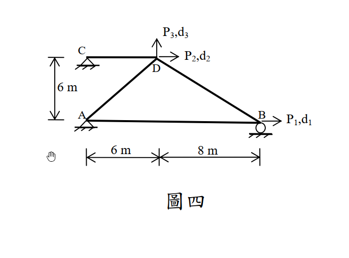
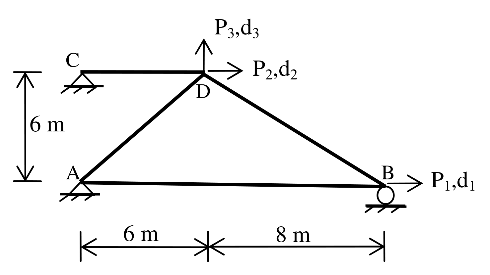

# SA-2013-4 題目正本

> 本檔只記錄考卷上寫了什麼、圖上畫了什麼，不含任何解法。解析見同資料夾 `SA-2013-4.md`。
> 判讀清單經使用者確認前，狀態為「待確認」；確認後本檔原則上不再修改（改動須回考卷原圖並記 log）。

| 項目 | 內容 |
|---|---|
| 考卷 | `raw/exams/SA-2013_結構學.pdf`，第 2 頁（背面）下半，第四題（圖四） |
| 考年 | 2013（民國 102 年）專技高考結構工程技師「結構學」 |
| 配分 | 25 分 |
| 附圖 | `SA-2013-4-fig-1.png`、`SA-2013-4-fig-2.png` |
| 判讀狀態 | **已確認**（2026-11-05 使用者確認。原轉錄：2026-11-05 轉錄；PyMuPDF 110 dpi 整頁＋250–800 dpi 局部放大、PDF 向量座標；盲讀於開啟解析前完成） |

## 1. 考卷原文（逐字）

四、如圖四所示桁架結構，請應用直接勁度法組成對應位移(d₁、d₂、d₃)之勁度矩陣。若所得位移(d₁、d₂、d₃)為(0.1277，0.1743，0.7055)mm，求所對應施加外力(P₁、P₂、P₃)值，並求桿件 AD、CD 之內力。所有桿件 E＝200 GPa，A＝10×10³ mm²。使用其他方法不予給分。（25 分）

## 2. 考卷給的公式、附表與參數

- 考卷沒有給任何參考公式或附表。
- E = 200 GPa、A = 10×10³ mm²。
- 位移 (d₁, d₂, d₃) = (0.1277, 0.1743, 0.7055) mm（題目給定）。
- 考卷沒有標 CD 桿長度（見判讀清單 #2）。
- 卷首注意事項：可以使用電子計算器。不必抄題，作答時請將試題題號及答案依照順序寫在試卷上，於本試題上作答者，不予計分。
- 考試時間：2 小時。

## 3. 附圖

*證據圖 SA-2013-4-fig-1.png*

*證據圖 SA-2013-4-fig-2.png（2026-11-05 自考卷重新擷取 500 dpi，無游標）*

圖面文字照錄：P₃,d₃、C、P₂,d₂、D、6 m、A、B、P₁,d₁、6 m、8 m、圖四

## 4. 判讀清單

| # | 項目 | 判讀 | 圖上／題文依據 | 把握 |
|---|---|---|---|---|
| 1 | 座標（A 為原點） | A(0,0)、B(14,0)、D(6,6)、C(0,6) | 尺寸線 6 m｜8 m（水平）、6 m（左側，由 C／D 高程到 A）；垂直向未依比例 | 確定 |
| 2 | CD 桿長度 | 附圖沒有直接標註；C 支承與 A 同一垂直線（PDF 向量座標 x 同為 288.8 pt）→ CD = 6 m | PDF 向量座標 | 確定（解讀）；使用者確認 |
| 3 | 構件 | CD、AD、DB、AB 四桿（AB 在圖上略斜，兩端 y 差 1.7 pt，視為水平） | 附圖；向量座標 | 確定（解讀）；使用者確認 |
| 4 | 支承 | A、C 鉸支承；B 滾支承（水平可動） | 附圖三角形／圓 | 確定 |
| 5 | 自由度 | d₁：B 水平（+x）；d₂：D 水平（+x）；d₃：D 垂直（+y） | 附圖箭頭 | 確定 |
| 6 | 材料 | E = 200 GPa、A = 10×10³ mm²（各桿相同） | 題文 | 確定 |
| 7 | 所求 | 3×3 勁度矩陣、P₁–P₃、AD 與 CD 內力；限直接勁度法 | 題文 | 確定 |
| 8 | 證據圖 | 舊截圖 fig-1：滑鼠游標（手形）在 A 左下方空白處，未壓到圖；新增 fig-2（2026-11-05 自考卷重新擷取 500 dpi） | — | 確定 |

---
*轉錄：2026-11-05（SA-U2-4 題目正本推廣・批 1）*
*確認：2026-11-05 使用者確認*
