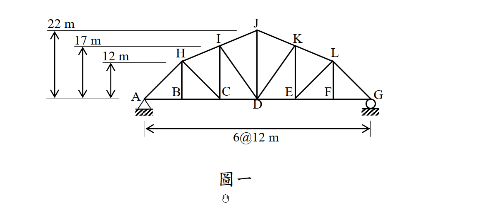
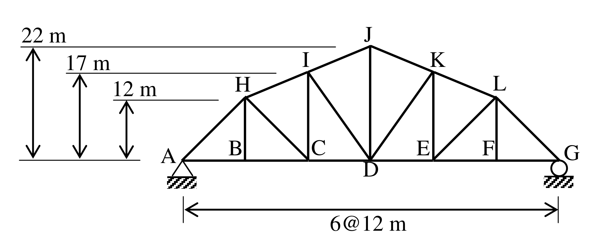

# SA-2014-1 題目正本

> 本檔只記錄考卷上寫了什麼、圖上畫了什麼，不含任何解法。解析見同資料夾 `SA-2014-1.md`。
> 判讀清單經使用者確認前，狀態為「待確認」；確認後本檔原則上不再修改（改動須回考卷原圖並記 log）。

| 項目 | 內容 |
|---|---|
| 考卷 | `raw/exams/SA-2014_結構學.pdf`，第 1 頁（正面）上半，第一題（圖一） |
| 考年 | 2014（民國 103 年）專技高考結構工程技師「結構學」 |
| 配分 | 25 分（㈠15 分、㈡10 分） |
| 附圖 | `SA-2014-1-fig-1.png`、`SA-2014-1-fig-2.png` |
| 判讀狀態 | **已確認**（2026-11-05 使用者確認。原轉錄：2026-11-05 轉錄；PyMuPDF 110 dpi 整頁＋350–1000 dpi 局部放大；盲讀於開啟解析前完成） |

## 1. 考卷原文（逐字）

一、如圖一所示之桁架結構，其 A 點為鉸支承，而 G 點為滾支承：

㈠當 C 點承受垂直向下載重 P 時，請計算 CD、ID 與 IJ 等三根桿件之軸力（註明拉力或壓力，答案可用分數或根號表示）。（15 分）

㈡若此垂直向下載重 P 可能分別作用於 B、C、D、E 或 F 中任何一點，請計算 CD 桿件所可能產生的最大軸力，並指出其對應之作用點。（10 分）

## 2. 考卷給的公式、附表與參數

- 考卷沒有給任何參考公式或附表。
- P 為符號。
- 卷首注意事項：㈠可以使用電子計算器。㈡不必抄題，作答時請將試題題號及答案依照順序寫在試卷上，於本試題上作答者，不予計分。
- 考試時間：2 小時。

## 3. 附圖

*證據圖 SA-2014-1-fig-1.png*

*證據圖 SA-2014-1-fig-2.png（2026-11-05 自考卷重新擷取 500 dpi，無游標）*

圖面文字照錄：22 m、17 m、12 m、J、I、K、H、L、A、B、C、E、F、G、D、6@12 m、圖一

## 4. 判讀清單

| # | 項目 | 判讀 | 圖上／題文依據 | 把握 |
|---|---|---|---|---|
| 1 | 下弦 | A(0,0)、B(12,0)、C(24,0)、D(36,0)、E(48,0)、F(60,0)、G(72,0) | 6@12 m；PDF 向量座標 12 m＝34 pt | 確定 |
| 2 | 上弦高度 | H(12,12)、I(24,17)、J(36,22)、K(48,17)、L(60,12) | 左側 22／17／12 m 尺寸線；向量座標量得 12.1、17.0、22.0 m | 確定 |
| 3 | 節點字母 | B、C、E、F 字母標在豎桿旁、下弦上方，指下弦節點 | 字母位置對齊豎桿；D 標在下弦下方 | 確定（解讀）；使用者確認 |
| 4 | 桿件 | 上弦 AH、HI、IJ、JK、KL、LG；下弦六格；豎桿 BH、CI、DJ、EK、FL；斜桿 HC、ID、KD、LE；共 21 桿（A–B–H、F–G–L 格無斜桿） | PDF 向量線段 | 確定 |
| 5 | 支承 | A 鉸支承、G 滾支承 | 題文；圖上符號 | 確定 |
| 6 | 靜定性 | j = 12、m = 21、r = 3 | 計數 | 確定 |
| 7 | 載重 | ㈠C 點 P 向下；㈡P 分別作用於 B、C、D、E、F | 題文（圖上未畫載重） | 確定 |
| 8 | 所求 | ㈠CD、ID、IJ 軸力；㈡CD 最大軸力及作用點 | 題文 | 確定 |
| 9 | 證據圖 | 舊 fig-1 滑鼠游標在「圖一」下方；新增 fig-2（500 dpi） | — | 確定 |

---
*轉錄：2026-11-05（SA-U1-2 題目正本推廣・批 1）*
*確認：2026-11-05 使用者確認*
