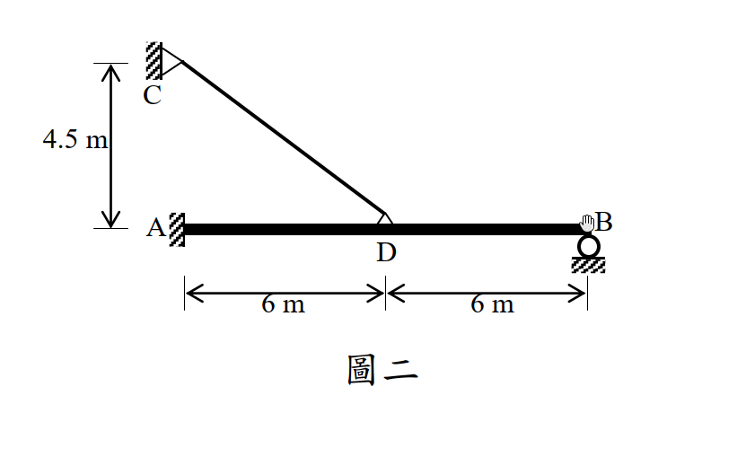
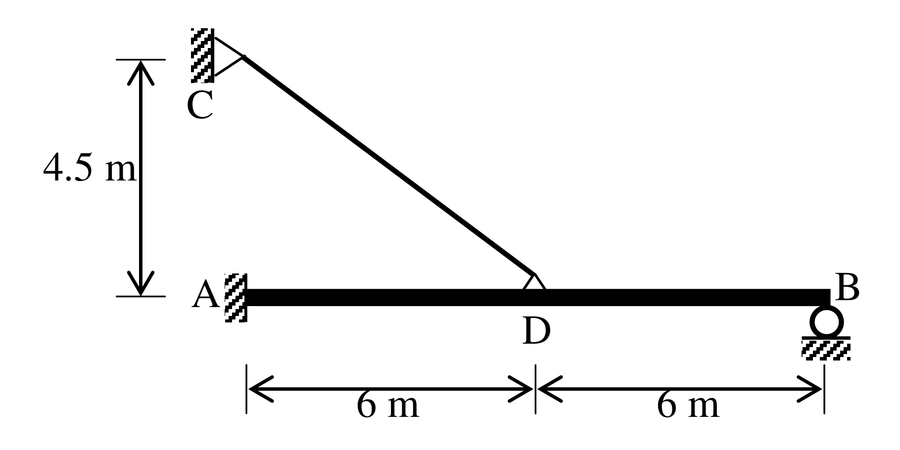

# SA-2014-2 題目正本

> 本檔只記錄考卷上寫了什麼、圖上畫了什麼，不含任何解法。解析見同資料夾 `SA-2014-2.md`。
> 判讀清單經使用者確認前，狀態為「待確認」；確認後本檔原則上不再修改（改動須回考卷原圖並記 log）。

| 項目 | 內容 |
|---|---|
| 考卷 | `raw/exams/SA-2014_結構學.pdf`，第 1 頁（正面），第二題（圖二） |
| 考年 | 2014（民國 103 年）專技高考結構工程技師「結構學」 |
| 配分 | 25 分 |
| 附圖 | `SA-2014-2-fig-1.png`、`SA-2014-2-fig-2.png` |
| 判讀狀態 | **已確認**（2026-11-07 使用者確認；影響答案項目定案：#3、#5、#6 CD 為斜桿 7.5 m（C 在 A 正上方，使用者確認；解析同日勘誤）。原轉錄：2026-11-07 轉錄；PyMuPDF 110 dpi 整頁＋400–1200 dpi 局部放大；PDF 向量繪圖；盲讀於開啟解析前完成） |

## 1. 考卷原文（逐字）

二、如圖二所示之複合結構，AB 構件為梁結構，A 點為固接支承，B 點為滾支承；而CD 構件為軸力桿件，C 點為鉸支承，且D 點與梁交接處為外部鉸接。另外，AB 構件之彈性模數與慣性矩乘積為$E_{AB}I_{AB}$＝10000 kN-m²，而CD 構件之彈性模數與斷面積乘積為$E_{CD}A_{CD}$＝40000 kN。請以諧合變位法計算當AB 構件承受垂直向下均佈載重8 kN/m 時之最大彎矩（絕對值最大者）及其發生處。（若以其他方法計算不予計分）（25 分）

## 2. 考卷給的公式、附表與參數

- 考卷沒有給任何參考公式或附表。
- 給定：$E_{AB}I_{AB}$＝10000 kN-m²；$E_{CD}A_{CD}$＝40000 kN；指定用諧合變位法。
- 均佈載重 8 kN/m 只寫在題文，**附圖沒有畫出載重**。
- 考卷沒有說是否忽略梁 AB 的軸向變形。
- 卷首注意事項：㈠可以使用電子計算器。㈡不必抄題，作答時請將試題題號及答案依照順序寫在試卷上，於本試題上作答者，不予計分。
- 考試時間：2 小時。

## 3. 附圖

*證據圖 SA-2014-2-fig-1.png*

*證據圖 SA-2014-2-fig-2.png（2026-11-07 自考卷重新擷取 500 dpi，無游標）*

圖面文字照錄：C、4.5 m、A、D、B、6 m、6 m、圖二

## 4. 判讀清單

| # | 項目 | 判讀 | 圖上／題文依據 | 把握 |
|---|---|---|---|---|
| 1 | A | 固接支承（梁端接左側剖線牆） | 500 dpi 放大；題文 | 確定 |
| 2 | B | 滾支承（圓圈＋剖線）→ 垂直反力 | 500 dpi 放大；題文 | 確定 |
| 3 | C | 鉸支承於左側直立牆（三角形尖端朝桿），位於 A 正上方 | 500 dpi 放大；C 鉸與 A 牆在同一直立線附近 | 確定 |
| 4 | D | 桿 CD 與梁交接的外部鉸（梁上方小三角形）；梁 AB 在 D 連續 | 題文「D 點與梁交接處為外部鉸接」 | 確定 |
| 5 | 尺寸 | A→D 6 m、D→B 6 m；C 在梁軸上方 4.5 m；CD 水平投影 6 m | 尺寸界線對齊 A 牆面、D、B；4.5 m 上界線對齊 C 鉸、下界線對齊梁軸 | 確定 |
| 6 | 桿 CD | 軸力桿件，長 √(6²＋4.5²)＝7.5 m（由尺寸計算） | 幾何 | 確定 |
| 7 | 載重 | 垂直向下均佈 8 kN/m，作用梁 AB 全長 12 m | 題文「AB 構件承受」；附圖未畫載重 | 確定（解讀）；使用者確認 |
| 8 | 剛度 | EI＝10000 kN-m²（梁）、EA＝40000 kN（桿） | 題文 | 確定 |
| 9 | 所求 | 最大彎矩（絕對值最大者）及其位置；限用諧合變位法 | 題文 | 確定 |
| 10 | 靜不定度 | 固接 3＋滾 1＋桿 1＝5 個未知力，方程式 3，二度靜不定 | 計數 | 確定（解讀）；使用者確認 |
| 11 | 證據圖 | 舊 fig-1 游標壓在 B 端（看不清 B 支承）；新增 fig-2（500 dpi） | — | 確定 |

---
*轉錄：2026-11-07（SA-U2-2 題目正本推廣・批 1）*
*確認：2026-11-07 使用者確認*
