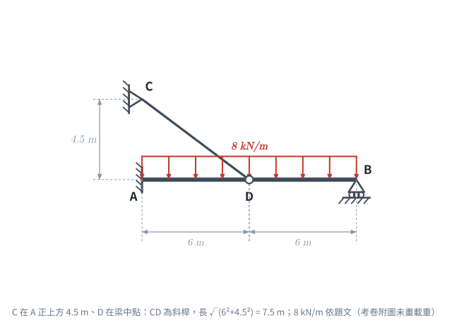
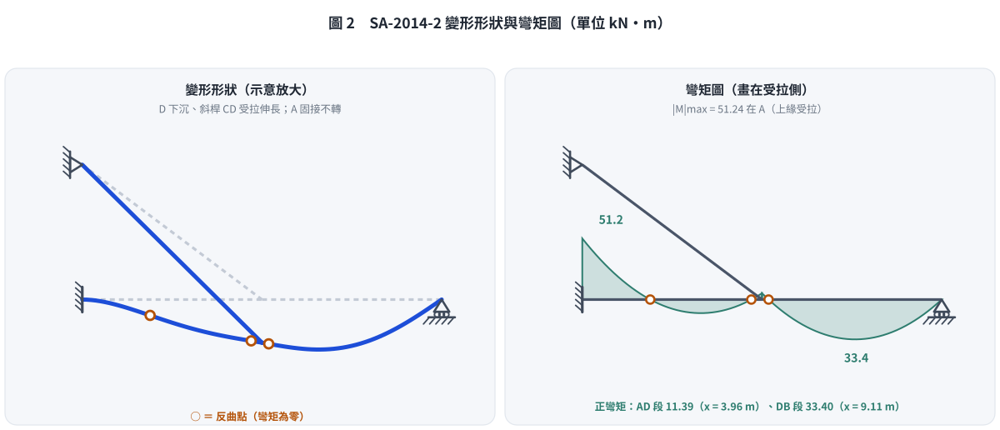

# 考題編號：SA-2014-2

**主分類：** `SA-U2-2` 靜不定結構諧合變位
**副分類：** 無
**分析法：** 諧合變位法
**標籤：** `諧合變位法` `複合結構` `最大彎矩` `彈性變形`

---

## 1. 題目（考卷原文見題目正本）

> 考卷原文、公式／附表、附圖與判讀清單（已確認）見 [`SA-2014-2-problem.md`](SA-2014-2-problem.md)。本節只列解題時最容易讀錯的地方與本解使用的記號；題意以題目正本為準。

*重繪自考卷附圖，依判讀清單 #1–#7 重繪；8 kN/m 依題文補畫（考卷附圖未畫載重）。攔：CD 讀成垂直桿 4.5 m（本題舊版解析）。*

### 常見誤讀
| 項目 | 正確判讀 | 常見誤讀 |
|---|---|---|
| CD 幾何 | C 在 **A 正上方** 4.5 m、D 在梁中點：CD 為**斜桿**，長 $\sqrt{6^2+4.5^2}=7.5$ m，$\sin\theta=0.6$、$\cos\theta=0.8$ | 當成 D 正上方的垂直桿、長 4.5 m（本題 2026-11-07 前的解析即如此，答成 28.8 kN-m） |
| 桿對梁的作用 | 只有垂直分力 $0.6T$ 參與梁的彎曲；水平分力 $0.8T$ 使 AD 段受壓 | 把整個桿力當成垂直力 |
| 彈性支承諧合 | 桿伸長 $=0.6\,v_D$（D 只能垂直移動） | 桿伸長 $=v_D$ |
| 載重範圍 | 8 kN/m 作用梁 AB 全長（附圖未畫，依題文） | 只算到 D |

**本解記號：** $T$＝CD 桿拉力（拉為正）；$R_B$＝B 點垂直反力（向上為正）；位移向下為正；彎矩以梁下側受拉為正；$x$ 自 A 量起。梁 AB 的軸向變形不計（考卷只給 $E_{AB}I_{AB}$，未給梁的軸向剛度），故 D 點水平位移為 0。

## 2. 考題核心精神與出題者意圖 (Core Concepts & Examiner's Intent)

本題測驗考生對於**多重靜不定複合結構**的分析能力，並指定使用「諧合變位法（柔度法）」。
1. **靜不定度判斷與多餘力選擇**：A 固接（3）、B 滾支承（1）、CD 桿（1）共 5 個未知力，平衡方程式 3 個，二度靜不定。取 CD 桿拉力 $T$ 與 B 點反力 $R_B$ 為多餘力，基本結構為懸臂梁。
2. **斜向彈性支承的諧合條件**：CD 是斜桿，桿力要分解：垂直分力 $T\sin\theta$ 頂住梁，梁 D 點的垂直位移 $v_D$ 投影到桿軸方向才是桿的伸長量（$\delta_{CD}=v_D\sin\theta$）。這一步是本題的關鍵，讀錯幾何就整題答錯。
3. **極值判斷**：解出多餘力後，寫出剪力方程式找剪力為零的點，與固接端、D 點的負彎矩一起比較，找出絕對值最大者。

## 3. 解題戰略地圖與陷阱分析 (Strategic Roadmap & Trap Analysis)

**解題策略：**
1. **設定基本系統與多餘力**：移除 B 點滾支承並切斷 CD 桿，基本結構為 A 端固接的懸臂梁 AB。多餘力：$X_1=T$（CD 桿拉力，對梁 D 點的垂直分力 $0.6T$ 向上）、$X_2=R_B$（向上）。
2. **計算基本變位（載重造成）**：懸臂梁在 8 kN/m 下 D、B 兩點的向下撓度 $\Delta_{D0}$、$\Delta_{B0}$。
3. **計算柔度係數（單位力造成）**：D 點、B 點單位向上力造成的撓度 $f_{DD}$、$f_{BB}$、$f_{DB}$。
4. **建立諧合方程式**：
   - B 點最終位移為 0：$\Delta_{B0}-f_{DB}(0.6T)-f_{BB}R_B=0$
   - D 點：桿伸長 $=0.6\,v_D$，即 $0.6\left[\Delta_{D0}-f_{DD}(0.6T)-f_{DB}R_B\right]=\dfrac{T L_{CD}}{E_{CD}A_{CD}}$
5. **求解與彎矩比較**：解出 $T$、$R_B$，求 A 點反力，比較 $M_A$、$M_D$ 與兩段剪力零點的彎矩。

**陷阱分析：**
- **CD 幾何**：C 在 A 正上方，不在 D 正上方。若把 CD 當成 4.5 m 垂直桿，D 點的彈簧勁度變成 $EA/L=8889$ kN/m（正確為 $EA\sin^2\theta/L=1920$ kN/m），桿被高估成 4.6 倍硬，|M|max 會答成 28.8 kN-m（正確 51.24 kN-m）。
- **投影兩次**：桿力投影到垂直方向乘一次 $\sin\theta$，位移投影到桿軸再乘一次 $\sin\theta$，D 點等效彈簧勁度是 $\dfrac{EA}{L}\sin^2\theta$，不是 $\dfrac{EA}{L}\sin\theta$。
- **CD 桿變形的符號**：$T$ 為拉力時桿伸長，D 點向下移動；向下為正時諧合式兩邊同號。
- **單位一致性**：保留 $EI$ 符號推導，最後代入 $\dfrac{L_{CD}}{E_{CD}A_{CD}}=\dfrac{7.5}{40000}=\dfrac{1.875}{EI}$（$EI=10000$）。

## 3.5 變數層次分析 (Variable Hierarchy Analysis)

> 複習提示：第一次解題後，在每個卡住的知識點旁標記 `⚠`；第二次複習時只看有 `⚠` 的項目。

### 最終目標
`利用諧合變位法求出 CD 桿拉力與 B 點反力，進而找出梁 AB 上絕對值最大的彎矩及其位置。`

### 本題關鍵公式（依計算順序）

> $\boxed{\cdot}$ = 需由前步驟推導，非題目直接給定的變數

$$\text{Step 1: } L_{CD}=\sqrt{6^2+4.5^2},\quad \sin\theta=\frac{4.5}{\boxed{L_{CD}}}$$

$$\text{Step 2: } \Delta_{B0} - f_{DB}\,(\boxed{\sin\theta}\,T) - f_{BB}\,R_B = 0$$

$$\text{Step 3: } \boxed{\sin\theta}\left[\Delta_{D0} - f_{DD}\,(\boxed{\sin\theta}\,T) - f_{DB}\,R_B\right] = \frac{T\,\boxed{L_{CD}}}{E_{CD}A_{CD}}$$

$$\text{Step 4: } V(x) = 0 \Rightarrow \text{ 尋找區段彎矩極值位置 } x$$

$$\text{Step 5: } |M|_{max} = \max(|M_A|, |M_D|, |M(x_{V=0})|)$$

### L1：題目直接給定
_看到題目就能讀出的數字，不需要任何公式。_

| 符號 | 數值 | 說明 |
|------|------|------|
| $w$ | 8 kN/m | AB 梁全長均佈載重（題文） |
| $L_{AB}$ | 12 m | AB 梁長 |
| $a$ | 6 m | A 到 D 距離（D 為梁中點） |
| $h$ | 4.5 m | C 在 A 正上方的高度 |
| $E_{AB}I_{AB}$ | 10000 kN-m² | 梁撓曲剛度 |
| $E_{CD}A_{CD}$ | 40000 kN | 桿軸向剛度 |

### L2：需知識點推導
_需要知道公式名稱與適用條件，套入 L1 即可算出。_

**幾何**

| 符號 | 公式/來源 | 卡關? |
|------|----------|:-----:|
| $L_{CD}$ | $\sqrt{a^2+h^2}=7.5$ m | |
| $\sin\theta,\ \cos\theta$ | $h/L_{CD}=0.6$、$a/L_{CD}=0.8$ | |

**懸臂梁受均佈載重之變位（向下為正）**

| 符號 | 公式/來源 | 卡關? |
|------|----------|:-----:|
| $\Delta_{D0}$ | $\frac{wx^2}{24EI}(6L^2 - 4Lx + x^2)$，代入 $x=6, L=12$ | |
| $\Delta_{B0}$ | $\frac{wL^4}{8EI}$，代入 $L=12$ | |

**單位力柔度係數（懸臂梁公式）**

| 符號 | 公式/來源 | 卡關? |
|------|----------|:-----:|
| $f_{DD}$ | D 點受單位力之 D 點變位：$\frac{a^3}{3EI}$ ($a=6$) | |
| $f_{BB}$ | B 點受單位力之 B 點變位：$\frac{L^3}{3EI}$ ($L=12$) | |
| $f_{DB}$ | B 點受單位力之 D 點變位：$\frac{x^2}{6EI}(3L - x)$ ($x=6$) | |

### L3：深層知識（不懂就卡住）

| 知識點 | 說明 | 卡關? |
|--------|------|:-----:|
| 斜桿彈性支承的諧合條件 | D 點只能垂直移動（梁軸向變形不計），桿伸長量是 $v_D$ 在桿軸方向的投影 $v_D\sin\theta$；桿力對梁的垂直作用是 $T\sin\theta$。兩次投影使 D 點等效彈簧勁度為 $\frac{EA}{L}\sin^2\theta$。 | |

## 4. 步驟化詳細計算過程 (Step-by-Step Detailed Calculation)

### Step 1：幾何與基本結構
- $L_{CD}=\sqrt{6^2+4.5^2}=7.5$ m，$\sin\theta=4.5/7.5=0.6$，$\cos\theta=6/7.5=0.8$。
- 移除 B 點滾支承、切斷 CD 桿，基本結構為 A 端固接的懸臂梁 AB。
- 多餘力：$X_1=T$（CD 桿拉力；對梁 D 點的垂直分力 $0.6T$ 向上、水平分力 $0.8T$ 向左），$X_2=R_B$（B 點向上反力）。

### Step 2：計算外力作用下基本結構的位移（向下為正）
均佈載重 $w = 8$ kN/m 作用於全跨 $L=12$ m。
- B 點（自由端）撓度：
  $$\Delta_{B0} = \frac{w L^4}{8 EI} = \frac{8 \times 12^4}{8 EI} = \frac{20736}{EI}$$
- D 點（$x=6$ m）撓度：
  $$\Delta_{D0} = \frac{8 \times 6^2}{24 EI} \left( 6(12^2) - 4(12)(6) + 6^2 \right) = \frac{12 \times 612}{EI} = \frac{7344}{EI}$$

### Step 3：計算柔度係數
- $f_{DD} = \dfrac{6^3}{3 EI} = \dfrac{72}{EI}$
- $f_{BB} = \dfrac{12^3}{3 EI} = \dfrac{576}{EI}$
- $f_{DB} = \dfrac{6^2}{6 EI} (3 \times 12 - 6) = \dfrac{180}{EI}$

### Step 4：建立諧合方程式並求解
CD 桿伸長量 $\delta_{CD}=\dfrac{T L_{CD}}{E_{CD}A_{CD}}=\dfrac{7.5\,T}{40000}=\dfrac{1.875\,T}{EI}$（$EI=10000$）。

**諧合條件 1（B 點最終位移為 0）：**
$$\frac{20736}{EI} - \frac{180}{EI}(0.6T) - \frac{576}{EI} R_B = 0 \Rightarrow 108\,T + 576\,R_B = 20736 \Rightarrow R_B = 36 - 0.1875\,T \quad \text{--- (式 1)}$$

**諧合條件 2（桿伸長 = D 點位移在桿軸方向的投影）：**
$$0.6\left[\frac{7344}{EI} - \frac{72}{EI}(0.6T) - \frac{180}{EI} R_B\right] = \frac{1.875\,T}{EI}$$
$$4406.4 - 25.92\,T - 108\,R_B = 1.875\,T \Rightarrow 27.795\,T + 108\,R_B = 4406.4 \quad \text{--- (式 2)}$$

**解聯立方程式：** 式 1 代入式 2：
$$27.795\,T + 3888 - 20.25\,T = 4406.4 \Rightarrow 7.545\,T = 518.4 \Rightarrow T = \frac{34560}{503} = 68.71 \text{ kN（拉）}$$
$$R_B = 36 - 0.1875 \times 68.71 = \frac{11628}{503} = 23.12 \text{ kN} (\uparrow)$$
桿對梁的垂直分力 $0.6T = 41.22$ kN（↑），水平分力 $0.8T = 54.97$ kN（使 AD 段受壓，A 點水平反力 54.97 kN 向右）。

**檢核：** D 點撓度 $v_D=\delta_{CD}/0.6=\dfrac{1.875\times 68.71}{0.6\times 10000}=0.02147$ m $=21.5$ mm（↓）；以直接勁度法（梁元素＋斜桿元素）重算，$T$、$R_B$、$R_A$、$M_A$ 四值一致。

### Step 5：計算梁上各點彎矩，找出絕對值最大者
梁 AB 受 8 kN/m 向下、D 點 41.22 kN 向上、B 點 23.12 kN 向上。

**求 A 點反力：**
$$\sum F_y = 0 \Rightarrow R_A = 96 - 41.22 - 23.12 = 31.66 \text{ kN} (\uparrow)$$
$$M(0) = M_A = -\left(8 \times 12 \times 6 - 41.22 \times 6 - 23.12 \times 12\right) = -\frac{25776}{503} = -51.24 \text{ kN-m}$$
（固接端上側受拉。）

**尋找區段極值：**
- **區間 A-D（$0 \le x \le 6$）：** $V(x) = 31.66 - 8x = 0 \Rightarrow x = 3.957$ m
  $$M(3.957) = -51.24 + \frac{31.66^2}{16} = +11.39 \text{ kN-m}$$
  $$M_D = M(6) = -51.24 + 31.66 \times 6 - 4 \times 6^2 = -5.30 \text{ kN-m}$$
- **區間 D-B（距 B 為 $x'$）：** $V = -23.12 + 8x' = 0 \Rightarrow x' = 2.890$ m（距 A 9.110 m）
  $$M = \frac{R_B^2}{2w} = \frac{23.12^2}{16} = +33.40 \text{ kN-m}$$

**比較各關鍵點彎矩：**
- $M_A$（$x=0$）$= -51.24$ kN-m
- $M_{max1}$（$x=3.957$）$= +11.39$ kN-m
- $M_D$（$x=6$）$= -5.30$ kN-m
- $M_{max2}$（$x=9.110$）$= +33.40$ kN-m

$$\boxed{\text{最大彎矩（絕對值）為 } 51.24 \text{ kN-m，發生於 A 點（固接端，上側受拉）}}$$

*圖 2　變形形狀與彎矩圖（勁度法重算，$T$、$R_B$、$M_A$ 與兩個正彎矩極值逐項核對本解）。斜桿 CD 只在 D 提供部分支撐，最大彎矩仍在固接端；這張圖攔的是「CD 當垂直桿」和「以為最大彎矩在跨中」。*

## 5. 關鍵爭議點與進階探討 (Critical Issues & Advanced Discussion)

- **讀錯幾何的代價**：把 CD 當成 D 正上方 4.5 m 的垂直桿時，D 點等效彈簧勁度為 $40000/4.5=8889$ kN/m；正確的斜桿為 $40000\times0.6^2/7.5=1920$ kN/m，只有前者的 22%。桿較軟，D 點分擔的載重少（垂直分力 51.2 → 41.2 kN），固接端彎矩因而由 28.8 增為 51.24 kN-m，D 點負彎矩由 −24.0 降為 −5.30 kN-m。
- **梁的軸力**：斜桿水平分力 54.97 kN 使梁 AD 段受壓、DB 段不受軸力。考卷未給梁的軸向剛度，本解依慣例不計梁的軸向變形（D 點水平位移為 0）；若計入，D 點會略向左移，桿伸長量需加上水平分量，數值變化甚小。
- **選擇不同多餘力的影響**：亦可選 $M_A$ 與 $R_B$（或 $M_A$ 與 $T$）為多餘力，基本系統改為簡支梁，可用共軛梁法求基本變位；不論選法，斜桿的諧合條件都要兩次投影 $\sin\theta$，結果相同。
- **彈性支撐的剛度表示**：保留 $EI$ 符號推導，只將常數項數字化，把 $L/EA$ 換算成 $EI$ 的倍數（本題 $1.875/EI$），可避免 10000 與 40000 這種大數字在乘除中出錯。

*修正日期：2026-11-07（解析勘誤：CD 由垂直桿 4.5 m 改為斜桿 7.5 m（題目正本判讀 #3、#5、#6，使用者確認；C 在 A 正上方）；|M|max 28.8 → 51.24 kN-m（位置仍在 A）；CD 桿力 51.2 → 68.71 kN（垂直分力 41.22 kN）、R_B 20 → 23.12 kN、R_A 24.8 → 31.66 kN、M_D −24 → −5.30 kN-m、正彎矩極值 +25 @ 9.5 m → +33.40 @ 9.110 m；§2、§3、§3.5、§4、§5 改寫；驗證：分數精確諧合解與直接勁度法兩路徑，11 值 MISMATCHES: 0）*
*修正日期：2026-11-07（§1 改為指向題目正本並放重繪附圖（figs/SA-2014-2-fig-1-problem.svg）、加常見誤讀；圖由 gen_SA-2014-2.py 產生，可重跑）*
*修正日期：2026-11-07（非勘誤）分類更正：刪除副分類 SA-U2-1（考卷限用諧合變位法、「若以其他方法計算不予計分」，與最小功法無交集；使用者決定）*
*修正日期：2026-11-07（非勘誤）圖解補繪：圖 2（gen_SA-2014-2.py，可重跑）*
