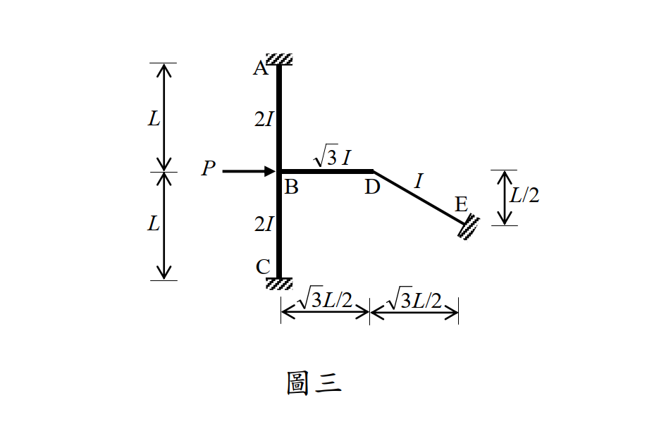

# SA-2014-3 題目正本

> 本檔只記錄考卷上寫了什麼、圖上畫了什麼，不含任何解法。解析見同資料夾 `SA-2014-3.md`。
> 判讀清單經使用者確認前，狀態為「待確認」；確認後本檔原則上不再修改（改動須回考卷原圖並記 log）。

| 項目 | 內容 |
|---|---|
| 考卷 | `raw/exams/SA-2014_結構學.pdf`，第 2 頁上半，第三題（圖三） |
| 考年 | 2014（民國 103 年）專技高考結構工程技師「結構學」 |
| 配分 | 25 分 |
| 附圖 | `SA-2014-3-fig-1.png` |
| 判讀狀態 | **已確認**（2026-11-07 使用者確認。原轉錄：2026-11-05 轉錄；PyMuPDF 110 dpi 整頁＋450 dpi 局部放大；盲讀於開啟解析前完成） |

## 1. 考卷原文（逐字）

三、如圖三所示之剛架結構，其 A、C 與 E 點均為固接支承，同時每根構件之彈性模數均為常數值 E； AB、BC、BD 及 DE 四根構件之長度分別為 L、L、√3L/2 與 L（L = 8m），而慣性矩分別為 2I、2I、√3I 與 I。當 B 點承受水平向右集中載重 P = 66 kN 時，請以傾角變位法計算 A、B、C、D、E 各點彎矩。（若以其他方法計算不予計分）（25 分）

## 2. 考卷給的公式、附表與參數

- 考卷沒有給任何參考公式或附表。
- 卷首注意事項：㈠可以使用電子計算器。㈡不必抄題，作答時請將試題題號及答案依照順序寫在試卷上，於本試題上作答者，不予計分。
- 考試時間：2 小時。

## 3. 附圖

*證據圖 SA-2014-3-fig-1.png*

圖面文字照錄：A、L、2I、P、B、√3 I、D、I、E、L/2、L、2I、C、√3L/2、√3L/2、圖三

## 4. 判讀清單

| # | 項目 | 判讀 | 圖上／題文依據 | 把握 |
|---|---|---|---|---|
| 1 | A | 固接支承，在 B 正上方 | 頂端斜線塊；題文「A、C 與 E 點均為固接支承」 | 確定 |
| 2 | C | 固接支承，在 B 正下方 | 底端斜線塊 | 確定 |
| 3 | E | 固接支承，斜置（剖線垂直於 DE 桿軸） | 斜線塊與 DE 垂直 | 確定 |
| 4 | B、D | 剛接節點（無鉸圈） | 圖上無空心圓 | 確定 |
| 5 | AB、BC | 垂直，各長 L，慣性矩 2I | 左側尺寸 L＋L；桿旁標 2I；題文 | 確定 |
| 6 | BD | 水平，長 √3L/2，慣性矩 √3I | 下方尺寸 √3L/2（B 至 D）；桿上標 √3 I | 確定 |
| 7 | DE | 水平投影 √3L/2、E 比 D 低 L/2，實長 L，慣性矩 I | 下方第二段 √3L/2（D 至 E）、右側 L/2；題文長 L 與投影吻合（(√3/2)²＋(1/2)²＝1） | 確定 |
| 8 | L | L = 8 m | 題文 | 確定 |
| 9 | E | 各桿 E 相同 | 題文 | 確定 |
| 10 | 載重 | B 點水平集中力 P = 66 kN 向右 | 箭頭由左指向 B；題文「水平向右」 | 確定 |
| 11 | 指定方法 | 傾角變位法（他法不計分） | 題文 | 確定 |
| 12 | 所求 | A、B、C、D、E 各點彎矩 | 題文 | 確定 |
| 13 | 考卷沒有給 | 軸向變形是否忽略（未提） | 題文 | 確定（解讀）：照剛架傾角變位法慣例忽略軸向變形；使用者確認 |

---
*轉錄：2026-11-05（SA-U2-3 題目正本推廣・批 2）*
*確認：2026-11-07 使用者確認*
