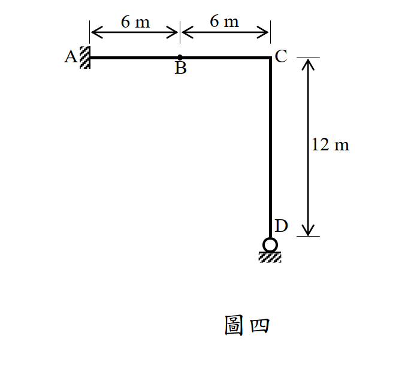

# SA-2014-4 題目正本

> 本檔只記錄考卷上寫了什麼、圖上畫了什麼，不含任何解法。解析見同資料夾 `SA-2014-4.md`。
> 判讀清單經使用者確認前，狀態為「待確認」；確認後本檔原則上不再修改（改動須回考卷原圖並記 log）。

| 項目 | 內容 |
|---|---|
| 考卷 | `raw/exams/SA-2014_結構學.pdf`，第 2 頁（背面）下半，第四題（圖四） |
| 考年 | 2014（民國 103 年）專技高考結構工程技師「結構學」 |
| 配分 | 25 分 |
| 附圖 | `SA-2014-4-fig-1.png` |
| 判讀狀態 | **已確認**（2026-11-07 使用者確認；影響答案項目定案：重繪圖依題文在 B 畫 20 kN 箭頭並註明（使用者決定）。原轉錄：2026-11-07 轉錄；PyMuPDF 110 dpi 整頁＋300–500 dpi 局部放大、PDF 向量座標核對；盲讀於開啟解析前完成） |

## 1. 考卷原文（逐字）

四、如圖四所示之剛架結構，其A 點為固接支承，D 點為滾支承，構件AC 與CD 之彈性模數與慣性矩乘積分別為EI 及2EI，且EI = 1000 kN-m²。請以最小功法計算當B 點承受一垂直向下載重20 kN 時C 點之轉角。（若以其他方法計算不予計分）（25 分）

## 2. 考卷給的公式、附表與參數

- 考卷沒有給任何參考公式或附表。
- EI＝1000 kN-m²；AC 為 EI、CD 為 2EI。
- **附圖上沒有畫 20 kN 箭頭**，載重只在題文。
- 考卷沒有說是否忽略軸向變形。
- 指定方法：最小功法；他法不計分。
- 卷首注意事項：㈠可以使用電子計算器。㈡不必抄題，作答時請將試題題號及答案依照順序寫在試卷上，於本試題上作答者，不予計分。
- 考試時間：2 小時。

## 3. 附圖

*證據圖 SA-2014-4-fig-1.png*

圖面文字照錄：6 m、6 m、A、B、C、12 m、D、圖四

## 4. 判讀清單

| # | 項目 | 判讀 | 圖上／題文依據 | 把握 |
|---|---|---|---|---|
| 1 | 構件 | A–C 水平（EI）；C–D 垂直（2EI）；C 剛接 | 題文；CD 線較粗 | 確定 |
| 2 | A | 固定端 | 題文；剖線 | 確定 |
| 3 | D | 滾支承：圓圈坐在水平剖線上，提供垂直反力 | 題文；圓圈＋剖線 | 確定（解讀）；使用者確認 |
| 4 | B | AC 中點的**標示點**（實心圓點），不是鉸 | 實心點（鉸應為空心圓） | 確定（解讀）；使用者確認 |
| 5 | 幾何 | AB＝BC＝6 m；CD＝12 m（D 在 C 正下方） | 上方尺寸 x=238.2｜294.9｜347.6；右側 12 m y=644.0｜753.4 | 確定 |
| 6 | 載重 | B 點 20 kN 垂直向下（**只在題文，圖上無箭頭**） | 題文 | 確定 |
| 7 | 考卷沒有給 | 軸向變形是否忽略 | 題文 | 確定 |
| 8 | 靜不定度 | 固定 3＋滾 1＝4：一度靜不定 | 計數 | 確定 |
| 9 | 所求 | C 點轉角；最小功法 | 題文 | 確定 |
| 10 | 證據圖 | 既有 fig-1 乾淨，沿用 | — | 確定 |

---
*轉錄：2026-11-07（SA-U2-1 題目正本推廣・批 1）*
*確認：2026-11-07 使用者確認*
