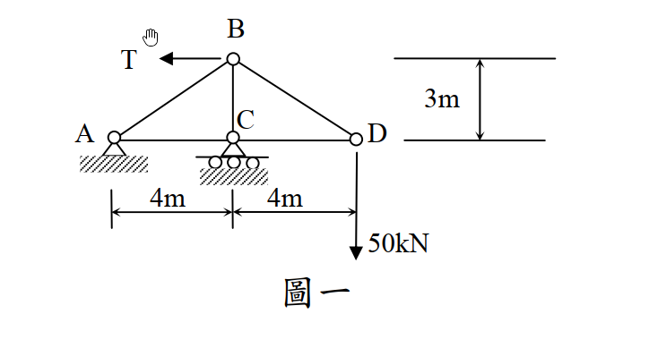
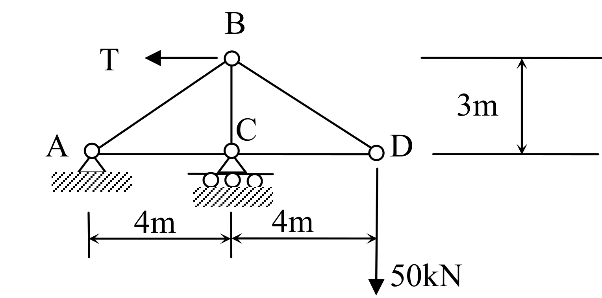

# SA-2015-1 題目正本

> 本檔只記錄考卷上寫了什麼、圖上畫了什麼，不含任何解法。解析見同資料夾 `SA-2015-1.md`。
> 判讀清單經使用者確認前，狀態為「待確認」；確認後本檔原則上不再修改（改動須回考卷原圖並記 log）。

| 項目 | 內容 |
|---|---|
| 考卷 | `raw/exams/SA-2015_結構學.pdf`，第 1 頁（正面）上半，第一題（圖一） |
| 考年 | 2015（民國 104 年）專技高考結構工程技師「結構學」 |
| 配分 | 25 分 |
| 附圖 | `SA-2015-1-fig-1.png`、`SA-2015-1-fig-2.png` |
| 判讀狀態 | **已確認**（2026-11-05 使用者確認。原轉錄：2026-11-05 轉錄；PyMuPDF 110 dpi 整頁＋350–1000 dpi 局部放大；盲讀於開啟解析前完成） |

## 1. 考卷原文（逐字）

一、一平面桁架如圖一所示，點 A 為鉸支承，點 C 為滾支承，點 D 承受一往下垂直載重 50 kN。若桿件 BD 較原設計縮短 0.5 cm，點 C 支承下陷 0.4 cm，假設所有桿件彈性模數與斷面積乘積 EA=2 × 10⁵ kN，為使點 D 垂直位移為零，試求點 B 所需施加之水平力量 T。（25 分）

## 2. 考卷給的公式、附表與參數

- 考卷沒有給任何參考公式或附表。
- EA = 2×10⁵ kN（題文）；BD 縮短 0.5 cm；C 下陷 0.4 cm。
- 卷首注意事項：㈠可以使用電子計算器。㈡不必抄題，作答時請將試題題號及答案依照順序寫在試卷上，於本試題上作答者，不予計分。
- 考試時間：2 小時。

## 3. 附圖

*證據圖 SA-2015-1-fig-1.png*

*證據圖 SA-2015-1-fig-2.png（2026-11-05 自考卷重新擷取 500 dpi，無游標）*

圖面文字照錄：B、T、C、A、D、3m、4m、4m、50kN、圖一

## 4. 判讀清單

| # | 項目 | 判讀 | 圖上／題文依據 | 把握 |
|---|---|---|---|---|
| 1 | 座標（以 A 為原點） | A(0,0)、C(4,0)、D(8,0)、B(4,3) | 下方 4m｜4m、右側 3m 尺寸線 | 確定 |
| 2 | 桿件 | AB、BC、BD、AC、CD（5 桿） | 圖面 | 確定 |
| 3 | 支承 | A 鉸支承；C 滾支承（三輪） | 題文；圖上符號 | 確定 |
| 4 | T | 作用於 B 的水平力，圖上箭頭向左 | 箭頭 | 確定 |
| 5 | 載重 | D 點 50 kN 向下 | 題文；箭頭 | 確定 |
| 6 | BD 製造誤差 | BD 較原設計縮短 0.5 cm | 題文 | 確定 |
| 7 | 支承沉陷 | C 點下陷 0.4 cm | 題文 | 確定 |
| 8 | 剛度 | 所有桿件 EA = 2×10⁵ kN | 題文 | 確定 |
| 9 | 條件與所求 | 使 D 點垂直位移為零，求 T | 題文 | 確定 |
| 10 | 證據圖 | 舊 fig-1 滑鼠游標在 T 箭頭上方；新增 fig-2（500 dpi） | — | 確定 |

---
*轉錄：2026-11-05（SA-U1-2 題目正本推廣・批 1）*
*確認：2026-11-05 使用者確認*
