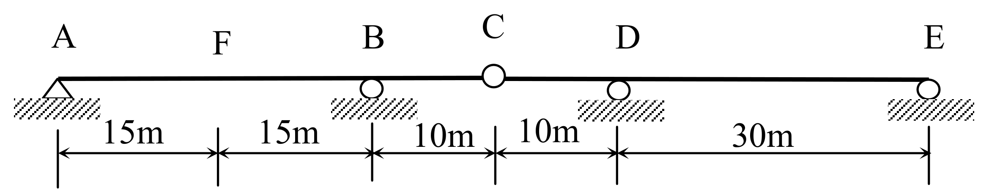

# SA-2015-2 題目正本

> 本檔只記錄考卷上寫了什麼、圖上畫了什麼，不含任何解法。解析見同資料夾 `SA-2015-2.md`。
> 判讀清單經使用者確認前，狀態為「待確認」；確認後本檔原則上不再修改（改動須回考卷原圖並記 log）。

| 項目 | 內容 |
|---|---|
| 考卷 | `raw/exams/SA-2015_結構學.pdf`，第 1 頁（正面），全一張，第二題（圖二） |
| 考年 | 2015（民國一百零四年）專技高考結構工程技師「結構學」 |
| 配分 | 25 分 |
| 附圖 | `SA-2015-2-fig-2.png`（2026-11-07 重新擷取）；既有 `SA-2015-2-fig-1.png` |
| 判讀狀態 | **已確認**（2026-11-07 使用者確認。原轉錄：2026-11-07 轉錄；PyMuPDF 110 dpi 整頁＋450–1200 dpi 局部放大；考卷可抽文字，逐字原文以 PDF 文字層核對；盲讀於開啟解析前完成） |

## 1. 考卷原文（逐字）

二、一連續梁如圖二所示，點 A 為鉸支承、點 B、D 及 E 為滾支承，點 C 為鉸接，彈性模數與慣性矩乘積 EI 為定值。試繪出點 F 之剪力影響線，並用共軛梁法求此影響線在點 F 及點 C 的值。（25 分）

## 2. 考卷給的公式、附表與參數

- 考卷沒有給任何參考公式或附表。
- 考卷沒有給 EI 數值（只說為定值）。
- 卷首注意事項：㈠可以使用電子計算器。㈡不必抄題，作答時請將試題題號及答案依照順序寫在試卷上，於本試題上作答者，不予計分。
- 考試時間：2 小時。

## 3. 附圖

*證據圖 SA-2015-2-fig-2.png（2026-11-07 自考卷 500 dpi 重新擷取）；既有 SA-2015-2-fig-1.png 帶有滑鼠游標（手形游標壓在 A 支承左側剖線上），保留不改。*

圖面文字照錄：A、F、B、C、D、E、15m、15m、10m、10m、30m、圖二

## 4. 判讀清單

| # | 項目 | 判讀 | 圖上／題文依據 | 把握 |
|---|---|---|---|---|
| 1 | 座標 | A(0)、F(15)、B(30)、C(40)、D(50)、E(80)，單位 m | 尺寸線 15｜15｜10｜10｜30 m（500 dpi），端點對齊各點 | 確定 |
| 2 | 支承 A | 鉸支承（三角形） | 500 dpi；既有 fig-1 游標壓在 A 剖線，以 fig-2 為準 | 確定 |
| 3 | 支承 B、D、E | 滾支承（圓圈） | 500 dpi | 確定 |
| 4 | C 點 | 內鉸（梁上空心圓，非支承） | 圖上大圓圈畫在梁線上、下方無剖線；題文「點 C 為鉸接」 | 確定 |
| 5 | F 點 | AB 跨中點，梁上一般點 | 圖上只有字母 | 確定 |
| 6 | 靜不定度 | 反力 5、平衡 3＋內鉸 1：一度靜不定 | 計數 | 確定 |
| 7 | EI | 全梁定值 | 題文 | 確定 |
| 8 | 所求 | F 點剪力影響線（繪圖），並用共軛梁法求影響線在 F 點與 C 點的值 | 題文；F 點剪力影響線在 F 有跳躍，「在點 F 的值」考卷未指定左側或右側 | 不確定（解讀）；使用者確認 |

---
*轉錄：2026-11-07（SA-U1-3 題目正本推廣・批 1）*
*確認：2026-11-07 使用者確認*
