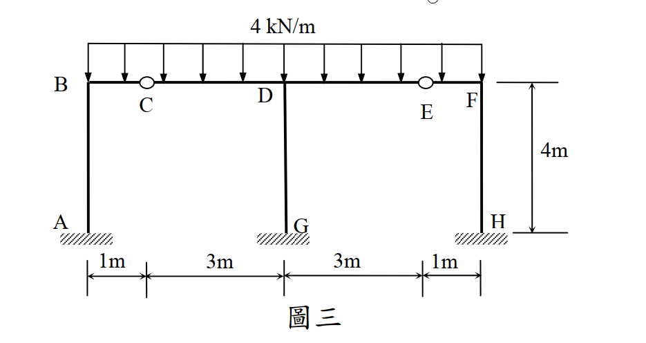

# SA-2015-3 題目正本

> 本檔只記錄考卷上寫了什麼、圖上畫了什麼，不含任何解法。解析見同資料夾 `SA-2015-3.md`。
> 判讀清單經使用者確認前，狀態為「待確認」；確認後本檔原則上不再修改（改動須回考卷原圖並記 log）。

| 項目 | 內容 |
|---|---|
| 考卷 | `raw/exams/SA-2015_結構學.pdf`，第 1 頁下半，第三題（圖三） |
| 考年 | 2015（民國 104 年）專技高考結構工程技師「結構學」 |
| 配分 | 25 分 |
| 附圖 | `SA-2015-3-fig-1.png` |
| 判讀狀態 | **待確認**（2026-11-05 轉錄；PyMuPDF 110 dpi 整頁＋300 dpi 局部放大；盲讀於開啟解析前完成） |

## 1. 考卷原文（逐字）

三、圖三為一平面構架，點 A、G 及 H 為固定支承，點 C 及 E 為鉸接，此構架點 B 至 F 間梁桿件承受一垂直均佈載重 4 kN/m。設所有桿件 EI 為定值，且忽略桿件軸向變形，試用傾角變位法，求各桿件端點彎矩及支承 G 之反力，並繪出 B 至 F 間梁桿件之彎矩圖。（25 分）

## 2. 考卷給的公式、附表與參數

- 考卷沒有給任何參考公式或附表。
- 卷首注意事項：㈠可以使用電子計算器。㈡不必抄題，作答時請將試題題號及答案依照順序寫在試卷上，於本試題上作答者，不予計分。
- 考試時間：2 小時。

## 3. 附圖

*證據圖 SA-2015-3-fig-1.png*

圖面文字照錄：4 kN/m、B、C、D、E、F、4m、A、G、H、1m、3m、3m、1m、圖三

## 4. 判讀清單

| # | 項目 | 判讀 | 圖上／題文依據 | 把握 |
|---|---|---|---|---|
| 1 | A、G、H | 固定支承（柱底） | 柱底斜線填充；題文 | 確定 |
| 2 | C、E | 梁上內鉸 | 梁上空心圓；題文「點 C 及 E 為鉸接」 | 確定 |
| 3 | B、D、F | 剛接節點 | 無鉸圈 | 確定 |
| 4 | 水平尺寸 | B–C 1 m、C–D 3 m、D–E 3 m、E–F 1 m（BF 共 8 m） | 下方尺寸線端點對齊 B、C、D、E、F 的鉛垂線 | 確定 |
| 5 | 柱高 | AB、GD、HF 皆 4 m | 右側尺寸 4m（梁頂至柱底）；三柱底同高 | 確定 |
| 6 | 剛度 | 所有桿件 EI 相同 | 題文 | 確定 |
| 7 | 載重 | 4 kN/m 向下，自 B 至 F 全長 | 箭頭範圍 B 至 F；題文「點 B 至 F 間」 | 確定 |
| 8 | 軸向變形 | 忽略 | 題文 | 確定 |
| 9 | 指定方法 | 傾角變位法 | 題文（未寫他法不給分） | 確定 |
| 10 | 所求 | 各桿件端點彎矩；支承 G 之反力；B 至 F 梁彎矩圖 | 題文 | 確定 |

---
*轉錄：2026-11-05（SA-U2-3 題目正本推廣・批 2）*
