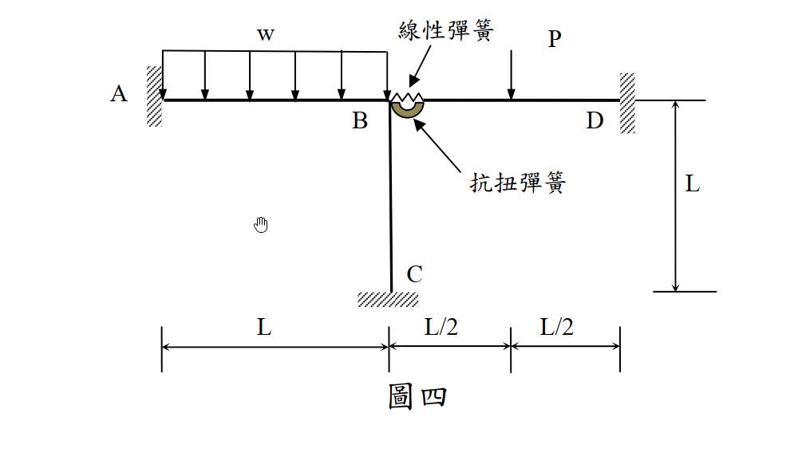
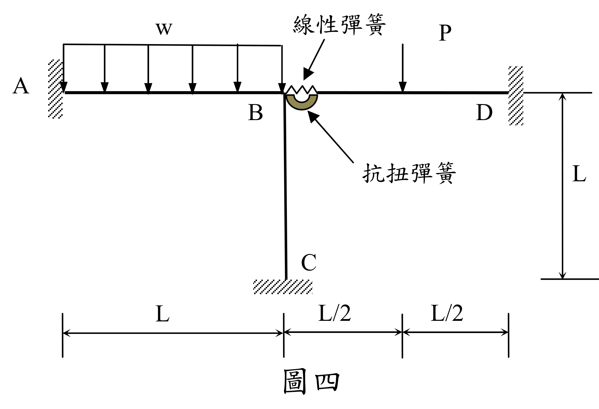

# SA-2015-4 題目正本

> 本檔只記錄考卷上寫了什麼、圖上畫了什麼，不含任何解法。解析見同資料夾 `SA-2015-4.md`。
> 判讀清單經使用者確認前，狀態為「待確認」；確認後本檔原則上不再修改（改動須回考卷原圖並記 log）。

| 項目 | 內容 |
|---|---|
| 考卷 | `raw/exams/SA-2015_結構學.pdf`，第 2 頁（背面），第四題（圖四） |
| 考年 | 2015（民國 104 年）專技高考結構工程技師「結構學」 |
| 配分 | 25 分 |
| 附圖 | `SA-2015-4-fig-1.png`、`SA-2015-4-fig-2.png` |
| 判讀狀態 | **已確認**（2026-11-05 使用者確認。原轉錄：2026-11-05 轉錄；PyMuPDF 110 dpi 整頁＋250–800 dpi 局部放大、PDF 向量座標；盲讀於開啟解析前完成） |

## 1. 考卷原文（逐字）

四、一平面構架承受載重如圖四所示，點 A、C 及 D 為固定支承，桿件 AB 與 BC 在 B 點為剛接，與桿件 BD 的接合是以一抗扭彈簧及一水平線性彈簧來連結，分別模擬彎矩及水平力的傳遞，但無垂直力傳遞。抗扭彈簧及線性彈簧的力與位移關係皆為線彈性。設桿件 AB、BC 與 BD 之 EI 及 EA 都為定值，桿長皆為 L，且忽略其軸向變形，抗扭彈簧及線性彈簧之彈簧常數分別為 kθ 和 ks。試標示此結構之位移自由度（完全束制之位移自由度不計），然後求對應這些自由度之勁度矩陣[K]及外力矩陣[R]。（[R]=[K][r]，[r]為位移矩陣）（25 分）

## 2. 考卷給的公式、附表與參數

- 考卷沒有給任何參考公式或附表。
- 彈簧常數 kθ（抗扭）、ks（水平線性）；EI、EA 定值；桿長皆 L；忽略軸向變形（題文）。
- 題文明寫 B 與 BD 的接合「無垂直力傳遞」。
- 考卷沒有給數值。
- 卷首注意事項：可以使用電子計算器。不必抄題，作答時請將試題題號及答案依照順序寫在試卷上，於本試題上作答者，不予計分。
- 考試時間：2 小時。

## 3. 附圖

*證據圖 SA-2015-4-fig-1.png*

*證據圖 SA-2015-4-fig-2.png（2026-11-05 自考卷重新擷取 500 dpi，無游標）*

圖面文字照錄：w、線性彈簧、P、A、B、D、抗扭彈簧、L、C、L、L/2、L/2、圖四

## 4. 判讀清單

| # | 項目 | 判讀 | 圖上／題文依據 | 把握 |
|---|---|---|---|---|
| 1 | 座標（B 為原點） | A(−L,0)、C(0,−L)、D(L,0) | 尺寸線 L｜L/2｜L/2（下方）、L（右側） | 確定 |
| 2 | 構件 | AB、BC（B 剛接）；BD 經彈簧接 B | 題文；附圖 | 確定 |
| 3 | 支承 | A、C、D 皆固定 | 題文；剖線 | 確定 |
| 4 | B–BD 接合 | 抗扭彈簧 kθ（彎矩）＋水平線性彈簧 ks（水平力），無垂直力傳遞 | 題文；附圖彈簧符號在 B 右側 | 確定 |
| 5 | 載重 w | 均佈，向下，A 到 B 全長（AB 段） | PDF 向量座標：載重線 x = 257.5–365.6 pt，AB 桿 258.1–366.8 pt | 確定 |
| 6 | 載重 P | 向下集中力，BD 上距 B 為 L/2（中點） | PDF 向量座標：P 箭頭 x = 425.8 pt，尺寸刻度 366.8｜425.6｜478.4 pt | 確定 |
| 7 | 剛度 | EI、EA 定值；忽略軸向變形 | 題文 | 確定 |
| 8 | 所求 | 標示自由度、[K]、[R] | 題文 | 確定 |
| 9 | 證據圖 | 舊截圖 fig-1：滑鼠游標（手形）在 AB 下方空白處，未壓到圖；新增 fig-2（2026-11-05 自考卷重新擷取 500 dpi） | — | 確定 |

---
*轉錄：2026-11-05（SA-U2-4 題目正本推廣・批 1）*
*確認：2026-11-05 使用者確認*
