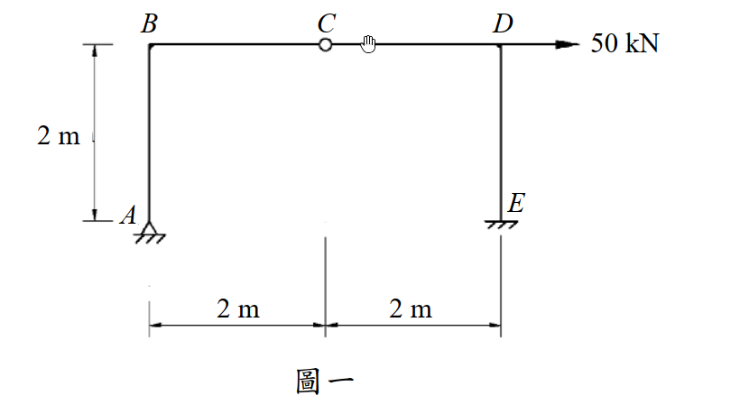
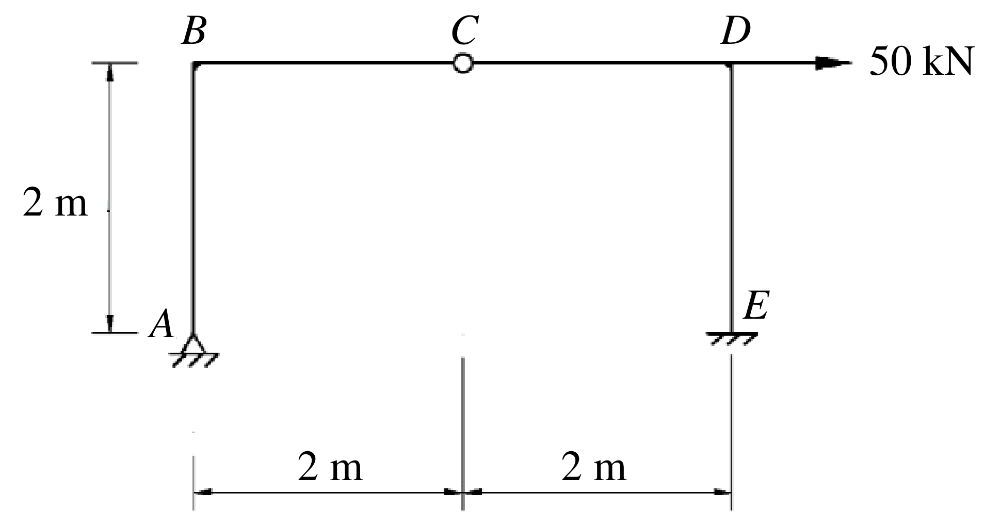

# SA-2016-1 題目正本

> 本檔只記錄考卷上寫了什麼、圖上畫了什麼，不含任何解法。解析見同資料夾 `SA-2016-1.md`。
> 判讀清單經使用者確認前，狀態為「待確認」；確認後本檔原則上不再修改（改動須回考卷原圖並記 log）。

| 項目 | 內容 |
|---|---|
| 考卷 | `raw/exams/SA-2016_結構學.pdf`，第 1 頁（正面）上半，第一題（圖一） |
| 考年 | 2016（民國 105 年）專技高考結構工程技師「結構學」 |
| 配分 | 25 分 |
| 附圖 | `SA-2016-1-fig-1.png`、`SA-2016-1-fig-2.png` |
| 判讀狀態 | **已確認**（2026-11-05 使用者確認；影響答案項目定案：#2 E 為固定端（使用者確認）。原轉錄：2026-11-05 轉錄；PyMuPDF 110 dpi 整頁＋350–1000 dpi 局部放大；盲讀於開啟解析前完成） |

## 1. 考卷原文（逐字）

一、圖一剛架使用材料之彈性模數為 E，斷面慣性矩為 I，EI =常數。試分析圖一之剛架，並繪彎矩圖。（25 分）

## 2. 考卷給的公式、附表與參數

- 考卷沒有給任何參考公式或附表。
- EI 只說是常數，沒有數值。
- 考卷沒有說是否忽略軸向變形。
- 卷首注意事項：㈠可以用電子計算器。㈡不必抄題，作答時請將試題題號及答案依照順序寫在試卷上，於本試題上作答者，不予計分。
- 考試時間：2 小時。

## 3. 附圖

*證據圖 SA-2016-1-fig-1.png*

*證據圖 SA-2016-1-fig-2.png（2026-11-05 自考卷重新擷取 500 dpi，無游標）*

圖面文字照錄：B、C、D、50 kN、2 m、A、E、2 m、2 m、圖一

## 4. 判讀清單

| # | 項目 | 判讀 | 圖上／題文依據 | 把握 |
|---|---|---|---|---|
| 1 | A | 鉸支承（三角形＋剖線） | 500–1000 dpi 放大 | 確定（解讀）；使用者確認 |
| 2 | E | 固定端（柱底直接接剖線，無三角形） | 500–1000 dpi 放大 | 確定（解讀）；使用者確認 |
| 3 | C | 梁中點內鉸 | 空心圓；下方尺寸刻度對齊 | 確定 |
| 4 | B、D | 剛接（梁柱角點無圓圈） | 圖面 | 確定 |
| 5 | 尺寸 | 柱高 2 m；B–C 2 m、C–D 2 m | 左側 2 m、下方 2 m｜2 m 尺寸線 | 確定 |
| 6 | 載重 | D 點 50 kN 水平向右 | 箭頭沿梁軸線延伸 | 確定 |
| 7 | 剛度 | 各桿 EI 相同（常數） | 題文 | 確定 |
| 8 | 靜不定度 | 鉸 2＋固定 3＋內鉸條件 1：r＝5、方程式 3＋1，一度靜不定 | 計數 | 確定 |
| 9 | 所求 | 分析並繪彎矩圖 | 題文 | 確定 |
| 10 | 證據圖 | 舊 fig-1 滑鼠游標壓在梁上 C 鉸右側（易誤看成第二個鉸）；新增 fig-2（500 dpi） | — | 確定 |

---
*轉錄：2026-11-05（SA-U1-2 題目正本推廣・批 1）*
*確認：2026-11-05 使用者確認*
