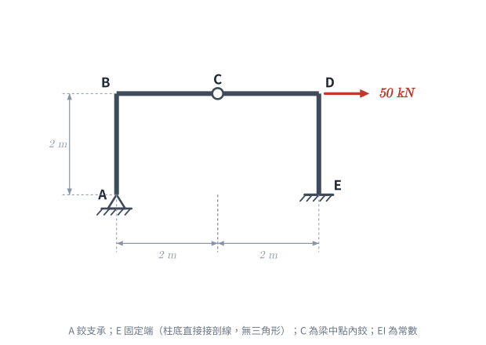

# 考題編號：SA-2016-1

**主分類：** `SA-U2-2` 靜不定結構諧合變位（2026-11-05 由 SA-U1-2 改歸）
**副分類：** `SA-U1-1` 靜不定度與穩定性之判斷
**分析法：** 諧合變位法（左段為二力構件，取其軸力為贅餘力）
**標籤：** `靜定剛架` `內鉸` `靜力平衡` `BMD` `水平載重` `靜不定剛架` `二力構件` `諧合變位法`

---

## 1. 題目（考卷原文見題目正本）

> 考卷原文、公式／附表、附圖與判讀清單（已確認）見 [`SA-2016-1-problem.md`](SA-2016-1-problem.md)。本節只列解題時最容易讀錯的地方與本解使用的記號；題意以題目正本為準。

*重繪自考卷附圖，依判讀清單 #1–#7 重繪。攔：E 讀成鉸支承（柱底直接接剖線、沒有三角形＝固定端）。*

### 常見誤讀
| 項目 | 正確判讀 | 常見誤讀 |
|---|---|---|
| E 支承 | 固定端（同卷圖二 A、圖三 A／D 也是這個畫法） | 鉸支承 → 三鉸剛架、靜定、各角點 50 kN·m（本題舊版解析） |
| 靜不定度 | 反力 2＋3＝5，平衡 3＋內鉸 1＝4，一度靜不定 | 靜定 |
| 軸向變形 | 考卷沒有說；本解依慣例忽略 | — |

**本解記號：** 座標原點 A，x 向右、y 向上；反力以座標軸正向為正；彎矩圖畫在受拉側，數值取絕對值並註明受拉側；$X$ 為左段 A–B–C 沿 AC 方向的軸力（拉為正）。

---

## 2. 考題核心精神與出題者意圖（Core Concepts & Examiner's Intent）

**核心觀念：** 先判定靜不定度，再看出「左段 A–B–C 兩端皆鉸、段內無載重」＝**二力構件**，把一度靜不定剛架化成「一根 L 形拉桿＋一支固定懸臂」的諧合問題。

**靜不定度計算：**

外部反力：A 鉸 2 個（$A_x$、$A_y$）＋ E 固定 3 個（$E_x$、$E_y$、$M_E$）＝ 5 個。

條件方程：整體平衡 3 個＋內鉸 C（$M_C=0$）1 個＝ 4 個。

$$\text{靜不定度} = 5 - 4 = 1$$

**出題者意圖：** 題目只說「試分析」、不指定方法，考的是能否先數對束制，再挑最省力的贅餘力。A 鉸＋C 內鉸讓左段成為二力構件，反力 $A_x$ 與 $A_y$ 必沿 AC 方向（45°），未知量一下子只剩一個。

**關鍵陷阱：** 把 E 看成鉸支承就變成三鉸剛架、一路靜定算下去，得到各角點 50 kN·m 的錯誤答案。

---

## 3. 解題戰略地圖與陷阱分析（Strategic Roadmap & Trap Analysis）

**作戰計畫：**
1. 判定一度靜不定；看出左段 A–B–C 為二力構件，力沿 AC 方向
2. 取左段軸力 $X$ 為贅餘力，左段與右段在 C 點沿 AC 方向的位移必須相等（諧合條件）
3. 左段柔度 $f_L$、右段（E 固定懸臂）柔度 $f_R$ 與載重位移 $\delta_0$ 用單位力法積分
4. 解出 $X$ → 反力 → 桿端彎矩 → 彎矩圖（含 DE 柱反曲點）

**陷阱清單：**

| # | 陷阱 | 應對 |
|---|------|------|
| 1 | **E 支承誤判**：柱底直接接剖線＝固定端，不是鉸 | 與同卷其他圖固定端的畫法交叉比對 |
| 2 | **二力構件方向**：左段兩端鉸、段內無載重，力沿 A–C 連線（45°），不是沿柱 | $A_x = A_y$ 數值相等 |
| 3 | **諧合方向**：比的是 C 點沿 AC 方向的位移，不是水平位移 | 單位力也沿 AC 方向施加 |
| 4 | **受拉側**：左段受拉被「拉直」，內側（柱右側、梁下側）受拉；DE 柱雙曲率 | 以自由體逐段取矩確認 |

---

## 3.5 變數層次分析（Variable Hierarchy Analysis）

> 複習提示：第一次解題後，在每個卡住的知識點旁標記 `⚠`；第二次複習時只看有 `⚠` 的項目。

### 最終目標
`判定一度靜不定 → 解贅餘力 X → 反力 → 桿端彎矩 → 彎矩圖（BMD）`

### 本題關鍵公式（依計算順序）

$$\text{Step 1: } f_L = \int \frac{m_L^2}{EI}\,ds,\quad f_R = \int \frac{m_R^2}{EI}\,ds,\quad \delta_0 = \int \frac{M_0\, m_R}{EI}\,ds$$

$$\text{Step 2: 諧合 } \delta_0 - X f_R = X f_L \Rightarrow \boxed{X = \frac{\delta_0}{f_L + f_R}}$$

$$\text{Step 3: 反力 } A_x = A_y = X/\sqrt{2},\ E_x,\ E_y,\ M_E$$

$$\text{Step 4: 桿端彎矩 } M_B,\ M_D,\ M_E \Rightarrow \text{BMD}$$

### L1：題目直接給定

| 符號 | 數值 | 說明 |
|------|------|------|
| $P$ | 50 kN（向右） | D 點水平集中力 |
| $L_{AB} = L_{DE}$ | 2 m | 柱高 |
| $L_{BC} = L_{CD}$ | 2 m | 梁各段 |
| $EI$ | 常數 | 全段相同（題目沒給數值；彎矩與 $EI$ 無關） |
| 支承 A | 鉸支承 | $A_x$、$A_y$ |
| 支承 E | 固定端 | $E_x$、$E_y$、$M_E$ |
| C | 內鉸 | $M_C = 0$ |

### L2：需知識點推導

| 符號 | 公式／來源 | 卡關? |
|------|-----------|:-----:|
| $f_L$ | 單位拉力沿 AC，彎矩＝到 AC 線的垂距：$2\int_0^2 \frac{s^2}{2}ds = \frac{8}{3}$（÷EI） | |
| $f_R$ | 右段單位力沿 AC 方向作用於 C：梁 $\frac{4}{3}$＋柱 $\frac{28}{3}$＝$\frac{32}{3}$（÷EI） | |
| $\delta_0$ | 50 kN 只使柱 DE 彎曲：$\frac{1000}{3\sqrt{2}}$（÷EI） | |
| $X$ | $\frac{\delta_0}{f_L+f_R} = \frac{25}{\sqrt{2}} \approx 17.68$ kN（拉） | |

### L3：深層知識（不懂就卡住）

| 知識點 | 說明 | 卡關? |
|--------|------|:-----:|
| **二力構件** | 兩端鉸接、段內無載重的構件，不論形狀為何，兩端合力必沿兩鉸連線 | |
| **靜不定度（含內鉸）** | 每個內鉸多一個條件方程；固定端比鉸多一個反力 | |
| **諧合變位法** | 釋放贅餘力後，兩個子結構在連接點的位移必須相容 | |
| **彎曲的 L 形拉桿** | 端點拉力使構件被拉直，內側（凹側）受拉，彎矩＝拉力×到兩鉸連線的垂距 | |

---

## 4. 步驟化詳細計算過程（Step-by-Step Detailed Calculation）

### 座標設定

以 A 為原點，x 向右、y 向上：A(0, 0)、B(0, 2)、C(2, 2)、D(4, 2)、E(4, 0)（單位 m）。

### Step 1：左段為二力構件，取軸力 $X$ 為贅餘力

左段 A–B–C 兩端為鉸（A 鉸支承、C 內鉸），段內無載重，兩端合力必沿 A–C 連線，方向單位向量
$$\mathbf{u} = \tfrac{1}{\sqrt{2}}(1,\ 1)\quad(\text{A 指向 C})$$

設 $X$ 為左段拉力。左段在 C 受右段拉力 $+X\mathbf{u}$；右段在 C 受左段拉力 $-X\mathbf{u}$（指向 A）。

### Step 2：左段柔度 $f_L$

單位拉力作用下，左段任一點的彎矩＝該點到 AC 連線（$y = x$）的垂距：
- 柱 AB 上 $(0, s)$：$m_L = s/\sqrt{2}$
- 梁 BC 上 $(x, 2)$：$m_L = (2 - x)/\sqrt{2}$

$$EI\, f_L = \int_0^2 \frac{s^2}{2}\,ds + \int_0^2 \frac{(2-x)^2}{2}\,dx = \frac{4}{3} + \frac{4}{3} = \frac{8}{3}$$

C 相對 A 沿 $\mathbf{u}$ 的伸長量 $= X f_L$。

### Step 3：右段（E 固定懸臂 E–D–C）的位移

右段 C 點沿 $\mathbf{u}$ 方向施加單位力，彎矩（逆時針為正，取截面以外 C 側）：
- 梁 CD 上 $(x, 2)$：$m_R = (2 - x)/\sqrt{2}$
- 柱 DE 上 $(4, y)$：$m_R = -(4 - y)/\sqrt{2}$

$$EI\, f_R = \int_0^2 \frac{(2-x)^2}{2}\,dx + \int_0^2 \frac{(4-y)^2}{2}\,dy = \frac{4}{3} + \frac{28}{3} = \frac{32}{3}$$

50 kN 作用於 D，只有柱 DE 受彎：$M_0 = -50(2 - y)$。

$$EI\,\delta_0 = \int_0^2 \left[-50(2-y)\right]\left[-\frac{4-y}{\sqrt{2}}\right] dy = \frac{50}{\sqrt{2}}\cdot\frac{20}{3} = \frac{1000}{3\sqrt{2}}$$

### Step 4：諧合條件

C 點為兩段共用，A 不動，右段 C 點沿 $\mathbf{u}$ 的位移必須等於左段伸長量：

$$\delta_0 - X f_R = X f_L$$

$$X = \frac{\delta_0}{f_L + f_R} = \frac{1000/(3\sqrt{2})}{40/3} = \frac{25}{\sqrt{2}} \approx 17.68\ \text{kN（拉）}$$

### Step 5：支承反力

左段拉力分量 $X/\sqrt{2} = 12.5$ kN：

$$\boxed{A_x = -12.5\ \text{kN（向左）},\quad A_y = -12.5\ \text{kN（向下）}}$$

右段在 C 受 $(-12.5,\ -12.5)$ kN，加上 D 點 50 kN 向右：

$$\boxed{E_x = -37.5\ \text{kN（向左）},\quad E_y = +12.5\ \text{kN（向上）}}$$

對 E 取矩：50 kN 對 E 的力矩 $= -50 \times 2 = -100$（順時針）；C 點力對 E 的力矩 $= (-2)(-12.5) - (2)(-12.5) = +50$；故

$$\boxed{M_E = 50\ \text{kN·m（反力矩逆時針）}}$$

**驗算（整體）：** $\sum F_x = -12.5 - 37.5 + 50 = 0$ ✓；$\sum F_y = -12.5 + 12.5 = 0$ ✓；對 A 取矩：$-50\times 2 + E_y \times 4 + M_E = -100 + 50 + 50 = 0$ ✓

### Step 6：各桿彎矩

**柱 AB 與梁 BC（左段）：** 彎矩＝$X \times$ 到 AC 線的垂距，內側受拉（柱右側、梁下側）。
- $M_A = 0$，$M_B = \frac{25}{\sqrt{2}} \times \frac{2}{\sqrt{2}} = \boxed{25\ \text{kN·m}}$（柱 AB 右側、梁 BC 下側受拉），$M_C = 0$

**梁 CD：** C 端受向下 12.5 kN（水平分量沿梁軸，不產生彎矩），如同由 D 伸出的懸臂，
- $M_C = 0$，$M_D = 12.5 \times 2 = \boxed{25\ \text{kN·m}}$（梁上側受拉）

**柱 DE：** 取截面以上自由體，
$$M(y) = 25 - 37.5\,(2 - y)\quad(\text{正值＝柱右側受拉})$$
- $M_D = 25$ kN·m（右側受拉），$M_E = 25 - 75 = -50$，即 $\boxed{50\ \text{kN·m}}$（左側受拉）
- 反曲點：$25 - 37.5(2 - y) = 0 \Rightarrow y = 4/3$ m（距 E 1.33 m，距 D 0.67 m）

### Step 7：彎矩圖（BMD）

| 位置 | 彎矩值 | 受拉側 |
|------|--------|--------|
| A | 0 | — |
| B（柱 AB 端＝梁 BC 端） | 25 kN·m | 柱右側（內側）／梁下側 |
| C（內鉸） | 0 | — |
| D（梁 CD 端＝柱 DE 頂） | 25 kN·m | 梁上側／柱右側（外側） |
| DE 柱反曲點 | 0 | 距 E 4/3 m |
| E（固定端） | 50 kN·m | 柱左側 |

**BMD 形狀：**
- 柱 AB：線性，A 端 0 → B 端 25，畫在柱右側
- 梁 BC：線性，B 端 25 → C 端 0，畫在梁下側
- 梁 CD：線性，C 端 0 → D 端 25，畫在梁上側
- 柱 DE：線性雙曲率，D 端 25（右側）→ 距 E 4/3 m 處為 0 → E 端 50（左側）

---

## 5. 關鍵爭議點與進階探討（Critical Issues & Advanced Discussion）

**爭議點一：E 是鉸還是固定？**
考卷圖一 E 的柱底直接接在剖線上，沒有三角形；A 則畫了三角形。同一份考卷圖二 A、圖三 A 與 D 的固定端都是這個畫法。依此 E 為固定端，本題為一度靜不定。若誤讀為鉸支承，結構變成三鉸剛架（靜定），各角點彎矩都是 50 kN·m，與本解差一倍（B、D）且漏掉固定端彎矩。

**爭議點二：分類。** E 固定使本題成為一度靜不定題，不屬 SA-U1-2「靜定結構之分析」；考卷沒有指定方法，本解用諧合變位法，故 2026-11-05 改歸 SA-U2-2（使用者決定），副分類 SA-U1-1（靜不定度判斷）保留。傾角變位法或最小功法也能解。

**交叉驗算：** 以 2D 勁度法（軸向剛度取極大以模擬不計軸向變形）重算，得 $M_B = M_D = 25$、$M_E = 50$ kN·m、$A_x = 12.5$ kN，與本解一致。

**考場安全策略：**
1. 先數束制判定靜不定度，再看有沒有二力構件可以把未知量降到一個
2. 諧合條件比的是贅餘力方向的位移，單位力也要沿同一方向施加
3. 自我檢查：鉸支承與內鉸處彎矩為零；固定端彎矩不為零；整體三個平衡式都要滿足

---

*修正日期：2026-11-05（解析勘誤：E 由鉸支承改為固定端（題目正本判讀 #2，使用者確認），本題由靜定改為一度靜不定，全文改寫為諧合變位法；M_B、M_D 50 → 25 kN·m，M_E 0 → 50 kN·m，反力 A_x 25 → 12.5 kN、E_x 25 → 37.5 kN；DE 柱改為雙曲率，反曲點距 E 4/3 m；驗證：sympy 閉合解與 2D 勁度法兩路徑，11 值 MISMATCHES: 0）*
*修正日期：2026-11-05（§1 改為指向題目正本並放重繪附圖（figs/SA-2016-1-fig-1-problem.svg）、加常見誤讀；圖由 gen_SA-2016-1.py 產生，可重跑）*
*修正日期：2026-11-05（非勘誤：主分類 SA-U1-2 → SA-U2-2，§5 爭議點二改寫）*
