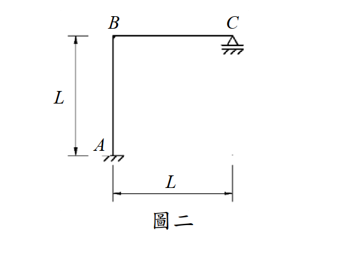

# SA-2016-2 題目正本

> 本檔只記錄考卷上寫了什麼、圖上畫了什麼，不含任何解法。解析見同資料夾 `SA-2016-2.md`。
> 判讀清單經使用者確認前，狀態為「待確認」；確認後本檔原則上不再修改（改動須回考卷原圖並記 log）。

| 項目 | 內容 |
|---|---|
| 考卷 | `raw/exams/SA-2016_結構學.pdf`，第 1 頁（正面），全一張，第二題（圖二） |
| 考年 | 2016（民國一百零五年）專技高考結構工程技師「結構學」 |
| 配分 | 25 分 |
| 附圖 | `SA-2016-2-fig-1.png` |
| 判讀狀態 | **已確認**（2026-11-07 使用者確認；影響答案項目定案：#3 C 為滾支承（使用者確認）。原轉錄：2026-11-07 轉錄；PyMuPDF 110 dpi 整頁＋450–1200 dpi 局部放大；考卷可抽文字，逐字原文以 PDF 文字層核對；盲讀於開啟解析前完成） |

## 1. 考卷原文（逐字）

二、圖二剛架 ABC 使用材料之彈性模數為 E，斷面慣性矩為 I，EI =常數。已知移動載重在 B 點及 C 點之間，不考慮桿件之軸向變形，試繪 C 點反力的影響線（influence line），並列出其方程式。（25 分）

## 2. 考卷給的公式、附表與參數

- 考卷沒有給任何參考公式或附表。
- 幾何以 L 表示（柱高 L、梁長 L），沒有數值；EI 常數，不考慮軸向變形。
- 卷首注意事項：㈠可以用電子計算器。㈡不必抄題，作答時請將試題題號及答案依照順序寫在試卷上，於本試題上作答者，不予計分。
- 考試時間：2 小時。

## 3. 附圖

*證據圖 SA-2016-2-fig-1.png（既有截圖完整、無游標，沿用）*

圖面文字照錄：B、C、A、L、L、圖二

## 4. 判讀清單

| # | 項目 | 判讀 | 圖上／題文依據 | 把握 |
|---|---|---|---|---|
| 1 | 座標 | A(0,0)、B(0,L)、C(L,L) | 左側 L 尺寸線（A 到 B）、下方 L 尺寸線（A 到 C 垂直線） | 確定 |
| 2 | 支承 A | 固定端（柱直接插入剖線地面） | 1200 dpi 局部 | 確定 |
| 3 | 支承 C | 滾支承：三角形坐在一塊板上，板與剖線地面之間另有一條平行線（間隙），只提供垂直反力 | 1200 dpi 局部；與同卷圖一 A 的鉸支承（三角形直接坐在剖線上）畫法不同 | 確定（解讀）：滾支承，請確認；使用者確認 |
| 4 | B 點 | 剛接角點（無鉸圈） | 圖面 | 確定 |
| 5 | 移動載重範圍 | 只在 B、C 之間（梁上） | 題文 | 確定 |
| 6 | 所求 | C 點反力（垂直）影響線，並列出方程式 | 題文 | 確定 |
| 7 | 變形假設 | 不考慮軸向變形；EI 常數 | 題文 | 確定 |
| 8 | 靜不定度 | 一度靜不定（C 為滾支承時） | 支承判讀 | 確定（解讀）；使用者確認 |

---
*轉錄：2026-11-07（SA-U1-3 題目正本推廣・批 1）*
*確認：2026-11-07 使用者確認*
