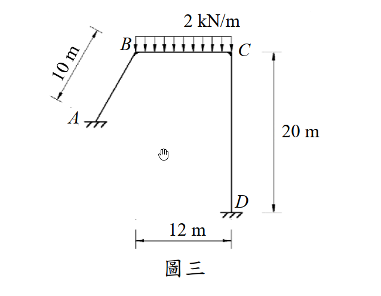
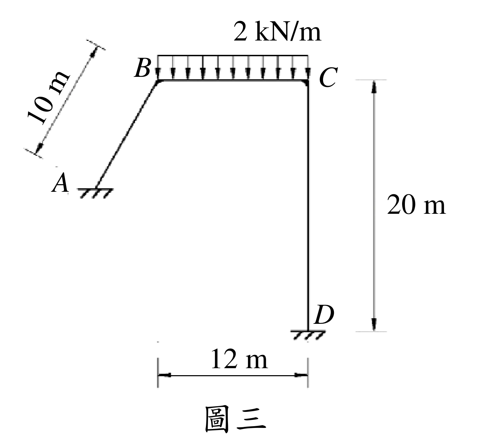

# SA-2016-3 題目正本

> 本檔只記錄考卷上寫了什麼、圖上畫了什麼，不含任何解法。解析見同資料夾 `SA-2016-3.md`。
> 判讀清單經使用者確認前，狀態為「待確認」；確認後本檔原則上不再修改（改動須回考卷原圖並記 log）。

| 項目 | 內容 |
|---|---|
| 考卷 | `raw/exams/SA-2016_結構學.pdf`，第 1 頁（正面）下部，第三題（圖三） |
| 考年 | 2016（民國 105 年）專技高考結構工程技師「結構學」 |
| 配分 | 25 分 |
| 附圖 | `SA-2016-3-fig-1.png`、`SA-2016-3-fig-2.png` |
| 判讀狀態 | **已確認**（2026-11-07 使用者確認。原轉錄：2026-11-07 轉錄；PyMuPDF 110 dpi 整頁＋300–500 dpi 局部放大、PDF 向量座標核對；盲讀於開啟解析前完成） |

## 1. 考卷原文（逐字）

三、圖三剛架使用材料之彈性模數為E，斷面慣性矩為I，EI =常數。已知於BC 間受2 kN/m 的均佈載重時，MAB = -23.2 kN-m、MBC = 5.63 kN-m、MCD = -25.3 kN-m、MDC = -17.0 kN-m，試求此時C 點的變位。（25 分）

## 2. 考卷給的公式、附表與參數

- 考卷沒有給任何參考公式或附表。
- EI 常數，沒有數值（答案以 EI 表示）。
- 題目已給四個桿端彎矩：M_AB＝−23.2、M_BC＝5.63、M_CD＝−25.3、M_DC＝−17.0 kN-m（照錄）；**考卷沒有說明彎矩正負號規約**，也沒有給 M_BA、M_CB。
- 考卷沒有說是否忽略軸向變形。
- **考卷沒有給 AB 斜桿的水平、垂直投影**，只標斜長 10 m；也沒有給 A 與 D 的高差。
- 「C 點的變位」沒有指定方向（水平／垂直／轉角）。
- 沒有指定解法。
- 卷首注意事項：㈠可以用電子計算器。㈡不必抄題，作答時請將試題題號及答案依照順序寫在試卷上，於本試題上作答者，不予計分。
- 考試時間：2 小時。

## 3. 附圖

*證據圖 SA-2016-3-fig-1.png*

*證據圖 SA-2016-3-fig-2.png（2026-11-07 自考卷重新擷取 500 dpi，無游標）*

圖面文字照錄：2 kN/m、10 m、B、C、A、20 m、D、12 m、圖三

## 4. 判讀清單

| # | 項目 | 判讀 | 圖上／題文依據 | 把握 |
|---|---|---|---|---|
| 1 | 構件 | A–B 斜桿、B–C 水平梁、C–D 垂直柱；B、C 剛接 | 圖面（角點圓角、無圓圈） | 確定 |
| 2 | A、D | 皆為固定端（短底線＋剖線，與 2016-1 的鉸支承三角形不同） | 圖面；題給 M_AB ≠ 0 亦相符 | 確定（解讀）；使用者確認 |
| 3 | 幾何 | AB 斜長 10 m；BC＝12 m；CD＝20 m | 10 m 斜向尺寸平行 AB；12 m 尺寸自 B 正下方至 D；20 m 對齊 C 與 D | 確定 |
| 4 | AB 傾角 | 考卷沒有給；圖面量測約 水平 4.8 m、垂直 8.7 m（僅示意） | 圖面像素比例 32 px/m 量得 | 不確定（解讀）；使用者確認 |
| 5 | 載重 | 2 kN/m 向下，只在 B–C 全長 | 題文；載重框對齊 B、C | 確定 |
| 6 | 題給彎矩 | M_AB＝−23.2、M_BC＝5.63、M_CD＝−25.3、M_DC＝−17.0 kN-m | 題文 | 確定 |
| 7 | 考卷沒有給 | 彎矩正負號規約；M_BA、M_CB；AB 投影；軸向變形是否忽略；所求變位的方向 | 題文 | 確定 |
| 8 | 所求 | C 點的變位 | 題文 | 確定 |
| 9 | 證據圖 | 舊 fig-1 構架內有滑鼠游標（未壓在構件上）；新增 fig-2（500 dpi，原圖為點陣圖，放大不增加細節） | — | 確定 |

---
*轉錄：2026-11-07（SA-U2-1 題目正本推廣・批 1）*
*確認：2026-11-07 使用者確認*
