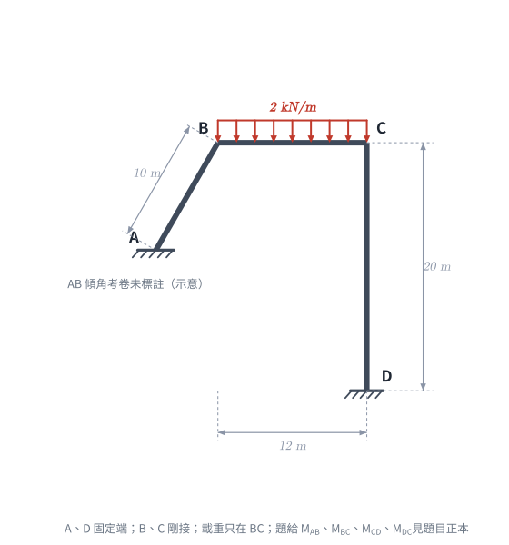
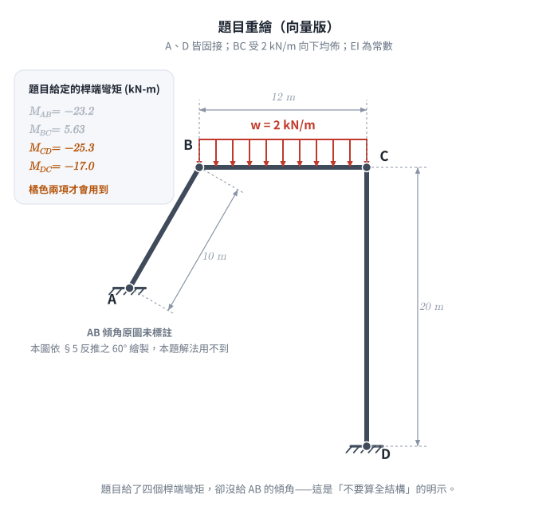
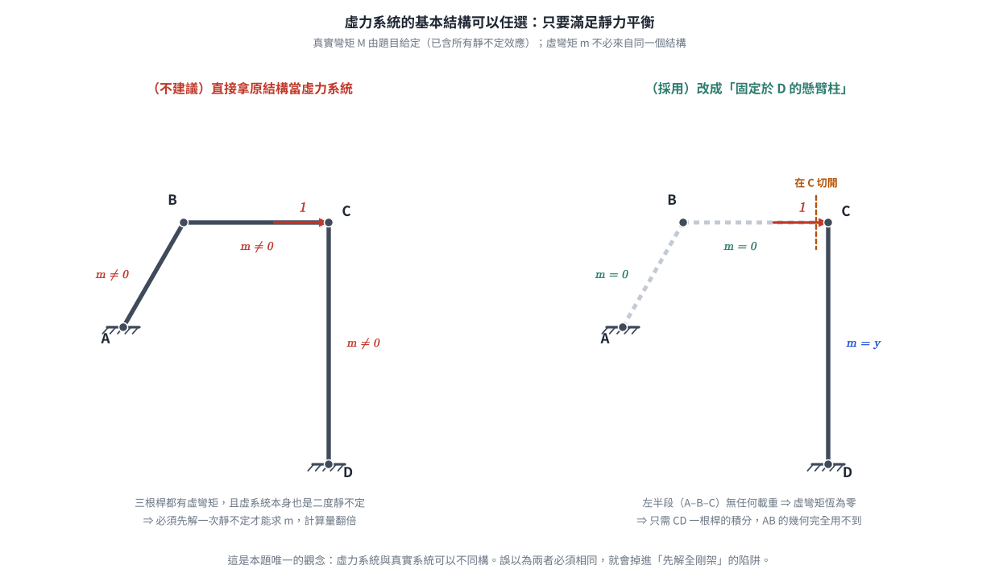
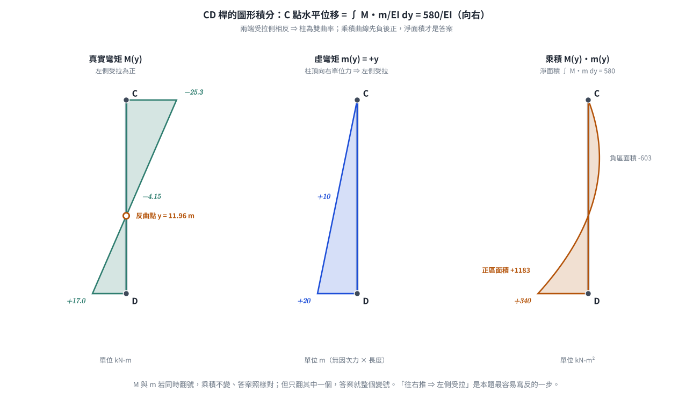

# 考題編號：SA-2016-3

**主分類：** `SA-U2-1` 靜不定結構最小功法
**副分類：** `SA-U2-3` 靜不定結構之傾角變位法
**分析法：** 單位力法（虛功原理） / 圖形積分法
**標籤：** `虛功法` `單位力法` `側移變位` `基本結構選取` `圖形積分法`

---

## 1. 題目（考卷原文見題目正本）

> 考卷原文、公式／附表、附圖與判讀清單（已確認）見 [`SA-2016-3-problem.md`](SA-2016-3-problem.md)。本節只列解題時最容易讀錯的地方與本解使用的記號；題意以題目正本為準。

*重繪自考卷附圖，依判讀清單 #1–#9 重繪；AB 傾角考卷未標註，圖中比例為示意。攔：A 讀成鉸支承、以為缺 AB 傾角就無法作答。*

### 常見誤讀
| 項目 | 正確判讀 | 常見誤讀 |
|---|---|---|
| A 支承 | 固定端（與同卷第一題的鉸支承三角形不同；題給 $M_{AB} \neq 0$） | 鉸支承 |
| AB 傾角 | 考卷沒有給；本題只用 CD 柱即可求 C 點變位 | 自行假設角度後才能解 |
| 彎矩正負號 | 考卷沒有給；本解採傾角變位法慣例，順時針作用於桿端為正 | 反向規約（C 點變位方向會相反） |

**本解記號：** 記號與正負號約定沿用 §4。

### 判讀圖解（解析自繪）

*圖 2　題目重繪（向量版）。四個桿端彎矩中只有橘色的 $M_{CD}$、$M_{DC}$ 會進入計算。它攔下的是「題目給了就一定要用」的直覺，以及把 AB 的傾角當成必要資訊而卡住。*

---

## 2. 考題核心精神與出題者意圖 (Core Concepts & Examiner's Intent)

**核心觀念：** 虛功原理（單位力法）中「虛力系統基本結構」的任意性。

**出題者意圖與破題關鍵：**
這是一道極具鑑別度的「觀念題」。
1. 圖上只標了 $AB = 10\ \text{m}$，**沒有標註 AB 桿的傾角或 A 點座標**。想硬解全剛架，得先反推幾何——而題目根本不打算讓你走這條路。
2. 題目卻給了「所有的桿端彎矩」。
3. 根據虛功原理 $1 \cdot \Delta = \int \frac{M m}{EI} ds$，真實彎矩 $M$ 已經完全已知。而虛彎矩 $m$ 可以建立在**任何滿足靜力平衡的靜定基本結構**上。
4. 若我們巧妙地選擇「**將 CD 視為固定於 D 的懸臂柱**」作為虛力系統的基本結構（相當於切斷 C 點左側），並在 C 點施加虛力，則虛彎矩 $m$ **僅存在於 CD 桿**。
5. 如此一來，積分式中 AB 桿與 BC 桿的 $m = 0$，完全不需要知道 AB 桿的幾何資訊，僅用 CD 桿的已知彎矩即可解出 C 點變位！

**關鍵陷阱：** 給定的 $M_{AB}$ 與 $M_{BC}$ 實際上是**干擾資訊（Distractors）**，用來迷惑觀念不夠清晰的考生，讓他們陷入試圖解出全結構反力與幾何的泥淖中。

---

## 3. 解題戰略地圖與陷阱分析 (Strategic Roadmap & Trap Analysis)

**作戰計畫：**
1. **確認變位方向：** 因不考慮軸向變形，且 CD 為長度 20m 的垂直桿（D 點固定），故 C 點無垂直位移（$\Delta_{Cy} = 0$）。「C 點變位」即指水平側移 $\Delta_{Cx}$。
2. **建立真實彎矩 $M(y)$：** 利用給定的 $M_{CD}$ 與 $M_{DC}$，畫出 CD 桿的彎矩圖。
3. **建立虛力系統 $m(y)$：** 選擇 D 端固定的懸臂柱 CD 為基本結構，於 C 點施加向右的單位力 $P'=1$，求虛彎矩分佈。
4. **圖形積分：** 使用圖形積分法（Simpson's Rule 簡化公式）將 $M$ 圖與 $m$ 圖相乘，求得 $\Delta_{Cx}$。
5. **補充計算轉角：** 實務上「變位」通常指位移，但為求周全，可同理施加單位虛力矩求出 C 點轉角 $\theta_C$。

---

## 3.5 變數層次分析 (Variable Hierarchy Analysis)

> 複習提示：第一次解題後，在每個卡住的知識點旁標記 `⚠`；第二次複習時只看有 `⚠` 的項目。

### 最終目標
`利用單位力法，僅對 CD 桿進行虛功積分，求出 C 點水平位移`

### 本題關鍵公式（依計算順序）

$$\text{Step 1: 定義 } M(y) \text{ 與 } m(y) \text{，以左側受拉為正}$$

$$\text{Step 2: } \Delta_{Cx} = \int_0^{20} \frac{M(y) \cdot m(y)}{EI} dy$$

$$\text{Step 3: 圖形積分 } \int Mm dy = \frac{L}{6}(M_t m_t + 4 M_m m_m + M_b m_b)$$

### L1：題目直接給定
| 符號 | 數值 | 說明 |
|------|------|------|
| $M_{CD}$ | -25.3 kN-m | 依傾角變位法慣例，負號表逆時針作用於桿端 |
| $M_{DC}$ | -17.0 kN-m | 逆時針作用於桿端 D |
| $L_{CD}$ | 20 m | CD 柱長度 |

### L2：需知識點推導
**Step 1：桿端彎矩 → 斷面內彎矩的換算（左側受拉為正）**

換算規則（軸線由 C 指向 D）：**近端同號、遠端反號**。

| 符號 | 公式／來源 | 卡關? |
|------|-----------|:-----:|
| $M_t$ (C 端) | $= M_{CD} = -25.3$ kN-m $\Rightarrow$ C 端**右**側受拉 | |
| $M_b$ (D 端) | $= -M_{DC} = +17.0$ kN-m $\Rightarrow$ D 端**左**側受拉 | |
| $y^*$ (反曲點) | $\dfrac{25.3}{(25.3+17.0)/20} = 11.96$ m（自 C 起算） | |

**Step 2：虛彎矩 $m$ 的建立（懸臂柱模型）**
| 符號 | 公式／來源 | 卡關? |
|------|-----------|:-----:|
| $m(y)$ | $+y$ | 柱頂受向右單位力 $\Rightarrow$ 柱向右彎 $\Rightarrow$ **背向位移的左側受拉**（正值） |

### L3：深層知識（不懂就卡住）
| 知識點 | 說明 | 卡關? |
|--------|------|:-----:|
| **虛功基本結構的任意性** | 虛力系統不需要與原結構有相同的靜不定度，只要滿足靜力平衡與邊界條件即可。這是本題能捨棄 AB、BC 桿的理論基礎。 | |
| **圖形積分法** | 兩個線性函數相乘的定積分，可完美展開為 $\frac{L}{6}(y_1 y_1' + 4 y_m y_m' + y_2 y_2')$，大幅降低計算錯誤率。 | |

---

## 4. 步驟化詳細計算過程 (Step-by-Step Detailed Calculation)

### Step 1：定義座標系與符號慣例
- 關注 CD 桿，設 $y$ 座標由 C 點（頂端）向下起算，$0 \le y \le 20$ m。
- **彎矩正負號：定義使「左側受拉」為正彎矩。**

### Step 2：解析真實彎矩 $M(y)$

題目給的是**桿端彎矩**（傾角變位法慣例：順時針作用於桿端為正，故 $-25.3$、$-17.0$ 皆為**逆時針**）；
虛功積分需要的是**斷面內彎矩**。兩者的換算只有一條規則要記：

> 沿桿件軸線由第一個下標指向第二個下標（此處 C $\to$ D，即 $y$ 向下），
> **近端取同號、遠端取反號**：$M(0) = M_{CD}$，$M(L) = -M_{DC}$。

- **C 端 (頂部, $y=0$)：** $M_{top} = M_{CD} = -25.3$ kN-m $\Rightarrow$ 負值代表 C 端**右側受拉**。
- **D 端 (底部, $y=20$)：** $M_{bot} = -M_{DC} = +17.0$ kN-m $\Rightarrow$ 正值代表 D 端**左側受拉**。
- **中點 ($y=10$)：** CD 桿無側向載重，彎矩沿桿線性變化，$M_{mid} = \dfrac{-25.3 + 17.0}{2} = -4.15$。
- **反曲點：** 兩端受拉側相反 $\Rightarrow$ 柱為**雙曲率**，零彎矩點在
  $y^* = \dfrac{25.3}{(25.3+17.0)/20} = 11.96$ m（自 C 起算）。這正是剛架側移的典型特徵。

### Step 3：建立虛力系統與虛彎矩 $m(y)$
- **基本結構：** 移除 A、B 節點的約束，將 CD 視為固定於 D 的懸臂柱。
- **虛載重：** 於 C 點施加水平向右的單位力 $P'=1$。
- **虛彎矩 $m(y)$：** 距 C 點 $y$ 處，力矩大小為 $1 \cdot y$。
  柱頂被推向右、柱身向右彎，**受拉的是背向位移的左側**，依「左側受拉為正」的約定取正號：
  $$m(y) = +y$$
  - $m_{top} = 0$
  - $m_{mid} = +10$
  - $m_{bot} = +20$

> **⚠ 這裡是本題最容易翻號的地方。** 常見的錯誤直覺是「往右推 $\Rightarrow$ 右側受拉」。
> 以旗桿受風為例：桿頂往下風處移動，受拉的是**迎風面**，也就是**背離位移方向**的那一側。
> 這與水平懸臂梁受向下載重時**上緣**受拉是同一件事。
> （$M$ 與 $m$ 若同時翻號，乘積不變、答案照樣對——但只要翻錯其中一個，答案就整個變號。）

*圖 3　虛力系統的基本結構選取。左圖是多數人的直覺路徑，右圖是本題的解法。它攔下的是「虛力系統必須與真實系統同構」這個誤解——虛系統只需滿足靜力平衡，不必具有相同的靜不定度。*

### Step 4：圖形積分法求水平位移 $\Delta_{Cx}$
根據虛功原理：
$$1 \cdot \Delta_{Cx} = \int_0^{20} \frac{M(y) \cdot m(y)}{EI} dy$$

使用圖形積分公式：
$$\int Mm dy = \frac{L}{6} \left( M_{top} m_{top} + 4 M_{mid} m_{mid} + M_{bot} m_{bot} \right)$$

代入數值：
$$\Delta_{Cx} = \frac{20}{6EI} \left[ (-25.3)(0) + 4(-4.15)(+10) + (+17.0)(+20) \right]$$
$$\Delta_{Cx} = \frac{10}{3EI} \left[ 0 - 166 + 340 \right]$$
$$\Delta_{Cx} = \frac{10}{3EI} \left[ 174 \right] = \frac{1740}{3EI} = \boxed{ \frac{580}{EI} }$$

由於結果為正，表示變位方向與虛力 $P'=1$ 相同，即**向右**。

*圖 4　CD 桿的 $M$ 圖、$m$ 圖與乘積曲線。乘積先負（$-603$）後正（$+1183$），淨面積 $580$ 才是答案。它攔下的是受拉側判斷寫反：$M$ 與 $m$ 同時翻號時答案不變，但只翻其中一個，$580/EI$ 就會變成 $-580/EI$。*

---
**（補充）求 C 點轉角 $\theta_C$**
雖一般「變位」指平移位移，但為求完整，同理可求轉角：
- 虛設系統：於 C 點施加**順時針**單位力矩 $M'=1$（在「左側受拉為正」的約定下，
  順時針施加於懸臂柱頂端對應 $m_\theta(y) = +1$，全桿為常數）。
- $\theta_C^{(順)} = \displaystyle\int_0^{20} \frac{M(y) \cdot 1}{EI} dy = \frac{\text{M 圖淨面積}}{EI}$
- $\theta_C^{(順)} = \dfrac{1}{EI}\left(\dfrac{-25.3 + 17.0}{2}\right) \times 20 = \dfrac{-4.15 \times 20}{EI} = -\dfrac{83}{EI}$
- 結果為負 $\Rightarrow$ 實際轉向與假設的順時針**相反**：

$$\boxed{ \theta_C = \frac{83}{EI} \text{（逆時針）} }$$

---

## 5. 關鍵爭議點與進階探討 (Critical Issues & Advanced Discussion)

**干擾資訊的識別：**
本題給定了 $M_{AB} = -23.2$ 與 $M_{BC} = 5.63$，以及 BC 上的載重 2 kN/m。這些資訊對於計算 C 點變位是**完全不需要**的。這凸顯了結構學考試中，不只要會「算」，更要會「選」——選擇最簡單、最不易出錯的虛功基本結構路徑。

**另解：CD 柱傾角變位式（本題副分類 SA-U2-3 的理由）：**
題給彎矩採傾角變位法規約（順時針為正），D 固定 $\theta_D = 0$、不計軸向變形，CD 柱的兩條傾角變位式剛好解兩個未知數：
$$M_{CD} = \frac{2EI}{20}\left(2\theta_C - 3\psi\right) = -25.3,\qquad M_{DC} = \frac{2EI}{20}\left(\theta_C - 3\psi\right) = -17.0$$
相減得 $\theta_C = -83/EI$（逆時針 $83/EI$），代回得 $\psi = 29/EI$（順時針），$\Delta_{Cx} = 20\psi = 580/EI$（向右）。與單位力法結果完全相同，且不必畫 $M$、$m$ 圖。

**答案的獨立驗算（全剛架模型）：**
題目雖未標 AB 的傾角，仍可反推：取 A 位於 B 左方 $5\ \text{m}$、下方 $5\sqrt{3} \approx 8.66\ \text{m}$
（即 $AB = 10\ \text{m}$、與水平夾 $60^\circ$），以 A、D 皆固接、忽略軸向變形建立**全剛架**模型，
可重現題目給定的四個桿端彎矩：

| 桿端彎矩 | 題目給定 | 全剛架模型 |
|---|---|---|
| $M_{AB}$ | $-23.2$ | $-23.16$ |
| $M_{BC}$ | $+5.63$ | $+5.63$ |
| $M_{CD}$ | $-25.3$ | $-25.29$ |
| $M_{DC}$ | $-17.0$ | $-17.05$ |

同一模型直接讀出 $\Delta_{Cx} = 587.4/EI$（向右）、$\theta_C = 82.4/EI$（逆時針）、$\Delta_{Cy} \approx 0$，
與本題「只積分 CD 桿」得到的 $580/EI$、$83/EI$ 相差約 $1.3\%$。
這個差異**全部來自題目給的桿端彎矩已四捨五入到三位有效數字**——
把未取捨的 $M_{CD} = -25.286$、$M_{DC} = -17.049$ 代入同一條圖形積分式，得到的正是 $587.4/EI$。
換句話說，「捨棄 AB、BC 兩桿」在理論上是**精確**的，不是近似；
考場上以題目給定的數據作答，$580/EI$ 就是正確答案。

**幾何條件的暗示：**
當題目刻意不給定 AB 桿的傾角與 A 點的精確座標時，就是在暗示考生「不要試圖計算全結構」。這種「資訊不足但仍可解」的題型，是國考常見的巧思，旨在獎勵觀念透徹的考生。

---

*圖解補繪：2026-08-28（向量圖，腳本 `gen_SA-2016-3.py`，可重跑）*

*修正日期：2026-11-07（§1 改為指向題目正本並放重繪附圖（figs/SA-2016-3-fig-1-problem.svg）、加常見誤讀；原 §1 解析自繪圖移至「判讀圖解（解析自繪）」；圖由 gen_SA-2016-3_problem.py 產生，可重跑）*
*修正日期：2026-11-07（分類更正（非勘誤）：副分類 SA-U2-2「諧合變位」→ SA-U2-3「傾角變位法」——題給桿端彎矩採傾角變位法規約，CD 柱兩條傾角變位式即可直接解出 C 點轉角與側移（§5 補另解），與諧合變位無關；使用者決定）*
