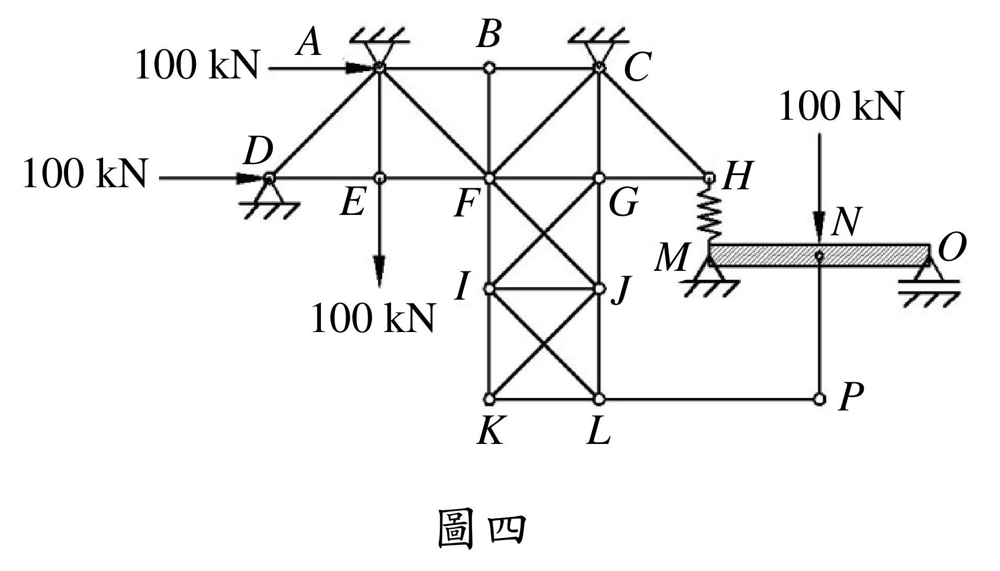

# SA-2016-4 題目正本

> 本檔只記錄考卷上寫了什麼、圖上畫了什麼，不含任何解法。解析見同資料夾 `SA-2016-4.md`。
> 判讀清單經使用者確認前，狀態為「待確認」；確認後本檔原則上不再修改（改動須回考卷原圖並記 log）。

| 項目 | 內容 |
|---|---|
| 考卷 | `raw/exams/SA-2016_結構學.pdf`，背面，第四題（圖四） |
| 考年 | 2016（民國 105 年）專技高考結構工程技師「結構學」 |
| 配分 | 25 分 |
| 附圖 | `SA-2016-4-fig-2.png`（本次從考卷擷取 500 dpi；既有 `SA-2016-4-fig-1.png` 保留） |
| 判讀狀態 | **已確認**（2026-11-07 使用者確認；原轉錄：2026-11-07 轉錄；PyMuPDF 110 dpi 整頁＋500 dpi 局部放大（附圖為內嵌 JPEG）；盲讀於開啟解析前完成） |

## 1. 考卷原文（逐字）

四、圖四右側MNO 梁在M 點以彈簧與左側桁架的H 點連接，彈簧之彈簧常數為k。在圖示的載重下，試判斷此構造中，那些桿件為零桿（zero-force member）。（25 分）

## 2. 考卷給的公式、附表與參數

- 考卷沒有給任何參考公式、尺寸或數值（除載重 100 kN 與彈簧常數符號 k）。
- 考卷沒有給任何尺寸；幾何只能從圖面判讀。
- 卷首注意事項：可以用電子計算器。不必抄題，作答時請將試題題號及答案依照順序寫在試卷上，於本試題上作答者，不予計分。
- 考試時間：2 小時。代號 00360，全一張（正、背面）。

## 3. 附圖

*證據圖 SA-2016-4-fig-2.png（500 dpi，自考卷擷取；舊證據圖 SA-2016-4-fig-1.png 有游標雜訊，保留不改）*

圖面文字照錄：100 kN（A 左）、100 kN（D 左）、100 kN（E 下）、100 kN（N 上）、A、B、C、D、E、F、G、H、I、J、K、L、M、N、O、P、圖四

## 4. 判讀清單

| # | 項目 | 判讀 | 圖上／題文依據 | 把握 |
|---|---|---|---|---|
| 1 | 支承 A、C | 鉸支承於上方（倒三角形加剖線） | 500 dpi 放大 | 確定 |
| 2 | 支承 D | 鉸支承於下方（三角形加剖線） | 500 dpi 放大 | 確定 |
| 3 | 支承 M、O | M 鉸支承；O 滾支承（三角形下有雙線） | 500 dpi 放大 | 確定（解讀）；使用者確認 |
| 4 | 節點列 | 上排 A、B、C；中排 D、E、F、G、H；下列 I、J；底列 K、L；P 在 L 右方同高，N 在 P 正上方（梁上） | 圖面節點小圓 | 確定 |
| 5 | 桿件（上部） | AB、BC；AD、AE、AF；BF；CF、CG、CH | 圖面 | 確定 |
| 6 | 桿件（中排） | DE、EF、FG、GH（共線水平） | 圖面 | 確定 |
| 7 | 桿件（F–G–I–J 格） | FI、GJ 垂直；IJ 水平；斜桿 F–J 與 G–I 交叉，交叉點**沒有節點** | 500 dpi 放大：交叉處無小圓 | 確定 |
| 8 | 桿件（I–J–K–L 格） | IK、JL 垂直；KL 水平；斜桿 I–L 與 J–K 交叉，交叉點沒有節點 | 500 dpi 放大 | 確定 |
| 9 | 桿件（右下） | LP 水平、NP 垂直（N 為梁上節點） | 圖面 | 確定 |
| 10 | 彈簧 | H 與 M 之間以彈簧相連（常數 k） | 題文＋圖面鋸齒線 | 確定 |
| 11 | MNO 梁 | M 至 O 的斜線填充梁，N 為梁上一點 | 題文＋圖面 | 確定 |
| 12 | 載重 | A 點 100 kN 向右；D 點 100 kN 向右；E 點 100 kN 向下；N 點 100 kN 向下。共四個 100 kN | 箭頭起訖：下向箭頭自 E 點向下伸出、「100 kN」字樣在箭頭下端（I 的左方），箭頭不經過 I | 確定 |
| 13 | I 點 | **沒有外力**（「100 kN」只是 E 點載重的標字，位置靠近 I） | 500 dpi 放大：箭頭在 E 的鉛垂線上，與 I 水平相距一格 | 確定 |
| 14 | 考卷沒有給 | 任何尺寸、k 數值；不需數值計算 | 題文 | 確定 |
| 15 | 所求 | 判斷哪些桿件為零桿 | 題文 | 確定 |
| 16 | 證據圖 | 既有 fig-1 左上角有手形游標（未壓到構件）；另擷取 500 dpi 乾淨版 fig-2 | 縮圖總表 | 確定 |

---
*轉錄：2026-11-07（SA 剩餘單元（U1-2 尾段、U2-5、U3-1、U3-2）題目正本推廣・批 1）*
*確認：2026-11-07 使用者確認*
