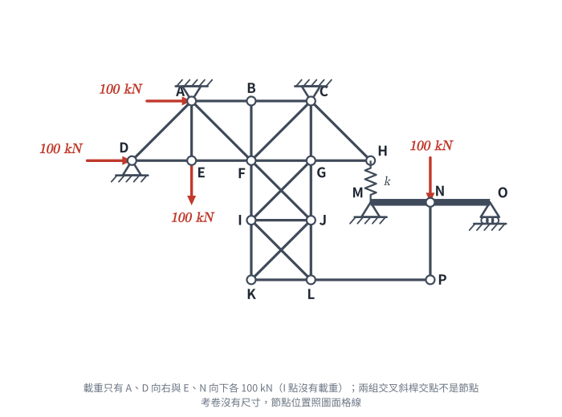
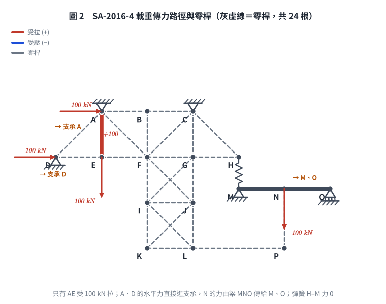

# 考題編號：SA-2016-4

**主分類：** `SA-U1-2` 靜定結構之分析
**副分類：** 無
**分析法：** 節點平衡法 (Method of Joints)
**標籤：** `零力桿件` `桁架` `節點平衡` `支承節點` `相容性`

---

## 1. 題目（考卷原文見題目正本）

> 考卷原文、公式／附表、附圖與判讀清單（已確認）見 [`SA-2016-4-problem.md`](SA-2016-4-problem.md)。本節只列解題時最容易讀錯的地方與本解使用的記號；題意以題目正本為準。

*重繪自考卷附圖，依判讀清單重繪。攔：把 E 點載重讀到 I 點、把交叉斜桿的交點當成節點。*

### 常見誤讀
| 項目 | 正確判讀 | 常見誤讀 |
|---|---|---|
| 向下載重 | 只有 E、N 兩處；「100 kN」字樣在 E 點箭頭下端、靠近 I，但 I 點沒有載重 | E、I、N 三處都有載重 |
| 交叉斜桿 | F–J 與 G–I、I–L 與 J–K 交叉處沒有節點，互不相連 | 交點當成節點 |
| NP 桿 | N 為梁上節點，NP、LP 在 P 點只接兩根桿 | — |
| 支承節點上的載重 | A、D 是鉸支承節點，作用在節點上的 100 kN 水平力直接由支承反力承受 | 以為 A、D 的水平力會流進 AD、AF、DE 等桿 |
| 零桿的範圍 | 題目問「哪些桿件為零桿」＝圖示載重下所有內力為零的桿；只用兩桿／三桿口訣只判得出 3 根，不是全部 | 口訣判完 BF、LP、NP 就停 |

**本解記號：** 零桿＝在圖示載重下內力為零的桿件；本題不需數值計算（考卷沒有尺寸）。

---

## 2. 考題核心精神與出題者意圖 (Core Concepts & Examiner's Intent)

**核心觀念：** 零力桿件的判斷不只靠「兩桿／三桿口訣」，還要看**載重實際怎麼傳到支承**。本題的四個 100 kN 有三個作用在「可以直接被支承或局部構件吃掉」的位置：
- A、D 是鉸支承節點，節點上的水平力直接由支承反力承受，不進入桿件；
- N 點的力由簡支梁 MNO 自己傳給 M、O；P 只接 LP、NP 兩桿，所以 NP、LP 為零；
- E 點的 100 kN 只要 AE 一根桿就能直接送到支承 A。

**出題者意圖：** 圖畫得很複雜（交叉斜桿、彈簧、梁、四個載重），看起來需要解聯立方程式；其實只要找出「每個載重最短的傳力路徑」，再確認這樣的試解同時滿足平衡與相容，就知道整個構造只有 AE 受力，其餘全部是零桿。

**兩個工具：**
1. **零桿口訣**（無外力、無支承的節點）：二桿不共線 ⇒ 兩桿皆零；三桿其中兩桿共線 ⇒ 第三桿為零。
2. **試解＋唯一性**（靜不定結構）：猜一組內力，若①每個節點平衡、②各桿變形與節點位移相容，則它就是線彈性的唯一解。

**關鍵陷阱：**
- **I 點沒有載重**：E 點向下箭頭的「100 kN」字樣寫在箭頭下端、靠近 I，但箭頭在 E 的鉛垂線上（題目正本 #12、#13）。
- **口訣判完不等於判完**：本桁架為 6 次靜不定，口訣只能判出 BF、LP、NP，其餘桿件必須用支承節點不動與相容性才能判定。

---

## 3. 解題戰略地圖與陷阱分析 (Strategic Roadmap & Trap Analysis)

**作戰計畫：**
1. **口訣先掃**：P 點（二桿）⇒ LP、NP；B 點（三桿、AB/BC 共線）⇒ BF。
2. **逐一追蹤四個載重的傳力路徑**：A、D 的水平力 → 支承；N 的力 → 梁 MNO → M、O；E 的力 → AE → 支承 A。
3. **寫出試解**：只有 AE ＝ 100 kN（拉），其餘桿件與彈簧力為 0。
4. **驗證試解**：所有節點平衡；節點位移與桿件伸長量相容 ⇒ 唯一解。

**陷阱：** 把 I 點當成有載重（I 有載重時 FI、IK、IL 等都會受力，答案完全不同）；口訣判出 3 根就停止。

---

## 3.5 變數層次分析 (Variable Hierarchy Analysis)

> 複習提示：第一次解題後，在每個卡住的知識點旁標記 `⚠`；第二次複習時只看有 `⚠` 的項目。

### 最終目標
`找出圖示載重下所有零力桿件 (Zero-Force Members)`

### L1：題目直接給定
| 符號 | 狀態 | 說明 |
|------|------|------|
| A、C、D | 鉸支承節點 | A、D 各受 100 kN 向右 |
| E | 自由節點、受 100 kN 向下 | 接 DE、EF（共線水平）與 AE（垂直） |
| I | 自由節點、**無載重** | 「100 kN」字樣屬於 E 點的箭頭 |
| P | 自由節點、無載重 | 只接 LP、NP 兩桿 |
| B | 自由節點、無載重 | 接 AB、BC（共線）與 BF |
| MNO | 簡支梁（M 鉸、O 滾） | N 受 100 kN 向下；H–M 以彈簧 k 相連 |

### L2：需知識點推導
| 節點／構件 | 推導 | 結論 | 卡關? |
|------|-----------|------|:-----:|
| P 點 | 二桿不共線、無外力 | $F_{LP}=F_{NP}=0$ | |
| B 點 | 垂直 AB、BC 方向 $\Sigma F_y=0$ | $F_{BF}=0$ | |
| 梁 MNO | NP ＝ 0 ⇒ N 點載重由簡支梁自行傳給 M、O | 梁與桁架之間無力傳遞 | |
| E 點 | $\Sigma F_y=0$：$F_{AE}-100=0$ | $F_{AE}=+100$ kN（拉） | |
| A、D 點 | 節點上的水平力由支承反力承受 | 不需任何桿件傳力 | |

### L3：深層知識（不懂就卡住）
| 知識點 | 說明 | 卡關? |
|--------|------|:-----:|
| **靜不定桁架的零桿判斷** | 口訣只能處理「無外力、無支承」的節點。其餘要用試解：若一組內力同時滿足所有節點平衡與變形相容，依線彈性解的唯一性即為真解 | |
| **相容性** | 試解中只有 E 點會動（向下 $100L_{AE}/EA$）；E 的鉛垂位移垂直於 DE、EF，一階不改變其長度；其他桿兩端皆不動 ⇒ 伸長量 0，與零內力相容 | |
| **彈簧 H–M** | H 不動、M 為鉸支承 ⇒ 彈簧不伸縮，力為 0（與 k 值無關） | |

---

## 4. 步驟化詳細計算過程 (Step-by-Step Detailed Calculation)

考卷沒有給尺寸，本題不需數值計算；以下是判斷過程。

### Step 1：口訣判斷（P、B 兩節點）
- **節點 P**：只接 LP（水平）與 NP（垂直）兩根不共線桿件，無外力、無支承。$\Sigma F_x=0 \Rightarrow F_{LP}=0$；$\Sigma F_y=0 \Rightarrow F_{NP}=0$。
- **節點 B**：接 AB、BC（共線水平）與 BF（垂直），無外力、無支承。$\Sigma F_y=0 \Rightarrow F_{BF}=0$。
- 口訣到此只能判出 **LP、NP、BF** 三根；其餘節點都有載重、支承或多於三桿，需要下一步。

### Step 2：追蹤四個載重的傳力路徑
| 載重 | 位置 | 傳力路徑 |
|---|---|---|
| 100 kN → | A（鉸支承節點） | 直接由 A 支承的水平反力承受 |
| 100 kN → | D（鉸支承節點） | 直接由 D 支承的水平反力承受 |
| 100 kN ↓ | N（梁上） | NP ＝ 0 ⇒ 由簡支梁 MNO 傳給 M、O 支承 |
| 100 kN ↓ | E | 經垂直桿 AE 傳到支承 A |

### Step 3：寫出試解並檢查平衡
試解：$F_{AE}=+100$ kN（拉），其餘 24 根桿件與彈簧力皆為 0。
- **E 點**：DE、EF 為 0；$\Sigma F_y$：$F_{AE}$ 向上拉 100 kN 與載重 100 kN 向下抵銷 ✓
- **A 點**（支承）：載重 100 kN → 與 AE 拉力 100 kN ↓ 由支承反力 100 kN ←、100 kN ↑ 承受 ✓
- **D 點**（支承）：載重 100 kN → 由支承反力 100 kN ← 承受 ✓
- **N 點**：由梁 MNO 承受；NP ＝ 0 ✓
- **其餘自由節點**（B、F、G、H、I、J、K、L、P）：無外力、所接桿件皆為 0 ✓

### Step 4：檢查相容性（唯一性）
- 支承 A、C、D、M 不動；試解中只有 AE 伸長，故只有 E 點向下移動 $\delta_E = 100\,L_{AE}/EA_{AE}$。
- DE、EF 是水平桿，E 的鉛垂位移垂直於桿軸，一階不改變其長度 ⇒ 伸長量 0，與零內力相容。
- 其他桿件兩端節點皆不動 ⇒ 伸長量 0；彈簧 H–M 兩端皆不動 ⇒ 力 0。
- 平衡與相容同時成立，依線彈性解唯一性，此試解即為真解，且**與各桿 EA、彈簧常數 k 無關**。

> **交叉驗算**：以直接勁度法建立全結構（25 桿＋彈簧，梁 MNO 以 N 點彈性支承模擬），五組隨機 EA 與 k 重算，每組都只有 $F_{AE}=+100$ kN，其餘桿件與彈簧力 $<10^{-8}$。

---

*圖 2　載重傳力路徑與零桿（以直接勁度法、五組隨機 EA 與 k 重算，結果都相同）。四個 100 kN 各自走最短路徑：A、D 進支承，N 進梁 MNO，E 只經 AE 到支承 A；其他桿件與彈簧都不受力。這張圖攔的是口訣判出 BF、LP、NP 三根就停，以及把 E 點載重讀到 I 點。*

## 5. 結論與最終答案 (Conclusion)

**零桿共 24 根：**
- 上部：AB、BC、AD、AF、BF、CF、CG、CH
- 中排：DE、EF、FG、GH
- 交叉格：FI、GJ、IJ、FJ、GI、IK、JL、KL、IL、JK
- 右下：LP、NP

彈簧 H–M 的力也為 0。**唯一受力桿為 AE ＝ 100 kN（拉力）**；N 點的 100 kN 由簡支梁 MNO 自行傳給 M、O。

**補充說明：**
- 只用兩桿／三桿口訣只能判出 BF、LP、NP 三根（舊版解答即停在這裡）；題目問的是圖示載重下哪些桿件為零桿，應答全部 24 根，並寫出 Step 3、Step 4 的平衡與相容理由。
- 若把 E 點下方的「100 kN」誤讀為作用在 I 點，FI、IK、IL 等桿都會受力，答案完全不同；考卷箭頭在 E 的鉛垂線上，I 點沒有載重。

*修正日期：2026-11-07（§1 改為指向題目正本，補重繪附圖 figs/SA-2016-4-fig-1-problem.svg）*
*修正日期：2026-11-08（盲解比對勘誤：零桿 3 根（BF、LP、NP）→ 24 根，只有 AE 受 100 kN 拉、彈簧力 0；刪除「I 點有載重」的誤讀；§2–§5 改寫為口訣＋傳力路徑＋試解平衡與相容；驗證：節點平衡逐點檢查＋直接勁度法五組隨機 EA／k，MISMATCHES: 0）*

*圖解補繪：2026-11-08（向量圖，腳本 `gen_SA-2016-4.py` 的 fig2_loadpath，以直接勁度法五組隨機 EA／k 重算後 assert，可重跑）*
