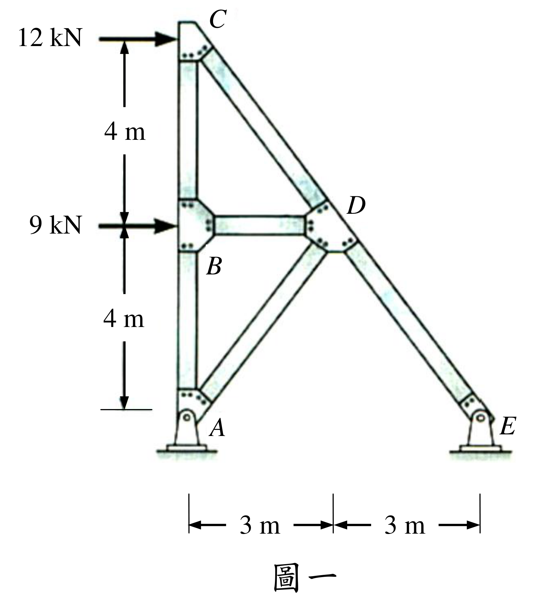

# SA-2017-1 題目正本

> 本檔只記錄考卷上寫了什麼、圖上畫了什麼，不含任何解法。解析見同資料夾 `SA-2017-1.md`。
> 判讀清單經使用者確認前，狀態為「待確認」；確認後本檔原則上不再修改（改動須回考卷原圖並記 log）。

| 項目 | 內容 |
|---|---|
| 考卷 | `raw/exams/SA-2017_結構學.pdf`，第 1 頁（正面），第一題（圖一） |
| 考年 | 2017（民國 106 年）專技高考結構工程技師「結構學」 |
| 配分 | 30 分（㈠15 分、㈡15 分） |
| 附圖 | `SA-2017-1-fig-2.png`（本次從考卷擷取 500 dpi；既有 `SA-2017-1-fig-1.png` 保留） |
| 判讀狀態 | **已確認**（2026-11-07 使用者確認；影響答案項目定案：#3、#5 桿件為 AB、BC、BD、AD、CD、DE，無 AC、BE（使用者確認；解析同日勘誤）。原轉錄：2026-11-07 轉錄；PyMuPDF 110 dpi 整頁＋300–500 dpi 局部放大（附圖為內嵌點陣圖，照片式桁架）；盲讀於開啟解析前完成） |

## 1. 考卷原文（逐字）

一、圖一為平面桁架結構，尺寸和水平載重如圖所示，點A 和點E 為鉸支承，所有桿件的彈性模數E 與斷面積A 皆為定值。試求：

㈠各桿件之內力（需註明拉力或壓力）。（15 分）

㈡結點C 之水平位移（需註明方向）。（15 分）

## 2. 考卷給的公式、附表與參數

- 考卷沒有給任何參考公式或附表。
- 給定：E、A 為定值（沒有數值）。
- 卷首注意事項：㈠可以使用電子計算器。㈡不必抄題，作答時請將試題題號及答案依照順序寫在試卷上，於本試題上作答者，不予計分。㈢本科目除專門名詞或數理公式外，應使用本國文字作答。
- 考試時間：2 小時。代號 00360，全一張（正、背面）。

## 3. 附圖

*證據圖 SA-2017-1-fig-2.png（500 dpi，自考卷擷取；舊證據圖 SA-2017-1-fig-1.png 有游標雜訊，保留不改）*

圖面文字照錄：12 kN、9 kN、4 m、4 m、3 m、3 m、A、B、C、D、E、圖一

## 4. 判讀清單

| # | 項目 | 判讀 | 圖上／題文依據 | 把握 |
|---|---|---|---|---|
| 1 | 支承 | A、E 鉸支承（銷座） | 題文＋圖面 | 確定 |
| 2 | 座標 | A(0,0)、B(0,4)、C(0,8)、D(3,4)、E(6,0)（m） | 垂直尺寸 4｜4 m 對齊 C、B、A 基準線；水平尺寸 3｜3 m 對齊 A、D、E | 確定 |
| 3 | 桿件 | AB、BC（左柱分兩段）、BD（水平）、**AD（斜，A→D，長 5 m）**、CD、DE；共 6 根 | 300 dpi 放大：自 A 節點板伸出的斜桿終止於 D 節點板下緣；B、E 之間沒有桿件 | 確定 |
| 4 | CD、DE | C、D、E 共線（同一斜率 −4/3），在 D 以節點板分成兩根桿件 | 座標；圖面 D 處節點板 | 確定 |
| 5 | A–C 直桿 | **沒有**另一根 A–C 全高桿；左柱在 B 有節點板，分為 AB、BC | 圖面 | 確定 |
| 6 | 載重 | C 點 12 kN 水平向右；B 點 9 kN 水平向右 | 箭頭位置對齊 C、B 高度 | 確定 |
| 7 | 靜定性 | m＝6、r＝4、j＝5：10＝10，靜定 | 計數 | 確定（解讀）；使用者確認 |
| 8 | 考卷沒有給 | E、A 數值、垂直載重、自重 | 題文 | 確定 |
| 9 | 所求 | ㈠各桿內力（拉／壓）；㈡結點 C 水平位移（方向） | 題文 | 確定 |
| 10 | 證據圖 | 既有 fig-1 在 B 左方有小游標；另擷取 500 dpi 乾淨版 fig-2 | 縮圖總表 | 確定 |

---
*轉錄：2026-11-07（SA 剩餘單元（U1-2 尾段、U2-5、U3-1、U3-2）題目正本推廣・批 1）*
*確認：2026-11-07 使用者確認*
