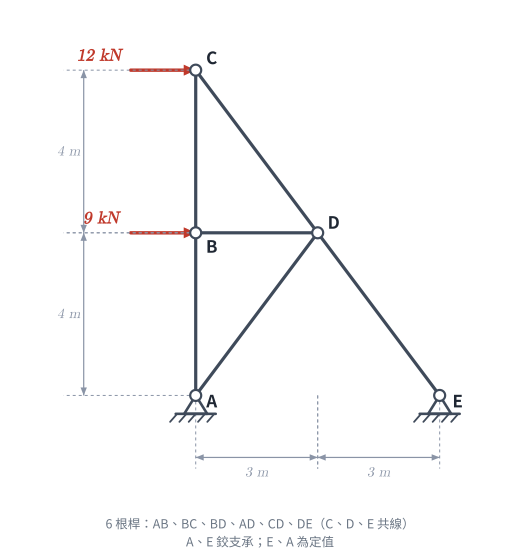

# 考題編號：SA-2017-1

**主分類：** `SA-U1-2` 靜定結構之分析
**副分類：** 無
**分析法：** 節點法 + 虛功法（單位力法）
**標籤：** `靜定桁架` `節點法` `虛功法` `水平位移` `3-4-5 斜桿`

---

## 1. 題目（考卷原文見題目正本）

> 考卷原文、公式／附表、附圖與判讀清單（已確認）見 [`SA-2017-1-problem.md`](SA-2017-1-problem.md)。本節只列解題時最容易讀錯的地方與本解使用的記號；題意以題目正本為準。

*重繪自考卷附圖，依判讀清單重繪。攔：把自 A 伸出的斜桿讀成 B–E、多補一根 A–C 全高桿（舊解的讀法，2026-11-07 勘誤）。*

### 常見誤讀
| 項目 | 正確判讀 | 常見誤讀 |
|---|---|---|
| 左下斜桿 | A–D（自 A 節點板接到 D 節點板下緣，長 5 m） | B–E（長 2√13 m） |
| 左柱 | 在 B 有節點板，分成 AB、BC 兩根 | 另有一根 A–C 全高桿 |
| 桿件數 | 6 根，m＋r＝6＋4＝10＝2j，靜定 | 7 根 |
| C、D、E | 共線（斜率 −4/3），在 D 分成 CD、DE 兩根 | — |

**本解記號：** 座標以 A 為原點（m）；桿力 $F_{ij}$ 拉為正；反力 $A_x, A_y, E_x, E_y$ 以向右、向上為正；虛擬系統為 C 點 1 kN 向右，虛擬桿力 $\bar f_{ij}$；$\delta_C$ 向右為正。

**子問題：**
1. 各桿件內力（註明拉力或壓力）（15 分）
2. 結點 C 的水平位移（註明方向）（15 分）

---

## 2. 考題核心精神與出題者意圖 (Core Concepts & Examiner's Intent)

**核心觀念：** 靜定桁架的完整解析流程——從平衡方程式求支承反力，到節點法逐一求各桿內力，再到虛功法（單位力法）求特定點位移。

**出題者意圖：**
- 測驗**節點法的執行順序**——先找只有兩根未知桿的節點（C、E），再推到 D、B、A。
- 測驗兩個鉸支承同時有水平反力時，水平反力要靠節點平衡才分得開（整體平衡只給 $A_x + E_x$）。
- 測驗**虛功法的完整應用**：在虛擬載重體系下重新解一次桁架，再帶入公式計算位移。

**潛在陷阱：**
- 判讀桿件配置：自 A 伸出的斜桿接到 D，不是 B–E。
- 虛擬體系只有 C 點 1 kN，B 點的 9 kN 不能帶進去。

---

## 3. 解題戰略地圖與陷阱分析 (Strategic Roadmap & Trap Analysis)

**步驟化作戰計畫：**
1. 整體平衡：對 A 取矩求 $E_y$，$\sum F_y$ 求 $A_y$
2. 節點 C（BC、CD 兩根未知）→ $F_{CD}$、$F_{BC}$
3. 節點 E（DE 一根未知加 $E_x$）→ $F_{DE}$、$E_x$
4. 節點 D → $F_{AD}$、$F_{BD}$
5. 節點 B → $F_{AB}$；節點 A → $A_x$ 並驗算
6. 虛擬載重（C 點 1 kN 向右）→ 重複步驟 1–5 求 $\bar f_i$
7. 虛功原理求 $\delta_C$

**⚠ 陷阱一：桿件配置**
自 A 伸出的斜桿接到 D（A→D 為 3-4-5 方向），B 與 E 之間沒有桿件；左柱在 B 斷成 AB、BC。

**⚠ 陷阱二：兩個鉸支承的水平反力**
整體 $\sum F_x$ 只能得到 $A_x + E_x = -21$ kN；要用節點 E 的 $\sum F_x$ 先求 $E_x$，再由整體或節點 A 求 $A_x$。

**⚠ 陷阱三：BD 不是零桿**
D 點接四根桿（BD、AD、CD、DE），零桿法則用不上；由節點 D 的 $\sum F_x$ 得 $F_{BD} = -9$ kN（壓），正好平衡 B 點的 9 kN。

**⚠ 陷阱四：虛擬體系求 $\bar{E}_y$**
虛擬體系外力只有 C 點 1 kN 向右，需重新對 A 取矩求 $\bar{E}_y = 1 \times 8/6 = 4/3$ kN。

---

## 3.5 變數層次分析 (Variable Hierarchy Analysis)

> 複習提示：第一次解題後，在每個卡住的知識點旁標記 `⚠`；第二次複習時只看有 `⚠` 的項目。

### 最終目標

求各桿件內力（拉／壓），並以虛功法求 **C 點水平位移** $\delta_C$（方向）。

### 本題關鍵公式（依計算順序）

$$\text{Step 1：} \quad \sum M_A = 0 \implies E_y = \frac{12 \times 8 + 9 \times 4}{6} = 22 \text{ kN}$$

$$\text{Step 2（節點 C）：} \quad \sum F_x = 0 \implies F_{CD} = -\frac{12}{3/5} = -20 \text{ kN}$$

$$\text{Step 3（節點 E）：} \quad \sum F_y = 0 \implies F_{DE} = -\frac{E_y}{4/5} = -27.5 \text{ kN}$$

$$\text{Step 4（節點 D）：} \quad \sum F_y = 0 \implies F_{AD} = \frac{\tfrac45 (F_{CD} - F_{DE})}{4/5} = 7.5 \text{ kN}$$

$$\text{Step 5（虛功法）：} \quad \delta_C = \frac{1}{EA}\sum_i F_i \cdot \bar{f}_i \cdot L_i$$

### L1：題目直接給定

| 符號 | 數值 | 說明 |
|------|------|------|
| $F_C$ | 12 kN (→) | C 點外力 |
| $F_B$ | 9 kN (→) | B 點外力 |
| $L_{AB} = L_{BC}$ | 4 m | 左柱兩段 |
| $L_{BD}$ | 3 m | 水平桿 |
| $x_D$、$x_E$ | 3 m、6 m | D、E 的水平距離 |
| $EA$ | 定值 | 所有桿件相同 |

### L2：需知識點推導

**【全域平衡】**

| 符號 | 公式／來源 | 卡關? |
|------|-----------|-------|
| $E_y$ | $\sum M_A = 0$，$(12 \times 8 + 9 \times 4)/6 = 22$ kN ↑ | |
| $A_y$ | $\sum F_y = 0$，$A_y = -22$ kN（↓） | |
| $A_x + E_x$ | $\sum F_x = 0$，$= -21$ kN | |

**【各桿內力（節點法）】**

| 符號 | 公式／來源 | 卡關? |
|------|-----------|-------|
| $L_{AD} = L_{CD} = L_{DE}$ | $\sqrt{3^2+4^2} = 5$ m（3-4-5 桿） | |
| $F_{CD}$ | 節點 C，$\sum F_x$：$-20$ kN（壓） | |
| $F_{BC}$ | 節點 C，$\sum F_y$：$16$ kN（拉） | |
| $F_{DE}$ | 節點 E，$\sum F_y$：$-27.5$ kN（壓） | |
| $E_x$ | 節點 E，$\sum F_x$：$-16.5$ kN（←） | |
| $F_{AD}$ | 節點 D，$\sum F_y$：$7.5$ kN（拉） | |
| $F_{BD}$ | 節點 D，$\sum F_x$：$-9$ kN（壓） | |
| $F_{AB}$ | 節點 B，$\sum F_y$：$16$ kN（拉） | |
| $A_x$ | 節點 A，$\sum F_x$：$-4.5$ kN（←） | |

**【虛擬內力（$\bar{P}=1$ 在 C 點向右）】**

| 符號 | 公式／來源 | 卡關? |
|------|-----------|-------|
| $\bar{E}_y$ | $\sum M_A = 0$：$1 \times 8/6 = 4/3$ kN ↑ | |
| $\bar{F}_{CD}$、$\bar F_{BC}$ | 節點 C：$-5/3$、$+4/3$ kN | |
| $\bar{F}_{DE}$ | 節點 E：$-5/3$ kN | |
| $\bar{F}_{AD}$、$\bar F_{BD}$ | 節點 D：$0$、$0$ | |
| $\bar{F}_{AB}$ | 節點 B：$4/3$ kN | |

**【位移計算】**

| 符號 | 公式／來源 | 卡關? |
|------|-----------|-------|
| $\sum F_i \bar{f}_i L_i$ | 各桿貢獻之和（見 §4.5） | |
| $\delta_C$ | $\frac{1}{EA}\sum F_i \bar{f}_i L_i$ | |

### L3：深層知識（不懂就卡住）

| 知識點 | 說明 | 卡關? |
|--------|------|-------|
| 判讀桿件 | 每根桿以節點板為界；看斜桿兩端各接在哪一塊節點板 | |
| 節點法的執行順序 | 從只有兩個未知數的節點開始（C、E → D → B → A） | |
| 兩鉸支承桁架 | 4 個反力但仍靜定（m＋r＝2j）；水平反力靠節點平衡分配 | |
| 虛功法（單位力法） | $\delta = \sum \frac{F_i \bar{f}_i L_i}{EA}$；$F_i$ 為真實內力，$\bar{f}_i$ 為單位虛擬力引起的內力 | |

---

## 4. 步驟化詳細計算過程 (Step-by-Step Detailed Calculation)

### 4.1 整體平衡求支承反力

對 A 點取矩（$y_E = y_A = 0$，故 $E_x$ 對 A 的力矩臂為零）：

$$\sum M_A = 0: \quad 12 \times 8 + 9 \times 4 - E_y \times 6 = 0 \implies E_y = \frac{132}{6} = 22 \text{ kN} \uparrow$$

$$\sum F_y = 0: \quad A_y + E_y = 0 \implies A_y = -22 \text{ kN}\ (\downarrow)$$

$$\sum F_x = 0: \quad A_x + E_x + 12 + 9 = 0 \implies A_x + E_x = -21 \text{ kN}$$

### 4.2 節點法求各桿內力

方向餘弦：C→D、A→D 皆為 3-4-5（$\cos = 3/5$、$\sin = 4/5$），D→E 為 $(3/5,\ -4/5)$。

**節點 C**（BC、CD，受 12 kN →）：
$$\sum F_x = 0: \quad 12 + F_{CD} \cdot \frac{3}{5} = 0 \implies \boxed{F_{CD} = -20 \text{ kN（壓）}}$$
$$\sum F_y = 0: \quad -F_{BC} - F_{CD} \cdot \frac{4}{5} = 0 \implies \boxed{F_{BC} = 16 \text{ kN（拉）}}$$

**節點 E**（DE，反力 $E_x$、$E_y = 22$ kN）：E→D 方向 $(-3/5,\ 4/5)$
$$\sum F_y = 0: \quad 22 + F_{DE} \cdot \frac{4}{5} = 0 \implies \boxed{F_{DE} = -27.5 \text{ kN（壓）}}$$
$$\sum F_x = 0: \quad E_x - F_{DE} \cdot \frac{3}{5} = 0 \implies E_x = -16.5 \text{ kN}\ (\leftarrow)$$

**節點 D**（BD、AD、CD、DE，無外力）：D→C $(-\tfrac35, \tfrac45)$、D→E $(\tfrac35, -\tfrac45)$、D→A $(-\tfrac35, -\tfrac45)$、D→B $(-1, 0)$
$$\sum F_y = 0: \quad \frac45 F_{CD} - \frac45 F_{DE} - \frac45 F_{AD} = 0 \implies -16 + 22 - \frac45 F_{AD} = 0 \implies \boxed{F_{AD} = 7.5 \text{ kN（拉）}}$$
$$\sum F_x = 0: \quad -\frac35 F_{CD} + \frac35 F_{DE} - \frac35 F_{AD} - F_{BD} = 0 \implies 12 - 16.5 - 4.5 - F_{BD} = 0 \implies \boxed{F_{BD} = -9 \text{ kN（壓）}}$$

**節點 B**（AB、BC、BD，受 9 kN →）：
$$\sum F_x = 0: \quad 9 + F_{BD} = 9 - 9 = 0 \ ✓$$
$$\sum F_y = 0: \quad F_{BC} - F_{AB} = 0 \implies \boxed{F_{AB} = 16 \text{ kN（拉）}}$$

**節點 A**（AB、AD，反力 $A_x$、$A_y = -22$）：
$$\sum F_y = 0: \quad -22 + F_{AB} + \frac45 F_{AD} = -22 + 16 + 6 = 0 \ ✓$$
$$\sum F_x = 0: \quad A_x + \frac35 F_{AD} = 0 \implies A_x = -4.5 \text{ kN}\ (\leftarrow)$$

整體驗算：$A_x + E_x = -4.5 - 16.5 = -21$ kN ✓

### 4.3 各桿內力彙整

| 桿件 | 長度 $L$ (m) | 內力 $F_i$ (kN) | 受力狀態 |
|------|------------|----------------|---------|
| AB   | 4 | +16 | **拉力** |
| BC   | 4 | +16 | **拉力** |
| BD   | 3 | −9 | **壓力** |
| AD   | 5 | +7.5 | **拉力** |
| CD   | 5 | −20 | **壓力** |
| DE   | 5 | −27.5 | **壓力** |

反力：$A_x = 4.5$ kN ←、$A_y = 22$ kN ↓、$E_x = 16.5$ kN ←、$E_y = 22$ kN ↑。

### 4.4 虛擬內力體系（C 點施加 $\bar{P}=1$ kN →）

$\bar{E}_y = \frac{1 \times 8}{6} = \frac{4}{3}$ kN ↑，$\bar A_y = -\frac43$ kN；節點 E 得 $\bar E_x = -1$ kN，節點 A 得 $\bar A_x = 0$。

| 桿件 | 虛擬內力 $\bar{f}_i$ (kN) | 來源 |
|------|--------------------------|------|
| AB   | +4/3 | 節點 B |
| BC   | +4/3 | 節點 C |
| BD   | 0 | 節點 D |
| AD   | 0 | 節點 D |
| CD   | −5/3 | 節點 C |
| DE   | −5/3 | 節點 E |

### 4.5 虛功法求 C 點水平位移

$$\delta_C = \frac{1}{EA} \sum_i F_i \cdot \bar{f}_i \cdot L_i$$

| 桿件 | $F_i$ | $\bar{f}_i$ | $L_i$ | $F_i \bar{f}_i L_i$ |
|------|-------|------------|-------|---------------------|
| AB   | 16 | 4/3 | 4 | $\frac{256}{3}$ |
| BC   | 16 | 4/3 | 4 | $\frac{256}{3}$ |
| BD   | −9 | 0 | 3 | 0 |
| AD   | 7.5 | 0 | 5 | 0 |
| CD   | −20 | −5/3 | 5 | $\frac{500}{3}$ |
| DE   | −27.5 | −5/3 | 5 | $\frac{1375}{6}$ |
| **合計** | | | | $\dfrac{512 + 500}{3} + \dfrac{1375}{6} = \dfrac{3399}{6} = 566.5$ |

$$\boxed{\delta_C = \frac{566.5}{EA} \text{ m} \quad (\text{向右；}EA \text{ 以 kN 計})}$$

**方向說明：** $\delta_C > 0$，與虛擬力方向相同，故 C 點水平位移**向右**。

**交叉驗算：** 以直接勁度法（EA＝1，A、E 鉸支）直接解 C 點水平位移，得 566.5，與虛功法相同。

---

## 5. 關鍵爭議點與進階探討 (Critical Issues & Advanced Discussion)

**爭議一：兩個鉸支承的水平反力怎麼分**
整體平衡只給 $A_x + E_x = -21$ kN。本題 E 點只接一根桿（DE），由節點 E 的 $\sum F_x$ 直接得 $E_x = -16.5$ kN，剩下的 $A_x = -4.5$ kN。兩鉸支承的桁架仍是靜定，前提是 m＋r＝2j 且幾何穩定。

**爭議二：虛功法的符號約定**
向右為正（與虛擬力方向一致）。本題 $\sum F_i \bar{f}_i L_i = 566.5 > 0$，C 點向右位移，與外力皆向右的直覺一致。

**爭議三：虛擬系統中 AD、BD 為零**
虛擬系統只有 C 點水平力，節點 D 上 CD、DE 兩力的水平、垂直分量互相抵消，AD、BD 不受力；所以真實系統中 AD、BD 的內力不貢獻 C 點水平位移，但仍要算出來回答第㈠小題。

---
*修正日期：2026-11-07（§1 改為指向題目正本，補重繪附圖 figs/SA-2017-1-fig-1-problem.svg）*
*修正日期：2026-11-07（讀題勘誤：桿件配置改依考卷為 AB、BC、BD、AD、CD、DE（舊解誤為 AC＋BE），AB 22→16、BD 0→−9、DE −20→−27.5 kN，新增 AD +7.5 kN，反力 A_x 0→4.5←、E_x 21←→16.5←，δ_C 536/EA → 566.5/EA（向右）；§2、§3、§3.5、§4、§5 依新配置改寫；驗證：節點法 sympy 精確解＋直接勁度法兩路徑，24 個數值 MISMATCHES: 0）*
