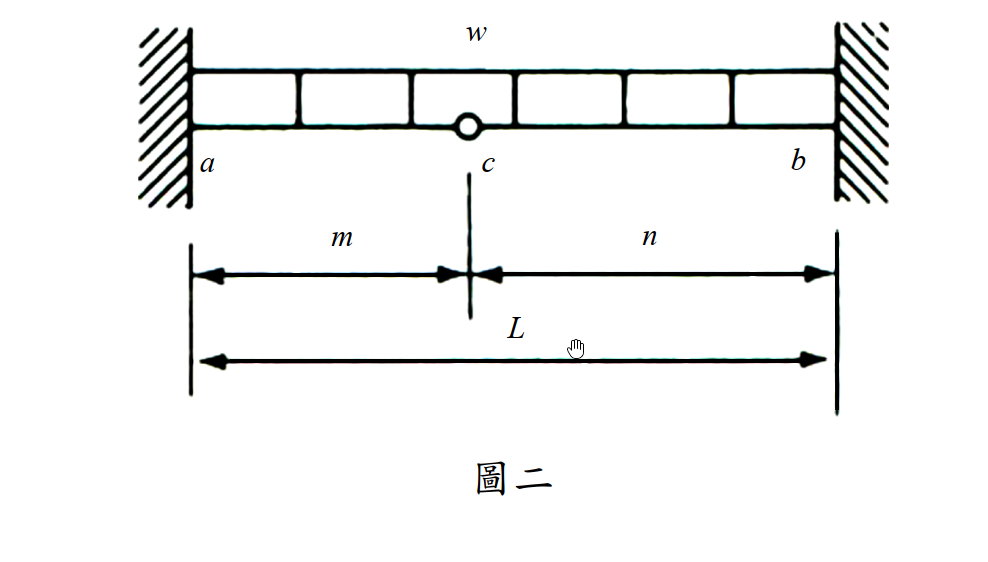
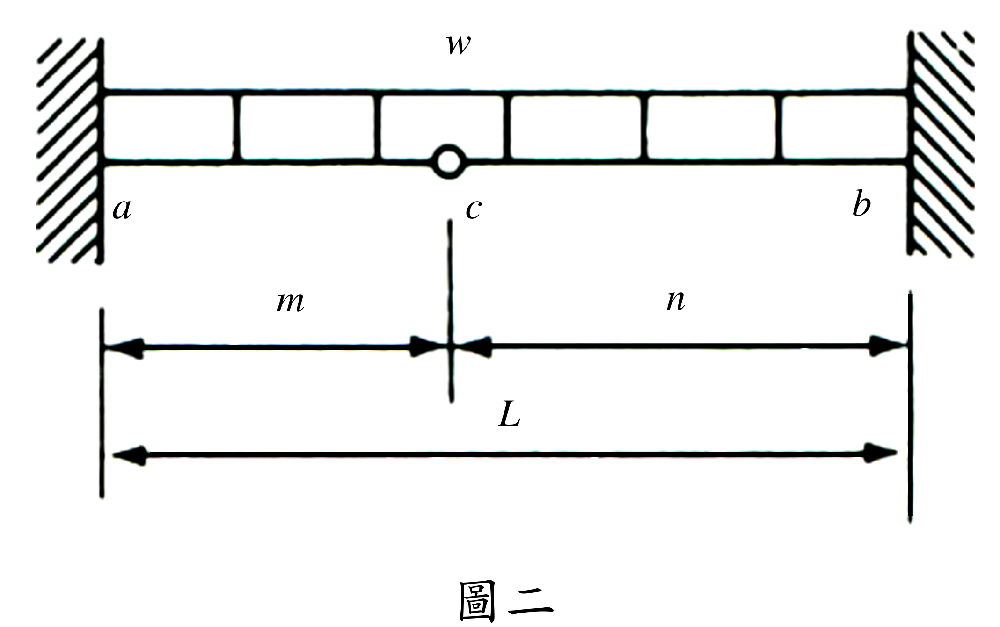

# SA-2017-2 題目正本

> 本檔只記錄考卷上寫了什麼、圖上畫了什麼，不含任何解法。解析見同資料夾 `SA-2017-2.md`。
> 判讀清單經使用者確認前，狀態為「待確認」；確認後本檔原則上不再修改（改動須回考卷原圖並記 log）。

| 項目 | 內容 |
|---|---|
| 考卷 | `raw/exams/SA-2017_結構學.pdf`，第 1 頁（正面）下半，第二題（圖二） |
| 考年 | 2017（民國 106 年）專技高考結構工程技師「結構學」 |
| 配分 | 20 分 |
| 附圖 | `SA-2017-2-fig-1.png`、`SA-2017-2-fig-2.png` |
| 判讀狀態 | **已確認**（2026-11-07 使用者確認。原轉錄：2026-11-07 轉錄；PyMuPDF 110 dpi 整頁＋300–500 dpi 局部放大、PDF 向量座標核對；盲讀於開啟解析前完成） |

## 1. 考卷原文（逐字）

二、圖二為梁結構，尺寸和均佈載重如圖所示，點c 為鉸接，所有桿件的彈性模數E 與斷面慣性矩I 皆為定值。試以最小功法求固定端彎矩（需註明方向，採用其它方法計算不予計分）。（20 分）

## 2. 考卷給的公式、附表與參數

- 考卷沒有給任何參考公式或附表。
- E、I 為定值；尺寸只有符號 m、n、L（沒有數值）。
- 指定方法：最小功法；他法不計分。
- 需註明彎矩方向。
- 卷首注意事項：㈠可以使用電子計算器。㈡不必抄題，作答時請將試題題號及答案依照順序寫在試卷上，於本試題上作答者，不予計分。㈢本科目除專門名詞或數理公式外，應使用本國文字作答。
- 考試時間：2 小時。

## 3. 附圖

*證據圖 SA-2017-2-fig-1.png*

*證據圖 SA-2017-2-fig-2.png（2026-11-07 自考卷重新擷取 500 dpi，無游標）*

圖面文字照錄：w、a、c、b、m、n、L、圖二

## 4. 判讀清單

| # | 項目 | 判讀 | 圖上／題文依據 | 把握 |
|---|---|---|---|---|
| 1 | a、b | 兩端皆固定端 | 牆面剖線 | 確定 |
| 2 | c | 梁內鉸（空心圓），距 a 為 m、距 b 為 n，m＋n＝L | 尺寸線分界對齊 c | 確定 |
| 3 | 載重 | 均布載重 w 滿跨 a–b（方塊列為均布載重符號，不是構件） | 方塊列兩端接牆 | 確定（解讀）；使用者確認 |
| 4 | m、n | 一般值（圖上 c 不在中點，約 0.43 L） | 圖面比例 | 確定（解讀）；使用者確認 |
| 5 | 考卷沒有給 | 數值尺寸；軸向變形（梁、無軸力） | 題文 | 確定 |
| 6 | 靜不定度 | 固定 6 反力－3 方程式－內鉸 1＝二度（水平反力為零後一度） | 計數 | 確定 |
| 7 | 所求 | 固定端彎矩（a、b 兩端，需註明方向）；最小功法 | 題文 | 確定 |
| 8 | 證據圖 | 舊 fig-1 的滑鼠游標在 L 字旁；新增 fig-2（500 dpi，原圖為點陣圖） | — | 確定 |

---
*轉錄：2026-11-07（SA-U2-1 題目正本推廣・批 1）*
*確認：2026-11-07 使用者確認*
