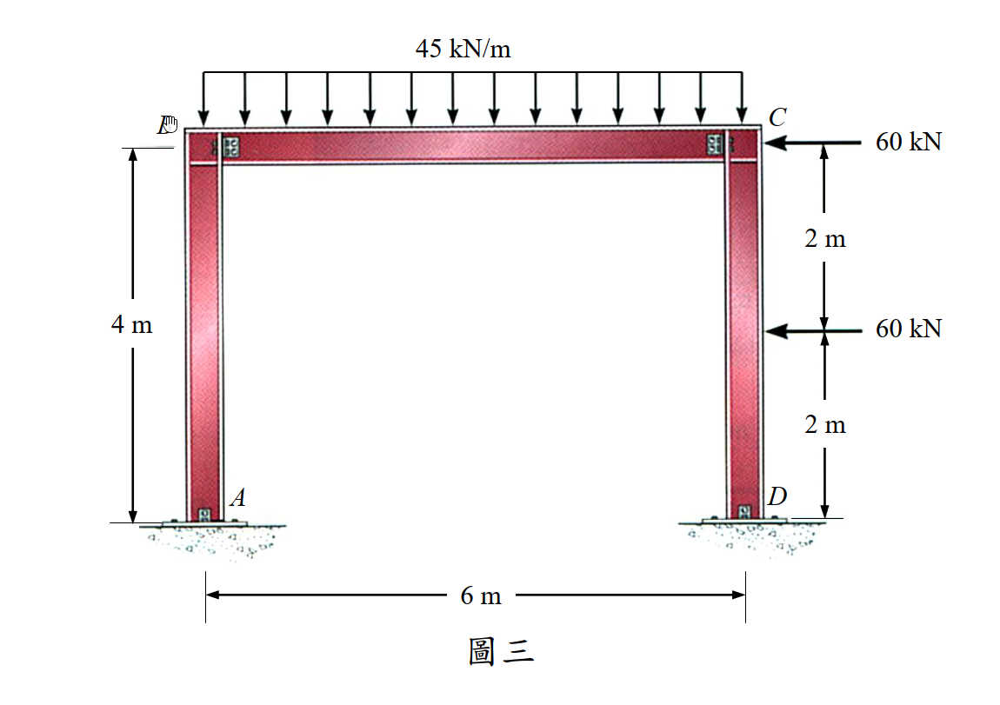

# SA-2017-3 題目正本

> 本檔只記錄考卷上寫了什麼、圖上畫了什麼，不含任何解法。解析見同資料夾 `SA-2017-3.md`。
> 判讀清單經使用者確認前，狀態為「待確認」；確認後本檔原則上不再修改（改動須回考卷原圖並記 log）。

| 項目 | 內容 |
|---|---|
| 考卷 | `raw/exams/SA-2017_結構學.pdf`，第 2 頁上半，第三題（圖三） |
| 考年 | 2017（民國 106 年）專技高考結構工程技師「結構學」 |
| 配分 | 30 分 |
| 附圖 | `SA-2017-3-fig-1.png` |
| 判讀狀態 | **待確認**（2026-11-05 轉錄；PyMuPDF 110 dpi 整頁＋250 dpi 局部放大；盲讀於開啟解析前完成） |

## 1. 考卷原文（逐字）

三、圖三為剛架結構，尺寸和載重如圖所示，點 A 和點 D 為鉸支承，點 B 和點 C 為固接，所有桿件的彈性模數 E 與斷面慣性矩 I 皆為定值。試以傾角變位法求各桿件端點之彎矩，以及點 A 和點 D 之轉角（需註明方向，採用其它方法計算不予計分）。（30 分）

## 2. 考卷給的公式、附表與參數

- 考卷沒有給任何參考公式或附表。
- 附圖為鋼構照片式插圖（柱腳底板、梁柱螺栓接頭），支承型式以題文為準。
- 卷首注意事項：㈠可以使用電子計算器。㈡不必抄題，作答時請將試題題號及答案依照順序寫在試卷上，於本試題上作答者，不予計分。㈢本科目除專門名詞或數理公式外，應使用本國文字作答。
- 考試時間：2 小時。

## 3. 附圖

*證據圖 SA-2017-3-fig-1.png*

圖面文字照錄：45 kN/m、B、C、60 kN、2 m、4 m、60 kN、2 m、A、D、6 m、圖三

## 4. 判讀清單

| # | 項目 | 判讀 | 圖上／題文依據 | 把握 |
|---|---|---|---|---|
| 1 | A、D | 鉸支承（柱底） | 題文「點 A 和點 D 為鉸支承」；圖為柱腳底板插圖 | 確定 |
| 2 | B、C | 剛接節點 | 題文「點 B 和點 C 為固接」（指梁柱剛接，非支承） | 確定（解讀） |
| 3 | 幾何 | 柱 AB、DC 各高 4 m；梁 BC 跨 6 m | 左側 4 m、下方 6 m 尺寸線 | 確定 |
| 4 | 剛度 | 所有桿件 EI 相同 | 題文 | 確定 |
| 5 | 均布載重 | 45 kN/m 向下，梁 BC 全跨 | 箭頭範圍 B 至 C | 確定 |
| 6 | 水平載重 1 | 60 kN 向左，作用於 C 點（梁頂高程） | 箭頭指向 C，與右側尺寸線上端（C）同高 | 確定 |
| 7 | 水平載重 2 | 60 kN 向左，作用於右柱中點（距 C、距 D 各 2 m） | 右側尺寸 2 m＋2 m，箭頭對齊中間刻度 | 確定 |
| 8 | 指定方法 | 傾角變位法（他法不計分） | 題文 | 確定 |
| 9 | 所求 | 各桿件端點彎矩；A、D 轉角（註明方向） | 題文 | 確定 |
| 10 | 考卷沒有給 | 軸向變形是否忽略（未提） | 題文 | 確定（解讀）：照慣例忽略 |

---
*轉錄：2026-11-05（SA-U2-3 題目正本推廣・批 2）*
