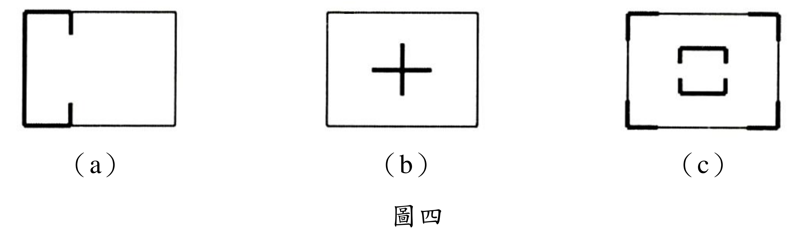

# SA-2017-4 題目正本

> 本檔只記錄考卷上寫了什麼、圖上畫了什麼，不含任何解法。解析見同資料夾 `SA-2017-4.md`。
> 判讀清單經使用者確認前，狀態為「待確認」；確認後本檔原則上不再修改（改動須回考卷原圖並記 log）。

| 項目 | 內容 |
|---|---|
| 考卷 | `raw/exams/SA-2017_結構學.pdf`，背面，第四題（圖四） |
| 考年 | 2017（民國 106 年）專技高考結構工程技師「結構學」 |
| 配分 | 20 分 |
| 附圖 | `SA-2017-4-fig-2.png`（本次從考卷擷取 500 dpi；既有 `SA-2017-4-fig-1.png` 保留） |
| 判讀狀態 | **已確認**（2026-11-07 使用者確認；影響答案項目定案：#1–#3 (a) 牆位置與方向、#7 (c) 中央開口核心（使用者確認；解析同日勘誤）。原轉錄：2026-11-07 轉錄；PyMuPDF 110 dpi 整頁＋300 dpi 局部放大（附圖為內嵌點陣圖）；盲讀於開啟解析前完成） |

## 1. 考卷原文（逐字）

四、圖四分別為三棟建築結構之樓層平面示意圖，粗線部分為剪力牆配置，試分別說明此三種平面配置規劃用以傳遞水平載重之優缺點。（20 分）

## 2. 考卷給的公式、附表與參數

- 考卷沒有給任何尺寸、載重方向或數值。
- 圖中粗線＝剪力牆，細線＝平面外框（非牆）。
- 卷首注意事項：㈠可以使用電子計算器。㈡不必抄題，作答時請將試題題號及答案依照順序寫在試卷上，於本試題上作答者，不予計分。㈢本科目除專門名詞或數理公式外，應使用本國文字作答。
- 考試時間：2 小時。代號 00360，全一張（正、背面）。

## 3. 附圖

*證據圖 SA-2017-4-fig-2.png（500 dpi，自考卷擷取；舊證據圖 SA-2017-4-fig-1.png 有游標雜訊，保留不改）*

圖面文字照錄：（a）、（b）、（c）、圖四

## 4. 判讀清單

| # | 項目 | 判讀 | 圖上／題文依據 | 把握 |
|---|---|---|---|---|
| 1 | (a) 左緣 | 粗線＝剪力牆，沿左緣全長（平面短向／圖上垂直方向） | 300 dpi 放大 | 確定 |
| 2 | (a) 上、下緣 | 上緣、下緣各只有靠左約 1/3 段為粗線（圖上水平方向的牆），其餘為細線 | 300 dpi 放大：粗線在約 1/3 處終止 | 確定 |
| 3 | (a) 短牆 | 上、下緣粗線終點各有一小段向平面內的垂直短牆 | 300 dpi 放大 | 確定 |
| 4 | (a) 右側 | 右側 2/3 與右緣沒有剪力牆 | 細線 | 確定 |
| 5 | (b) | 平面中央一個十字形剪力牆（兩片正交牆在中心相交），外框無牆 | 300 dpi 放大 | 確定 |
| 6 | (c) 四角 | 四個角落各一 L 形剪力牆（兩向各一短段）；四邊中段無牆 | 300 dpi 放大 | 確定 |
| 7 | (c) 中央核心 | **平面中央另有一組剪力牆**：上方ㄇ形（開口向下）與下方ㄇ形（開口向上），左右兩側中段各留一個開口，形成有開口的核心筒 | 300 dpi 放大 | 確定 |
| 8 | 考卷沒有給 | 平面尺寸、樓層數、載重方向、質心位置 | 題文 | 確定 |
| 9 | 所求 | 三種配置傳遞水平載重的優缺點（文字題） | 題文 | 確定 |
| 10 | 證據圖 | 既有 fig-1 在「圖四」左方有手形游標；另擷取 500 dpi 乾淨版 fig-2 | 縮圖總表 | 確定 |

---
*轉錄：2026-11-07（SA 剩餘單元（U1-2 尾段、U2-5、U3-1、U3-2）題目正本推廣・批 1）*
*確認：2026-11-07 使用者確認*
