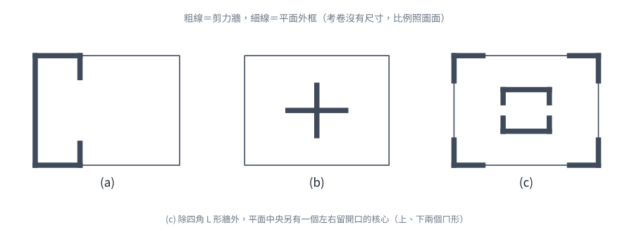
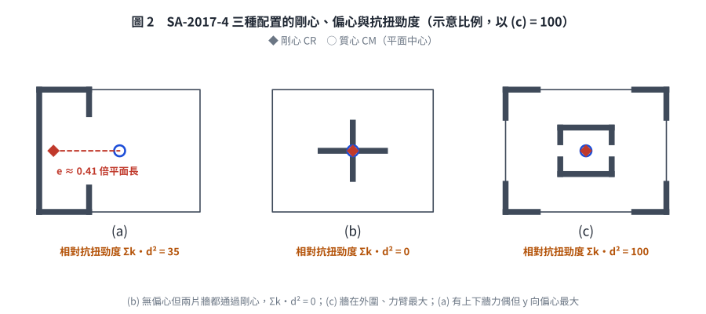

# 考題編號：SA-2017-4

**主分類：** `SA-U3-1` 建築結構系統之使用
**副分類：** 無
**分析法：** 論述題（定性分析）
**標籤：** `剪力牆` `平面配置` `偏心` `扭矩` `水平載重傳遞` `建築結構系統` `抗扭勁度` `樓板乾縮`

---

## 1. 題目（考卷原文見題目正本）

> 考卷原文、公式／附表、附圖與判讀清單（已確認）見 [`SA-2017-4-problem.md`](SA-2017-4-problem.md)。本節只列解題時最容易讀錯的地方與本解使用的記號；題意以題目正本為準。

*重繪自考卷附圖，依判讀清單重繪。攔：(a) 牆的方向讀反、(c) 漏讀中央核心（2026-11-07 勘誤）。*

### 常見誤讀
| 項目 | 正確判讀 | 常見誤讀 |
|---|---|---|
| (a) 左緣牆 | 沿平面短向（圖上垂直）全長 → 抵抗 y 向（圖上上下方向）水平力 | 當成 x 向牆 |
| (a) 上、下緣牆 | 只在靠左約 1/3 段，沿長向（圖上水平）→ 抵抗 x 向水平力；兩片對稱於平面中線 | 當成 y 向牆、或以為沿全長 |
| (c) 中央 | 四角 L 形牆之外，平面中央另有一個核心（上、下兩個ㄇ形，左右中段留開口） | 漏讀中央核心，以為中央完全開放 |
| (b) 中央 | 兩片正交牆在中心相交成「+」形，是**開口截面**；兩片牆都通過剛心 | 當成閉合的核心筒，以為抗扭勁度高 |

**本解記號：** 平面長向（圖上水平）為 x、短向（圖上垂直）為 y；CR＝剛性中心、CM＝質量中心（假設在平面幾何中心）；「x 向牆」指牆身沿 x 方向、以面內勁度抵抗 x 向水平力。

**題目要求：** 分別說明此三種平面配置規劃用以**傳遞水平載重**之**優缺點**。（20 分）

---

## 2. 考題核心精神與出題者意圖 (Core Concepts & Examiner's Intent)

**核心觀念：** 剪力牆的平面配置決定了建築的：
1. **剛性中心（CR, Center of Rigidity）**的位置
2. **質量中心（CM, Center of Mass）**與 CR 之間的**偏心距（e）**
3. 對水平載重（地震、風）的**抗扭轉能力**
4. 各方向（x、y）的**側向勁度**是否充足

**出題者意圖：**
- 測驗考生對「**剛性中心**」概念的理解：剛性中心距越小，扭矩越小。
- 測驗考生對「**兩方向均需配置**」的認識：x 方向與 y 方向的水平力需分別有牆承擔。
- 測驗考生對「**均勻分散配置**」的優缺點辨識：集中配置（如中央十字牆）vs 分散配置（如四周角落）的工程取捨——對稱（偏心小）不等於抗扭好，抗扭勁度看牆離剛心的力臂。

**關鍵評分要點（各題 5～7分）：**
1. **剛性中心位置的分析** — CR 在哪裡、偏心距大不大
2. **扭轉效應的討論** — 偏心大時地震引發附加扭矩
3. **雙向抗側能力** — 是否能有效傳遞兩個方向的水平力
4. **實用性與空間利用** — 建築平面使用效率

---

## 3. 解題戰略地圖與陷阱分析 (Strategic Roadmap & Trap Analysis)

**答題架構：**
對三種配置各自分析：
1. 剛性中心位置 → 偏心距 → 扭矩大小
2. X 向與 Y 向的抗側勁度
3. 優點（明確列舉）
4. 缺點（明確列舉）

**⚠ 陷阱一：混淆「剪力牆方向」與「抵抗方向」**
垂直紙面方向（平面圖的上下）延伸的牆，其面外（out-of-plane）勁度極小，只有面內（in-plane）方向才能有效抵抗水平力。因此必須辨別每面牆能抵抗哪個方向的水平力。

**⚠ 陷阱二：忽略扭矩討論**
地震不但產生平移，如果 CM ≠ CR 還會產生附加扭矩，導致邊緣構件受力加大。很多考生只討論剪力傳遞而忘了扭轉效應。

**⚠ 陷阱三：看清楚每片牆的方向與有沒有中央核心**
(a) 的左緣牆是 y 向牆、上下緣牆是 x 向牆，兩方向的剛性中心位置不同；(c) 除了四角 L 形牆，中央還有一個左右留開口的核心，不能當成「中央完全開放」。

**⚠ 陷阱四：「對稱」不等於「抗扭好」**
(b) 雙軸對稱、偏心 ≈ 0，但兩片牆都通過剛心，$\sum k_i d_i^2 \approx 0$，扭轉勁度極低；偶然扭矩（質量分布不均、地震動的扭轉分量）只能靠外圍構架抵抗。

---

## 3.5 變數層次分析 (Variable Hierarchy Analysis)

> 複習提示：第一次解題後，在每個卡住的知識點旁標記 `⚠`；第二次複習時只看有 `⚠` 的項目。

### 最終目標

論述三種平面剪力牆配置的優缺點，涵蓋剛性中心、偏心、扭矩、雙向剛度、空間利用等面向。

### L1：題目直接給定

| 符號/概念 | 說明 |
|-----------|------|
| 配置 (a) | 左緣全長 y 向牆＋上、下緣靠左約 1/3 的 x 向牆與向內短牆；右側 2/3 無牆（C 形開口向右） |
| 配置 (b) | 兩片正交剪力牆在平面中央相交成「+」形（開口截面），外框無牆 |
| 配置 (c) | 四角 L 形牆＋中央核心（上、下兩個ㄇ形，左右留開口） |
| 比較基準 | 水平載重（地震、風）的傳遞效率與抗扭性 |

### L2：需知識點推導

| 概念 | 公式／推導 | 卡關? |
|------|-----------|-------|
| 剛性中心（CR） | $x_{CR} = \sum(k_i x_i)/\sum k_i$，剪力牆在哪側、勁度大，CR 就偏向哪側 | |
| 偏心距（e） | $e = |x_{CM} - x_{CR}|$，CM 通常假設在平面幾何中心 | |
| 附加扭矩 | $T = V \cdot e$，V 為總水平力，e 為偏心距 | |
| 抗扭剛度 | $GJ = \sum k_i \cdot d_i^2$，$d_i$ 為各牆至 CR 的距離；牆離 CR 越遠，抗扭貢獻越大 | |
| 雙向抗側 | 牆只靠面內勁度抗側：x 向水平力由牆身沿 x 向的牆承擔，y 向水平力由牆身沿 y 向的牆承擔 | |

### L3：深層知識（不懂就卡住）

| 知識點 | 說明 | 卡關? |
|--------|------|-------|
| 樓板剛性假設 | 剪力牆之間的水平力傳遞需要剛性樓板（Rigid Diaphragm）；若樓板為柔性，則各牆分擔依其相對位置直接計算，偏心效應更顯著 | |
| 開口截面 vs. 閉合截面 | 剪力牆形成閉合截面（如圍繞電梯井）時，其抗扭剛度（$GJ$）遠大於開口截面（Bredt's formula）。配置 (b) 的「+」形是開口截面，自身 St. Venant 扭轉勁度很小；(c) 中央核心左右留開口，也是開口截面，要靠連梁才接近閉合 | |
| 偶然扭矩 | 即使 CR ＝ CM，規範仍要求考慮偶然偏心（質量分布的不確定）；抗扭勁度近零的配置 (b) 對偶然扭矩最敏感，易出現扭轉振態控制 | |
| 樓板乾縮與溫度變形 | 剪力牆相距越遠，越會束制樓板的乾縮與溫度伸縮，樓板容易開裂；牆集中一處或一端（(a)、(b)）較不受此影響 | |
| 牆的面內/面外勁度差異 | 牆面內勁度 >> 面外勁度；配置設計需確保兩個正交方向各有牆的面內參與 | |
| 規則性要求（耐震設計規範） | 規範通常要求建築在平面上的剛性中心與質量中心之偏心距應盡量小（通常 < 10% 平面尺寸），以避免過大扭矩 | |

---

## 4. 詳細論述（Step-by-Step Analysis）

### 4.1 配置（a）分析：左側集中式（C 形，開口向右）

**圖形說明：** 左緣一片沿短向（y 向）全長的牆；上緣與下緣各一片只在靠左約 1/3 的長向（x 向）牆，牆端各有一小段向平面內的 y 向短牆。三片牆在左側兩角相連，形成開口向右的 C 形；右側 2/3 沒有任何剪力牆。

**剛性中心位置：**
- **x 向水平力**由上、下兩片 x 向牆承擔；兩片對稱於平面中線 → x 向的 CR 在中線上，與 CM 同高，**x 向載重幾乎不產生扭矩**。
- **y 向水平力**由左緣牆（與兩段短牆）承擔，全部集中在左側 → y 向的 CR 靠近左緣，與 CM（平面中央）相距約半個平面長 → **y 向載重偏心距 e 大**，產生大扭矩 $T = V_y \cdot e$。
- 扭矩主要靠上、下兩片 x 向牆形成力偶（力臂＝平面短向全寬）來抵抗，所以結構不會失去抗扭能力，但扭轉位移大。

**優點：**
1. **右側立面與平面完全開放**：牆集中在左側，可作為樓梯、電梯、設備區，右側 2/3 有大面開窗與自由隔間的彈性。
2. **三片牆相連成 C 形整體**：左緣牆與上下緣牆在角部相接，彼此互為翼牆，整體抗彎與抗扭效率比三片獨立牆高。
3. **x 向對稱**：x 向載重下兩片牆對稱分擔，行為規則。
4. **施工集中**：牆集中一區，模板與配筋施工效率高。
5. **樓板不受束制**：牆都在同一端，樓板的乾縮與溫度變形幾乎不受束制，較不易開裂。

**缺點：**
1. **y 向嚴重偏心**：y 向載重下 CR 在左、CM 在中，附加扭矩大，右側遠端柱的側移與剪力大幅放大，屬平面不規則（扭轉不規則）。
2. **樓板需長距離傳力**：右側 2/3 樓板的慣性力要靠樓板（剛性隔板）以懸臂方式傳回左側牆，樓板剪力與弦材拉力大，開孔要受限制。
3. **x 向牆長度有限**：上、下緣牆只有平面長度約 1/3，x 向勁度與強度有限。
4. **右側需另配抗側構件**：實務上要在右側補剪力牆或抗彎構架，才能把剛性中心拉回中央。

**結論：** x 向尚稱規則，但 y 向偏心大、扭轉不規則，不宜單獨作為主要抗側系統。

---

### 4.2 配置（b）分析：中央十字形牆

**圖形說明：** 兩片正交剪力牆（一片 x 向、一片 y 向）在平面中央相交成正十字（+）形，外框沒有牆。「+」形是**開口截面**，不是圍合的核心筒。

**剛性中心位置：**
- 十字形牆對稱配置於平面中央 → x 方向 CR 與 y 方向 CR 均在平面幾何中心。
- 假設質量均勻分布，CM 也在幾何中心 → **偏心距 e ≈ 0**，配置本身不產生扭矩。

**抗扭勁度（本配置的關鍵）：**
- 剛性樓板下，樓層抗扭勁度 $K_\theta=\sum k_i d_i^2$，$d_i$ 為牆面內方向至 CR 的垂直距離。
- 兩片牆都**通過 CR**，$d_i \approx 0$ ⇒ $K_\theta \approx 0$；剩下的只有牆本身很小的 St. Venant 扭轉勁度與外圍構架的貢獻。
- 規範要求考慮的偶然扭矩（質量分布不確定、地震動扭轉分量）幾乎全部要靠外圍構架承擔，容易出現扭轉振態控制、周邊構件變位放大。

**優點：**
1. **配置無偏心**：雙軸對稱，CR ≈ CM，平移載重不產生附加扭矩。
2. **雙向都有牆**：x 向牆抵抗 x 向水平力、y 向牆抵抗 y 向水平力，兩向勁度可均衡。
3. **外圍立面與周邊平面完全開放**：牆集中在中央，周邊可大面開窗、自由隔間；十字牆之間可配置樓梯、電梯與管道。
4. **樓板束制小**：牆集中在中央，樓板乾縮與溫度變形受束制少。

**缺點：**
1. **抗扭勁度極低（最主要缺點）**：兩片牆都通過剛心，$\sum k_i d_i^2 \approx 0$，抵抗偶然扭矩的能力差，扭轉振動容易放大；需靠外圍構架補足抗扭。
2. **贅餘度低**：每個方向只有一片牆承擔全部側力，一片牆破壞就失去該方向的主要抗側系統。
3. **傾覆力矩集中**：牆的平面範圍小，傾覆力矩力臂短，牆端拉拔力大、基礎受力集中。
4. **樓板傳力路徑長**：外圍的慣性力要經樓板傳到中央，需要集力梁（collector）與足夠的樓板剪力強度。

**結論：** 無偏心、兩向都有牆，但抗扭勁度近乎為零且贅餘度低；作為主要抗側系統時，必須搭配外圍抗彎構架提供抗扭能力。

---

### 4.3 配置（c）分析：四角 L 形牆＋中央開口核心

**圖形說明：** 四個角落各一片 L 形牆（含 x 向與 y 向兩段）；平面中央另有一組核心牆——上、下兩個ㄇ形（上方開口向下、下方開口向上），左右兩側中段各留一個開口，形成有開口的核心筒。四邊中段沒有牆。

**剛性中心位置：**
- 四角牆與中央核心都對稱於兩條中線 → x、y 兩向的 CR 都在平面中央，與 CM 重合 → **偏心距 e ≈ 0**。

**優點：**
1. **偏心距近乎為零**：雙軸對稱，幾乎無附加扭矩，受力行為規則。
2. **抗扭剛度最大**：四角 L 形牆離 CR 最遠，$\sum k_i d_i^2$ 最大，能以最長力臂抵抗扭轉（含偶然扭矩），**三種配置中抗扭最佳**。
3. **兩向都有牆、且有兩道防線**：角牆與中央核心都同時有 x 向與 y 向牆段；周邊牆與核心兩套系統互為備援（贅餘度高）。
4. **核心可整合垂直動線**：中央核心可作為電梯、樓梯、管道間，結構與設備整合良好。
5. **樓板傳力路徑短**：周邊慣性力就近傳到角牆，中央的傳到核心。

**缺點：**
1. **角牆長度有限**：每片 L 形牆的兩段都短，單片面內勁度不大，需靠數量與力臂補足；牆端多，邊界構件（Boundary Element）配筋量大。
2. **核心開口需要連接梁**：核心左右開口把核心分成兩個ㄇ形，開口處上方的連接梁（連梁）受大剪力，需特別配筋；若連梁不足，兩個ㄇ形各自作用，核心勁度與抗扭能力下降。
3. **平面使用受限**：中央被核心佔用、四角被 L 形牆佔用，角落無法大面開窗；可用空間為核心與周邊之間的環狀區域。
4. **牆量與造價較高**：五組牆分散配置，施工面多。
5. **樓板乾縮受束制**：外圍牆彼此相距遠，會束制樓板的乾縮與溫度變形，樓板容易開裂，需配置收縮鋼筋或設後澆帶。

**結論：** 雙軸對稱、抗扭最佳且有核心整合動線，是三者中最規則、最穩健的配置；代價是角牆短、核心開口連梁需特別設計。

---

## 5. 三種配置綜合比較（Summary Table）

| 評估項目 | 配置（a）左側 C 形 | 配置（b）中央十字 | 配置（c）四角＋中央核心 |
|---------|-----------------|-----------------|-----------------|
| 剛性中心位置 | x 向居中；y 向嚴重偏左 | 中央 | 中央 |
| 偏心距 e | **y 向大**（最差）| **≈ 0** | **≈ 0** |
| 附加扭矩 | **y 向大**（危險）| 最小 | 最小 |
| X 向抗側勁度 | 上下兩片短牆，有限 | 良好 | 良好（角牆＋核心） |
| Y 向抗側勁度 | 左緣一片牆，偏心 | 良好 | 良好（角牆＋核心） |
| 抗扭剛度 | 中（靠上下牆力偶）| **極低**（兩片牆都通過剛心）| **最高**（力臂最大）|
| 平面使用彈性 | 右側開放，好 | 周邊開放，好（中央十字牆佔用少） | 中央核心＋四角牆，中等 |
| 規範符合性 | y 向扭轉不規則 | 無配置偏心，但偶然扭矩敏感 | **最佳** |
| 適用建築類型 | 不建議單獨使用 | 需搭配外圍構架抗扭 | 中高層、需規則平面者 |
| 設備整合能力 | 牆集中一側，尚可 | 良好（十字牆之間）| 良好（中央核心）|
| 樓板乾縮束制 | 小（牆在同一端）| 小（牆在中央）| 大（外圍牆相距遠）|
| 贅餘度 | 低 | 低（每向一片牆）| 高（角牆＋核心兩道防線）|

**設計建議優先次序：（c）≥（b）>（a）**（(c) 兼有對稱、最大抗扭力臂與中央核心；(b) 無偏心但兩片牆都通過剛心、抗扭勁度近零；(a) y 向偏心最嚴重）

配置（a）在實際設計中幾乎不會單獨使用，通常需要補充右側的水平力抵抗構件。

---

*圖 2　三種配置的剛心、偏心與相對抗扭勁度（依圖面比例量取牆位置，牆勁度取與牆長成正比的示意值，以 (c) = 100）。(b) 雖然沒有偏心，但兩片牆都通過剛心，$\sum k_i d_i^2 = 0$；(c) 的牆離剛心最遠，抗扭最好。這張圖攔的是「對稱就抗扭好」——把 (b) 的十字牆當成閉合核心筒，以及 (a) 的偏心方向判錯。*

## 關鍵爭議點與進階探討 (Critical Issues & Advanced Discussion)

**爭議一：配置（a）、（c）的樓板剛性假設**
(a) 右側 2/3 樓板要以懸臂方式把慣性力傳回左側牆，(c) 要把力分配到四角與中央核心，兩者都要求樓板為剛性隔板（足夠厚度、限制大開孔）。若樓板偏柔，(a) 的右側變形會更大，(c) 的角牆與核心分擔比例也會偏離剛度分配。

**爭議二：配置（b）是不是核心筒**
圖（b）只有兩片相交的牆，是「+」形開口截面，不是圍合的閉合核心筒。若實際設計把十字牆延伸成圍合電梯間的閉合筒，抗扭勁度可按 Bredt's formula 計算、大幅提高；但依考卷圖面作答，應以「兩片牆通過剛心、抗扭勁度近零」為主要缺點。

**爭議三：「水平載重傳遞」的完整路徑**
完整的水平力傳遞路徑為：**慣性力（地震）→ 樓板（剛性隔板）→ 水平力傳至各剪力牆（按剛度分配）→ 剪力牆傳至基礎**。三種配置的差別在於樓板到剪力牆的傳力效率，以及剪力牆是否均勻分配，防止局部過載。

---
*修正日期：2026-11-07（§1 改為指向題目正本，補重繪附圖 figs/SA-2017-4-fig-1-problem.svg）*
*修正日期：2026-11-07（讀題勘誤：(a) 牆的方向依考卷更正（左緣為 y 向牆、上下緣靠左約 1/3 為 x 向牆，舊解對調），§4.1 剛心與偏心推論改寫為「x 向居中、y 向嚴重偏心」；(c) 補讀中央左右留開口的核心（舊解漏讀，誤寫中央完全開放），§4.3 改寫；§3 陷阱三、§3.5 L1 與 L2「雙向抗側」、§5 比較表與優先次序、爭議一同步；驗證：回考卷第 2 頁圖四 300 dpi 逐片核對牆位置，文字題無數值）*
*修正日期：2026-11-08（盲解比對勘誤（觀念）：(b) 由「十字形核心筒、閉合截面可提高抗扭剛度、最佳抗側系統之一」改為「+ 形開口截面、兩片牆都通過剛心、抗扭勁度近零」，§4.2 改寫（主要缺點改為抗扭勁度低、贅餘度低）；§1 常見誤讀、§2、§3 陷阱四、§3.5 L1／L3、§5 比較表與爭議二同步；補 (a) 樓板不受束制、(c) 樓板乾縮受束制；排序 (c) ≥ (b) > (a) 不變；驗證：示意平面（30×12）剛性樓板 Σk·d² 計算，(b) 為 0、(c) > (a) > (b)，MISMATCHES: 0）*

*圖解補繪：2026-11-08（向量圖，腳本 `gen_SA-2017-4.py` 的 fig2_torsion，依圖面比例計算剛心與 Σk·d² 後 assert 定性結論，可重跑）*
