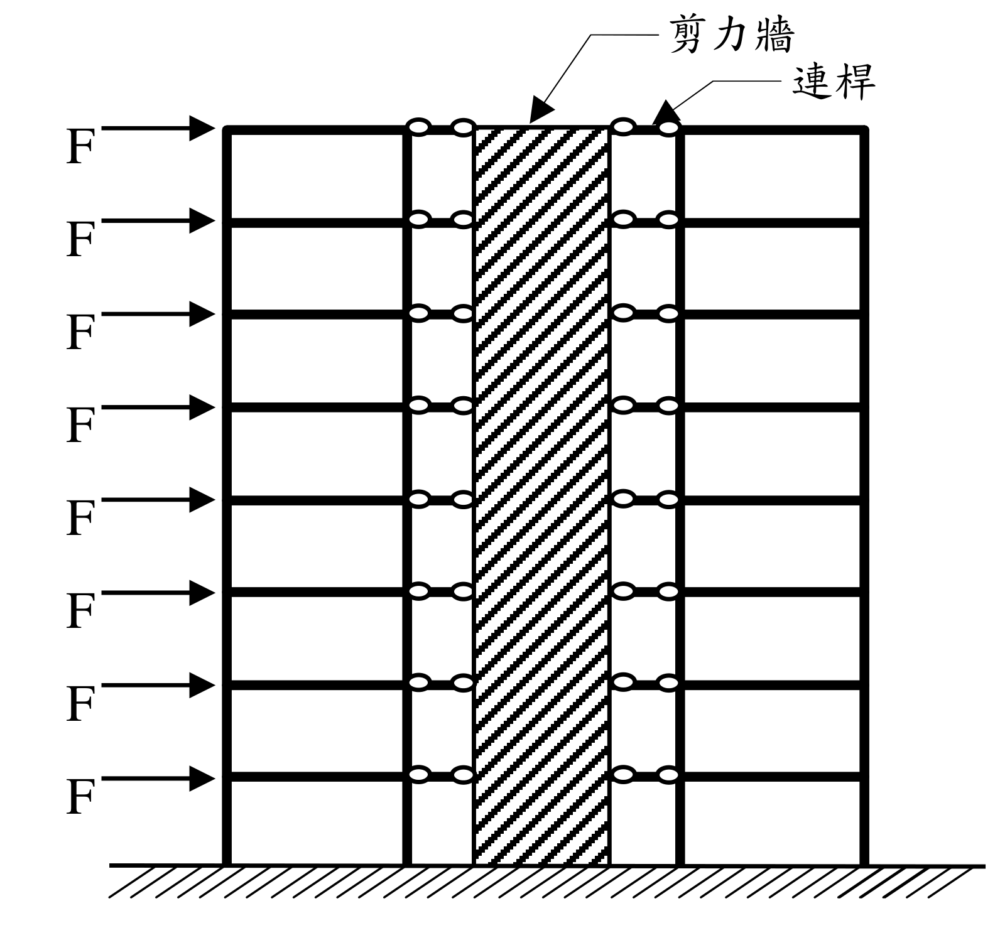

# SA-2018-1 題目正本

> 本檔只記錄考卷上寫了什麼、圖上畫了什麼，不含任何解法。解析見同資料夾 `SA-2018-1.md`。
> 判讀清單經使用者確認前，狀態為「待確認」；確認後本檔原則上不再修改（改動須回考卷原圖並記 log）。

| 項目 | 內容 |
|---|---|
| 考卷 | `raw/exams/SA-2018_結構學.pdf`，第 1 頁（頁次 2－1），第一題 |
| 考年 | 2018（民國 107 年）專技高考結構工程技師「結構學」 |
| 配分 | 25 分 |
| 附圖 | `SA-2018-1-fig-2.png`（本次從考卷擷取 500 dpi；既有 `SA-2018-1-fig-1.png` 保留） |
| 判讀狀態 | **已確認**（2026-11-07 使用者確認；原轉錄：2026-11-07 轉錄；PyMuPDF 110 dpi 整頁＋350 dpi 局部放大（附圖為向量圖）；盲讀於開啟解析前完成） |

## 1. 考卷原文（逐字）

一、如下圖8 層樓平面構架以貫通全樓高的剪力牆加勁，假設剪力牆提供的樓層水平勁度為構架的5 倍，且構架與剪力牆之間使用只能承受軸力的連桿連接。若各樓層承受相等的水平力F 作用，如下圖。㈠不需經過精確分析，請分別繪出構架與剪力牆所受的樓層水平力分布示意圖，圖中請以虛線畫上外力F，並依此比例標畫水平力大小，以資比較。㈡請解釋題㈠中水平力分布圖的理由。（25 分）

## 2. 考卷給的公式、附表與參數

- 考卷沒有給任何尺寸、樓高、EI 或數值。
- 給定比例：剪力牆的樓層水平勁度為構架的 5 倍。
- 卷首注意事項：㈠可以使用電子計算器。㈡不必抄題，作答時請將試題題號及答案依照順序寫在試卷上，於本試題上作答者，不予計分。㈢本科目除專門名詞或數理公式外，應使用本國文字作答。
- 考試時間：2 小時。代號 00340，頁次 2－1、2－2。

## 3. 附圖

*證據圖 SA-2018-1-fig-2.png（500 dpi，自考卷擷取；舊證據圖 SA-2018-1-fig-1.png 有游標雜訊，保留不改）*

圖面文字照錄：剪力牆、連桿、F（8 個）

## 4. 判讀清單

| # | 項目 | 判讀 | 圖上／題文依據 | 把握 |
|---|---|---|---|---|
| 1 | 樓層數 | 8 層，各樓層一個 F | 圖面 8 個箭頭 | 確定 |
| 2 | 構架 | 剪力牆左、右各一個單跨構架（每側兩根柱），各層有梁 | 350 dpi 放大 | 確定 |
| 3 | 剪力牆 | 中央一片，貫通全樓高 | 題文＋斜線填充 | 確定 |
| 4 | 連桿 | 每層樓兩側各一根，兩端圓圈（鉸接），只傳軸力 | 題文＋圖面小圓 | 確定 |
| 5 | 載重 | 各樓層水平向右 F，作用在左側構架外柱 | 箭頭位置 | 確定 |
| 6 | 基礎 | 柱與剪力牆皆落在地面剖線上，圖面未畫支承符號；視為固定於基礎 | 圖面 | 確定（解讀）；使用者確認 |
| 7 | 勁度比 | 剪力牆提供的樓層水平勁度為構架 5 倍 | 題文 | 確定 |
| 8 | 考卷沒有給 | 樓高、跨度、EI、F 數值；不需精確分析 | 題文 | 確定 |
| 9 | 所求 | ㈠構架與剪力牆的樓層水平力分布示意圖（虛線畫外力 F、依比例）；㈡解釋理由 | 題文 | 確定 |
| 10 | 證據圖 | 既有 fig-1 牆上有小游標；另擷取 500 dpi 乾淨版 fig-2 | 縮圖總表 | 確定 |

---
*轉錄：2026-11-07（SA 剩餘單元（U1-2 尾段、U2-5、U3-1、U3-2）題目正本推廣・批 1）*
*確認：2026-11-07 使用者確認*
