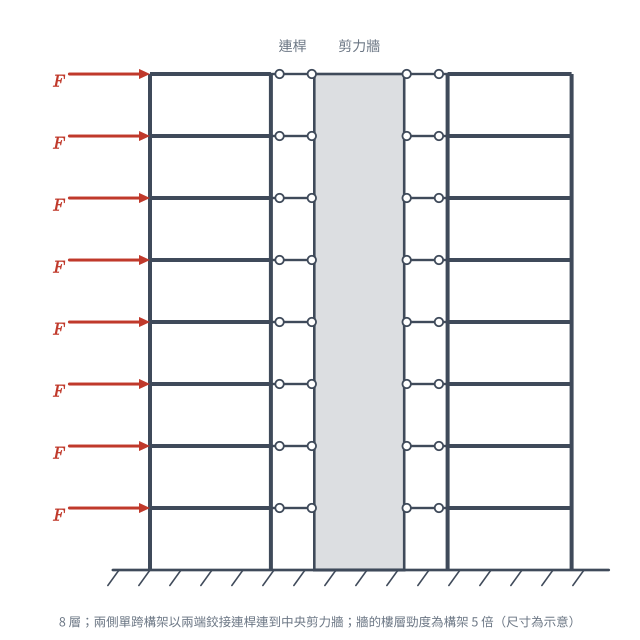
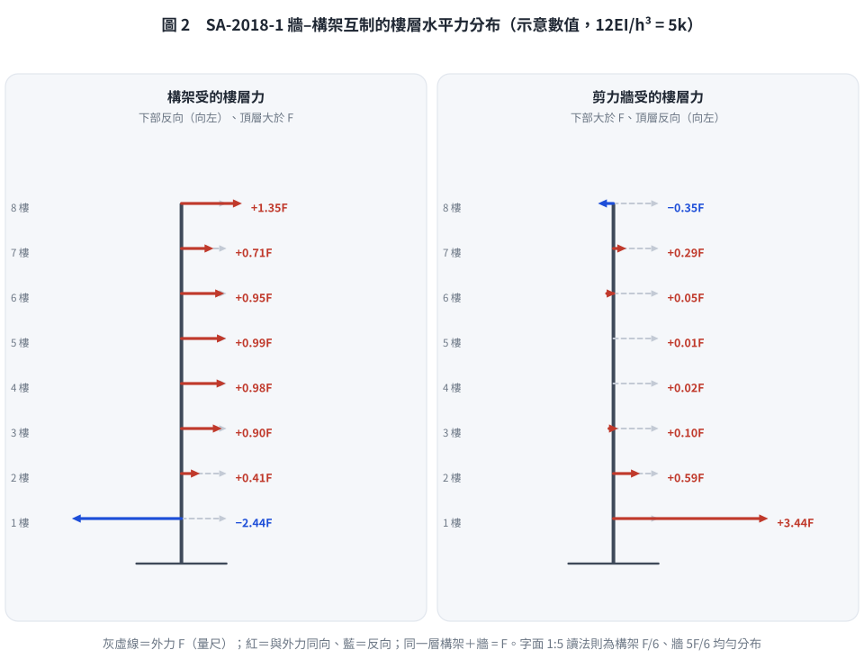

# 考題編號：SA-2018-1

**主分類：** `SA-U3-2` 建築結構系統分析
**副分類：** 無
**分析法：** 結構系統定性分析
**標籤：** `剛架與剪力牆互制` `變形模態` `剪力型與彎曲型` `水平力分配`

---

## 1. 題目（考卷原文見題目正本）

> 考卷原文、公式／附表、附圖與判讀清單（已確認）見 [`SA-2018-1-problem.md`](SA-2018-1-problem.md)。本節只列解題時最容易讀錯的地方與本解使用的記號；題意以題目正本為準。

*重繪自考卷附圖，依判讀清單重繪。攔：把連桿當成剛接（可傳彎矩）、以為外力直接作用在剪力牆。*

### 常見誤讀
| 項目 | 正確判讀 | 常見誤讀 |
|---|---|---|
| 連桿 | 兩端鉸接，只傳軸力（水平力） | 剛接，可傳彎矩 |
| 勁度比 5 倍 | 剪力牆提供的樓層水平勁度為構架的 5 倍（整體平均比）；本解採牆–構架互制讀法，字面 1:5 讀法見 §5 | 每層固定按 5:1 分配外力，忽略牆（撓曲型）與構架（剪力型）變形模態不同 |
| 反向力的範圍 | 構架只在下部幾層受反向力（範圍隨牆／構架勁度比而變），頂層大於 F | 以為構架大半樓層都反向 |
| 尺寸 | 考卷沒有尺寸，只要示意圖 | 自行假設樓高、跨度去精算 |

**本解記號：** F＝各樓層外力；構架以剪力型變形、剪力牆以彎曲型變形為主；樓層水平力分布圖以虛線畫外力 F 作比例基準。

---

## 2. 考題核心精神與出題者意圖 (Core Concepts & Examiner's Intent)
本題測驗的核心觀念為**「剛架與剪力牆的互制作用 (Wall-Frame Interaction)」**。
出題者希望考生突破「依勁度比例固定分配水平力」的盲點（例如誤以為每層樓剛架分擔 $\frac{1}{6}F$，剪力牆分擔 $\frac{5}{6}F$）。事實上，剛架屬於「剪力型結構 (Shear Mode)」，而剪力牆屬於「彎曲型結構 (Flexural Mode)」，兩者因為連桿的束制必須維持相同的側向位移，這會導致兩者在高度方向產生強烈的互制力，進而改變水平力的分配，甚至在某些樓層出現反向的水平力。

## 3. 解題戰略地圖與陷阱分析 (Strategic Roadmap & Trap Analysis)
- **戰略一：分析各自的變形模態**
  剪力牆若單獨受載，變形曲線如懸臂梁呈「下凹 (Concave)」，頂部斜率最大；剛架若單獨受載，變形曲線呈「上凸 (Convex)」，底部斜率最大。
- **戰略二：推導互制力的方向**
  為了迫使兩者位移一致，在結構下部，剪力牆會拉住變形較大的剛架（剛架受負向力，牆受大於 $F$ 的正向力）；在結構上半部，剪力牆頂部位移增長迅速，剛架會試圖拉回剪力牆，導致剛架頂層承受大於 $F$ 的正向水平力，而剪力牆在頂部則承受反向水平力。
- **陷阱**：直接按樓層勁度比 1:5 畫出均勻等比例的分布圖，等於把剪力牆當成剪力型彈簧，錯失本題「互制」的測驗核心（第㈡小題要求解釋分布理由即在此）；此讀法的依據與限制見 §5。

## 3.5 變數層次分析 (Variable Hierarchy Analysis)

### 最終目標
定性繪製出因變形模態互制而產生的剛架與剪力牆水平力高度分布圖，並合理解釋。

### 本題關鍵公式（依計算順序）
$$ \boxed{F_{ext}} = \boxed{F_{frame}} + \boxed{F_{wall}} = F $$
（各樓層水平力總和）
$$ y_{frame}(x) = y_{wall}(x) $$
（位移諧合條件）

### L1：題目直接給定
- 樓層數 ∣ $n = 8$ ∣ 8層樓
- 勁度比 ∣ $K_{wall} = 5 K_{frame}$ ∣ 單層等效水平勁度
- 外力 ∣ $F$ ∣ 各層外力相同（均勻分布）

### L2：需知識點推導
**互制力分配**
- $F_{frame}$ ∣ 模態疊加 ∣ 
- $F_{wall}$ ∣ $F - F_{frame}$ ∣ 

### L3：深層知識（不懂就卡住）
- 剛架與剪力牆互制作用 ∣ 必須理解剪力型與彎曲型結構強迫位移一致時，水平力分配不會是常數，且在頂層與底層會產生反向載重。 ∣

## 4. 步驟化詳細計算過程 (Step-by-Step Detailed Calculation)

### (一) 水平力分布示意圖
> 📊 **繪圖說明：**
> - **外力 $F$**：各樓層為定值，以等長虛線表示。
> - **剛架受力 ($F_{frame}$)**：底部幾層承受向左的力（負值，與外力反向）；中間樓層向右、小於 $F$；頂樓承受大於 $F$ 的向右力。
> - **剪力牆受力 ($F_{wall}$)**：底部幾層承受大於 $F$ 的向右力，往上遞減；頂樓承受向左的力（負值，與外力反向）。

由於剛架與剪力牆間由連桿連結，各樓層的水平位移必須完全一致。其受力分布規律如下圖特徵：
- **剪力牆 (Wall)**：底部幾層受力**大於 $F$**（1 樓最大，約 3F）；往上遞減，中間樓層小於 $F$；**第 8 樓出現反向（向左）的水平力**。
- **剛架 (Frame)**：底部幾層（約 1–2 樓）受力為**反向（向左）**；中間樓層為正向、小於 $F$；**第 8 樓承受大於 $F$ 的正向水平力**（約 1.4–1.9F）。
- 各層的構架力＋剪力牆力恆等於 $F$；反向力延伸到幾樓、頂層大多少，隨「5 倍」換算成牆 $EI$ 的方式而變，示意圖只要求畫出上述形狀並以虛線 $F$ 為量尺標出大小關係。

> **示意數值（僅供確認形狀）**：牆以 8 層懸臂撓曲梁、構架以剪力型樓層彈簧 $k$ 模擬，取 $12EI/h^3=5k$：構架各層 $-2.44,\ 0.41,\ 0.90,\ 0.98,\ 0.99,\ 0.95,\ 0.71,\ 1.35\,F$；剪力牆 $3.44,\ 0.59,\ 0.10,\ 0.02,\ 0.01,\ 0.05,\ 0.29,\ -0.35\,F$（1→8 樓）。取 $3EI/h^3=5k$：構架 $-2.23,\ -0.46,\ 0.32,\ 0.66,\ 0.77,\ 0.72,\ 0.48,\ 1.88\,F$。

*圖 2　牆–構架互制的樓層水平力分布（示意數值模型，取 $12EI/h^3 = 5k$，與上文示意數值一致）。灰虛線是外力 $F$ 的量尺，同一層構架＋牆恆等於 $F$。這張圖攔的是照字面 1:5 畫成沿高度均勻的分布（看不出互制），以及把反向力畫錯層——構架的反向力只在最下面一、兩層，頂層構架大於 $F$、牆在頂層反向。*

### (二) 水平力分布圖的理由

**1. 變形模態的差異：**
- **剪力牆**屬於「彎曲型變形 (Flexural mode)」：如同一根直立的懸臂梁，受水平力時其變形曲線在底部曲率最大，且位移增加率（斜率）會隨著高度越來越大，呈現下凹形狀。
- **構架**屬於「剪力型變形 (Shear mode)」：其變形主要來自樓層間的相對層次剪力變形，變形曲線在底部斜率最大，隨著高度增加斜率逐漸減小，呈現上凸形狀。

**2. 位移諧合與互制作用 (Interaction)：**
本題中兩者透過連桿連接，強制兩者在各樓層的位移必須相等（$y_{frame} = y_{wall}$），形成一個「反曲」的綜合彈性曲線（底部下凹、頂部上凸）。
為了達成此一妥協形狀，兩者之間會產生巨大的內部互制力：
- **在結構下部**：剪力牆自身剛度極大且變形小，而構架較易變形。為了把構架「拉住」以配合剪力牆的較小位移，剪力牆必須施加向左的力給構架。對外力平衡而言，意味著**構架承受了反向（負）的水平力**，而**剪力牆則必須承擔大於外力 $F$ 的水平力**。
- **在結構上半部（特別是頂層）**：剪力牆若自由變形，其頂部位移會非常大；而構架的剪力變形特性使其頂部增量較緩。為了將剪力牆「拉回」以配合構架，構架必須對剪力牆施加向左的拉力。因此在頂層，**剪力牆承受了反向（負）的水平力**，而**構架則承擔了大於外部施加 $F$ 的正向水平力**。

**結論：**
因兩者變形特性的根本差異，雖然剪力牆提供的平均樓層勁度為構架的 5 倍，但水平力分配絕非各層固定的 5:1，而是底部牆受載大於外力，頂部構架受載大於外力，且兩者在不同高度區段均會出現與外力相反的反向載重。

## 5. 關鍵爭議點與進階探討 (Critical Issues & Advanced Discussion)

### 另一種讀法：照字面的 1:5 樓層勁度比
- **讀法**：題文說「剪力牆提供的**樓層水平勁度**為構架的 5 倍」並要求「依此比例標畫」。若把每層的牆與構架都看成獨立的樓層彈簧，連桿使兩者在各層位移相同，則每層的水平力依樓層勁度分配：構架每層 $F/6$、剪力牆每層 $5F/6$，沿高度均勻。
- **限制**：這等於把剪力牆當成**剪力型**構件（每層變形只由該層剪力決定）。實際上貫通全高的剪力牆是撓曲型懸臂構件，某一層的位移受全部樓層力影響，「樓層勁度」並不是與載重分布無關的定值；只有在牆與構架變形模態相同（同為剪力型或同為撓曲型）時，1:5 均勻分配才成立。
- **本解為何採互制讀法**：①「依此比例標畫」可理解為以虛線外力 $F$ 為量尺標畫大小；②第㈡小題要求「解釋水平力分布圖的理由」，若分布只是均勻 1:5，理由一句話即完，與 25 分配分不符；③題設（貫通全樓高剪力牆、只傳軸力的連桿、8 層）正是牆–構架互制的經典模型。
- **作答建議**：以互制形狀為主答；可附註「若僅依樓層勁度比，構架 $F/6$、牆 $5F/6$，但因牆為撓曲型、構架為剪力型，實際分配沿高度改變」，兩種讀法的理由都寫到。

### 其他
- **反向力範圍隨勁度比變化**：牆愈剛（$EI$ 相對構架愈大），構架反向的樓層愈多、牆頂反向力愈小；「5 倍」換算方式不同，牆在底層承擔的樓層剪力比例約在 52%–98% 之間，所以本題只能畫形狀，不宜標出精確樓層數值。
- **高層建築設計實務**：這種「剛架－剪力牆」雙重系統 (Dual System) 是高層建築抗震設計的經典型式。工程師正是利用頂部剛架能拉住剪力牆、底部剪力牆能限制剛架變形的互補特性，使得整體結構在頂部的側移大幅減少，從而獲得極佳的整體剛度。

*修正日期：2026-11-07（§1 改為指向題目正本，補重繪附圖 figs/SA-2018-1-fig-1-problem.svg）*
*修正日期：2026-11-08（盲解比對題意判定（使用者採牆–構架互制讀法）：§4 互制形狀保留；§5「錯誤作法」改寫為「照字面 1:5 樓層勁度比」讀法、其限制與本解採互制讀法的理由；§4（一）樓層描述更正——構架反向只在下部約 1–2 樓（舊寫 1~5 樓反向、6 樓約 0，需牆 EI 比題設大一個數量級以上才會如此），頂層約 1.4–1.9F，補示意數值；§3「得 0 分」改為說明；標頭主／副分類格式對齊；驗證：8 層離散模型（兩種 5 倍換算＋EI 掃描）與連續化微分方程有限差分兩路徑，形狀判據 MISMATCHES: 0）*
*修正日期：2026-11-08（落實檢查補清勘誤殘留：§3 戰略二下部互制方向寫反「剛架會拉住變形較小的剪力牆」→「剪力牆會拉住變形較大的剛架」，與 §4（二）一致；數值與結論不變）*

*圖解補繪：2026-11-08（向量圖，腳本 `gen_SA-2018-1.py` 的 fig2_distribution，示意數值模型 assert 對照上文，可重跑）*
