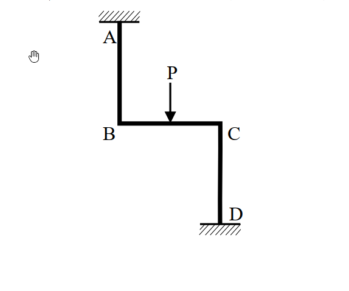
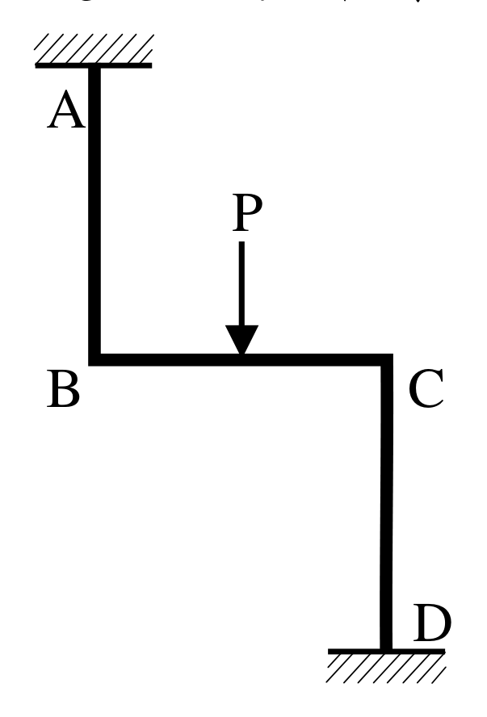

# SA-2018-2 題目正本

> 本檔只記錄考卷上寫了什麼、圖上畫了什麼，不含任何解法。解析見同資料夾 `SA-2018-2.md`。
> 判讀清單經使用者確認前，狀態為「待確認」；確認後本檔原則上不再修改（改動須回考卷原圖並記 log）。

| 項目 | 內容 |
|---|---|
| 考卷 | `raw/exams/SA-2018_結構學.pdf`，第 1 頁下半，第二題 |
| 考年 | 2018（民國 107 年）專技高考結構工程技師「結構學」 |
| 配分 | 25 分 |
| 附圖 | `SA-2018-2-fig-1.png`、`SA-2018-2-fig-2.png` |
| 判讀狀態 | **已確認**（2026-11-05 使用者確認。原轉錄：2026-11-05 轉錄；PyMuPDF 110 dpi 整頁＋250–800 dpi 局部放大、PDF 向量座標；盲讀於開啟解析前完成） |

## 1. 考卷原文（逐字）

二、撓曲構架如下圖，在水平桿件 BC 中央承受向下外力 P 作用。假設所有桿件 EI 值固定且長度均為 L，軸向變形及剪力變形均可忽略。請畫結構圖並定義自由度編號，然後建立勁度矩陣及節點外力向量，並以直接勁度法求解各自由度位移（以其他方法計算不予計分）。接著，請繪製彎矩圖，必須標示所有桿件節點處、局部最大或最小處之值。（25 分）

## 2. 考卷給的公式、附表與參數

- 考卷沒有給任何參考公式或附表。
- EI 定值、各桿長 L；忽略軸向與剪力變形（題文）。
- 附圖沒有尺寸線，長度以題文為準。
- 考卷沒有給數值。
- 卷首注意事項：可以使用電子計算器。不必抄題，作答時請將試題題號及答案依照順序寫在試卷上，於本試題上作答者，不予計分。本科目除專門名詞或數理公式外，應使用本國文字作答。
- 考試時間：2 小時。

## 3. 附圖

*證據圖 SA-2018-2-fig-1.png*

*證據圖 SA-2018-2-fig-2.png（2026-11-05 自考卷重新擷取 500 dpi，無游標）*

圖面文字照錄：A、P、B、C、D

## 4. 判讀清單

| # | 項目 | 判讀 | 圖上／題文依據 | 把握 |
|---|---|---|---|---|
| 1 | 幾何 | A 在 B 正上方 L；C 在 B 右方 L；D 在 C 正下方 L（Z 字形） | 題文「長度均為 L」；PDF 向量座標 AB = 52.9、BC = 52.1、CD = 52.1 pt | 確定 |
| 2 | 節點 B、C | 剛接（無鉸圈） | 附圖 | 確定 |
| 3 | 支承 A、D | 固定端 | 附圖剖線（A 在上、D 在下） | 確定 |
| 4 | 載重 | P 向下，BC 中點 | 題文；PDF 向量座標 P 箭頭 x = 313.6 pt、BC 中點 313.35 pt | 確定 |
| 5 | 剛度 | EI 定值；忽略軸向、剪力變形 | 題文 | 確定 |
| 6 | 所求 | 結構圖與自由度編號、勁度矩陣、節點外力向量、各自由度位移、彎矩圖（節點、局部極值）；限直接勁度法 | 題文 | 確定 |
| 7 | 證據圖 | 舊截圖 fig-1：滑鼠游標（手形）在 A 左下方空白處，未壓到圖；新增 fig-2（2026-11-05 自考卷重新擷取 500 dpi） | — | 確定 |

---
*轉錄：2026-11-05（SA-U2-4 題目正本推廣・批 1）*
*確認：2026-11-05 使用者確認*
