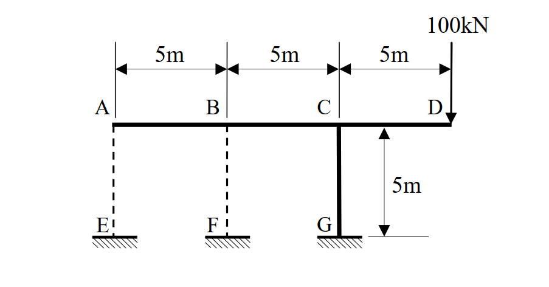

# SA-2018-3 題目正本

> 本檔只記錄考卷上寫了什麼、圖上畫了什麼，不含任何解法。解析見同資料夾 `SA-2018-3.md`。
> 判讀清單經使用者確認前，狀態為「待確認」；確認後本檔原則上不再修改（改動須回考卷原圖並記 log）。

| 項目 | 內容 |
|---|---|
| 考卷 | `raw/exams/SA-2018_結構學.pdf`，頁次 2－2 上半，第三題（無圖號） |
| 考年 | 2018（民國 107 年）專技高考結構工程技師「結構學」 |
| 配分 | 25 分 |
| 附圖 | `SA-2018-3-fig-1.png` |
| 判讀狀態 | **已確認**（2026-11-07 使用者確認。原轉錄：2026-11-07 轉錄；PyMuPDF 110 dpi 整頁＋300–500 dpi 局部放大、PDF 向量座標核對；盲讀於開啟解析前完成） |

## 1. 考卷原文（逐字）

三、如下圖結構在D 點受100 kN 向下集中力作用，試以最小功法求纜索AE 及BF 的內力，並繪梁A~D 之彎矩圖。圖中粗黑實線表示梁柱桿件，斷面EI 值皆為1000 kN-m²，忽略軸向及剪切變形；細虛線表示只承受拉力的纜索，斷面EA 值為500 kN。（25 分）

## 2. 考卷給的公式、附表與參數

- 考卷沒有給任何參考公式或附表。
- 梁柱 EI＝1000 kN-m²，忽略軸向及剪切變形；纜索 EA＝500 kN，只承受拉力。
- 指定方法：最小功法（未寫他法不計分）。
- 卷首注意事項：㈠可以使用電子計算器。㈡不必抄題，作答時請將試題題號及答案依照順序寫在試卷上，於本試題上作答者，不予計分。㈢本科目除專門名詞或數理公式外，應使用本國文字作答。
- 考試時間：2 小時。

## 3. 附圖

*證據圖 SA-2018-3-fig-1.png*

圖面文字照錄：100kN、5m、5m、5m、A、B、C、D、5m、E、F、G

## 4. 判讀清單

| # | 項目 | 判讀 | 圖上／題文依據 | 把握 |
|---|---|---|---|---|
| 1 | 梁 | A–B–C–D 連續梁，AB＝BC＝CD＝5 m；D 為自由端 | 上方尺寸 x 分界對齊 A、B、C、D | 確定 |
| 2 | 柱 | C–G 垂直 5 m，C 剛接（T 形接頭），G 固定 | 粗實線；G 底剖線 | 確定（解讀）；使用者確認 |
| 3 | 纜索 | A–E、B–F 垂直細虛線，長 5 m，只受拉；兩端視為鉸接 | 題文；虛線 | 確定 |
| 4 | E、F | 地面錨碇（剖線），與 G 同高 | 底線 y=283.3 同高 | 確定 |
| 5 | 載重 | D 點 100 kN 向下 | 箭頭尖端在 D | 確定 |
| 6 | 剛度 | 梁柱 EI＝1000 kN-m²，忽略軸向、剪切；纜索 EA＝500 kN | 題文 | 確定 |
| 7 | 靜不定度 | G 3＋纜索 2＝5 未知、3 方程式：二度靜不定（須確認纜索受拉） | 計數 | 確定 |
| 8 | 所求 | 纜索 AE、BF 內力；梁 A~D 彎矩圖（題目只要梁，不含柱 CG） | 題文 | 確定 |
| 9 | 證據圖 | 既有 fig-1 乾淨，沿用 | — | 確定 |

---
*轉錄：2026-11-07（SA-U2-1 題目正本推廣・批 1）*
*確認：2026-11-07 使用者確認*
