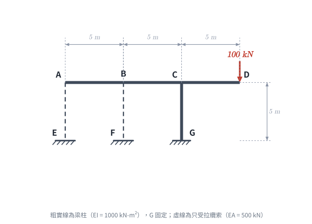
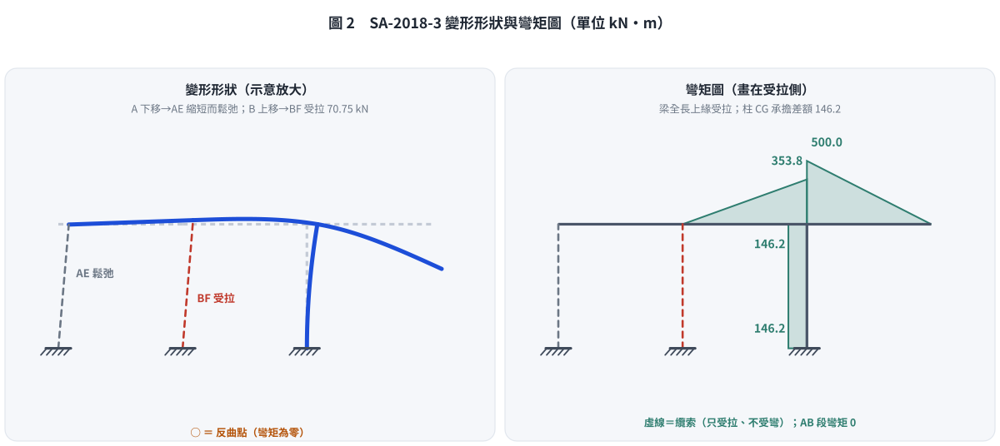

# 考題編號：SA-2018-3

**主分類：** `SA-U2-1` 靜不定結構最小功法
**副分類：** 無
**分析法：** 最小功法 (Castigliano's 2nd Theorem)
**標籤：** `最小功法`, `靜不定結構`, `纜索無壓力`, `彎矩圖`

---

## 1. 題目（考卷原文見題目正本）

> 考卷原文、公式／附表、附圖與判讀清單（已確認）見 [`SA-2018-3-problem.md`](SA-2018-3-problem.md)。本節只列解題時最容易讀錯的地方與本解使用的記號；題意以題目正本為準。

*重繪自考卷附圖，依判讀清單 #1–#9 重繪。攔：把纜索當成可受壓的桿件。*

### 常見誤讀
| 項目 | 正確判讀 | 常見誤讀 |
|---|---|---|
| 纜索 | 只受拉；計算出受壓就鬆弛（內力取 0） | 可拉可壓的二力桿 |
| 柱 CG | C 為剛接 T 形接頭，G 固定 | C 鉸接 |
| 所求 | 纜索 AE、BF 內力與梁 A~D 彎矩圖 | 含柱 CG 彎矩圖 |

**本解記號：** 記號與正負號約定沿用 §4。

---

## 1.5 基本設定與物理判斷

觀察題目所給結構，梁 ABCD 由柱 CG 及纜索 AE、BF 支撐。特別注意題目提示：「**細虛線表示只承受拉力的纜索**」。這是一個極重要的陷阱，意味著在受力變形過程中，若計算出纜索受壓，則該纜索實際上會發生**鬆弛 (Slack)**，其內力為 0。

- 結構幾何與剛度：
  - 梁 ABCD 長度分段：$L_{AB}=5\text{m}$, $L_{BC}=5\text{m}$, $L_{CD}=5\text{m}$。$EI = 1000 \text{ kN-m}^2$。
  - 柱 CG 長度：$L_{CG}=5\text{m}$。$EI = 1000 \text{ kN-m}^2$。
  - 纜索 AE, BF 長度：$L = 5\text{m}$。$EA = 500 \text{ kN}$。
- 忽略梁、柱之軸向與剪切變形。

若無纜索作用，D 點 $100\text{ kN}$ 向下的載重會對 C 點產生巨大的順時針彎矩 $M_C = 100 \times 5 = 500 \text{ kN-m}$。此彎矩由柱 CG 抵抗，導致柱頂 C 點發生順時針旋轉角 $\theta_C = \frac{M L}{EI} = \frac{500 \times 5}{1000} = 2.5 \text{ rad}$。
這會使得 A、B 兩點產生極大的向上位移（$v_A \approx 25\text{m}, v_B \approx 12.5\text{m}$）。因此，纜索勢必會被拉伸以抵抗此位移。

然而，若我們同時將 AE ($X_1$) 與 BF ($X_2$) 設為冗力並列出最小功聯立方程式，會解得 $X_1 < 0$，代表 AE 處於壓力狀態。由於纜索**無法承受壓力**，因此 **AE 必定鬆弛，其內力 $X_1 = 0$**。以下我們直接以 $X_1 = 0$、僅 $X_2$（BF拉力）為冗力進行分析，並在事後驗證 A 點位移。

---

## 2. 最小功法解析 (單一冗力 $X_2$)

去除鬆弛的纜索 AE，設纜索 BF 的拉力為 $X_2$ (冗力)。

### 2.1 彎矩函數建立
定義各桿件之彎矩 $M$ (以造成梁底面/柱右面受拉為正)：
- **AB段** (0~5m)：無外力作用，$M_{AB} = 0$。
- **BC段** (設 $x$ 由 B 點向右起算，0~5m)：僅受 B 點向下力 $X_2$，$M_{BC}(x) = -X_2 x$。
- **CD段** (設 $x$ 由 D 點向左起算，0~5m)：受 D 點向下力 100kN，$M_{CD}(x) = -100 x$。
- **CG段 (柱)** (由 C 至 G)：
  在節點 C 取力矩平衡。梁 BC 對 C 點的彎矩為 $-5 X_2$ (逆時針)，梁 CD 對 C 點的彎矩為 $-500$ (順時針)。
  故柱 CG 必須提供一抵抗彎矩，使得整體平衡。由於無水平力作用，柱的剪力為 0，彎矩呈常數分佈。
  $M_{CG} = 500 - 5 X_2$ (常數)。

### 2.2 應變能與最小功方程式
總應變能 $U = \sum \int \frac{M^2}{2EI} ds + \sum \frac{F^2 L}{2EA}$。
依據最小功法 (卡氏第二定理)，$\frac{\partial U}{\partial X_2} = 0$：
$$ \frac{\partial U}{\partial X_2} = \int \frac{M_{BC}}{EI} \left(\frac{\partial M_{BC}}{\partial X_2}\right) dx + \int \frac{M_{CG}}{EI} \left(\frac{\partial M_{CG}}{\partial X_2}\right) dy + \frac{X_2 L_{BF}}{EA} = 0 $$

將彎矩函數與偏導數代入 ($EI = 1000, EA = 500$)：
$$ \frac{\partial M_{BC}}{\partial X_2} = -x \quad , \quad \frac{\partial M_{CG}}{\partial X_2} = -5 $$

計算各項積分：
1. BC段：$\int_0^5 \frac{(-X_2 x)(-x)}{1000} dx = \frac{X_2}{1000} \left[ \frac{x^3}{3} \right]_0^5 = \frac{125}{3000} X_2 = \frac{125}{3} \times 10^{-3} X_2$
2. CG段：$\int_0^5 \frac{(500 - 5 X_2)(-5)}{1000} dy = \frac{-25}{1000} (500 - 5 X_2) = \left(-12.5 + \frac{125}{1000} X_2 \right)$
3. 纜索BF：$\frac{X_2 \times 5}{500} = \frac{10}{1000} X_2$

將三項相加並令其等於 0：
$$ \left( \frac{125/3}{1000} + \frac{125}{1000} + \frac{10}{1000} \right) X_2 - 12.5 = 0 $$
$$ \left( \frac{125}{3} + 135 \right) \frac{X_2}{1000} = 12.5 $$
$$ \left( \frac{125 + 405}{3} \right) X_2 = 12500 \implies \frac{530}{3} X_2 = 12500 $$
$$ X_2 = \frac{37500}{530} = \frac{3750}{53} \approx 70.755 \text{ kN} $$

### 2.3 驗證纜索 AE 鬆弛 (Slack)
我們需計算 A 點的最終位移，確認其向下移動 (使得纜索長度變短而鬆弛)。
在 A 點施加一向下單位虛擬力 $P_A = 1$：
- $m_{BC}(x) = -(x+5)$
- $m_{CG} = -10$
$$ v_A = \int_0^5 \frac{M_{BC} m_{BC}}{EI} dx + \int_0^5 \frac{M_{CG} m_{CG}}{EI} dy $$
$$ v_A = \int_0^5 \frac{(-70.755 x)(-(x+5))}{1000} dx + \int_0^5 \frac{(500 - 5(70.755))(-10)}{1000} dy $$
$$ v_A = \frac{70.755}{1000} \left( \frac{125}{3} + \frac{125}{2} \right) - \frac{50}{1000}(146.225) = 7.370 - 7.311 = 0.059 \text{ m} \text{ (向下)} $$
因為 $v_A > 0$ (A 點向下位移)，纜索 AE 受壓縮而發生鬆弛，驗證 $X_1 = 0$ 完全正確！

---

## 3. 彎矩圖 (梁 A~D)

根據算出的 $X_2 = \frac{3750}{53} \text{ kN}$，計算各關鍵點的彎矩：
- **A 點與 B 點：** $M_A = M_B = 0$ (AB段無外力，且 AE 鬆弛)。
- **C 點左側 (BC段端點)：** $M_{C-} = -X_2 \times 5 = -70.755 \times 5 = -353.77 \text{ kN-m}$。
- **C 點右側 (CD段端點)：** $M_{C+} = -100 \times 5 = -500 \text{ kN-m}$。
- **D 點：** $M_D = 0$。

*(註：C 點左右兩側的彎矩差額 $500 - 353.77 = 146.23 \text{ kN-m}$，即為傳遞至柱 CG 的彎矩。)*

**繪圖指示：**
1. 繪製 A-B-C-D 基準線。
2. AB 段彎矩為 0。
3. BC 段為一次線性分佈，從 B 點的 0 漸增至 C 點左側的 $-353.77 \text{ kN-m}$ (上方受拉)。
4. CD 段為一次線性分佈，從 D 點的 0 漸增至 C 點右側的 $-500 \text{ kN-m}$ (上方受拉)。
5. 注意在 C 點有一突跳不連續 (被柱吸收)。

*圖 2　變形形狀與彎矩圖（虛線為纜索；以 §2 的 $X_2 = 3750/53$ kN 代入，並驗證 B 上移量等於 BF 伸長量 $X_2 L/EA$）。A 點往下掉，AE 長度變短，只能鬆弛。攔：把 AE 當成可受壓的桿件、兩索一起當贅力。*

## 4. 結論
- **纜索 AE 內力：** $0 \text{ kN}$ (鬆弛)
- **纜索 BF 內力：** $70.75 \text{ kN}$ (拉力)

*修正日期：2026-11-07（§1 改為指向題目正本並放重繪附圖（figs/SA-2018-3-fig-1-problem.svg）、加常見誤讀；原解析無題目重述，新增 §1（首次引用證據圖見題目正本），原 §1「基本設定與物理判斷」改為 §1.5；圖由 gen_SA-2018-3.py 產生，可重跑）*
*圖解補繪：2026-11-07（圖 2 變形與彎矩圖，向量圖，腳本 `gen_SA-2018-3.py`，可重跑）*
