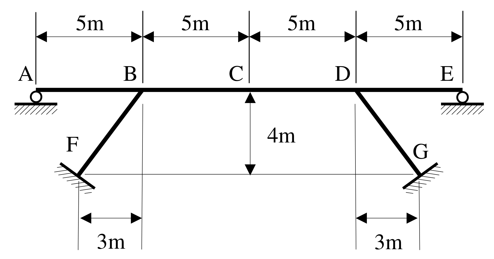

# SA-2018-4 題目正本

> 本檔只記錄考卷上寫了什麼、圖上畫了什麼，不含任何解法。解析見同資料夾 `SA-2018-4.md`。
> 判讀清單經使用者確認前，狀態為「待確認」；確認後本檔原則上不再修改（改動須回考卷原圖並記 log）。

| 項目 | 內容 |
|---|---|
| 考卷 | `raw/exams/SA-2018_結構學.pdf`，第 2 頁（頁次 2－2），第四題 |
| 考年 | 2018（民國一百零七年）專技高考結構工程技師「結構學」 |
| 配分 | 25 分 |
| 附圖 | `SA-2018-4-fig-2.png`（2026-11-07 重新擷取）；既有 `SA-2018-4-fig-1.png` |
| 判讀狀態 | **已確認**（2026-11-07 使用者確認。原轉錄：2026-11-07 轉錄；PyMuPDF 110 dpi 整頁＋450–1200 dpi 局部放大；考卷可抽文字，逐字原文以 PDF 文字層核對；盲讀於開啟解析前完成） |

## 1. 考卷原文（逐字）

四、靜不定橋梁結構如下圖，A、E 為滾支承，F、G 為固定支承。請在上部梁 A-B-C-D-E 上繪出中點 C 向下位移的影響線。請註明正負並標明所有局部最大、最小值。假設所有斷面 EI 皆為 800 kN-m²，且只考慮撓曲變形，不計軸向變形和剪切變形。靜不定結構分析方法不限制。（25 分）

## 2. 考卷給的公式、附表與參數

- 考卷沒有給任何參考公式或附表。
- 所有斷面 EI = 800 kN-m²；只考慮撓曲變形，不計軸向與剪切變形。
- 卷首注意事項：㈠可以使用電子計算器。㈡不必抄題，作答時請將試題題號及答案依照順序寫在試卷上，於本試題上作答者，不予計分。㈢本科目除專門名詞或數理公式外，應使用本國文字作答。
- 考試時間：2 小時。

## 3. 附圖

*證據圖 SA-2018-4-fig-2.png（2026-11-07 自考卷 500 dpi 重新擷取）；既有 SA-2018-4-fig-1.png 帶有滑鼠游標（手形游標在左側 3m 尺寸線旁），保留不改。*

圖面文字照錄：5m、5m、5m、5m、A、B、C、D、E、4m、F、G、3m、3m

## 4. 判讀清單

| # | 項目 | 判讀 | 圖上／題文依據 | 把握 |
|---|---|---|---|---|
| 1 | 座標（以 A 為原點） | A(0,0)、B(5,0)、C(10,0)、D(15,0)、E(20,0)；F(2,−4)、G(18,−4) | 上方 4×5m 尺寸線；C 下 4m 尺寸線至 F–G 連線；下方 3m 尺寸線自 F、G 量到 B、D 鉛垂線（450 dpi） | 確定 |
| 2 | 斜撐 | BF、DG，長 5 m，B、D 處向外下斜（呈「八」字張開） | 圖面 | 確定 |
| 3 | 節點 B、D | 梁與斜撐剛接（無鉸圈） | 圖面 | 確定（解讀）；使用者確認 |
| 4 | 支承 A、E | 滾支承（圓圈＋剖線） | 題文＋圖面 | 確定 |
| 5 | 支承 F、G | 固定支承（垂直於斜撐的板＋剖線） | 題文＋圖面 | 確定 |
| 6 | EI | 全部構件 800 kN-m² | 題文 | 確定 |
| 7 | 所求 | 上部梁 A–E 上單位力移動時，C 點向下位移的影響線；註明正負、標出所有局部極大極小值 | 題文 | 確定 |
| 8 | 變形假設 | 只考慮撓曲；不計軸向（梁與斜撐軸向不變形）與剪切 | 題文 | 確定 |

---
*轉錄：2026-11-07（SA-U1-3 題目正本推廣・批 1）*
*確認：2026-11-07 使用者確認*
