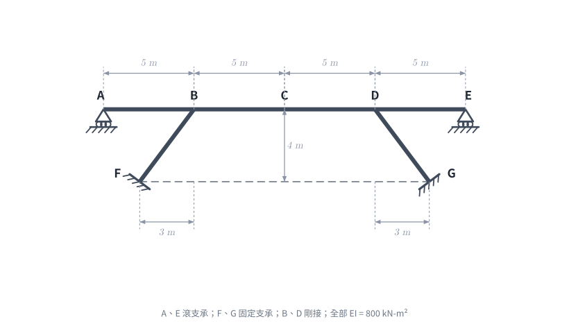
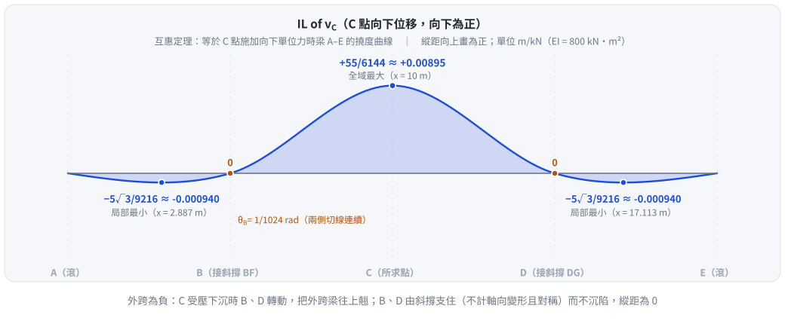

# 考題編號：SA-2018-4

**主分類：** `SA-U1-3` 靜定及靜不定結構影響線
**副分類：** 無
**分析法：** 馬克士威-貝提互惠定理 (Maxwell-Betti Reciprocal Theorem) + 傾角撓度法
**標籤：** `影響線`, `靜不定結構`, `對稱性`, `剛架位移`

---

## 1. 題目（考卷原文見題目正本）

> 考卷原文、公式／附表、附圖與判讀清單（已確認）見 [`SA-2018-4-problem.md`](SA-2018-4-problem.md)。本節只列解題時最容易讀錯的地方與本解使用的記號；題意以題目正本為準。

*重繪自考卷附圖，依判讀清單 #1–#8 重繪。攔：斜撐方向讀反（F、G 在 B、D 外側）、F、G 讀成鉸支承。*

### 常見誤讀
| 項目 | 正確判讀 | 常見誤讀 |
|---|---|---|
| 斜撐位置 | F 在 B 左方 3 m、G 在 D 右方 3 m，皆在梁下 4 m（向外張開） | 向內收 |
| F、G 支承 | 固定支承 | 鉸支承 |
| B、D 接頭 | 剛接（考卷無鉸圈） | 鉸接 |
| 所求 | 單位力沿 A–E 移動時 C 點向下位移的影響線 | C 點彎矩影響線 |

**本解記號：** 記號與正負號約定沿用 §4。

---

## 1.5 核心觀念與物理簡化

依據 **馬克士威-貝提互惠定理 (Maxwell-Betti Reciprocal Theorem)**，要求 C 點向下位移 $v_C$ 的影響線 $IL_{v_C}(x)$，其形狀與數值**完全等同於在 C 點施加一單位向下力 ($P=1$) 時，整個梁 A-B-C-D-E 的撓度曲線 $v(x)$**。

### 1.1 對稱性與運動學分析
當我們在 C 點施加向下單位力時，結構幾何與載重呈現**完全對稱**。
- 由於忽略所有軸向變形 ($EA = \infty$)，梁 A-E 各點的水平位移必須相同，設為 $u$。
- F、G 為固定端。斜向構件 BF 與 DG 長度皆為 $\sqrt{3^2 + 4^2} = 5\text{ m}$。
- 對於構件 BF，B 點位移必須與 BF 垂直，故運動學限制為 $3u + 4v_B = 0 \implies v_B = -0.75u$。
- 對於構件 DG，D 點位移必須與 DG 垂直，限制為 $-3u + 4v_D = 0 \implies v_D = 0.75u$。
- 然而，因為結構與載重對稱，結構的變形也必然對稱，即 $v_B = v_D$。
- 代入後得到 $-0.75u = 0.75u \implies u = 0$。進而得出 **$v_B = 0$ 且 $v_D = 0$**。

**重要結論：** 在 C 點施加對稱載重時，結構不發生側移，且 B、D 兩點不發生垂直位移！因此，B 與 D 可視為**剛性鉸支承**。
同時，斜向構件 BF 與 DG 兩端皆無平移，僅在 B、D 點隨梁旋轉。這兩根構件提供了轉動勁度 $K = \frac{4EI}{L_{BF}} = \frac{4(800)}{5} = 640 \text{ kN-m/rad}$。

---

## 2. 傾角撓度法求解

將梁視為連續梁，在 B、D 點有剛性垂直支承與旋轉彈簧。
利用對稱性，$\theta_C = 0$。我們來解節點 B 的轉角 $\theta_B$。

- **AB 段 (L=5m)**：A 為滾支承 ($M_A=0$)，故 $M_{BA} = \frac{3EI}{L} \theta_B = \frac{3(800)}{5} \theta_B = 480 \theta_B$。
- **BF 段 (旋轉彈簧)**：$M_{BF} = 640 \theta_B$。
- **BD 段 (L=10m)**：跨中 C 點受 $P=1$。兩端固定彎矩 (FEM) 為 $\pm \frac{PL}{8} = \pm \frac{1(10)}{8} = \pm 1.25 \text{ kN-m}$。
  $M_{BD} = \frac{2EI}{10} (2\theta_B + \theta_D) - 1.25$。因對稱性 $\theta_D = -\theta_B$，
  $M_{BD} = \frac{EI}{5} \theta_B - 1.25 = 160 \theta_B - 1.25$。

**節點 B 力矩平衡**：
$$ M_{BA} + M_{BF} + M_{BD} = 0 $$
$$ 480 \theta_B + 640 \theta_B + 160 \theta_B - 1.25 = 0 \implies 1280 \theta_B = 1.25 \implies \theta_B = \frac{1}{1024} \text{ rad} $$

將 $\theta_B$ 代回求桿端彎矩：
- $M_{BA} = 480 \times \frac{1}{1024} = \frac{15}{32} \text{ kN-m}$ (對 AB 段為負彎矩，即上方受拉)。
- $M_{BD} = 160 \times \frac{1}{1024} - 1.25 = -\frac{35}{32} \text{ kN-m}$ (對 BD 段為負彎矩)。

---

## 3. 影響線數值計算 (撓度曲線)

### 3.1 跨度 AB (與跨度 DE 對稱)
AB 段僅受端彎矩 $M_B = -15/32 \text{ kN-m}$，無跨中載重。
其撓度曲線 (向下為正)：
$$ v(x) = \frac{M_B\, x (L^2 - x^2)}{6 EI \cdot L} = \frac{(-15/32)\, x (25 - x^2)}{6(800)(5)} = \frac{x (x^2 - 25)}{51200} $$
欲求局部極值，令 $v'(x) = 0 \implies 3x^2 - 25 = 0 \implies x = \frac{5}{\sqrt{3}} \approx 2.887 \text{ m}$ (自 A 點起算)。
代入得局部最小值 (最大向上位移)：
$$ v_{min} = -\frac{5\sqrt{3}}{9216} \approx -0.000940 \text{ m} $$

### 3.2 跨度 BD (計算 C 點最大值)
BD 段長 10m，跨中受 $P=1$，兩端受負彎矩 $M = -35/32 \text{ kN-m}$。
C 點位移為懸垂位移與端彎矩位移的疊加：
$$ v_C = \frac{P L_{BD}^3}{48 EI} + \frac{M L_{BD}^2}{8 EI} = \frac{1 \times 10^3}{48(800)} - \frac{(35/32) \times 10^2}{8(800)} $$
$$ v_C = \frac{1000}{38400} - \frac{3500}{204800} = \frac{5}{192} - \frac{35}{2048} = \frac{160 - 105}{6144} = \frac{55}{6144} \approx 0.00895 \text{ m} $$
此即為全結構影響線的**正向最大值**。

---

## 4. 影響線繪製重點整理

影響線 $IL_{v_C}(x)$ 之特徵如下：
1. **A 點 ($x=0$)**：0
2. **A~B 區段**：影響線為負值 (代表載重在此區段會使 C 點上抬)。
   - **局部最小值**發生在距離 A 點 $\frac{5}{\sqrt{3}} \approx 2.887\text{m}$ 處，值為 **$-\frac{5\sqrt{3}}{9216} \approx -0.000940 \text{ m/kN}$**。
3. **B 點 ($x=5\text{m}$)**：0
4. **B~D 區段**：影響線為正值 (載重在此區段使 C 點下沉)。
   - **全域最大值**發生在中點 C ($x=10\text{m}$)，值為 **$\frac{55}{6144} \approx 0.00895 \text{ m/kN}$**。
5. **D 點 ($x=15\text{m}$)**：0
6. **D~E 區段**：對稱於 A~B，影響線為負值。
   - **局部最小值**發生在距離 E 點 $\frac{5}{\sqrt{3}}\text{m}$ (即 $x \approx 17.113\text{m}$) 處，值為 **$-\frac{5\sqrt{3}}{9216} \approx -0.000940 \text{ m/kN}$**。
7. **E 點 ($x=20\text{m}$)**：0

*圖 2　C 點向下位移影響線（互惠定理：即 C 點受向下單位力時梁 A–E 的撓度曲線）。攔的是把外跨 AB、DE 畫成 0 —— B、D 不沉陷但會轉動，外跨被翹起而為負；以及漏掉斜撐的轉動勁度、把 BD 當簡支梁（C 值會變成 $\frac{5}{192}$）。*

*修正日期：2026-11-07（§1 改為指向題目正本並放重繪附圖（figs/SA-2018-4-fig-1-problem.svg）、加常見誤讀；原解析無題目重述，新增 §1，原 §1「核心觀念與物理簡化」改為 §1.5；圖由 gen_SA-2018-4.py 產生，可重跑）*
*圖解補繪：2026-11-07（圖 2 影響線，向量圖，腳本 `gen_SA-2018-4_il.py`，可重跑）*
*修正日期：2026-11-07（表述更正（非勘誤）：§3.1 中間式改為 $M_B\,x(L^2-x^2)/(6EIL)$（正彎矩向下撓為正），原寫法代入 $M_B = -15/32$ 與最終式差一個負號；最終式與極值不變）*
