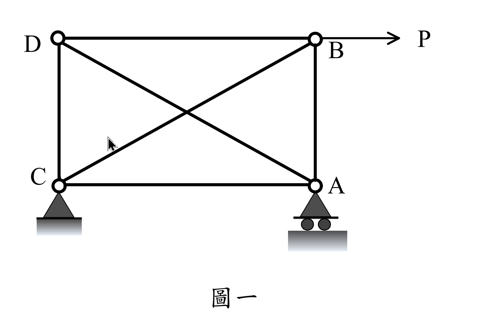
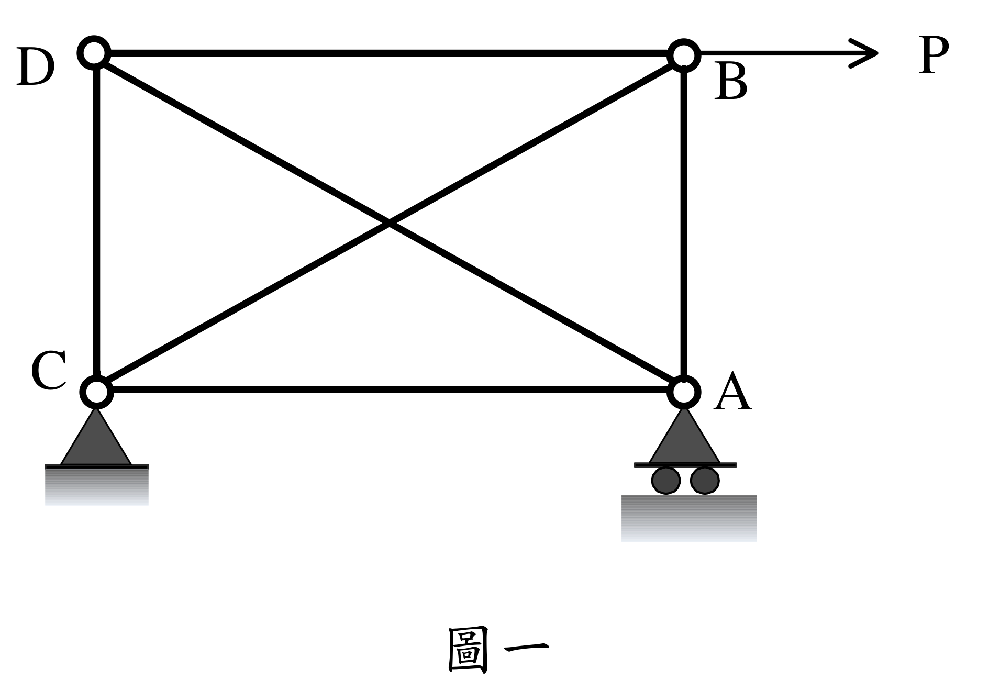

# SA-2019-1 題目正本

> 本檔只記錄考卷上寫了什麼、圖上畫了什麼，不含任何解法。解析見同資料夾 `SA-2019-1.md`。
> 判讀清單經使用者確認前，狀態為「待確認」；確認後本檔原則上不再修改（改動須回考卷原圖並記 log）。

| 項目 | 內容 |
|---|---|
| 考卷 | `raw/exams/SA-2019_結構學.pdf`，頁次 3－1，第一題（圖一） |
| 考年 | 2019（民國 108 年）專技高考結構工程技師「結構學」 |
| 配分 | 25 分 |
| 附圖 | `SA-2019-1-fig-1.png`、`SA-2019-1-fig-2.png` |
| 判讀狀態 | **已確認**（2026-11-07 使用者確認。原轉錄：2026-11-07 轉錄；PyMuPDF 110 dpi 整頁＋300–500 dpi 局部放大、PDF 向量座標核對；盲讀於開啟解析前完成） |

## 1. 考卷原文（逐字）

一、如圖一所示之桁架，各桿件都有相同之楊氏模數E 及斷面積A。已知對角桿件長15 m，水平桿件長12 m，垂直桿件長9 m。若各桿件之軸拉強度都為1250 kN，而軸壓強度如下：對角桿件144 kN、水平桿件225 kN、垂直桿件400 kN。今考慮B 點受一向右之力P，若P 由0 逐漸加大，則B 點之向右位移UB 也會逐漸加大，直至最後桁架會形成破壞機構。試求出破壞機構形成時對應之極限外力，並且以P 為縱軸UB 為橫軸，試繪出加載至破壞機構過程中P 對UB 的定性（大致）關係圖。假設各桿件強度達到之前都是線彈性，而強度達到後，張桿內力可以維持其強度但壓桿內力變為零，此外不論張或壓桿，強度達到後勁度都為零。（25 分）

## 2. 考卷給的公式、附表與參數

- 考卷沒有給任何參考公式或附表。
- E、A 各桿相同，沒有數值（P–U_B 圖為定性）。
- 軸拉強度 1250 kN（全部桿件）；軸壓強度：對角 144 kN、水平 225 kN、垂直 400 kN。
- 材料行為：達強度前線彈性；達強度後張桿維持強度、壓桿內力變為零；勁度皆為零。
- 卷首注意事項：㈠可以使用電子計算器。㈡不必抄題，作答時請將試題題號及答案依照順序寫在試卷上，於本試題上作答者，不予計分。㈢本科目除專門名詞或數理公式外，應使用本國文字作答。
- 考試時間：2 小時。

## 3. 附圖

*證據圖 SA-2019-1-fig-1.png*

*證據圖 SA-2019-1-fig-2.png（2026-11-07 自考卷重新擷取 500 dpi，無游標）*

圖面文字照錄：D、B、P、C、A、圖一

## 4. 判讀清單

| # | 項目 | 判讀 | 圖上／題文依據 | 把握 |
|---|---|---|---|---|
| 1 | 節點 | D 左上、B 右上、C 左下、A 右下 | 圖面字母 | 確定 |
| 2 | 桿件 | DB、CA（水平）、DC、BA（垂直）、DA、CB（對角）共 6 根；對角交叉不相連 | 交叉點無圓圈 | 確定 |
| 3 | C | 鉸支承（2 反力） | 實心三角形接地 | 確定（解讀）；使用者確認 |
| 4 | A | 滾支承（三角形＋兩圓輪）：提供垂直反力 | 圖面 | 確定（解讀）；使用者確認 |
| 5 | 幾何 | 水平 12 m、垂直 9 m、對角 15 m（圖上沒有尺寸線） | 題文 | 確定 |
| 6 | 載重 | B 點 P 水平向右，由 0 漸增 | 箭頭由 B 向右 | 確定 |
| 7 | 強度 | 拉 1250（全部）；壓 對角 144、水平 225、垂直 400 kN | 題文 | 確定 |
| 8 | 靜不定度 | m 6＋r 3＝9＞2j 8：一度靜不定 | 計數 | 確定 |
| 9 | 所求 | 破壞機構形成時之極限外力；P–U_B 定性圖 | 題文 | 確定 |
| 10 | 證據圖 | 舊 fig-1 的箭頭游標在 C–B 斜桿附近；新增 fig-2（500 dpi） | — | 確定 |

---
*轉錄：2026-11-07（SA-U2-1 題目正本推廣・批 1）*
*確認：2026-11-07 使用者確認*
