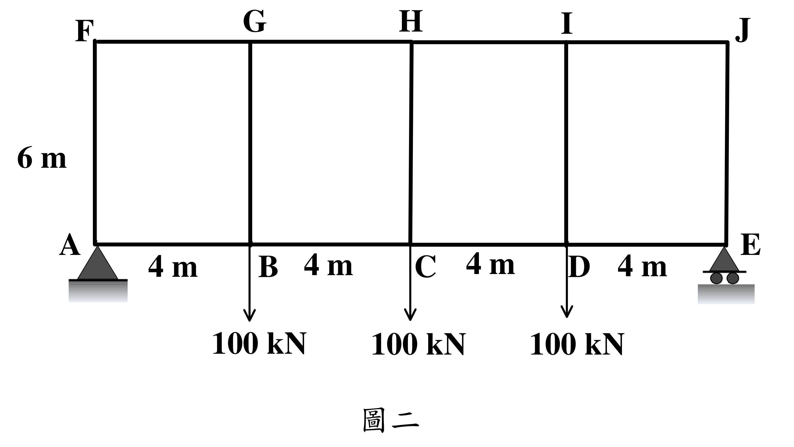

# SA-2019-2 題目正本

> 本檔只記錄考卷上寫了什麼、圖上畫了什麼，不含任何解法。解析見同資料夾 `SA-2019-2.md`。
> 判讀清單經使用者確認前，狀態為「待確認」；確認後本檔原則上不再修改（改動須回考卷原圖並記 log）。

| 項目 | 內容 |
|---|---|
| 考卷 | `raw/exams/SA-2019_結構學.pdf`，第 2 頁（頁次 3－2），第二題（圖二） |
| 考年 | 2019（民國 108 年）專技高考結構工程技師「結構學」 |
| 配分 | 25 分 |
| 附圖 | `SA-2019-2-fig-2.png`（本次從考卷擷取 500 dpi；既有 `SA-2019-2-fig-1.png` 保留） |
| 判讀狀態 | **已確認**（2026-11-07 使用者確認；原轉錄：2026-11-07 轉錄；PyMuPDF 110 dpi 整頁（附圖為向量圖，文字可抽取）；盲讀於開啟解析前完成） |

## 1. 考卷原文（逐字）

二、范倫迪爾桁架（Vierendeel Truss）實際上受力行為像是構架，因為構件彼此接合為剛接。考慮圖二之范倫迪爾桁架，其受力後各構件受彎矩之變形為一雙曲率變形，採近似分析時可假設反曲點位於各構件之中點，據此假設，分析該桁架，並繪出上下弦桿之彎矩圖、軸力圖及腹桿之彎矩圖、軸力圖。（25 分）

## 2. 考卷給的公式、附表與參數

- 考卷沒有給任何參考公式。
- 給定假設：各構件反曲點位於中點。
- 考卷沒有給 EI（近似分析不需要）。
- 卷首注意事項：㈠可以使用電子計算器。㈡不必抄題，作答時請將試題題號及答案依照順序寫在試卷上，於本試題上作答者，不予計分。㈢本科目除專門名詞或數理公式外，應使用本國文字作答。
- 考試時間：2 小時。代號 00340，頁次 3－1～3－3。

## 3. 附圖

*證據圖 SA-2019-2-fig-2.png（500 dpi，自考卷擷取；舊證據圖 SA-2019-2-fig-1.png 有游標雜訊，保留不改）*

圖面文字照錄：F、G、H、I、J、6 m、A、B、C、D、E、4 m、4 m、4 m、4 m、100 kN、100 kN、100 kN、圖二

## 4. 判讀清單

| # | 項目 | 判讀 | 圖上／題文依據 | 把握 |
|---|---|---|---|---|
| 1 | 支承 | A 鉸支承（實心三角形）；E 滾支承（三角形下有兩滾輪） | 圖面 | 確定 |
| 2 | 幾何 | 下弦 A–E 四格各 4 m（共 16 m）；高 6 m（A 至 F） | 尺寸文字 | 確定 |
| 3 | 構件 | 上弦 FG、GH、HI、IJ；下弦 AB、BC、CD、DE；腹桿 AF、BG、CH、DI、EJ；全部剛接 | 題文＋圖面 | 確定 |
| 4 | 載重 | B、C、D 各 100 kN 向下（作用於下弦節點） | 箭頭自 B、C、D 向下 | 確定 |
| 5 | 近似假設 | 所有構件反曲點在中點 | 題文 | 確定 |
| 6 | 考卷沒有給 | EI、構件斷面；上弦無載重 | 題文 | 確定 |
| 7 | 所求 | 上下弦桿與腹桿的彎矩圖、軸力圖 | 題文 | 確定 |
| 8 | 證據圖 | 既有 fig-1 左側有游標（未壓到構件）；另擷取 500 dpi 乾淨版 fig-2 | 縮圖總表 | 確定 |

---
*轉錄：2026-11-07（SA 剩餘單元（U1-2 尾段、U2-5、U3-1、U3-2）題目正本推廣・批 1）*
*確認：2026-11-07 使用者確認*
