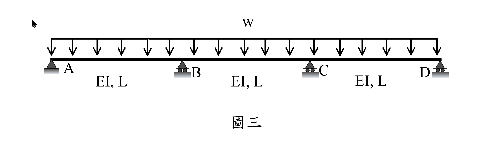
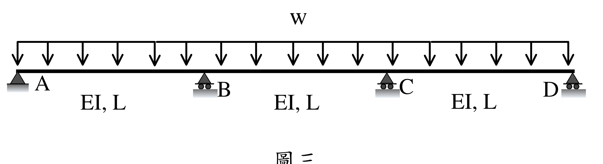

# SA-2019-3 題目正本

> 本檔只記錄考卷上寫了什麼、圖上畫了什麼，不含任何解法。解析見同資料夾 `SA-2019-3.md`。
> 判讀清單經使用者確認前，狀態為「待確認」；確認後本檔原則上不再修改（改動須回考卷原圖並記 log）。

| 項目 | 內容 |
|---|---|
| 考卷 | `raw/exams/SA-2019_結構學.pdf`，第 2 頁下半，第三題（圖三） |
| 考年 | 2019（民國 108 年）專技高考結構工程技師「結構學」 |
| 配分 | 25 分 |
| 附圖 | `SA-2019-3-fig-1.png`、`SA-2019-3-fig-2.png` |
| 判讀狀態 | **已確認**（2026-11-07 使用者確認。原轉錄：2026-11-05 轉錄；PyMuPDF 110 dpi 整頁＋400–500 dpi 局部放大；盲讀於開啟解析前完成） |

## 1. 考卷原文（逐字）

三、如圖三所示受均布載重 w 之三跨連續梁，考慮支承 B 及支承 C 都向下沉陷，且沉陷量相同。當沉陷量增加時，支承 A 及 D 垂直反力會增加，而支承 B 及 C 垂直反力會減少。試問當沉陷量為多少時，支承 A 垂直反力會增加 0.1 wL？試以傾角變位法求解。以其他方法作答者一律不予以計分。（25 分）

## 2. 考卷給的公式、附表與參數

- 考卷沒有給任何參考公式或附表。
- 沉陷量以 w、L、EI 表示（題目未給數值）。
- 卷首注意事項：㈠可以使用電子計算器。㈡不必抄題，作答時請將試題題號及答案依照順序寫在試卷上，於本試題上作答者，不予計分。㈢本科目除專門名詞或數理公式外，應使用本國文字作答。
- 考試時間：2 小時。

## 3. 附圖

*證據圖 SA-2019-3-fig-1.png*

*證據圖 SA-2019-3-fig-2.png（2026-11-05 自考卷重新擷取 500 dpi，無游標）*

圖面文字照錄：w、A、B、C、D、EI, L、EI, L、EI, L、圖三

## 4. 判讀清單

| # | 項目 | 判讀 | 圖上／題文依據 | 把握 |
|---|---|---|---|---|
| 1 | A | 鉸支承 | 三角形、無滾輪（500 dpi） | 確定 |
| 2 | B、C、D | 滾支承 | 三角形下有兩個滾輪 | 確定 |
| 3 | 跨長與剛度 | 三跨各長 L、EI 相同 | 每跨標 EI, L | 確定 |
| 4 | 載重 | 均布 w 向下，A 至 D 全長 | 箭頭範圍 A 至 D；題文 | 確定 |
| 5 | 沉陷 | B、C 同量向下沉陷 Δ（未知，為所求） | 題文 | 確定 |
| 6 | 所求 | 使 A 垂直反力增加 0.1wL 的沉陷量 | 題文 | 確定 |
| 7 | 指定方法 | 傾角變位法（他法不計分） | 題文 | 確定 |
| 8 | 證據圖 | 舊 fig-1 左上角有滑鼠游標；新增 fig-2（500 dpi） | — | 確定 |

---
*轉錄：2026-11-05（SA-U2-3 題目正本推廣・批 2）*
*確認：2026-11-07 使用者確認*
