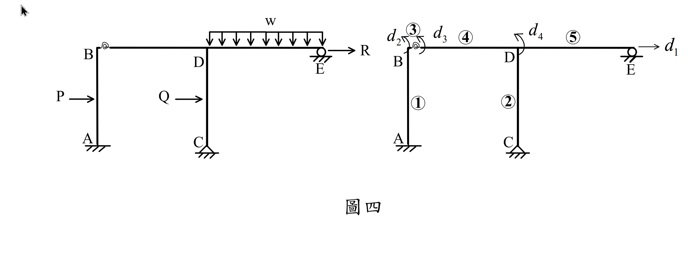
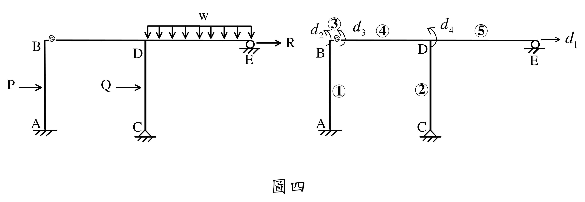

# SA-2019-4 題目正本

> 本檔只記錄考卷上寫了什麼、圖上畫了什麼，不含任何解法。解析見同資料夾 `SA-2019-4.md`。
> 判讀清單經使用者確認前，狀態為「待確認」；確認後本檔原則上不再修改（改動須回考卷原圖並記 log）。

| 項目 | 內容 |
|---|---|
| 考卷 | `raw/exams/SA-2019_結構學.pdf`，第 3 頁，第四題（圖四） |
| 考年 | 2019（民國 108 年）專技高考結構工程技師「結構學」 |
| 配分 | 25 分 |
| 附圖 | `SA-2019-4-fig-1.png`、`SA-2019-4-fig-2.png` |
| 判讀狀態 | **已確認**（2026-11-05 使用者確認。原轉錄：2026-11-05 轉錄；PyMuPDF 110 dpi 整頁＋250–800 dpi 局部放大、PDF 向量座標；盲讀於開啟解析前完成） |

## 1. 考卷原文（逐字）

四、考慮圖四之構架，假設各構件之軸向變形很小可以忽略，各桿件之楊氏模數都為 E、斷面二次矩都為 I 且長度都為 L；外力 P 及 Q 作用於柱之中點。如圖四所示，梁 BD 接到柱 AB 採半剛性接頭，以旋轉彈簧模擬之（可當作零長度），旋轉彈簧勁度假設為 10 EI/L（EI，L 為梁、柱構件性質）。若以勁度法表示該構架平衡方程式，可寫為 [K]{D} = {P}，其中 {D} 為位移向量，依序包括水平位移 d₁、B 點左側旋轉角 d₂、B 點右側旋轉角 d₃ 及 D 點旋轉角 d₄ 共四個自由度；[K] 為結構勁度矩陣；{P} 為外力向量。試求 [K] 及 {P}；求 [K] 前，先寫出每個元素之勁度矩陣再組合得 [K]，旋轉彈簧視為一個元素。（25 分）

## 2. 考卷給的公式、附表與參數

- 考卷沒有給任何參考公式或附表。
- 旋轉彈簧勁度 10 EI/L；各桿 E、I、L 相同；忽略軸向變形（題文）。
- 考卷沒有給數值。
- 卷首注意事項：可以使用電子計算器。不必抄題，作答時請將試題題號及答案依照順序寫在試卷上，於本試題上作答者，不予計分。本科目除專門名詞或數理公式外，應使用本國文字作答。
- 考試時間：2 小時。

## 3. 附圖

*證據圖 SA-2019-4-fig-1.png*

*證據圖 SA-2019-4-fig-2.png（2026-11-05 自考卷重新擷取 500 dpi，無游標）*

圖面文字照錄：w、B、D、E、R、P、Q、A、C、d₂、③、d₃、④、d₄、⑤、d₁、①、②、圖四

## 4. 判讀清單

| # | 項目 | 判讀 | 圖上／題文依據 | 把握 |
|---|---|---|---|---|
| 1 | 幾何 | A、C 為柱底；AB、CD 柱長 L；BD、DE 梁長 L；B、D、E 同高程 | 題文「長度都為 L」；附圖無尺寸線 | 確定 |
| 2 | 支承 A | 固定端（剖線） | 附圖 | 確定 |
| 3 | 支承 C | 鉸支承（三角形） | 附圖 | 確定 |
| 4 | 支承 E | 滾支承（圓），可水平移動 | 附圖 | 確定 |
| 5 | B 接頭 | 柱頂與梁 BD 之間為零長度旋轉彈簧，k = 10 EI/L | 題文；附圖彈簧符號 | 確定 |
| 6 | 節點 D | 梁 BD、DE 與柱 CD 剛接 | 附圖 | 確定 |
| 7 | 載重 | P 向右作用 AB 中點；Q 向右作用 CD 中點；w 向下 DE 全長；R 向右作用 E | 題文；附圖 | 確定 |
| 8 | 自由度 | d₁：水平位移（向右，畫在 E）；d₂：B 左側（柱頂）轉角；d₃：B 右側（梁端）轉角；d₄：D 轉角；三個轉角箭頭皆**逆時針** | 題文；800 dpi 箭頭方向 | 確定 |
| 9 | 元素編號 | ① AB、② CD、③ 旋轉彈簧、④ BD、⑤ DE | 右圖圈號 | 確定 |
| 10 | 所求 | 各元素勁度矩陣、組合 [K]、外力向量 {P} | 題文 | 確定 |
| 11 | 證據圖 | 舊截圖 fig-1：左上角有滑鼠游標（箭頭），圖面縮得很小（左右兩圖擠在 2494 px 寬內、線很細）；新增 fig-2（2026-11-05 自考卷重新擷取 500 dpi） | — | 確定 |

---
*轉錄：2026-11-05（SA-U2-4 題目正本推廣・批 1）*
*確認：2026-11-05 使用者確認*
