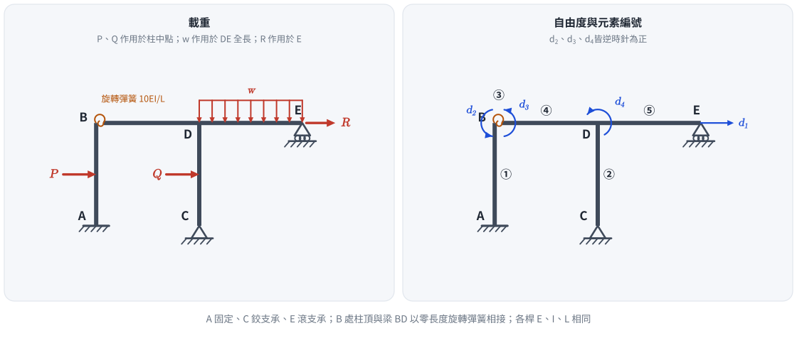
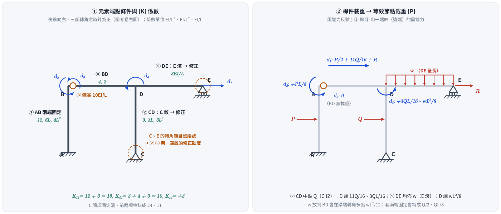

# 考題編號：SA-2019-4

**主分類：** `SA-U2-4` 靜不定結構之矩陣分析法
**副分類：** 無
**標籤：** `勁度矩陣` `半剛性接頭` `旋轉彈簧` `節點載重向量`

---

## 1. 題目（考卷原文見題目正本）

> 考卷原文、公式／附表、附圖與判讀清單（已確認）見 [`SA-2019-4-problem.md`](SA-2019-4-problem.md)。本節只列解題時最容易讀錯的地方與本解使用的記號；題意以題目正本為準。

*重繪自考卷附圖，依判讀清單 #1–#11 重繪。攔：C 讀成固定端、B 讀成剛接、轉角正向讀反。*

### 常見誤讀
| 項目 | 正確判讀 | 常見誤讀 |
|---|---|---|
| C 支承 | 鉸支承 | 固定端 |
| B 接頭 | 柱頂與梁之間的旋轉彈簧 10EI/L（零長度） | 剛接 |
| d₂、d₃、d₄ | 皆逆時針為正 | 順時針 |
| 均佈 w 範圍 | DE 梁全長（D 到 E） | BD 梁 |

**本解記號：** d₁ 向右、d₂–d₄ 逆時針為正（與考卷右圖一致）；桿端彎矩與固端彎矩皆以逆時針為正。

> **勘誤（2026-11-05）**：舊版 §3–§4 把 C 當固定端、把 w 放在 BD 梁、轉角取順時針為正，[K] 與 {P} 隨之錯誤；已依題目正本重算（詳見頁尾修正日期）。

## 2. 考題核心精神與出題者意圖 (Core Concepts & Examiner's Intent)

本題為標準的**直接勁度法 (Direct Stiffness Method)** 組裝題，題目已把自由度與元素編號都指定好，考的是三件事：
1. **半剛性接頭**：B 點柱頂與梁端以零長度旋轉彈簧相接，兩側轉角不同，必須各給一個自由度（$d_2$、$d_3$），彈簧本身當成一個連接兩轉角的元素。
2. **端點條件的修正勁度**：題目只給 4 個自由度，**C 柱底為鉸支承、E 為滾支承**，兩處轉角都沒有編號，所以柱 CD（下端鉸）與梁 DE（右端鉸）都要用一端鉸接的修正勁度（或寫全矩陣再靜態凝縮）。
3. **等效節點載重**：柱中點水平力 P、Q 與 DE 上的均佈 w 要換成固端力再反號；柱 CD 與梁 DE 的固端力要用「一端固定、一端鉸接」的值（$3QL/16$、$11Q/16$、$wL^2/8$），不是兩端固定的 $QL/8$、$wL^2/12$。

## 3. 解題戰略地圖與陷阱分析 (Strategic Roadmap & Trap Analysis)

1. **確立自由度（題目指定）**：$d_1$ 梁層水平位移（向右）；$d_2$ B 點柱頂轉角；$d_3$ B 點梁端轉角；$d_4$ D 點轉角——三個轉角在考卷右圖皆為**逆時針**。忽略軸向變形，B、D、E 同步側移 $d_1$，各節點無垂直位移。
2. **元素與對應自由度**：
   - ① 柱 AB（A 固定）：$[d_1, d_2]$
   - ② 柱 CD（**C 鉸**）：$[d_1, d_4]$，修正勁度
   - ③ 旋轉彈簧：$[d_2, d_3]$
   - ④ 梁 BD：$[d_3, d_4]$（兩端無相對側移）
   - ⑤ 梁 DE（**E 滾支**）：$[d_4]$，修正勁度
3. **組裝**：依自由度標籤把元素係數疊加成 $4\times4$。
4. **外力向量**：$\{P\} = \{P_{節點}\} - \{F_{固端}\}$。

**陷阱分析：**
- **陷阱 1：C 讀成固定端。** C 柱底畫的是三角形鉸支承（A 才是剖線固定端）。讀成固定端會把 ② 寫成 $12EI/L^3$、$6EI/L^2$、$4EI/L$，$K_{11}$ 由 15 變 24、$K_{44}$ 由 10 變 11，且 Q 的固端力也跟著錯。
- **陷阱 2：w 放錯梁。** 均佈 w 的箭頭排在 D 到 E 之間，BD 梁沒有載重；放到 BD 會在 $P_3$ 多出 $wL^2/12$。
- **陷阱 3：轉角正向。** 考卷右圖三個轉角箭頭皆逆時針。若改用順時針，矩陣中「側移–轉角」耦合項全部變號；作答前先依圖定正向。
- **陷阱 4：用兩端固定的固端力。** ② 與 ⑤ 都是一端鉸接，固端彎矩是 $3QL/16$、$wL^2/8$，剪力是 $11Q/16$（固定端側）。

## 4. 步驟化詳細計算過程 (Step-by-Step Detailed Calculation)

### Step 1：寫出各元素之勁度矩陣
各桿長 $L$、$EI$ 相同；$d_1$ 向右、轉角逆時針為正。柱的側移–轉角耦合：柱頂向右平移 $\Delta$ 時弦轉角為順時針 $\Delta/L$，由傾角變位式 $M = \frac{2EI}{L}(2\theta_i+\theta_j-3\psi)$、$\psi=-\Delta/L$ 得柱頂所需逆時針彎矩 $+\frac{6EI}{L^2}\Delta$（兩端固定）或 $+\frac{3EI}{L^2}\Delta$（另一端鉸）。

**1. 元素 ① — 柱 AB（A 固定）**，自由度 $[d_1, d_2]$：
$$[k^{(1)}] = \begin{bmatrix}
\dfrac{12EI}{L^3} & \dfrac{6EI}{L^2} \\[6pt]
\dfrac{6EI}{L^2} & \dfrac{4EI}{L}
\end{bmatrix}$$

**2. 元素 ② — 柱 CD（C 鉸，修正勁度）**，自由度 $[d_1, d_4]$：
$$[k^{(2)}] = \begin{bmatrix}
\dfrac{3EI}{L^3} & \dfrac{3EI}{L^2} \\[6pt]
\dfrac{3EI}{L^2} & \dfrac{3EI}{L}
\end{bmatrix}$$
（由兩端固定的 $6\times6$ 柱元素對 C 端轉角靜態凝縮而得。）

**3. 元素 ③ — 旋轉彈簧**，自由度 $[d_2, d_3]$，$k_r = 10EI/L$：
$$[k^{(3)}] = \frac{10EI}{L}\begin{bmatrix} 1 & -1 \\ -1 & 1 \end{bmatrix}$$

**4. 元素 ④ — 梁 BD**，自由度 $[d_3, d_4]$：
$$[k^{(4)}] = \frac{EI}{L}\begin{bmatrix} 4 & 2 \\ 2 & 4 \end{bmatrix}$$

**5. 元素 ⑤ — 梁 DE（E 滾支，修正勁度）**，自由度 $[d_4]$：
$$[k^{(5)}] = \begin{bmatrix} \dfrac{3EI}{L} \end{bmatrix}$$

### Step 2：組合結構勁度矩陣 $[K]$
$$[K] = \frac{EI}{L^3} \begin{bmatrix}
12+3 & 6L & 0 & 3L \\
6L & (4+10)L^2 & -10L^2 & 0 \\
0 & -10L^2 & (10+4)L^2 & 2L^2 \\
3L & 0 & 2L^2 & (3+4+3)L^2
\end{bmatrix}
= \frac{EI}{L^3} \begin{bmatrix}
15 & 6L & 0 & 3L \\
6L & 14L^2 & -10L^2 & 0 \\
0 & -10L^2 & 14L^2 & 2L^2 \\
3L & 0 & 2L^2 & 10L^2
\end{bmatrix}$$

### Step 3：計算外力向量 $\{P\}$
$\{P\}$ = 直接作用於自由度的外力 − 固端力（固端力指桿件兩端鎖住時，支承作用在桿端的力；逆時針、向右為正）。

1. **柱 ① AB，中點水平力 P（兩端固定）**：固端水平剪力兩端各 $P/2$（向左）；B 端固端彎矩 $-PL/8$（順時針）。
   → 等效：$d_1$：$+P/2$；$d_2$：$+PL/8$。
2. **柱 ② CD，中點水平力 Q（C 鉸、D 固定）**：D 端（固定端）固端剪力 $11Q/16$（向左）、C 端 $5Q/16$；D 端固端彎矩 $-3QL/16$（順時針）。
   → 等效：$d_1$：$+11Q/16$；$d_4$：$+3QL/16$。
3. **梁 ⑤ DE，均佈 w（D 固定、E 鉸）**：D 端固端彎矩 $+wL^2/8$（逆時針）。
   → 等效：$d_4$：$-wL^2/8$。
4. **梁 ④ BD**：無載重，對 $d_3$ 無貢獻。
5. **節點直接外力**：E 點水平力 R，作用方向與 $d_1$ 相同 → $+R$。

$$P_1 = R + \frac{P}{2} + \frac{11Q}{16},\qquad P_2 = \frac{PL}{8},\qquad P_3 = 0,\qquad P_4 = \frac{3QL}{16} - \frac{wL^2}{8}$$

*圖 2　左：五個元素的端點條件與貢獻給 $[K]$ 的係數——C、E 的轉角題目沒有編號，柱 ② 與梁 ⑤ 用一端鉸的修正勁度；右：桿件載重反號後落在 $d_1$–$d_4$ 的等效節點載重。這張圖攔三種錯：把 C 讀成固定端（$K_{11}$、$K_{44}$ 變 24、11）、把 w 放到 BD 梁、對一端鉸的桿件套用兩端固定的固端力。*

### Step 4：檢核
- **對角項物理意義**：$K_{11}$ 為兩柱側向勁度和 $12+3 = 15\,EI/L^3$（固定–固定柱與鉸–固定柱，梁層轉角鎖住時）；$K_{44} = 3+4+3 = 10\,EI/L$（CD 修正、BD、DE 修正）。
- **對稱性**：$[K]$ 對稱。
- **程式驗算**：以平面剛架總位能法、保留 C、E 轉角為自由度組 $6\times6$ 勁度矩陣後靜態凝縮，得到相同的 $[K]$ 與 $\{P\}$。

## 5. 最終答案

$$[K] = \frac{EI}{L^3} \begin{bmatrix}
15 & 6L & 0 & 3L \\
6L & 14L^2 & -10L^2 & 0 \\
0 & -10L^2 & 14L^2 & 2L^2 \\
3L & 0 & 2L^2 & 10L^2
\end{bmatrix}, \qquad \{P\} = \begin{Bmatrix}
R + \dfrac{P}{2} + \dfrac{11Q}{16} \\[6pt]
\dfrac{PL}{8} \\[6pt]
0 \\[6pt]
\dfrac{3QL}{16} - \dfrac{wL^2}{8}
\end{Bmatrix}$$

（$d_1$ 向右、$d_2$–$d_4$ 逆時針為正。若改以順時針為正，第 1 列／行與轉角的耦合項及 $P_2$–$P_4$ 變號，對角項不變。）

- **作答方式補充**：題文要求「先寫出每個元素之勁度矩陣再組合」。② 與 ⑤ 也可寫成含 C、E 轉角的完整元素矩陣，組成 $6\times6$ 後再對 C、E 轉角靜態凝縮，結果相同。

*修正日期：2026-11-05（§1 改為指向題目正本並放重繪附圖（figs/SA-2019-4-fig-1-problem.svg）、加常見誤讀；圖由 gen_SA-2019-4.py 產生，可重跑）*

*修正日期：2026-11-05（勘誤：依題目正本判讀 #3 C 為鉸支承、#7 w 作用於 DE、#8 轉角逆時針，重寫 §2–§5。[K]：K₁₁ 24 → 15 EI/L³、K₁₂ −6 → +6 EI/L²、K₁₄ −6 → +3 EI/L²、K₄₄ 11 → 10 EI/L；{P}：P₁ R+(P+Q)/2 → R+P/2+11Q/16、P₂ −PL/8 → +PL/8、P₃ wL²/12 → 0、P₄ −QL/8−wL²/12 → 3QL/16−wL²/8。驗證：平面剛架總位能法（保留 C、E 轉角後凝縮）重算 16 項（[K] 上三角 10＋{P} 4＋修正勁度 2）MISMATCHES: 0（腳本 wiki/queries/勘誤驗算-SA-U2-4-批1/errata_check.py）；來源 wiki/queries/盲解比對-SA-U2-4-批1-2026-11-05.md）*

*圖解補繪：2026-11-05（向量圖，腳本 `gen_SA-2019-4_fem.py`，由元素係數組裝後 assert 解析 [K]、{P}，可重跑）*
