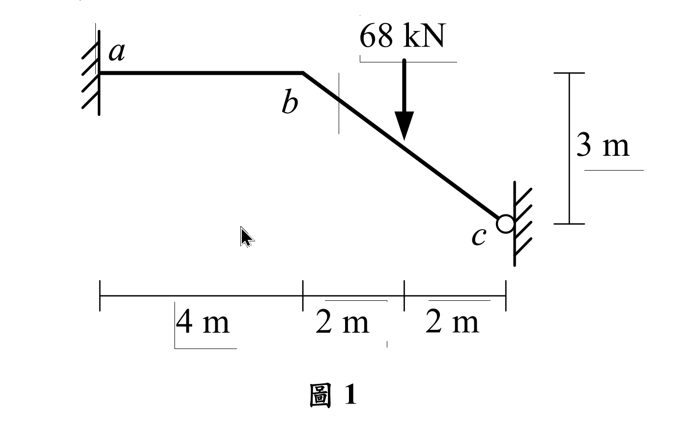
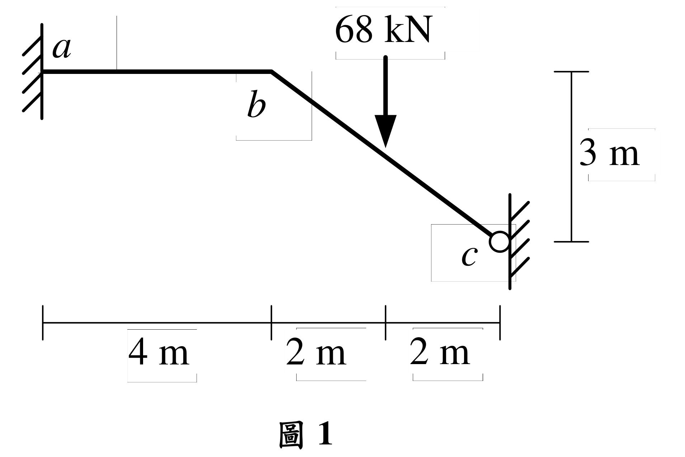

# SA-2020-1 題目正本

> 本檔只記錄考卷上寫了什麼、圖上畫了什麼，不含任何解法。解析見同資料夾 `SA-2020-1.md`。
> 判讀清單經使用者確認前，狀態為「待確認」；確認後本檔原則上不再修改（改動須回考卷原圖並記 log）。

| 項目 | 內容 |
|---|---|
| 考卷 | `raw/exams/SA-2020_結構學.pdf`，第 1 頁上半，第一題（圖 1） |
| 考年 | 2020（民國 109 年）專技高考結構工程技師「結構學」 |
| 配分 | 25 分 |
| 附圖 | `SA-2020-1-fig-1.png`、`SA-2020-1-fig-2.png` |
| 判讀狀態 | **已確認**（2026-11-07 使用者確認；影響答案項目定案：#6 c 為靠垂直牆的滾支承（使用者確認，與解析相同）。原轉錄：2026-11-05 轉錄；PyMuPDF 110 dpi 整頁＋400–500 dpi 局部放大；盲讀於開啟解析前完成） |

## 1. 考卷原文（逐字）

一、如圖 1 所示結構，承受垂直集中載重 68 kN，a 點為固定端，桿件 ab 及 bc 有相同之彈性模數 E 與慣性矩 I。若不考慮桿件 ab 及 bc 的軸向變形，求 ab 桿件端點彎矩及 c 點反力。（25 分）

## 2. 考卷給的公式、附表與參數

- 考卷沒有給任何參考公式或附表。
- EI 沒有給數值（答案彎矩與反力不需要 EI）。
- 題文沒有寫 c 點支承型式，只能由附圖判讀。
- 卷首注意事項：㈠可以使用電子計算器。㈡不必抄題，作答時請將試題題號及答案依照順序寫在試卷上，於本試題上作答者，不予計分。㈢本科目除專門名詞或數理公式外，應使用本國文字作答。
- 考試時間：2 小時。

## 3. 附圖

*證據圖 SA-2020-1-fig-1.png*

*證據圖 SA-2020-1-fig-2.png（2026-11-05 自考卷重新擷取 500 dpi，無游標）*

圖面文字照錄：a、b、68 kN、3 m、c、4 m、2 m、2 m、圖 1

## 4. 判讀清單

| # | 項目 | 判讀 | 圖上／題文依據 | 把握 |
|---|---|---|---|---|
| 1 | a | 固定端（左側垂直牆） | 垂直剖線牆，桿端直接接牆；題文 | 確定 |
| 2 | b | 剛接轉折點 | 無鉸圈 | 確定 |
| 3 | ab | 水平，長 4 m | 下方尺寸第一段 4 m，b 對齊第一個刻度 | 確定 |
| 4 | bc | 斜桿，水平 4 m、垂直落差 3 m，實長 5 m | 下方 2 m＋2 m；右側 3 m 尺寸線上端對齊 ab 高程、下端對齊 c | 確定 |
| 5 | 載重 | 68 kN 向下，作用點水平距 b 2 m（bc 中點） | 箭頭對齊下方第二個刻度 | 確定 |
| 6 | c 支承 | 滾支承靠在垂直牆上：只有水平反力，可沿牆上下滑動、可自由轉動 | 單一空心圓貼牆、無三角形；同一出題風格（2021 年第一題 a 點）以單一圓圈表示滾支承，鉸支承則畫三角形 | 不確定（影響答案，請確認）；使用者確認 |
| 7 | 剛度 | ab、bc 的 E、I 相同 | 題文 | 確定 |
| 8 | 軸向變形 | 不考慮（ab、bc） | 題文 | 確定 |
| 9 | 所求 | ab 桿件端點彎矩；c 點反力 | 題文 | 確定 |
| 10 | 考卷沒有給 | 指定方法（題文未限定） | 題文 | 確定 |
| 11 | 證據圖 | 舊 fig-1 有滑鼠游標；新增 fig-2（500 dpi） | — | 確定 |

---
*轉錄：2026-11-05（SA-U2-3 題目正本推廣・批 2）*
*確認：2026-11-07 使用者確認*
