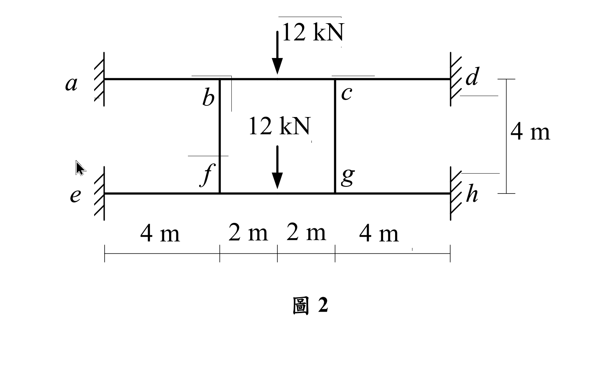
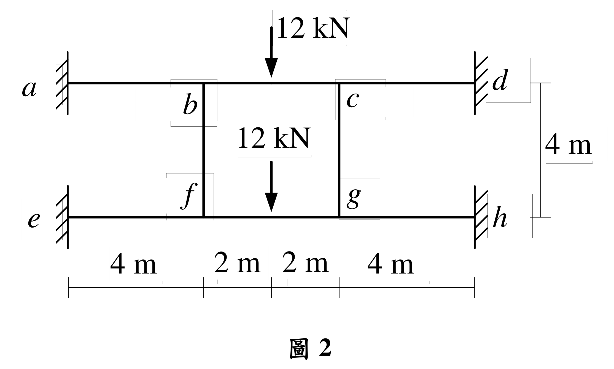

# SA-2020-2 題目正本

> 本檔只記錄考卷上寫了什麼、圖上畫了什麼，不含任何解法。解析見同資料夾 `SA-2020-2.md`。
> 判讀清單經使用者確認前，狀態為「待確認」；確認後本檔原則上不再修改（改動須回考卷原圖並記 log）。

| 項目 | 內容 |
|---|---|
| 考卷 | `raw/exams/SA-2020_結構學.pdf`，第 1 頁下半，第二題（圖 2） |
| 考年 | 2020（民國 109 年）專技高考結構工程技師「結構學」 |
| 配分 | 25 分 |
| 附圖 | `SA-2020-2-fig-1.png`、`SA-2020-2-fig-2.png` |
| 判讀狀態 | **待確認**（2026-11-05 轉錄；PyMuPDF 110 dpi 整頁＋350–500 dpi 局部放大；盲讀於開啟解析前完成） |

## 1. 考卷原文（逐字）

二、如圖 2 所示之平面剛架結構，a、d、e、h 點為固定端，b、c、f、g 點為剛性接頭，各桿件有相同之彈性模數 E 與慣性矩 I，且 EI = 20000 kN-m²。不考慮各桿件的軸向變形，求 b 點垂直位移、轉角及 ab 桿件的端點彎矩。（25 分）

## 2. 考卷給的公式、附表與參數

- 考卷沒有給任何參考公式或附表。
- EI = 20000 kN-m²（題文）。
- 卷首注意事項：㈠可以使用電子計算器。㈡不必抄題，作答時請將試題題號及答案依照順序寫在試卷上，於本試題上作答者，不予計分。㈢本科目除專門名詞或數理公式外，應使用本國文字作答。
- 考試時間：2 小時。

## 3. 附圖

*證據圖 SA-2020-2-fig-1.png*

*證據圖 SA-2020-2-fig-2.png（2026-11-05 自考卷重新擷取 500 dpi，無游標）*

圖面文字照錄：12 kN、a、b、c、d、12 kN、4 m、f、g、e、h、4 m、2 m、2 m、4 m、圖 2

## 4. 判讀清單

| # | 項目 | 判讀 | 圖上／題文依據 | 把握 |
|---|---|---|---|---|
| 1 | a、d、e、h | 固定端（垂直牆） | 剖線牆；題文 | 確定 |
| 2 | b、c、f、g | 剛性接頭 | 題文 | 確定 |
| 3 | 水平尺寸 | a–b 4 m、b–c 4 m（2 m＋2 m）、c–d 4 m；下梁 e–f、f–g、g–h 同 | 下方尺寸刻度 4、2、2、4 m；b、c 柱線分別對齊第 1、3 個刻度，中間刻度只標載重位置 | 確定 |
| 4 | 柱 | bf、cg 垂直，高 4 m | 右側 4 m 尺寸線（上梁至下梁） | 確定 |
| 5 | 剛度 | 各桿 EI = 20000 kN-m² | 題文 | 確定 |
| 6 | 載重 | 上梁 bc 中點、下梁 fg 中點各 12 kN 向下 | 箭頭對齊中間 2 m｜2 m 刻度 | 確定 |
| 7 | 軸向變形 | 不考慮 | 題文 | 確定 |
| 8 | 所求 | b 點垂直位移、b 點轉角、ab 桿端點彎矩 | 題文 | 確定 |
| 9 | 證據圖 | 舊 fig-1 有滑鼠游標（e 點附近）；新增 fig-2（500 dpi） | — | 確定 |

---
*轉錄：2026-11-05（SA-U2-3 題目正本推廣・批 2）*
