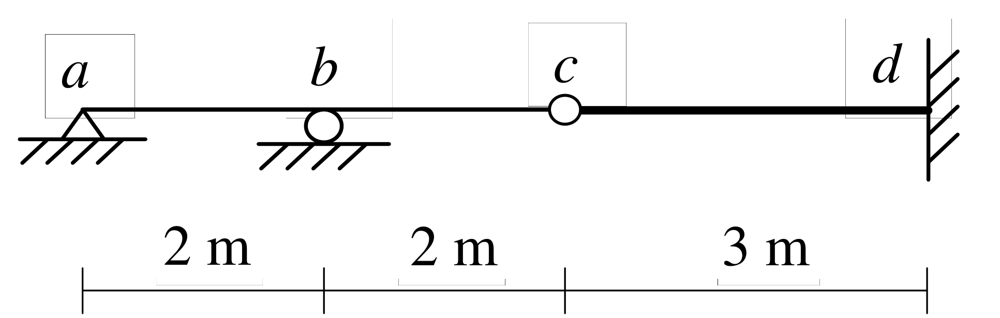

# SA-2020-3 題目正本

> 本檔只記錄考卷上寫了什麼、圖上畫了什麼，不含任何解法。解析見同資料夾 `SA-2020-3.md`。
> 判讀清單經使用者確認前，狀態為「待確認」；確認後本檔原則上不再修改（改動須回考卷原圖並記 log）。

| 項目 | 內容 |
|---|---|
| 考卷 | `raw/exams/SA-2020_結構學.pdf`，第 2 頁（頁次 2－2），第三題（圖 3） |
| 考年 | 2020（民國一百零九年）專技高考結構工程技師「結構學」 |
| 配分 | 25 分 |
| 附圖 | `SA-2020-3-fig-2.png`（2026-11-07 重新擷取）；既有 `SA-2020-3-fig-1.png` |
| 判讀狀態 | **已確認**（2026-11-07 使用者確認。原轉錄：2026-11-07 轉錄；PyMuPDF 110 dpi 整頁＋450–1200 dpi 局部放大；考卷可抽文字，逐字原文以 PDF 文字層核對；盲讀於開啟解析前完成） |

## 1. 考卷原文（逐字）

三、如圖 3 所示靜不定梁結構，桿件 ab、bc 及 cd 有相同彈性模數為 E，桿件 ab 及 bc 慣性矩為 I，而桿件 cd 慣性矩為 1.5I。繪出 b 點反力影響線的示意圖，並求此反力影響線的最大值及其在 c 點的數值。（25 分）

## 2. 考卷給的公式、附表與參數

- 考卷沒有給任何參考公式或附表。
- E 相同；ab、bc 慣性矩 I，cd 為 1.5I；沒有給 E、I 數值。
- 卷首注意事項：㈠可以使用電子計算器。㈡不必抄題，作答時請將試題題號及答案依照順序寫在試卷上，於本試題上作答者，不予計分。㈢本科目除專門名詞或數理公式外，應使用本國文字作答。
- 考試時間：2 小時。

## 3. 附圖

*證據圖 SA-2020-3-fig-2.png（2026-11-07 自考卷 500 dpi 重新擷取）；既有 SA-2020-3-fig-1.png 帶有滑鼠游標（箭頭游標在 a 左方空白處，未壓到構件），保留不改。*

圖面文字照錄：a、b、c、d、2 m、2 m、3 m、圖 3

## 4. 判讀清單

| # | 項目 | 判讀 | 圖上／題文依據 | 把握 |
|---|---|---|---|---|
| 1 | 座標 | a(0)、b(2)、c(4)、d(7)，單位 m | 尺寸線 2｜2｜3 m（500 dpi） | 確定 |
| 2 | 支承 a | 鉸支承（三角形＋剖線） | 500 dpi | 確定 |
| 3 | 支承 b | 滾支承（圓圈＋剖線） | 500 dpi | 確定 |
| 4 | c 點 | 內鉸（梁上空心圓，下方無支承） | 500 dpi | 確定 |
| 5 | 支承 d | 固定端（垂直牆線＋剖線） | 500 dpi | 確定 |
| 6 | 慣性矩 | ab、bc 為 I；cd 為 1.5I（圖上 cd 畫粗線） | 題文＋圖面 | 確定 |
| 7 | 靜不定度 | 垂直方向一度靜不定 | 支承＋內鉸計數 | 確定 |
| 8 | 所求 | b 點反力影響線示意圖；影響線最大值；影響線在 c 點的數值 | 題文 | 確定 |

---
*轉錄：2026-11-07（SA-U1-3 題目正本推廣・批 1）*
*確認：2026-11-07 使用者確認*
