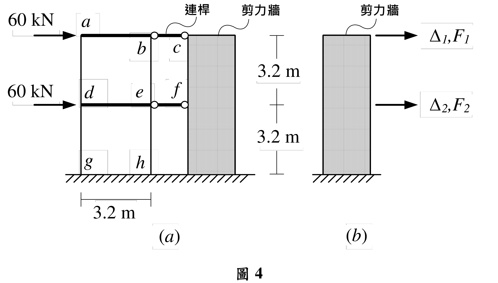

# SA-2020-4 題目正本

> 本檔只記錄考卷上寫了什麼、圖上畫了什麼，不含任何解法。解析見同資料夾 `SA-2020-4.md`。
> 判讀清單經使用者確認前，狀態為「待確認」；確認後本檔原則上不再修改（改動須回考卷原圖並記 log）。

| 項目 | 內容 |
|---|---|
| 考卷 | `raw/exams/SA-2020_結構學.pdf`，第 2 頁（頁次 2－2），第四題（圖 4） |
| 考年 | 2020（民國 109 年）專技高考結構工程技師「結構學」 |
| 配分 | 25 分 |
| 附圖 | `SA-2020-4-fig-2.png`（本次從考卷擷取 500 dpi；既有 `SA-2020-4-fig-1.png` 保留） |
| 判讀狀態 | **已確認**（2026-11-07 使用者確認；原轉錄：2026-11-07 轉錄；PyMuPDF 110 dpi 整頁＋300–400 dpi 局部放大（附圖為向量圖）；盲讀於開啟解析前完成） |

## 1. 考卷原文（逐字）

四、如圖4(a)所示之二層樓平面結構，各樓層承受相同的水平力60 kN，梁柱構架與剪力牆在各樓層之間設置bc及ef 連桿傳遞水平軸力。構架梁柱桿件的彈性模數都為E，另構架之柱桿件斷面慣性矩都為I，且EI = 81920 kN-m²，而構架之梁桿件斷面慣性矩為無限大。如圖4(b)所示剪力牆有二個自由度，已知剪力牆之力{F₁, F₂}與位移{Δ₁, Δ₂}關係式，採用勁度矩陣表示如下：

$$\begin{Bmatrix}F_1\\F_2\end{Bmatrix}=(30000\ \text{kN/m})\begin{bmatrix}1&-2\\-2&6\end{bmatrix}\begin{Bmatrix}\Delta_1\\\Delta_2\end{Bmatrix}$$

。不考慮連桿及構架梁柱桿件的軸向變形，求圖4(a)二層樓結構之各連桿的軸力、一樓剪力牆的基底剪力、eh柱桿件的端點彎矩及剪力。（25分）

## 2. 考卷給的公式、附表與參數

- 給定：柱 EI＝81920 kN-m²（kN-m 的平方，非係數 2）；梁 I＝∞。
- 給定：剪力牆勁度矩陣 30000 kN/m × [[1, −2], [−2, 6]]，Δ₁、F₁ 在頂層，Δ₂、F₂ 在一樓。
- 考卷沒有給剪力牆的 EI 或尺寸（由勁度矩陣代表）。
- 卷首注意事項：㈠可以使用電子計算器。㈡不必抄題，作答時請將試題題號及答案依照順序寫在試卷上，於本試題上作答者，不予計分。㈢本科目除專門名詞或數理公式外，應使用本國文字作答。
- 考試時間：2 小時。代號 00340，頁次 2－1、2－2。

## 3. 附圖

*證據圖 SA-2020-4-fig-2.png（500 dpi，自考卷擷取；舊證據圖 SA-2020-4-fig-1.png 有游標雜訊，保留不改）*

圖面文字照錄：60 kN、60 kN、a、b、c、d、e、f、g、h、連桿、剪力牆、3.2 m、3.2 m、3.2 m、(a)、剪力牆、Δ1,F1、Δ2,F2、(b)、圖 4

## 4. 判讀清單

| # | 項目 | 判讀 | 圖上／題文依據 | 把握 |
|---|---|---|---|---|
| 1 | 構架節點 | 頂層 a（左）、b（右）；一樓 d（左）、e（右）；柱底 g（左）、h（右） | 400 dpi 放大：b、e 標字在右柱內側 | 確定 |
| 2 | 梁 | ab、de，I＝∞（剛性） | 題文＋粗線 | 確定 |
| 3 | 柱 | ad、dg、be、eh，EI＝81920 kN-m² | 題文；300 dpi 放大確認 m 的上標 2 為單位指數 | 確定 |
| 4 | 柱底 g、h | 落在地面剖線，圖面無支承符號；視為固定端 | 圖面 | 確定（解讀）；使用者確認 |
| 5 | 連桿 | bc（頂層）、ef（一樓），兩端圓圈＝鉸接，只傳軸力，不計軸向變形 | 題文＋圖面 | 確定 |
| 6 | 尺寸 | 層高 3.2 m、3.2 m；構架跨度 3.2 m；連桿長度沒有標 | 尺寸線 | 確定 |
| 7 | 載重 | 頂層 a、一樓 d 各 60 kN 水平向右 | 箭頭 | 確定 |
| 8 | 剪力牆勁度 | {F₁,F₂}＝30000 kN/m·[[1,−2],[−2,6]]{Δ₁,Δ₂}；1 號自由度在頂層、2 號在一樓，正向向右 | 題文式＋圖 4(b) | 確定 |
| 9 | 考卷沒有給 | 連桿長度、剪力牆尺寸／EI、柱底支承符號 | 題文 | 確定 |
| 10 | 所求 | 各連桿軸力、一樓剪力牆基底剪力、eh 柱端點彎矩與剪力 | 題文 | 確定 |
| 11 | 證據圖 | 既有 fig-1 頂端夾帶題文殘字、左側有游標；另擷取 500 dpi 乾淨版 fig-2 | 縮圖總表 | 確定 |

---
*轉錄：2026-11-07（SA 剩餘單元（U1-2 尾段、U2-5、U3-1、U3-2）題目正本推廣・批 1）*
*確認：2026-11-07 使用者確認*
