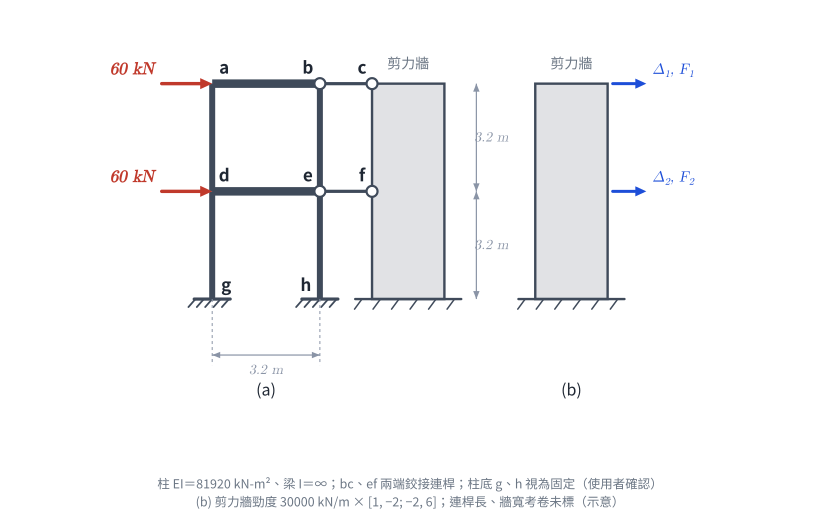

# 考題編號：SA-2020-4

**主分類：** `SA-U3-2` 建築結構系統分析
**副分類：** 無
**分析法：** 矩陣位移法 / 剛架與剪力牆互制
**標籤：** `剛架與剪力牆互制` `矩陣分析` `剪力建築`

---

## 1. 題目（考卷原文見題目正本）

> 考卷原文、公式／附表、附圖與判讀清單（已確認）見 [`SA-2020-4-problem.md`](SA-2020-4-problem.md)。本節只列解題時最容易讀錯的地方與本解使用的記號；題意以題目正本為準。

*重繪自考卷附圖，依判讀清單重繪。攔：Δ₁、Δ₂ 的樓層對調、把連桿當成可傳彎矩。*

### 常見誤讀
| 項目 | 正確判讀 | 常見誤讀 |
|---|---|---|
| 剪力牆自由度 | 1 號在頂層、2 號在一樓 | 1 號在一樓 |
| 柱 EI | 81920 kN-m²（「m²」的 2 是單位指數） | 讀成 2EI |
| 柱底 | g、h 視為固定（圖面無支承符號；使用者確認） | 鉸支 |

**本解記號：** 構架節點 a、b、d、e、g、h，ab、de 為剛性梁；柱高 3.2 m；連桿軸力 $N_{bc}$、$N_{ef}$ 以拉為正；位移、力向右為正。

---

## 2. 考題核心精神與出題者意圖 (Core Concepts & Examiner's Intent)

這是一道設計極度巧妙的**「剛架與剪力牆互制 (Frame-Shear Wall Interaction)」**考題。
由於題目特別聲明「構架之梁桿件斷面慣性矩為無限大」，這表示剛架的行為是標準的**剪力建築 (Shear Building)**。
出題者給定了剪力牆的勁度矩陣，並暗示我們透過組合剛架與剪力牆的系統勁度矩陣來求解各樓層的側移量。
最令人驚豔的是這題的數字設計：當你算出剛架與剪力牆的整體位移後，會發現系統的變形特徵讓某個連桿的受力直接歸零！這正是出題老師精心調配參數的結果，藉此考驗考生對側力分配與矩陣力學的掌握程度。

---

## 3. 解題戰略地圖與陷阱分析 (Strategic Roadmap & Trap Analysis)

**解題步驟：**
1. **建立剛架勁度矩陣：** 利用剪力建築公式 $k = \sum 12EI/h^3$ 計算剛架各樓層的側向勁度，並組裝出剛架勁度矩陣 $[K_f]$。
2. **組裝總勁度矩陣：** 系統總勁度矩陣 $[K] = [K_f] + [K_w]$。
3. **求解樓層位移：** 建立系統位移方程式 $[K]\{\Delta\} = \{P\}$，解出二樓位移 $\Delta_1$ 與一樓位移 $\Delta_2$。
4. **回推各構件受力：**
   - **連桿軸力**：計算剪力牆在各樓層分擔的水平力 $[K_w]\{\Delta\}$，即為連桿傳遞的軸力。
   - **牆基底剪力**：剪力牆各層受力之總和。
   - **柱端彎矩剪力**：利用柱兩端的相對側移計算單一柱的剪力與彎矩。

**陷阱分析：**
- **陷阱一：樓層標號混淆。** 題目給的剪力牆勁度矩陣，對角線數值為 $1$ 與 $6$。根據結構常識，底層的勁度必定遠大於頂層，因此可判斷 $\Delta_1, F_1$ 代表頂層 (2樓)，$\Delta_2, F_2$ 代表底層 (1樓)。若標號顛倒將無法得分。
- **陷阱二：忽視「每層樓有兩根柱子」。** 剛架的樓層側向勁度是該層所有柱子側向勁度的總和。本題單跨剛架每層有兩根柱子，故 $K_i = 2 \times (12EI/h^3)$，漏乘 2 會導致後續所有計算全錯。
- **陷阱三：柱端彎矩的分配與方向。** 剪力建築的柱兩端不旋轉，彎矩公式為 $M = 6EI\Delta/h^2$（非 $3EI/h^2$ 或傾角變位公式），且兩端彎矩大小相等、方向相同，以抵抗側移產生之轉角。

---

## 3.5 變數層次分析 (Variable Hierarchy Analysis)

> 複習提示：第一次解題後，在每個卡住的知識點旁標記 `⚠`；第二次複習時只看有 `⚠` 的項目。

### 最終目標
`求出各連桿軸力、牆基底剪力、特定柱的端點剪力與彎矩`

### 本題關鍵公式（依計算順序）

> $\boxed{\cdot}$ = 需由前步驟推導，非題目直接給定的變數

$$\text{Step 1 (剛架勁度): } K_{fi} = 2 \times \frac{12EI}{h^3} \Rightarrow [K_f] = \begin{bmatrix} K_{f2} & -K_{f2} \\ -K_{f2} & K_{f1}+K_{f2} \end{bmatrix}$$

$$\text{Step 2 (系統矩陣): } [K_{total}] = \boxed{[K_f]} + [K_w]$$

$$\text{Step 3 (求解位移): } \boxed{[K_{total}]} \begin{Bmatrix} \Delta_1 \\ \Delta_2 \end{Bmatrix} = \begin{Bmatrix} P_1 \\ P_2 \end{Bmatrix} \Rightarrow \text{解出 } \boxed{\Delta_1}, \boxed{\Delta_2}$$

$$\text{Step 4 (目標力): } \begin{Bmatrix} F_{w1} \\ F_{w2} \end{Bmatrix} = [K_w] \begin{Bmatrix} \boxed{\Delta_1} \\ \boxed{\Delta_2} \end{Bmatrix} \text{ (連桿軸力)}, \quad V_{eh} = \frac{12EI}{h^3}\boxed{\Delta_2}, \quad M_e = \frac{6EI}{h^2}\boxed{\Delta_2}$$

### L1：題目直接給定
_看到題目就能讀出的數字，不需要任何公式。_

| 符號 | 數值 | 說明 |
|------|------|------|
| $EI$ | 81920 | 柱彈性模數與慣性矩乘積 |
| $h$ | 3.2m | 樓層高度 |
| $P_1, P_2$ | 60 kN | 各樓層外加水平載重 |
| $[K_w]$ | 30000 $\begin{bmatrix} 1 & -2 \\ -2 & 6 \end{bmatrix}$ | 剪力牆勁度矩陣 |

### L2：需知識點推導
_需要知道公式名稱與適用條件，套入 L1 即可算出。_

**Step 1：單柱與樓層側向勁度**

| 符號 | 公式/來源 | 卡關? |
|------|----------|:-----:|
| $k_c$ | $12EI/h^3$ (因梁無限剛，為剪力建築柱) | |
| $K_{fi}$ | $2 \times k_c$ (每層有 2 根柱) | |

**Step 4：內力計算**

| 符號 | 公式/來源 | 卡關? |
|------|----------|:-----:|
| $V_{w\_base}$ | $F_{w1} + F_{w2}$ (牆基底剪力) | |
| $M_e, M_h$ | $6EI\Delta_2/h^2$ (剪力建築柱端彎矩) | |

### L3：深層知識（不懂就卡住）

| 知識點 | 說明 | 卡關? |
|--------|------|:-----:|
| 自由度編號判斷 | $[K_w]$ 中 $K_{22} = 6 > K_{11} = 1$，底部牆剛度必大於頂部，故 $\Delta_1$ 為二樓，$\Delta_2$ 為一樓。 | |
| 連桿受力意義 | 連桿即為牆與剛架的介面。連桿受力 = 牆在該層分配到的側力 $F_w$。 | |
| 側移方向與彎矩符號 | 結構受向右側移，柱向右傾倒 (S型)，為維持端點零旋轉，兩端均須提供逆時針 (CCW) 之束制彎矩。 | |

---

## 4. 步驟化詳細計算過程 (Step-by-Step Detailed Calculation)

**Step 1: 建立剛架的勁度矩陣 $[K_f]$**
已知柱的 $EI = 81920 \text{ kN-m}^2$，樓層高度 $h = 3.2 \text{ m}$。
對於剪力建築，單根兩端不旋轉的柱側向勁度為：
$$ k_c = \frac{12 EI}{h^3} = \frac{12 \times 81920}{3.2^3} = \frac{983040}{32.768} = 30000 \text{ kN/m} $$
每層樓有兩根柱子 (例如 2 樓有 $ad, be$；1 樓有 $dg, eh$)，故各樓層的側向勁度為：
$$ K_{f1} = 2 \times 30000 = 60000 \text{ kN/m} \quad (\text{1樓側向勁度})$$
$$ K_{f2} = 2 \times 30000 = 60000 \text{ kN/m} \quad (\text{2樓側向勁度})$$
定義 $\Delta_1$ 為 2 樓位移 (頂層)，$\Delta_2$ 為 1 樓位移 (底層)。
剛架的勁度矩陣 $[K_f]$ 建立規則為：$K_{11} = K_{f2}$ (頂層自身)，$K_{22} = K_{f1} + K_{f2}$ (底層承受兩層)，非對角線為 $-K_{f2}$：
$$ [K_f] = \begin{bmatrix} 60000 & -60000 \\ -60000 & 120000 \end{bmatrix} = 30000 \begin{bmatrix} 2 & -2 \\ -2 & 4 \end{bmatrix} \text{ kN/m} $$

**Step 2: 組合整體系統勁度矩陣 $[K_{total}]$**
題目已知剪力牆的勁度矩陣 $[K_w]$ 為：
$$ [K_w] = 30000 \begin{bmatrix} 1 & -2 \\ -2 & 6 \end{bmatrix} \text{ kN/m} $$
整體系統勁度矩陣為剛架與剪力牆之和：
$$ [K_{total}] = [K_f] + [K_w] = 30000 \left( \begin{bmatrix} 2 & -2 \\ -2 & 4 \end{bmatrix} + \begin{bmatrix} 1 & -2 \\ -2 & 6 \end{bmatrix} \right) = 30000 \begin{bmatrix} 3 & -4 \\ -4 & 10 \end{bmatrix} \text{ kN/m} $$

**Step 3: 求解各樓層側移量**
系統承受的外力向量 $\{P\}$ 為 (2樓與1樓皆受 60 kN 向右力)：
$$ \begin{Bmatrix} P_1 \\ P_2 \end{Bmatrix} = \begin{Bmatrix} 60 \\ 60 \end{Bmatrix} \text{ kN} $$
建立系統方程式 $[K_{total}] \{\Delta\} = \{P\}$：
$$ 30000 \begin{bmatrix} 3 & -4 \\ -4 & 10 \end{bmatrix} \begin{Bmatrix} \Delta_1 \\ \Delta_2 \end{Bmatrix} = \begin{Bmatrix} 60 \\ 60 \end{Bmatrix} $$
化簡 (兩邊同除以 60)：
$$ 500 \begin{bmatrix} 3 & -4 \\ -4 & 10 \end{bmatrix} \begin{Bmatrix} \Delta_1 \\ \Delta_2 \end{Bmatrix} = \begin{Bmatrix} 1 \\ 1 \end{Bmatrix} $$
解聯立方程式：
行列式 $det = 3 \times 10 - (-4 \times -4) = 30 - 16 = 14$
$$ \begin{Bmatrix} \Delta_1 \\ \Delta_2 \end{Bmatrix} = \frac{1}{500 \times 14} \begin{bmatrix} 10 & 4 \\ 4 & 3 \end{bmatrix} \begin{Bmatrix} 1 \\ 1 \end{Bmatrix} = \frac{1}{7000} \begin{Bmatrix} 14 \\ 7 \end{Bmatrix} = \begin{Bmatrix} 0.002 \text{ m} \\ 0.001 \text{ m} \end{Bmatrix} $$
得知側移量為：**2樓 $\Delta_1 = 2 \text{ mm}$，1樓 $\Delta_2 = 1 \text{ mm}$**。

**Step 4: 目標力與彎矩計算**

**(1) 各連桿的軸力 ($bc$ 及 $ef$)**
連桿傳遞的軸力，即為剪力牆在各樓層分配到的水平載重 $\{F_w\}$：
$$ \begin{Bmatrix} F_{w1} \\ F_{w2} \end{Bmatrix} = [K_w] \begin{Bmatrix} \Delta_1 \\ \Delta_2 \end{Bmatrix} = 30000 \begin{bmatrix} 1 & -2 \\ -2 & 6 \end{bmatrix} \begin{Bmatrix} 0.002 \\ 0.001 \end{Bmatrix} $$
- 頂層 (2樓) 剪力牆受力：$F_{w1} = 30000 (1 \times 0.002 - 2 \times 0.001) = \mathbf{0 \text{ kN}}$
- 底層 (1樓) 剪力牆受力：$F_{w2} = 30000 (-2 \times 0.002 + 6 \times 0.001) = 30000 (0.002) = \mathbf{60 \text{ kN}}$ (向右)

這意味著外力 60 kN 在頂部全由剛架承受，在底部全由剪力牆承受！
因此 $bc$ 連桿不傳遞任何力量；而 $ef$ 連桿將剛架上的力傳遞給剪力牆，使得連桿自身承受壓力。
- 答案：$\boxed{bc \text{ 連桿軸力： } 0 \text{ kN}}, \quad \boxed{ef \text{ 連桿軸力： } 60 \text{ kN} \text{ (壓力)}}$

**(2) 一樓剪力牆的基底剪力**
剪力牆的基底剪力即為其所承受的所有水平外力總和：
- 答案：$\boxed{V_{base\_wall} = F_{w1} + F_{w2} = 0 + 60 = \mathbf{60 \text{ kN}}}$

**(3) $eh$ 柱桿件的端點彎矩及剪力**
$eh$ 柱位於 1 樓，其兩端點的相對側移為 $\Delta_2 = 0.001 \text{ m}$。因梁慣性矩無限大，柱兩端皆無旋轉。
- **剪力 ($V_{eh}$)**：
  $$ \boxed{V_{eh} = k_c \times \Delta_2 = 30000 \times 0.001 = \mathbf{30 \text{ kN}}}$$
- **端點彎矩 ($M_e, M_h$)**：
  柱受側移變形呈現反曲點在中央的 S 型，兩端需施加逆時針的束制彎矩以維持零轉角：
  $$ \boxed{M_e = M_h = \frac{6 EI \Delta_2}{h^2} = \frac{V_{eh} \times h}{2} = \frac{30 \times 3.2}{2} = \mathbf{48 \text{ kN-m} \text{ (逆時針 CCW)}}}$$

*(驗算：1樓剛架的基底總剪力為 2 根柱子 $2 \times 30 = 60 \text{ kN}$；加上剪力牆的 $60 \text{ kN}$，剛好等於總外力 $60+60=120 \text{ kN}$，平衡無誤！)*

---

## 5. 關鍵爭議點與進階探討 (Critical Issues & Advanced Discussion)

- **連桿軸力為零的神奇現象**：為什麼 $bc$ 連桿軸力為 0？這是因為，當你「單獨」對剪力牆的 1樓 施加 60 kN 水平力時，其變形量剛好就是頂樓 2mm、底樓 1mm。而這個變形量，又「剛好」等於你「單獨」對剛架的 2樓 施加 60 kN 水平力時的變形量！既然兩者在各自分擔極端載重的情況下，自然呈現出完全相同的變形曲線，把他們接在一起時，當然就不會有互相拉扯的內力（在頂層）。這顯示了出題者在調配剛度矩陣參數時的極度用心。

*修正日期：2026-11-07（§1 改為指向題目正本，補重繪附圖 figs/SA-2020-4-fig-1-problem.svg）*
