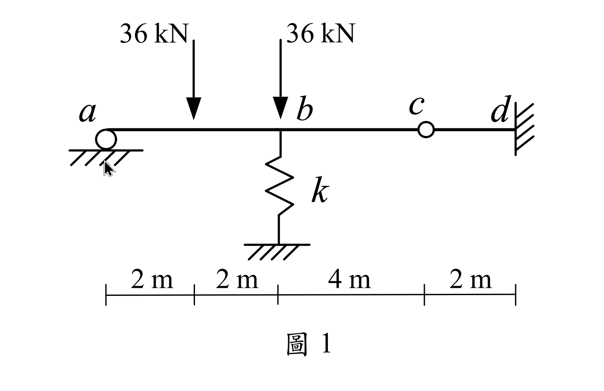
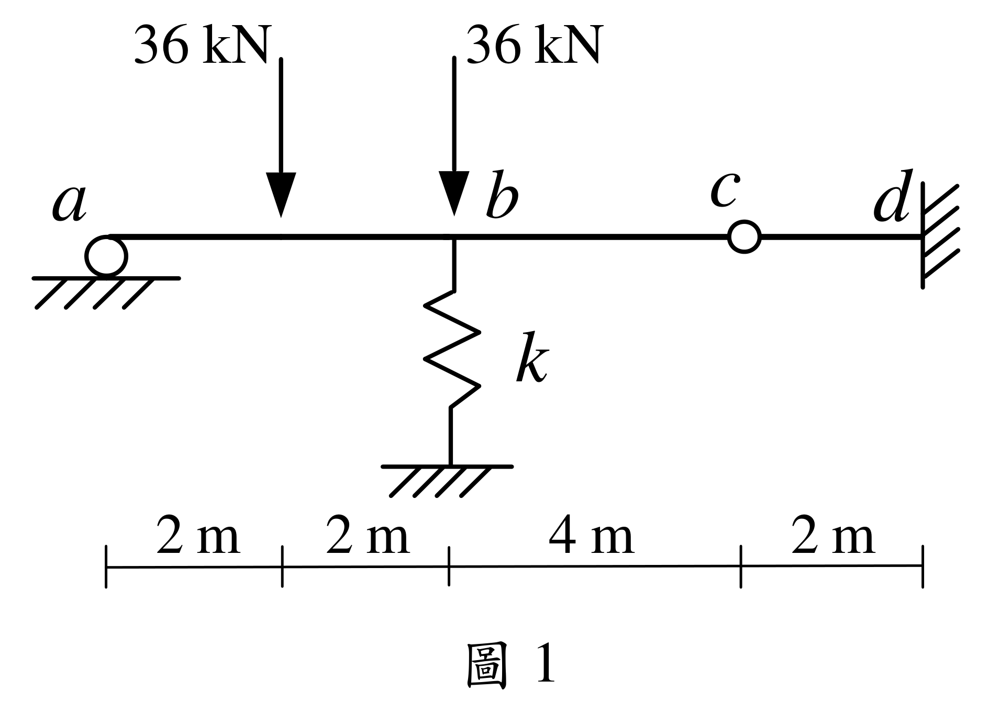

# SA-2021-1 題目正本

> 本檔只記錄考卷上寫了什麼、圖上畫了什麼，不含任何解法。解析見同資料夾 `SA-2021-1.md`。
> 判讀清單經使用者確認前，狀態為「待確認」；確認後本檔原則上不再修改（改動須回考卷原圖並記 log）。

| 項目 | 內容 |
|---|---|
| 考卷 | `raw/exams/SA-2021_結構學.pdf`，第 1 頁上半，第一題（圖 1） |
| 考年 | 2021（民國 110 年）專技高考結構工程技師「結構學」 |
| 配分 | 25 分 |
| 附圖 | `SA-2021-1-fig-1.png`、`SA-2021-1-fig-2.png` |
| 判讀狀態 | **待確認**（2026-11-05 轉錄；PyMuPDF 110 dpi 整頁＋400–500 dpi 局部放大；盲讀於開啟解析前完成） |

## 1. 考卷原文（逐字）

一、如圖示結構，a 點為滾支承，c 點為鉸接，d 點為固定端，彈簧係數 k = 15000 kN/m，梁桿件有相同彈性模數 E 與慣性矩 I，且 EI = 10000 kN-m²。求梁桿件的彎矩圖、b 點轉角及垂直位移。（25 分）

## 2. 考卷給的公式、附表與參數

- 考卷沒有給任何參考公式或附表。
- k = 15000 kN/m、EI = 10000 kN-m²（題文）。
- 卷首注意事項：㈠可以使用電子計算器。㈡不必抄題，作答時請將試題題號及答案依照順序寫在試卷上，於本試題上作答者，不予計分。㈢本科目除專門名詞或數理公式外，應使用本國文字作答。
- 考試時間：2 小時。

## 3. 附圖

*證據圖 SA-2021-1-fig-1.png*

*證據圖 SA-2021-1-fig-2.png（2026-11-05 自考卷重新擷取 500 dpi，無游標）*

圖面文字照錄：36 kN、36 kN、a、b、c、d、k、2 m、2 m、4 m、2 m、圖 1

## 4. 判讀清單

| # | 項目 | 判讀 | 圖上／題文依據 | 把握 |
|---|---|---|---|---|
| 1 | a | 滾支承（垂直反力） | 圓圈下接地剖線；題文 | 確定 |
| 2 | b | 梁上一點，下方接垂直線性彈簧 k（另一端接地） | 鋸齒彈簧符號；題文 k | 確定 |
| 3 | c | 梁上內鉸 | 空心圓；題文「c 點為鉸接」 | 確定 |
| 4 | d | 固定端（右側垂直牆） | 剖線牆；題文 | 確定 |
| 5 | 尺寸 | a 至第 1 載重 2 m、至 b 2 m、b–c 4 m、c–d 2 m（全長 10 m） | 下方尺寸刻度；b 對齊第 2 刻度 | 確定 |
| 6 | 載重 | 36 kN 向下於距 a 2 m 處（ab 中點）；36 kN 向下於 b | 箭頭位置對齊刻度 | 確定 |
| 7 | 剛度 | 梁 EI = 10000 kN-m²；k = 15000 kN/m | 題文 | 確定 |
| 8 | 所求 | 梁彎矩圖、b 點轉角及垂直位移 | 題文 | 確定 |
| 9 | 考卷沒有給 | 指定方法（題文未限定） | 題文 | 確定 |
| 10 | 證據圖 | 舊 fig-1 有滑鼠游標壓在 a 支承剖線上；新增 fig-2（500 dpi） | — | 確定 |

---
*轉錄：2026-11-05（SA-U2-3 題目正本推廣・批 2）*
