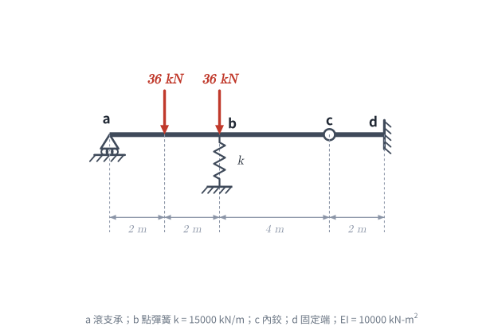
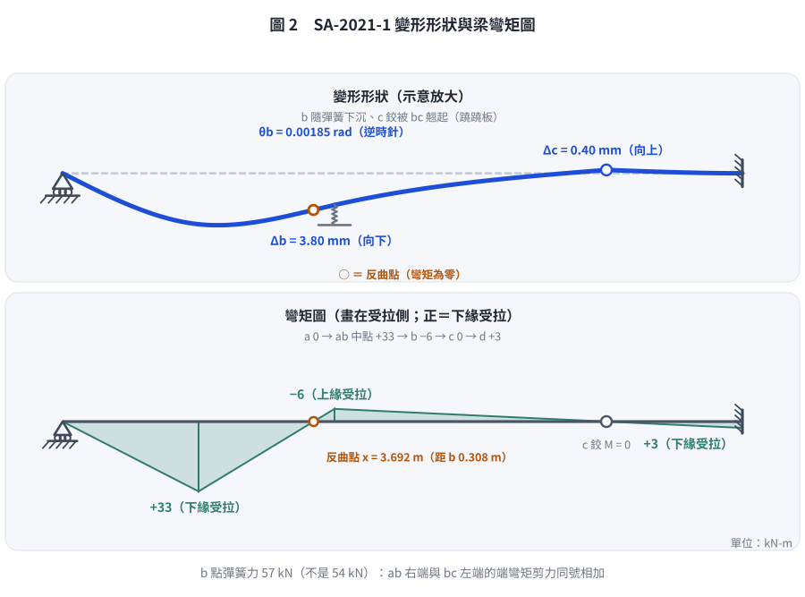

### 考題編號：SA-2021-1

**主分類：** `SA-U2-3` 靜不定結構之傾角變位法與位移
**副分類：** 無
**分析法：** 傾角變位法
**標籤：** `傾角變位法` `彈簧支承` `內部鉸` `連續梁` `沈陷` `節點剪力合成`

---

## 1. 題目（考卷原文見題目正本）

> 考卷原文、公式／附表、附圖與判讀清單（已確認）見 [`SA-2021-1-problem.md`](SA-2021-1-problem.md)。本節只列解題時最容易讀錯的地方與本解使用的記號；題意以題目正本為準。

*重繪自考卷附圖，依判讀清單 #1–#10 重繪。攔：c 讀成支承、彈簧位置讀錯。*

### 常見誤讀
| 項目 | 正確判讀 | 常見誤讀 |
|---|---|---|
| c 點 | 內鉸 | 支承 |
| 彈簧 | 在 b 點，$k = 15000$ kN/m | 在 ab 中點 |
| 載重 | ab 中點（距 a 2 m）與 b 點各 36 kN | 只在 b |
| b 點垂直平衡 | $ab$、$bc$ 端彎矩的剪力修正同號相加（$+M_{ba}/2$），彈簧力 57 kN | 以為兩跨等長就抵銷，得 54 kN、$\Delta_b$ = 3.6 mm（本解 2026-11-08 前的錯誤） |

**本解記號：** 記號與正負號約定沿用 §4。

---

## 2. 考題核心精神與出題者意圖 (Core Concepts & Examiner's Intent)

本題測驗考生處理「混合複雜邊界條件」的能力，結合了彈簧支承（柔性支承）與內部鉸接。出題者的核心意圖在於：
1. **等效剛度簡化**：能否看出右側懸臂段 $cd$ 可等效為 $c$ 點的彈簧支承。
2. **節點剪力的正負號**：$b$ 點同時有彈簧與集中力，垂直平衡要把 $ab$（$b$ 在右端）與 $bc$（$b$ 在左端）的端剪力正確合成。兩桿的端彎矩對 $b$ 點剪力的貢獻**同向相加**（$M_{ba}/4 - M_{bc}/4 = M_{ba}/2$），$\Delta_b$ 與 $\theta_b$、$\Delta_c$ 耦合，須三式聯立。

## 3. 解題戰略地圖與陷阱分析 (Strategic Roadmap & Trap Analysis)

**解題策略：**
1. **右段簡化**：先單獨分析 $cd$ 段，將其對 $c$ 點的支撐效果轉化為等效彈簧常數 $k_c$。
2. **傾角變位法**：對 $a-b-c$ 段列出傾角變位方程式。因 $a, c$ 彎矩為零，直接使用修正版傾角變位公式（鉸端修正）。
3. **節點平衡**：
   - $b$ 點彎矩平衡（求 $\theta_b$ 與 $\Delta_c$ 關係）
   - $b$ 點垂直力平衡（含彈簧力；與 $\theta_b$、$\Delta_c$ 耦合）
   - $c$ 點垂直力平衡（求 $\Delta_c$ 與 $M_{bc}$ 關係）
4. **解聯立並繪圖**：求出所有未知變位後，代回求端彎矩並繪製 BMD。

**陷阱分析：**
- **陷阱 1：忽略 $b$ 點的雙重載重效果**：$b$ 點除了有彈簧，還有一個直接作用在節點上的 36 kN 外力，列垂直平衡時極易遺漏。
- **陷阱 2：變位正負號混淆**：同時存在 $\Delta_b$ 與 $\Delta_c$，在計算弦旋轉角 $\psi$ 時，若未統一符號約定（如統一向下為正），極易在方程式中寫反。

## 3.5 變數層次分析 (Variable Hierarchy Analysis)

> 複習提示：第一次解題後，在每個卡住的知識點旁標記 `⚠`；第二次複習時只看有 `⚠` 的項目。

### 最終目標
`求出 b 點位移與轉角，並解出各桿端彎矩以繪製 BMD`

### 本題關鍵公式（依計算順序）

$$\text{Step 1: } k_c = \frac{3EI}{L_{cd}^3}$$

$$\text{Step 2: } M_{Fba}^{mod} = M_{Fba} - \frac{1}{2} M_{Fab}$$

$$\text{Step 3: } M_{ba} = \frac{3EI}{L_{ab}} \left( \theta_b - \frac{\Delta_b}{L_{ab}} \right) + \boxed{M_{Fba}^{mod}}$$

$$\text{Step 4: } \sum F_{yb} = 0 \Rightarrow V_{ba} + V_{bc} + P_b = k_b \Delta_b$$

### L1：題目直接給定
_看到題目就能讀出的數字，不需要任何公式。_

| 符號 | 數值 | 說明 |
|------|------|------|
| $EI$ | 10000 kN-m² | 梁抗彎剛度 |
| $k_b$ | 15000 kN/m | $b$ 點彈簧常數 |
| $L_{ab}, L_{bc}$ | 4 m, 4 m | $ab$ 與 $bc$ 桿長 |

### L2：需知識點推導
_需要知道公式名稱與適用條件，套入 L1 即可算出。_

**Step 1：懸臂等效剛度**

| 符號 | 公式/來源 | 卡關? |
|------|----------|:-----:|
| $k_c$ | $3EI / L_{cd}^3$ (懸臂梁端點受力變位公式倒數) | |

**Step 2：固端彎矩與修正**

| 符號 | 公式/來源 | 卡關? |
|------|----------|:-----:|
| $M_{Fba}^{mod}$ | $(+PL/8) - 0.5(-PL/8) = 3PL/16$ | |

### L3：深層知識（不懂就卡住）
_L2 中某些公式本身需要背景概念才能正確應用的知識點。_

| 知識點 | 說明 | 卡關? |
|--------|------|:-----:|
| 節點剪力合成的正負號 | 桿件 $i$ 端與 $j$ 端的端彎矩剪力修正符號相反：左桿右端 $+(M_i+M_j)/L$、右桿左端 $-(M_i+M_j)/L$。兩跨等長、外端皆鉸時，$M_{bc}=-M_{ba}$ 使兩項**相加**而非抵銷。 | ⚠ |
| 弦旋轉角 $\psi$ 的相對性 | $\psi_{bc} = (\Delta_c - \Delta_b) / L_{bc}$，需嚴格遵守幾何相對位移關係。 | |

## 4. 步驟化詳細計算過程 (Step-by-Step Detailed Calculation)

**Step 1：處理右側懸臂段 $cd$**
$c-d$ 為長度 $L_{cd}=2\text{ m}$ 的桿件，$d$ 端固定。$c$ 點受垂直向下力 $V_c$ 時的位移為 $\Delta_c = \frac{V_c L_{cd}^3}{3EI}$。
將其視為 $c$ 點的等效彈簧支承，其彈簧常數為：
$$k_c = \frac{3EI}{L_{cd}^3} = \frac{3(10000)}{2^3} = 3750 \text{ kN/m}$$

**Step 2：計算固端彎矩 (FEM)**
對 $a-b$ 桿件，中點受集中載重 $P = 36\text{ kN}$，因 $a$ 為鉸支承，採用修正固端彎矩：
$$M_{Fba}^{mod} = M_{Fba} - \frac{1}{2} M_{Fab} = \frac{PL}{8} - \frac{1}{2}\left(-\frac{PL}{8}\right) = \frac{3PL}{16}$$
$$M_{Fba}^{mod} = \frac{3(36)(4)}{16} = 27 \text{ kN-m}$$
$b-c$ 桿件無跨中載重，故 $M_{Fbc}^{mod} = 0$。

**Step 3：列傾角變位方程式**
設向下位移 $\Delta$ 為正，順時針轉角為正。
對於 $a-b$ 桿件（$a$ 鉸接，修正版）：
$$M_{ba} = \frac{3EI}{L_{ab}} (\theta_b - \psi_{ab}) + M_{Fba}^{mod} = \frac{3(10000)}{4} \left( \theta_b - \frac{\Delta_b}{4} \right) + 27 = 7500 \theta_b - 1875 \Delta_b + 27$$
對於 $b-c$ 桿件（$c$ 鉸接，修正版）：
$$M_{bc} = \frac{3EI}{L_{bc}} (\theta_b - \psi_{bc}) = \frac{3(10000)}{4} \left( \theta_b - \frac{\Delta_c - \Delta_b}{4} \right) = 7500 \theta_b - 1875 \Delta_c + 1875 \Delta_b$$

**Step 4：節點 $b$ 垂直力平衡（與 $\theta_b$ 耦合）**
節點 $b$ 的向下總力包含：外力 36 kN，以及 $ab$、$bc$ 兩桿對節點的作用力。桿件對節點的向下力＝桿件 $b$ 端受到的向上剪力：

- $ab$ 桿（$b$ 在**右端**）：對 $a$ 取矩，$V_{b}^{ab}\cdot 4 - 36\cdot 2 - M_{ba} = 0 \Rightarrow V_{b}^{ab} = 18 + \dfrac{M_{ba}}{4}$（$M_{ab}=0$）
- $bc$ 桿（$b$ 在**左端**）：對 $c$ 取矩，$-V_{b}^{bc}\cdot 4 - M_{bc} = 0 \Rightarrow V_{b}^{bc} = -\dfrac{M_{bc}}{4}$（$M_{cb}=0$）

$$V_{b\text{向下}} = 18 + \frac{M_{ba}}{4} - \frac{M_{bc}}{4}$$

> ⚠ 左桿的 $b$ 在右端、右桿的 $b$ 在左端，**端彎矩對剪力的貢獻符號相反**。代入 $M_{bc} = -M_{ba}$ 後兩項是**相加**（$= M_{ba}/2$），不會抵銷——2026-11-08 前的版本在這裡寫成同號而得「恰好等於 18」，是錯的。

由節點彎矩平衡 $M_{ba} + M_{bc} = 0$：
$$V_{b\text{向下}} = 18 + \frac{M_{ba}}{2}$$
與彈簧力平衡：
$$18 + \frac{M_{ba}}{2} + 36 = k_b\,\Delta_b = 15000\,\Delta_b \quad \text{--- (式3)}$$

**Step 5：節點 $c$ 垂直力平衡（求 $\Delta_c$ 與 $M_{bc}$ 關係）**
桿件 $bc$ 對節點 $c$ 的向下作用力為 $M_{bc}/4$，由 $c$ 點等效彈簧（$cd$ 懸臂）支撐：
$$k_c \Delta_c = \frac{M_{bc}}{4} \Rightarrow 3750 \Delta_c = \frac{M_{bc}}{4} \Rightarrow M_{bc} = 15000 \Delta_c \quad \text{--- (式4)}$$

**Step 6：解聯立方程式（$\theta_b$、$\Delta_b$、$\Delta_c$）**
節點 $b$ 彎矩平衡 $M_{ba} + M_{bc} = 0$：
$$15000\,\theta_b - 1875\,\Delta_c + 27 = 0 \quad \text{--- (式1)}$$
式 4 代入 $M_{bc}$ 的傾角變位式：
$$7500\,\theta_b + 1875\,\Delta_b - 16875\,\Delta_c = 0 \quad \text{--- (式2)}$$
式 3 以 $M_{ba} = -M_{bc} = -15000\,\Delta_c$ 代入：
$$54 - 7500\,\Delta_c = 15000\,\Delta_b \quad \text{--- (式3')}$$
三式聯立（精確分數）：
$$\Delta_c = -\frac{1}{2500}\ \text{m} = -0.40\ \text{mm（向上）},\qquad \Delta_b = \frac{54 + 3}{15000} = \frac{19}{5000}\ \text{m}$$
$$\boxed{\Delta_b = 0.0038\ \text{m} = 3.80\ \text{mm（向下）}}$$
$$\theta_b = \frac{1875\Delta_c - 27}{15000} = \frac{-0.75 - 27}{15000} \;\Rightarrow\; \boxed{\theta_b = -\frac{37}{20000}\ \text{rad} = -0.00185\ \text{rad（逆時針）}}$$
（另：$\theta_a = +\dfrac{83}{20000} = 0.00415$ rad 順時針。）

**Step 7：計算桿端彎矩與繪圖**
$$M_{bc} = 15000\left(-\frac{1}{2500}\right) = -6\ \text{kN-m},\qquad M_{ba} = -M_{bc} = +6\ \text{kN-m}$$
（順時針為正：$ab$ 右端順時針 6 ⇒ 梁在 $b$ 點為**負彎矩 −6 kN-m，上緣受拉**。）

- $a$ 點反力：$R_a = 18 - \dfrac{M_{ba}}{4} = 18 - 1.5 = 16.5$ kN（↑）
- $ab$ 跨中彎矩（距 $a$ 2 m）：$M_{mid} = 16.5 \times 2 = \mathbf{+33}$ kN-m（下緣受拉）
- 彈簧力：$k_b\Delta_b = 57$ kN（↑）
- $c$ 點：$bc$ 對 $c$ 的力 $M_{bc}/4 = -1.5$ kN，即 $cd$ 懸臂在 $c$ 端受 **1.5 kN 向上**；$d$ 端反力 1.5 kN（↓）、$M_d = 1.5 \times 2 = \mathbf{3}$ kN-m（$cd$ 段下緣受拉，正彎矩）

**梁彎矩圖（下緣受拉為正）：** $a$ 0 → $ab$ 中點 $+33$ → $b$ $-6$ → $c$ 0（鉸）→ $d$ $+3$。$ab$ 段 $2<x<4$ 時 $M(x) = 16.5x - 36(x-2) = 72 - 19.5x$，反曲點在 $x = 3.692$ m（距 $b$ 0.308 m）。

*圖 2　變形形狀與梁彎矩圖（勁度法重解，彈簧以二力桿模擬，數值與本節相同）。b 點下沉 3.80 mm（彈簧力 57 kN）、逆時針轉 0.00185 rad，c 鉸被 bc 翹起 0.40 mm，使 $cd$ 段為正彎矩、d 端 +3。這張圖攔的是 b 點剪力合成寫成同號抵銷（得 3.6 mm、$M_b = -6.35$），以及把 c 點畫成下沉、$cd$ 段彎矩畫反。*

**整體驗算：** $\Sigma F_y$：$16.5 + 57 - 1.5 - 72 = 0$ ✓；$\Sigma M_a$：$-36(2) - 36(4) + 57(4) - 1.5(10) + 3 = -72 - 144 + 228 - 15 + 3 = 0$ ✓（$M_d$ 3 kN-m 逆時針作用於梁）。

## 5. 關鍵爭議點與進階探討 (Critical Issues & Advanced Discussion)

1. **$\Delta_b$ 不能單獨由垂直平衡求出**：看似「兩跨等長、外端皆鉸 ⇒ 端彎矩剪力抵銷」，實際上 $M_{bc} = -M_{ba}$ 讓 $ab$ 右端與 $bc$ 左端的剪力修正**同號相加**，$b$ 點多分到 $M_{ba}/2 = 3$ kN，彈簧力 57 kN（不是 54 kN）。若誤以為抵銷，會得 $\Delta_b = 3.6$ mm，且整體 $\Sigma F_y$ 差 3.2 kN——用整體平衡檢核就能攔下。
2. **正負號與物理意義的驗證**：計算得出 $\Delta_c$ 為負值（向上），這在直覺上是合理的。因為 $ab$ 段受載向下變形，帶動 $b$ 點下沉；但 $bc$ 段無載重，為了維持 $b$ 點的轉角與變形諧合，這根「蹺蹺板」的右端 $c$ 點勢必會被向上翹起，導致 $cd$ 懸臂梁承受向上拉力。

*修正日期：2026-11-07（§1 改為指向題目正本並放重繪附圖（figs/SA-2021-1-fig-1-problem.svg）、加常見誤讀；圖由 gen_SA-2021-1.py 產生，可重跑）*

*修正日期：2026-11-08（解析勘誤：§4 Step 4 節點 b 垂直平衡的剪力修正符號錯（舊式 18 − M_ba/4 − M_bc/4，正確 18 + M_ba/4 − M_bc/4），Δ_b 3.6 → 3.80 mm、θ_b −63/34000 → −37/20000 rad（仍逆時針，0.00185）、M_b −6.35 → −6 kN-m、ab 跨中 32.82 → 33、M_d 3.18 → 3 kN-m、Δ_c −0.424 → −0.40 mm；§2、§3、§3.5 L3、§5 同步改寫，§1 常見誤讀補一列。驗證：scripts/fixes/2026-11-08_recalc_SA-U2-3_B2.py，剛架勁度法（彈簧二力桿）＋傾角變位三式聯立兩路徑，MISMATCHES: 0）*

*修正日期：2026-11-08（圖解補繪：§4 Step 7 補圖 2（變形形狀＋梁彎矩圖，標 b −6 上緣受拉、ab 中點 +33、d +3 與反曲點）；數值由勁度法重解並以 assert 對照本解正本，腳本 `gen_SA-2021-1.py`，可重跑；標頭主分類名稱對齊命題大綱（非勘誤））*
