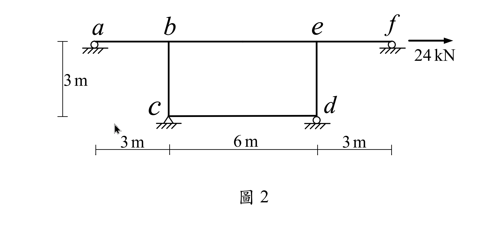
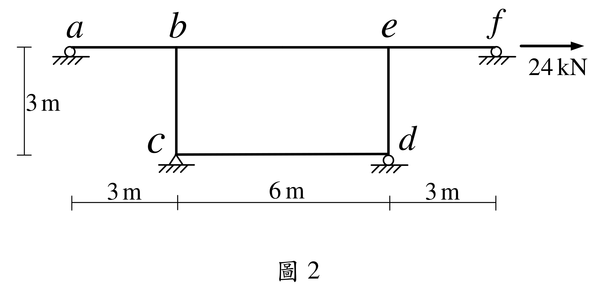

# SA-2021-2 題目正本

> 本檔只記錄考卷上寫了什麼、圖上畫了什麼，不含任何解法。解析見同資料夾 `SA-2021-2.md`。
> 判讀清單經使用者確認前，狀態為「待確認」；確認後本檔原則上不再修改（改動須回考卷原圖並記 log）。

| 項目 | 內容 |
|---|---|
| 考卷 | `raw/exams/SA-2021_結構學.pdf`，第 1 頁下半，第二題（圖 2） |
| 考年 | 2021（民國 110 年）專技高考結構工程技師「結構學」 |
| 配分 | 25 分 |
| 附圖 | `SA-2021-2-fig-1.png`、`SA-2021-2-fig-2.png` |
| 判讀狀態 | **已確認**（2026-11-07 使用者確認。原轉錄：2026-11-05 轉錄；PyMuPDF 110 dpi 整頁＋400–500 dpi 局部放大；盲讀於開啟解析前完成） |

## 1. 考卷原文（逐字）

二、如圖示剛架結構，不考慮桿件的軸向變形，a、d、f 點為滾支承，c 點為鉸支承，桿件有相同彈性模數 E 與慣性矩 I，且 EI = 20000 kN-m²。求 abef 梁桿件的彎矩圖、b 點轉角及水平位移。（25 分）

## 2. 考卷給的公式、附表與參數

- 考卷沒有給任何參考公式或附表。
- EI = 20000 kN-m²（題文）。
- 卷首注意事項：㈠可以使用電子計算器。㈡不必抄題，作答時請將試題題號及答案依照順序寫在試卷上，於本試題上作答者，不予計分。㈢本科目除專門名詞或數理公式外，應使用本國文字作答。
- 考試時間：2 小時。

## 3. 附圖

*證據圖 SA-2021-2-fig-1.png*

*證據圖 SA-2021-2-fig-2.png（2026-11-05 自考卷重新擷取 500 dpi，無游標）*

圖面文字照錄：a、b、e、f、24 kN、3 m、c、d、3 m、6 m、3 m、圖 2

## 4. 判讀清單

| # | 項目 | 判讀 | 圖上／題文依據 | 把握 |
|---|---|---|---|---|
| 1 | a、f | 滾支承（垂直反力） | 小圓圈下接地剖線；題文 | 確定 |
| 2 | d | 滾支承（垂直反力），同時是柱 ed 與下梁 cd 的交點 | 小圓圈；題文 | 確定 |
| 3 | c | 鉸支承，同時是柱 bc 與下梁 cd 的交點 | 三角形；題文 | 確定 |
| 4 | b、e、c、d 節點 | 框身 b–e–d–c 各角為剛接（c、d 只是對地鉸／滾，桿件之間連續） | 各角無鉸圈 | 確定（解讀）；使用者確認 |
| 5 | 尺寸 | a–b 3 m、b–e 6 m、e–f 3 m；柱 bc、ed 高 3 m；cd 6 m | 下方 3、6、3 m；左側 3 m（上梁至下梁） | 確定 |
| 6 | 剛度 | 各桿 EI = 20000 kN-m² | 題文 | 確定 |
| 7 | 載重 | f 點 24 kN 水平向右 | 箭頭在 f 右側指向右 | 確定 |
| 8 | 軸向變形 | 不考慮 | 題文 | 確定 |
| 9 | 所求 | abef 梁彎矩圖、b 點轉角及水平位移 | 題文 | 確定 |
| 10 | 考卷沒有給 | 指定方法（題文未限定） | 題文 | 確定 |
| 11 | 證據圖 | 舊 fig-1 有滑鼠游標（c 支承附近）；新增 fig-2（500 dpi） | — | 確定 |

---
*轉錄：2026-11-05（SA-U2-3 題目正本推廣・批 2）*
*確認：2026-11-07 使用者確認*
