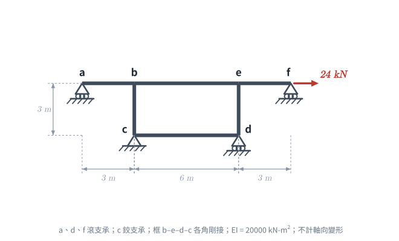
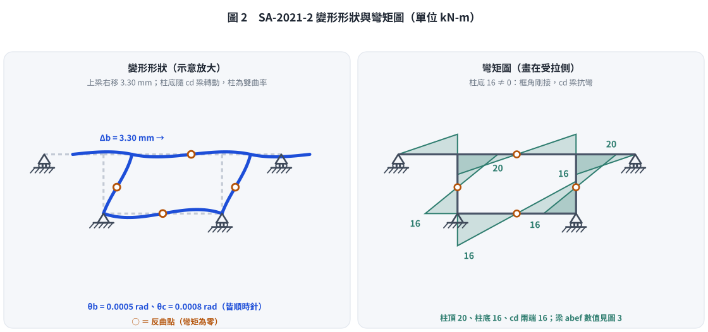
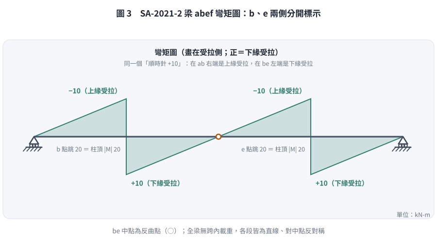

### 考題編號：SA-2021-2

**主分類：** `SA-U2-3` 靜不定結構之傾角變位法與位移
**副分類：** 無
**分析法：** 傾角變位法
**標籤：** `傾角變位法` `有側移剛架` `對稱結構` `反對稱載重` `框角剛接`

---

## 1. 題目（考卷原文見題目正本）

> 考卷原文、公式／附表、附圖與判讀清單（已確認）見 [`SA-2021-2-problem.md`](SA-2021-2-problem.md)。本節只列解題時最容易讀錯的地方與本解使用的記號；題意以題目正本為準。

*重繪自考卷附圖，依判讀清單 #1–#11 重繪。攔：c、d 支承型式對調、把 c、d 當成桿件之間的鉸。*

### 常見誤讀
| 項目 | 正確判讀 | 常見誤讀 |
|---|---|---|
| c、d | c 鉸支承、d 滾支承；框 b–e–d–c 各角桿件之間剛接 | 互換，或當成桿件間的鉸 |
| 載重 | f 點 24 kN 水平向右 | 向下 |
| c、d 柱底 | 框角剛接，柱底彎矩由 cd 梁提供（$M_{cb} = -16$ kN-m） | 當成柱底鉸、cd 只是連桿，得 Δ = 8.1 mm（本解 2026-11-08 前的錯誤） |
| 梁端受拉側 | $M_{ba} = +10$（順時針、在 ab 右端）⇒ 上緣受拉 | 把順時針端彎矩一律當成下緣受拉 |

**本解記號：** 記號與正負號約定沿用 §4。

---

## 2. 考題核心精神與出題者意圖 (Core Concepts & Examiner's Intent)

本題的核心在於**正確讀出框身 b–e–d–c 的邊界**，再利用**對稱幾何 + 反對稱載重**簡化。
- 下梁 $cd$ 與柱 $bc$、$ed$ 在 $c$、$d$ **剛接**（題目正本判讀 #4，使用者確認）：$c$、$d$ 只是框角下方的對地鉸／滾支承，**不是柱底鉸**。框角對地不抗轉，但 $cd$ 梁的抗彎勁度會約束柱底轉動，柱底彎矩**不為 0**。
- 不計軸向變形：$cd$ 兩端水平位移相同，$c$ 為鉸支承 ⇒ $d$ 也不能水平移動；$c$、$d$ 也不能上下移動。上梁整體只有水平側移 $\Delta$。
- 結構左右對稱、側力 24 kN 可視為反對稱載重 ⇒ 反對稱變形：$\theta_b = \theta_e$、$\theta_c = \theta_d$、$\theta_a = \theta_f$，兩柱各分 12 kN 層剪力。

## 3. 解題戰略地圖與陷阱分析 (Strategic Roadmap & Trap Analysis)

**解題策略：**
1. **確認邊界條件**：$a$、$f$ 滾支承 ⇒ $M_{ab} = M_{fe} = 0$（用修正式）；$c$、$d$ 為框角節點 ⇒ 節點平衡 $M_{cb} + M_{cd} = 0$（**不是** $M_{cb} = 0$）。
2. **利用反對稱性**：未知量剩 $\theta = \theta_b = \theta_e$、$\phi = \theta_c = \theta_d$、$\psi = \Delta/h$ 三個。
3. **傾角變位法**：節點 $b$、節點 $c$ 彎矩平衡＋層剪力方程，三式聯立。
4. **繪製 BMD**：把端彎矩換成梁的內彎矩（受拉側），標出 $b$、$e$ 兩處的跳躍。

**陷阱分析：**
- **陷阱 1：把柱底當成鉸**：$c$ 下畫三角形、$d$ 下畫圓，容易誤以為柱底 $M = 0$。框角剛接時柱底有 $M_{cb} = -16$ kN-m，若當鉸會得 $\Delta = 8.1$ mm（多估 2.5 倍）。
- **陷阱 2：端彎矩換成受拉側**：順時針端彎矩作用在桿件**左端**是正彎矩（下緣受拉），作用在**右端**是負彎矩（上緣受拉）。本題 $M_{ba} = +10$ 在 $ab$ 的右端 ⇒ 梁在 $b$ 左側**上緣受拉**。

## 3.5 變數層次分析 (Variable Hierarchy Analysis)

> 複習提示：第一次解題後，在每個卡住的知識點旁標記 `⚠`；第二次複習時只看有 `⚠` 的項目。

### 最終目標
`利用反對稱性把未知數降為 θ、φ、ψ 三個，求出側移與轉角，再繪梁 abef 的彎矩圖。`

### 本題關鍵公式（依計算順序）

$$\text{Step 1: 反對稱 } \theta_b = \theta_e = \theta,\ \theta_c = \theta_d = \phi,\ \psi = \frac{\Delta}{h}$$

$$\text{Step 2: } M_{ba} = \frac{3EI}{L_{ab}}\theta,\quad M_{be} = \frac{2EI}{L_{be}}(2\theta + \theta) ,\quad M_{cd} = \frac{2EI}{L_{cd}}(2\phi + \phi)$$

$$\text{Step 3: } M_{bc} = \frac{2EI}{h}(2\theta + \phi - 3\psi),\quad M_{cb} = \frac{2EI}{h}(2\phi + \theta - 3\psi)$$

$$\text{Step 4: } \sum M_b = 0,\ \sum M_c = 0,\ \frac{M_{bc} + M_{cb}}{h} = -\frac{\boxed{P}}{2}$$

### L1：題目直接給定
_看到題目就能讀出的數字，不需要任何公式。_

| 符號 | 數值 | 說明 |
|------|------|------|
| $EI$ | 20000 kN-m² | 桿件抗彎剛度 |
| $L_{ab}, L_{ef}$ | 3 m | 外伸梁段長度（$a$、$f$ 滾支承） |
| $L_{be}, L_{cd}, h$ | 6 m, 6 m, 3 m | 上梁中跨、下梁、柱高 |
| $P$ | 24 kN | $f$ 點水平力（向右） |

### L2：需知識點推導
_需要知道公式名稱與適用條件，套入 L1 即可算出。_

**Step 2–3：桿端彎矩式**

| 符號 | 公式/來源 | 卡關? |
|------|----------|:-----:|
| $M_{ba}$ | $a$ 端滾支承 ⇒ 修正式 $3EI\theta/L_{ab} = EI\theta$ | |
| $M_{be}$ | 反對稱 $\theta_e = \theta_b$ ⇒ $\frac{2EI}{6}(3\theta) = EI\theta$ | |
| $M_{cd}$ | 反對稱 $\theta_d = \theta_c$ ⇒ $\frac{2EI}{6}(3\phi) = EI\phi$ | |
| 層剪力 | 每根柱 $V = 12$ kN ⇒ $M_{bc} + M_{cb} = -36$ kN-m | |

### L3：深層知識（不懂就卡住）
_L2 中某些公式本身需要背景概念才能正確應用的知識點。_

| 知識點 | 說明 | 卡關? |
|--------|------|:-----:|
| 對地支承 vs 桿件間的鉸 | $c$ 的三角形、$d$ 的圓只表示框角對地的束制；框角各桿之間仍剛接，柱底彎矩由 $cd$ 梁提供 | ⚠ |
| 不計軸向變形 | $cd$ 兩端水平位移相同、$c$ 不動 ⇒ $d$ 也不動；柱不伸縮 ⇒ 上梁只有水平側移 | |
| 反對稱變形 | 對稱結構受反對稱載重：$\theta_b = \theta_e$、$\theta_c = \theta_d$，兩柱剪力相同 | |
| 端彎矩 → 受拉側 | 順時針端彎矩：作用於桿件**左端** ⇒ 下緣受拉（正）；作用於**右端** ⇒ 上緣受拉（負） | ⚠ |

---

## 4. 步驟化詳細計算過程 (Step-by-Step Detailed Calculation)

**符號約定：** 桿端彎矩、節點轉角、弦轉角皆順時針為正；$\Delta$ 向右為正，柱弦轉角 $\psi = \Delta/3$。以 $EI$ 乘轉角記為 $EI\theta$、$EI\phi$、$EI\psi$。

**Step 1：邊界條件與反對稱性**
- 不計軸向變形：$c$ 為鉸支承不動，$cd$ 軸向剛性 ⇒ $d$ 不水平移動；$a$、$d$、$f$ 滾支承與柱不伸縮 ⇒ 所有節點無垂直位移。上梁 $a$–$b$–$e$–$f$ 只有共同水平側移 $\Delta$，兩柱 $\psi = \Delta/3$，上下梁無弦轉角。
- 框角 $b$、$e$、$c$、$d$ 剛接（判讀 #4）。$a$、$f$ 為梁端滾支承 ⇒ $M_{ab} = M_{fe} = 0$；$c$、$d$ 對地不抗轉 ⇒ 節點平衡 $M_{cb} + M_{cd} = 0$、$M_{de} + M_{dc} = 0$。
- 反對稱：$\theta_b = \theta_e = \theta$，$\theta_c = \theta_d = \phi$，兩柱各承受層剪力 $24/2 = 12$ kN。

**Step 2：傾角變位方程式**
$$M_{ba} = \frac{3EI}{3}\theta = EI\theta \qquad (a \text{ 端修正式})$$
$$M_{be} = \frac{2EI}{6}(2\theta + \theta) = EI\theta$$
$$M_{bc} = \frac{2EI}{3}(2\theta + \phi - 3\psi),\qquad M_{cb} = \frac{2EI}{3}(2\phi + \theta - 3\psi)$$
$$M_{cd} = \frac{2EI}{6}(2\phi + \phi) = EI\phi$$

**Step 3：三條平衡方程式**
- 節點 $b$：$M_{ba} + M_{be} + M_{bc} = 0$
$$\frac{10}{3}EI\theta + \frac{2}{3}EI\phi - 2EI\psi = 0 \quad \text{--- (式1)}$$
- 節點 $c$：$M_{cb} + M_{cd} = 0$
$$\frac{2}{3}EI\theta + \frac{7}{3}EI\phi - 2EI\psi = 0 \quad \text{--- (式2)}$$
- 層剪力：柱 $bc$ 無跨內載重，柱頂受梁的水平力 $= (M_{bc} + M_{cb})/h$；兩柱合計平衡 24 kN：
$$\frac{M_{bc} + M_{cb}}{3} = -12 \Rightarrow 2EI\theta + 2EI\phi - 4EI\psi = -36 \quad \text{--- (式3)}$$

**Step 4：解聯立**
(式1) − (式2)：$\frac{8}{3}EI\theta - \frac{5}{3}EI\phi = 0 \Rightarrow EI\phi = 1.6\,EI\theta$
代入 (式1)：$\frac{10}{3}EI\theta + \frac{3.2}{3}EI\theta = 2EI\psi \Rightarrow EI\psi = 2.2\,EI\theta$
代入 (式3)：$(2 + 3.2 - 8.8)EI\theta = -36 \Rightarrow EI\theta = 10$
$$EI\theta = 10,\qquad EI\phi = 16,\qquad EI\psi = 22 \Rightarrow EI\Delta = 66$$

代入 $EI = 20000$ kN-m²：
- $b$ 點轉角：$\boxed{\theta_b = \frac{10}{20000} = 5.0 \times 10^{-4}\ \text{rad（順時針）}}$
- $b$ 點水平位移：$\boxed{\Delta_b = \frac{66}{20000} = 0.0033\ \text{m} = 3.30\ \text{mm（向右）}}$

（其他：$\theta_c = \theta_d = 8.0 \times 10^{-4}$ rad 順時針；由 $M_{ab} = \frac{2EI}{3}(2\theta_a + \theta_b) = 0$ 得 $\theta_a = \theta_f = -2.5 \times 10^{-4}$ rad，逆時針。）

**Step 5：桿端彎矩**

| 桿端 | 彎矩（順時針為正，kN-m） |
|---|---|
| $M_{ab}$、$M_{fe}$ | 0 |
| $M_{ba}$、$M_{ef}$ | $+10$ |
| $M_{be}$、$M_{eb}$ | $+10$ |
| $M_{bc}$、$M_{ed}$ | $\frac{2}{3}(20 + 16 - 66) = -20$ |
| $M_{cb}$、$M_{de}$ | $\frac{2}{3}(32 + 10 - 66) = -16$ |
| $M_{cd}$、$M_{dc}$ | $+16$ |

檢核：節點 $b$ $10 + 10 - 20 = 0$ ✓；節點 $c$ $-16 + 16 = 0$ ✓；層剪力 $(-20 - 16)/3 = -12$ ✓。
反力：$a$ 3.33 kN（↓）、$f$ 3.33 kN（↑）；$c$ 水平 24 kN（←）、垂直 5.33 kN（↓）；$d$ 5.33 kN（↑）。

*圖 2　變形形狀與彎矩圖（勁度法重解，框角 b、e、c、d 全部剛接，數值與 Step 5 相同）。柱底 c、d 隨下梁 $cd$ 順時針轉 $8.0\times10^{-4}$ rad，柱為雙曲率、中段有反曲點；柱底彎矩 16 由 $cd$ 梁提供。這張圖攔的就是本解舊版的錯：把 c、d 當柱底鉸（柱底 $M = 0$、柱單曲率、$\Delta = 8.1$ mm）。*

**Step 6：梁 abef 彎矩圖（下緣受拉為正）**
- $ab$ 段：$M_{ba} = +10$ 順時針作用在 $ab$ **右端** ⇒ 負彎矩。$a$ 0 → $b$ 左 $\mathbf{-10}$（上緣受拉），直線。
- $be$ 段：$M_{be} = +10$ 順時針作用在 $be$ **左端** ⇒ $b$ 右 $\mathbf{+10}$（下緣受拉）；$M_{eb} = +10$ 作用在右端 ⇒ $e$ 左 $\mathbf{-10}$（上緣受拉）；直線、跨中反曲點（$M = 0$）。
- $ef$ 段：$M_{ef} = +10$ 作用在 $ef$ 左端 ⇒ $e$ 右 $\mathbf{+10}$（下緣受拉）→ $f$ 0。

$b$、$e$ 兩處彎矩各跳 20 kN-m，等於柱頂彎矩 $|M_{bc}| = |M_{ed}| = 20$。全梁無跨內載重，BMD 由直線段組成，對中點反對稱。

*圖 3　梁 abef 彎矩圖（下緣受拉為正）。$b$、$e$ 兩側分開標示：左側 −10（上緣受拉）、右側 +10（下緣受拉），跳躍量 20 等於柱頂彎矩。這張圖攔的是把節點處平滑連線，以及把「順時針 +10」一律當成下緣受拉——舊版四個梁端的受拉側全部標反。*

---

## 5. 關鍵爭議點與進階探討 (Critical Issues & Advanced Discussion)

1. **柱底是鉸還是框角剛接**：2026-11-08 前的版本把 $c$、$d$ 當成柱底鉸、$cd$ 只是軸向連桿，得 $M_{bc} = -36$、$\theta_b = 9 \times 10^{-4}$ rad、$\Delta = 8.1$ mm。依考卷附圖與題目正本判讀 #4（使用者確認），框身各角為剛接，$cd$ 梁以 $EI\phi$ 的勁度約束柱底，柱底分到 $-16$ kN-m，柱頂彎矩降為 $-20$，側移降為 3.30 mm。兩種模型差 2.5 倍，讀圖時要看清楚支承符號畫在「框角下方」還是「柱與梁之間」。
2. **節點彎矩跳躍**：剛架梁的 BMD 在柱節點處會跳躍，跳躍量等於柱頂彎矩。本題 $b$ 點由 $-10$（左側）跳到 $+10$（右側），繪圖時左右分開標示，不能平滑連線。
3. **受拉側的判定**：同一個「順時針 +10」，在 $ab$ 右端是上緣受拉、在 $be$ 左端是下緣受拉。舊版曾把四個梁端的受拉側全部標反，判定時一律先問「這個端彎矩作用在桿件的左端還是右端」。

*修正日期：2026-11-07（§1 改為指向題目正本並放重繪附圖（figs/SA-2021-2-fig-1-problem.svg）、加常見誤讀；圖由 gen_SA-2021-2.py 產生，可重跑）*

*修正日期：2026-11-08（解析勘誤：使用者判定框角 c、d 剛接（題目正本判讀 #4），舊版把柱底當鉸、cd 當連桿；§2–§5 依框角剛接重解：θ_b 9.0×10⁻⁴ → 5.0×10⁻⁴ rad（順時針）、Δ_b 8.1 → 3.30 mm（向右）、M_bc −36 → −20、柱底 M_cb 0 → −16、梁端 ±18 → ±10 kN-m；梁 BMD 受拉側更正（b 左、e 左上緣受拉，b 右、e 右下緣受拉，舊版四處標反）；§3.5 L3「端彎矩 → 受拉側」改正。驗證：scripts/fixes/2026-11-08_recalc_SA-U2-3_B2.py，剛架勁度法 7 自由度＋反對稱傾角變位三式兩路徑，MISMATCHES: 0）*

*修正日期：2026-11-08（落實檢查後補清勘誤殘留：標籤刪除舊模型的「連桿效應」（cd 為受彎梁、非連桿）。數值不變）*

*修正日期：2026-11-08（圖解補繪：Step 5 補圖 2（框角剛接變形形狀＋彎矩圖）、Step 6 補圖 3（梁 abef 彎矩圖，b、e 兩側跳躍與受拉側）；數值由勁度法重解並以 assert 對照本解正本，腳本 `gen_SA-2021-2.py`，可重跑；標頭主分類名稱對齊命題大綱（非勘誤））*
