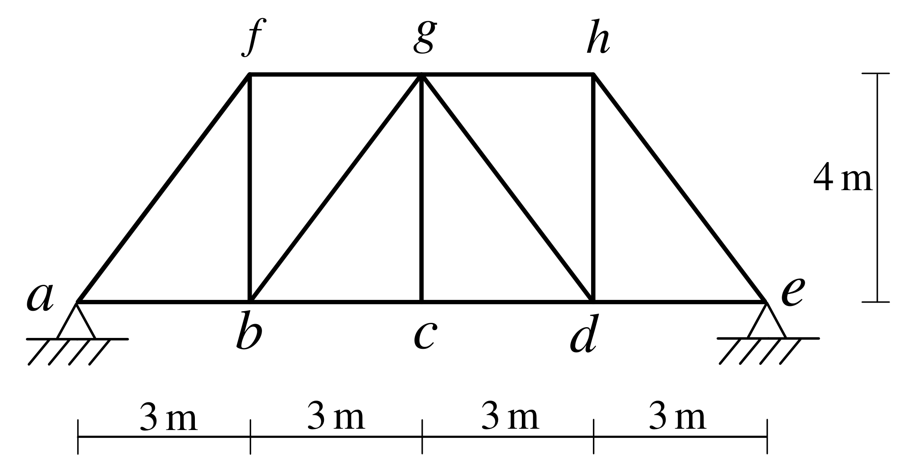

# SA-2021-3 題目正本

> 本檔只記錄考卷上寫了什麼、圖上畫了什麼，不含任何解法。解析見同資料夾 `SA-2021-3.md`。
> 判讀清單經使用者確認前，狀態為「待確認」；確認後本檔原則上不再修改（改動須回考卷原圖並記 log）。

| 項目 | 內容 |
|---|---|
| 考卷 | `raw/exams/SA-2021_結構學.pdf`，第 2 頁（頁次 2－2），第三題（圖 3） |
| 考年 | 2021（民國一百一十年）專技高考結構工程技師「結構學」 |
| 配分 | 25 分 |
| 附圖 | `SA-2021-3-fig-2.png`（2026-11-07 重新擷取）；既有 `SA-2021-3-fig-1.png` |
| 判讀狀態 | **已確認**（2026-11-07 使用者確認。原轉錄：2026-11-07 轉錄；PyMuPDF 110 dpi 整頁＋450–1200 dpi 局部放大；考卷可抽文字，逐字原文以 PDF 文字層核對；盲讀於開啟解析前完成） |

## 1. 考卷原文（逐字）

三、如圖示桁架結構，a 點及 e 點都為鉸支承，各桿件有相同彈性模數 E 與斷面積 A。當向下之單位載重在桁架底弦 abcde 移動，分別求 a 點水平反力、ab 桿件及 bg 桿件軸力的影響線。（25 分）

## 2. 考卷給的公式、附表與參數

- 考卷沒有給任何參考公式或附表。
- 各桿 EA 相同，沒有給數值。
- 卷首注意事項：㈠可以使用電子計算器。㈡不必抄題，作答時請將試題題號及答案依照順序寫在試卷上，於本試題上作答者，不予計分。㈢本科目除專門名詞或數理公式外，應使用本國文字作答。
- 考試時間：2 小時。

## 3. 附圖

*證據圖 SA-2021-3-fig-2.png（2026-11-07 自考卷 500 dpi 重新擷取）；既有 SA-2021-3-fig-1.png 帶有滑鼠游標（箭頭游標在 fb–bg 之間的格內，未壓到桿件），保留不改。*

圖面文字照錄：f、g、h、a、b、c、d、e、4 m、3 m、3 m、3 m、3 m、圖 3

## 4. 判讀清單

| # | 項目 | 判讀 | 圖上／題文依據 | 把握 |
|---|---|---|---|---|
| 1 | 座標（以 a 為原點） | a(0,0)、b(3,0)、c(6,0)、d(9,0)、e(12,0)；f(3,4)、g(6,4)、h(9,4) | 下方 4×3 m、右側 4 m 尺寸線；f、g、h 與 b、c、d 垂直對齊（450 dpi） | 確定 |
| 2 | 桿件 | 下弦 ab、bc、cd、de；上弦 fg、gh；端斜桿 af、he；豎桿 fb、gc、hd；斜桿 bg、gd；共 13 桿 | 450 dpi | 確定 |
| 3 | 斜桿方向 | bg 由 b 往右上到 g；gd 由 g 往右下到 d | 450 dpi | 確定 |
| 4 | 支承 a、e | 皆為鉸支承（三角形＋剖線） | 題文＋圖面 | 確定 |
| 5 | 靜不定度 | j = 8、m = 13、r = 4：m + r − 2j = 1，一度（外部）靜不定 | 計數 | 確定 |
| 6 | EA | 各桿相同 | 題文 | 確定 |
| 7 | 移動載重 | 向下單位載重，只在底弦 a–e 上移動 | 題文 | 確定 |
| 8 | 所求 | a 點水平反力、ab 桿軸力、bg 桿軸力的影響線 | 題文 | 確定 |

---
*轉錄：2026-11-07（SA-U1-3 題目正本推廣・批 1）*
*確認：2026-11-07 使用者確認*
