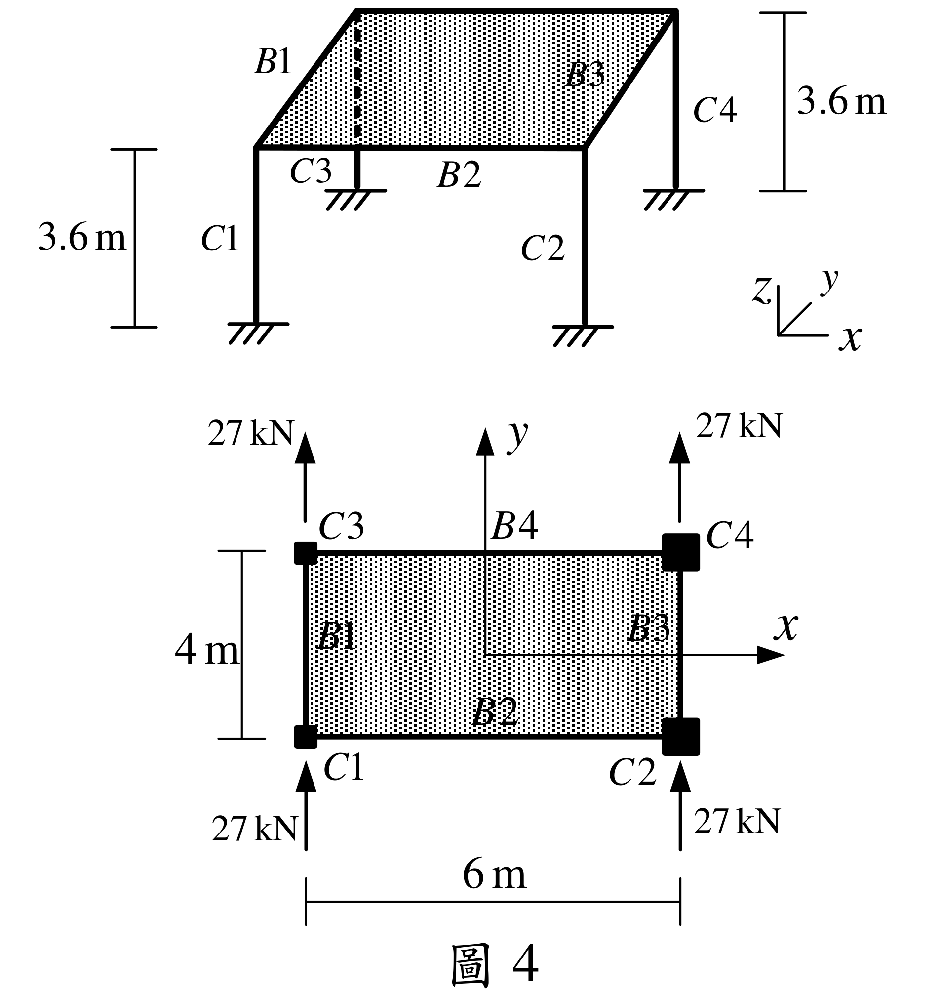

# SA-2021-4 題目正本

> 本檔只記錄考卷上寫了什麼、圖上畫了什麼，不含任何解法。解析見同資料夾 `SA-2021-4.md`。
> 判讀清單經使用者確認前，狀態為「待確認」；確認後本檔原則上不再修改（改動須回考卷原圖並記 log）。

| 項目 | 內容 |
|---|---|
| 考卷 | `raw/exams/SA-2021_結構學.pdf`，第 2 頁（頁次 2－2），第四題（圖 4） |
| 考年 | 2021（民國 110 年）專技高考結構工程技師「結構學」 |
| 配分 | 25 分 |
| 附圖 | `SA-2021-4-fig-2.png`（本次從考卷擷取 500 dpi；既有 `SA-2021-4-fig-1.png` 保留） |
| 判讀狀態 | **已確認**（2026-11-07 使用者確認；影響答案項目定案：#2 EI_d＝9720、EI_e＝48600 kN-m²（使用者確認；解析同日勘誤）。原轉錄：2026-11-07 轉錄；PyMuPDF 110 dpi 整頁＋300–400 dpi 局部放大（附圖為向量圖）；盲讀於開啟解析前完成） |

## 1. 考卷原文（逐字）

四、如圖所示一層樓建築結構，共有四根柱及四根梁，不考慮桿件的軸向變形，樓高3.6 m，屋頂樓板視為剛性樓板（即平面內剛度無限大，而平面外的剛度則忽略不計）。構架梁柱桿件的彈性模數都為E，其中C1 及C3 柱桿件二個方向的斷面慣性矩都為I_d，且EI_d = 9720 kN-m²，C2 及C4 柱桿件二個方向的斷面慣性矩都為I_e，且EI_e = 48600 kN-m²，而梁桿件斷面慣性矩為無限大。四根柱在一樓柱頂各承受Y 向水平力27 kN，不考慮柱桿件的扭轉勁度。求C3 及C4 柱桿件，在柱底端點二個方向的剪力及柱頂二個方向的水平位移。（25 分）

## 2. 考卷給的公式、附表與參數

- 給定：EI_d＝9720 kN-m²（C1、C3）、EI_e＝48600 kN-m²（C2、C4），兩個方向相同。**「m²」的 2 是單位指數，不是 EI 前的係數。**
- 給定：梁 I＝∞；樓板平面內剛性；不計軸向變形、不計柱扭轉勁度。
- 卷首注意事項：㈠可以使用電子計算器。㈡不必抄題，作答時請將試題題號及答案依照順序寫在試卷上，於本試題上作答者，不予計分。㈢本科目除專門名詞或數理公式外，應使用本國文字作答。
- 考試時間：2 小時。代號 00340，頁次 2－1、2－2。

## 3. 附圖

*證據圖 SA-2021-4-fig-2.png（500 dpi，自考卷擷取；舊證據圖 SA-2021-4-fig-1.png 有游標雜訊，保留不改）*

圖面文字照錄：B1、B2、B3、B4、C1、C2、C3、C4、3.6 m、3.6 m、x、y、z、27 kN（四處）、4 m、6 m、圖 4

## 4. 判讀清單

| # | 項目 | 判讀 | 圖上／題文依據 | 把握 |
|---|---|---|---|---|
| 1 | 柱位 | C1 左下、C2 右下、C3 左上、C4 右上；以平面中心為原點：C1(−3,−2)、C2(3,−2)、C3(−3,2)、C4(3,2) m | 平面圖 6 m、4 m 尺寸線；x、y 軸自中心畫出 | 確定 |
| 2 | 柱斷面 | C1、C3：EI_d＝9720 kN-m²；C2、C4：EI_e＝48600 kN-m²（＝5 EI_d）；兩方向相同 | 題文；300 dpi 放大確認 9720、48600 前沒有係數 | 確定 |
| 3 | 柱底 | 固定端（立體圖柱底短橫線加剖線） | 400 dpi 放大 | 確定 |
| 4 | 柱頂 | 梁 I＝∞、樓板剛性 → 柱頂不轉動 | 題文 | 確定 |
| 5 | 樓高 | 3.6 m | 尺寸線 | 確定 |
| 6 | 載重 | 四柱柱頂各 27 kN，沿 +y 方向（平面圖箭頭向上） | 題文＋平面圖 | 確定 |
| 7 | 考卷沒有給 | 樓板質量、x 向載重、柱扭轉勁度（明示不考慮） | 題文 | 確定 |
| 8 | 所求 | C3、C4 柱底兩方向剪力、柱頂兩方向水平位移 | 題文 | 確定 |
| 9 | 證據圖 | 既有 fig-1 左側有游標（未壓到構件）；另擷取 500 dpi 乾淨版 fig-2 | 縮圖總表 | 確定 |

---
*轉錄：2026-11-07（SA 剩餘單元（U1-2 尾段、U2-5、U3-1、U3-2）題目正本推廣・批 1）*
*確認：2026-11-07 使用者確認*
